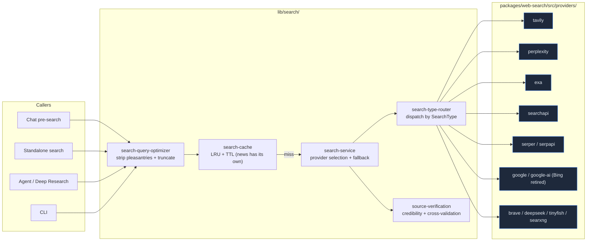

# Search System

Cognia exposes web search to AI through a provider bus.
Callers use `search(query, options)`.
The catalogue has thirteen providers: Tavily, Perplexity, Exa, SearchAPI, Serper, SerpAPI, Bing, Google, Google AI, Brave, DeepSeek, TinyFish, and SearXNG.
Bing is retained only as a retired record. Search types and safe-search levels differ by adapter.
All providers use the same `SearchResponse` shape, so callers receive a consistent result format.

<TLDR>
  App callers use `lib/search/configured-search.ts:searchWithAppSettings()`; CLI callers inject the
  same resolved policy without Zustand. That entry applies query optimization, PII redaction, live
  defaults, safe search, provider preference/fallback, the shared TTL/LRU cache, hard domain
  filtering, source verification, and usage reporting. A per-provider circuit breaker
  (`provider-health.ts`) parks recently-failing providers, and each provider's `defaultOptions` sit
  between host defaults and call-time fields. The framework-independent provider bus lives under
  `packages/web-search/src/`; callers do not implement provider HTTP requests themselves.
</TLDR>

## Overview



## Data Types

All providers fold their native responses into the same `SearchResponse`, defined in `packages/web-search/src/types.ts`:

```ts title="packages/web-search/src/types.ts"
export type SearchProviderType =
  | "tavily"
  | "perplexity"
  | "exa"
  | "searchapi"
  | "serper"
  | "serpapi"
  | "bing"
  | "google"
  | "google-ai"
  | "brave"
  | "deepseek"
  | "tinyfish"
  | "searxng"

export type SearchDepth = "basic" | "advanced" | "deep"
export type SearchType = "general" | "news" | "academic" | "images" | "videos"
export type SearchRecency = "day" | "week" | "month" | "year" | "any"

export interface SearchResult {
  title: string
  url: string
  content: string
  score: number
  publishedDate?: string
  source?: string
  favicon?: string
  thumbnail?: string
}

export interface SearchResponse {
  provider: SearchProviderType
  query: string
  answer?: string
  results: SearchResult[]
  responseTime: number
  totalResults?: number
  images?: SearchImage[]
}
```

`SearchOptions` is the common provider input: `maxResults` / `searchDepth` / `searchType` / `includeAnswer` / `includeRawContent` / `includeDomains` / `excludeDomains` / `recency` / `country` / `language` / `safeSearch`. The adapter registry defines supported safe-search levels. Strict safe search is mandatory: adapters that cannot enforce it are excluded before I/O, including fallback/cache eligibility. An agent cannot relax host strict safe search or mandatory domain constraints. Moderate is advisory unless explicitly required, and unsupported advisory controls are reported as degraded. `UnifiedSearchOptions.preferredProviders` places selected providers first while preserving global-priority fallback. `includeDomains` is always a hard post-filter: a provider response with no matching URL is not considered a success.

## Unified Search Entry

```ts title="packages/web-search/src/search-service.ts"
export async function search(
  query: string,
  options: UnifiedSearchOptions = {}
): Promise<SearchResponse> {
  const { provider, fallbackEnabled = true, providerSettings, ...searchOptions } = options
  // 1. Retrieve the list of enabled providers
  // 2. If a provider is specified, place it at the head, with the rest as fallback
  // 3. Try in order, return the first success, accumulate failures into lastError
  // 4. Each attempt writes back usage stats via recordUsage() to the settings store
}
```

Core public facades:

- `search(query, opts)` — Main entry; allows failure fallback even when a provider is specified.
- `autoSearch(query, providerSettings, opts)` — No provider passed; automatically picks by priority.
- `searchWithProvider(provider, query, apiKey, opts)` — One-off call; does not read global settings.
- `aggregateSearch(query, providerSettings, opts)` — Parallel calls to all enabled providers; results are deduplicated by URL, re-sorted by `score`, and top 20 retained.

Failure fallback covers provider errors and responses that cannot satisfy the hard domain constraint. Desktop and web callers should use `searchWithAppSettings()` instead of assembling these options directly; it also ensures cached hits do not create a second provider request or usage charge.

Host policy is re-applied after every merge, so neither a caller nor a provider's own `defaultOptions` can weaken it: strict safe search stays strict, include domains are intersected with the host's sources (a caller request wholly outside them fails before I/O with `SearchDomainPolicyError`; a provider default simply yields), and exclude domains are unioned. Under a hard source scope an answer with no allowed grounding result is cleared. Grounding providers (`google-ai`) bill a model generation per call, so they run only when chosen — the explicit or selected provider — and never as an automatic fallback. The cache key carries the resolved fallback policy, and a cancelled or out-of-scope request is never served a cache hit. Every provider body is read under the shared 8 MiB decoded-byte ceiling.

`search()` resolves each attempt's options by precedence — host `baseOptions` < the provider's `defaultOptions` < explicit call-time fields (explicit `undefined` placeholders are stripped so they never clobber a lower rung) — and consults the shared in-memory circuit breaker (`provider-health.ts`): a provider past its consecutive-failure threshold is parked at the back of the try-order until a cooldown elapses, then a single half-open probe may close it. Persisted tuning (`searchProviderHealth` — enabled / failureThreshold / cooldownMs, clamped by `SEARCH_PROVIDER_HEALTH_LIMITS`) is pushed into the breaker on every configured call, and the cache key digests every candidate provider's `defaultOptions`, so editing an override busts the entries it shaped.

## Query Optimization

User messages often contain pleasantries like "please help me look at" or "I'd like to know about"; feeding these directly to search engines hurts recall. `search-query-optimizer.ts` does four things:

1. **Filler stripping** — Leading/trailing please / 帮我 / 谢谢 etc. in Chinese and English are removed by regex.
2. **Intent preservation** — Detects `what/how/why/?/什么/如何/?` etc. and preserves the interrogative form.
3. **Truncation** — `MAX_QUERY_LENGTH = 300`; tries extracting the core sentence first, then falls back to the first sentence, then to word-boundary truncation.
4. **Whitespace cleanup** — Collapses multiple spaces.

```ts title="lib/search/search-query-optimizer.ts"
export function optimizeSearchQuery(message: string): string {
  if (!message || message.trim().length === 0) return ""
  const query = message.trim()
  if (query.length <= MAX_QUERY_LENGTH) return cleanQuery(query)
  // Long query three-level degradation: core sentence → first sentence → word-boundary truncation
}
```

Callers generally invoke `optimizeSearchQuery(userMessage)` before passing to `search()`; scenarios that don't need it (program-generated queries) can bypass directly.

## Cache

`search-cache.ts` implements LRU + TTL result caching:

- Default `defaultTTL = 5 min`; `searchType === "news"` shrinks to `newsTTL = 1 min`.
- Key is a combined hash of query / provider order / maxResults / type / depth / recency / safe search / answer / rawContent / language / country / domain filter — any change counts as a cache miss.
- Cache rows retain provider metadata, so Settings can call `invalidateProvider(provider)` instead of trying to match an opaque hash.
- `CacheStats` exposes `hits / misses / hitRate`, visible during debugging.

The app binding applies the latest TTL and capacity before each use. The core cache remains optional for non-app hosts.

## Type Routing

`getEffectiveSearchCapabilities()` in `packages/web-search/src/search-type-router.ts` is the source for UI chips and adapter eligibility. Explicit unsupported search types, engines, and mandatory safe-search levels fail before network I/O; they are never silently changed to general search. SearchAPI and SerpAPI expose descriptor-defined engines; SearXNG accepts instance-defined engine names matching `SEARXNG_ENGINE_PATTERN`. `resolveEngine()` keeps provider defaults when no override is supplied. Google AI model choices come from `GOOGLE_AI_GROUNDING_MODELS` with `GOOGLE_AI_DEFAULT_MODEL` as the default.

## Provider Integration

Each provider follows the same file structure:

```
packages/web-search/src/providers/<name>.ts
├── searchWith<Name>(query, apiKey, options)        // general
├── searchNewsWith<Name>(...)                       // optional
├── searchImagesWith<Name>(...)                     // optional
├── searchVideosWith<Name>(...)                     // optional
├── searchScholarWith<Name>(...)                    // optional
└── test<Name>Connection(apiKey)                    // connectivity button on the settings page
```

Corresponding test files `<name>.test.ts` use `vi.mock(global.fetch)` to verify HTTP call shapes + response parsing. All providers skip `playwright-scraper` (depends on Node-only Puppeteer, unsuitable for `output: "export"` + Tauri webview).

### Provider Overview

| Provider     | Lifecycle                                        | Authentication                        | Effective search types                  | Enforceable safe search |
| ------------ | ------------------------------------------------ | ------------------------------------- | --------------------------------------- | ----------------------- |
| `tavily`     | Active                                           | API key                               | general, news                           | off, moderate, strict   |
| `perplexity` | Active                                           | API key                               | general                                 | None                    |
| `exa`        | Active                                           | API key                               | general, news, academic                 | None                    |
| `searchapi`  | Active                                           | API key                               | general, news, images, academic         | off, moderate, strict   |
| `serper`     | Active                                           | API key                               | general, news, images, videos, academic | None                    |
| `serpapi`    | Active                                           | API key                               | general, news, images                   | off, moderate, strict   |
| `bing`       | Retired 2025-08-11                               | Stored key retained                   | Unavailable                             | None                    |
| `google`     | Legacy; ends 2027-01-01; closed to new customers | API key + cx                          | general, images                         | off, moderate, strict   |
| `google-ai`  | Active                                           | API key + grounding model choice      | general                                 | None                    |
| `brave`      | Active                                           | API key                               | general, news, images, videos           | off, moderate, strict   |
| `deepseek`   | Active; disabled by default                      | API key                               | general                                 | None                    |
| `tinyfish`   | Active; disabled by default                      | API key                               | general, news, academic                 | None                    |
| `searxng`    | Active; disabled by default                      | Instance endpoint (`baseUrl`), no key | general, news, academic, images, videos | off, moderate, strict   |

Capabilities describe the installed adapters, not a guarantee that an account or SearXNG instance enables every engine. Bing is labeled retired and cannot be enabled, edited or tested; its stored key is preserved. Provider state is independently reported as retired, disabled, missing key, missing configuration, or configured. Configured does not mean online.

SearXNG needs an absolute endpoint with no embedded credentials, query or fragment. Public endpoints require HTTPS. HTTP is allowed only for private/loopback hosts with the explicit **Allow private/HTTP endpoint** grant; private HTTPS endpoints also require that grant. The adapter retains a validated deployment path and appends `/search`. No public instance is silently substituted.

## Search and Reader are separate operations

Settings → Search has separate **Providers** and **Reading** panels, with independent configuration and **Test search** / **Test reader** actions. Enabling Search does not enable a Reader. A vendor Reader can run while that vendor's Search switch is off, using the same stored key. Fetch needs no Search provider; Search needs a configured eligible provider when using Cognia's tools.

Tools settings choose **Prefer Cognia search** and **Prefer Cognia fetch** independently. An absent operation preference inherits the legacy `preferCognia` value. Native availability and each operation's preference resolve through `resolveWebAccess()`; the composer displays Search and Fetch routing independently. Per-turn and capability off switches retain authority.

### Readers, recipients and costs

| Reader      | Recipient                                                  | Cost / credentials                                            |
| ----------- | ---------------------------------------------------------- | ------------------------------------------------------------- |
| `direct`    | Cognia fetches the origin itself                           | No Reader vendor key or vendor API charge                     |
| `platform`  | Original WeChat / YouTube site                             | No third-party Reader or key                                  |
| `fxtwitter` | FxTwitter; the target page URL is sent to this third party | Keyless third-party reader                                    |
| `jina`      | Jina; the target page URL is sent to this third party      | Keyless third-party reader; service limits apply              |
| `tavily`    | Tavily                                                     | Reuses Tavily Search key; bills the user's Tavily account     |
| `exa`       | Exa                                                        | Reuses Exa Search key; bills the user's Exa account           |
| `deepseek`  | DeepSeek                                                   | Reuses DeepSeek Search key; bills the user's DeepSeek account |
| `tinyfish`  | TinyFish                                                   | Reuses TinyFish Search key; bills the user's TinyFish account |

Remote readers disclose `Pages you read are sent to <vendor>`. No second key field is created. Missing vendor keys make the Reader unavailable and link back to that Search provider card. Priority up/down buttons order remote fallbacks and are keyboard accessible; a default reader can be `auto` or a specific reader. Auto tries applicable original-site/platform and direct reading, then enabled configured remote readers only when external fallback is permitted. Strict pins do not silently switch readers. Private targets, raw/non-GET requests, bodies and caller target headers use the guarded direct path rather than cloud delegation; authentication/paywall failures are not a reason to bypass access controls through another reader.

Direct reads follow redirects one hop at a time, re-checking each hop against the private-host guard and dropping `Authorization`/`Cookie` on a cross-origin hop; a transport that can only follow redirects itself has its final URL checked before the body is used. The CLI and the desktop HTTP bridges (buffered and streaming, when `blockPrivate` is enabled) also refuse a hostname if any DNS answer is private or resolution returns no addresses. Direct desktop connections are pinned to the checked addresses, and native `follow` redirects repeat this check and pinning on every hop (up to 10), dropping `Authorization`/`Cookie` across origins. With a configured HTTP/SOCKS proxy, the desktop still checks local DNS on every hop, but the proxy may resolve the hostname differently: this is best-effort protection and the proxy must enforce its own destination policy. Requests without `blockPrivate` retain their existing behavior. A missing or auth-walled file (401/404 served as a PDF) and a short HTTP-200 sign-in or subscription page are terminal, never handed to an external reader. Each origin reader serves only its own sites (`platform` never reaches FxTwitter for an X link). Reader connection tests use a page the reader handles: YouTube for `platform`, an X post for `fxtwitter`, `example.com` otherwise. A read stops before its next outbound stage, cache hit or publish when the account changes or the user changes the web settings it was planned under. The legacy **Always distill** switch and the Reader's distillation mode are one setting.

### Installation and upgrade policy

- Fresh installation: direct and platform on; every remote reader off; `externalFallback: off`; `distillation: off`.
- Upgrade of a settings row without `webReader`: preserve compatibility eligibility for direct, platform, FxTwitter and Jina (Jina only on a reachable host); external fallback stays configured. No vendor Reader is inferred or enabled. Legacy `alwaysDistill: true` becomes `required`. This preserves eligibility, not evidence of past use.
- Explicit version-1 records are authoritative. Unknown future versions remain stored verbatim and inactive; the UI shows compatibility settings and requires confirmation before replacing the record on the first Reader change.
- New DeepSeek, TinyFish and SearXNG Search providers remain disabled until explicitly configured and enabled.

### Distillation

| Mode          | Consequence                                                                                                              |
| ------------- | ------------------------------------------------------------------------------------------------------------------------ |
| `off`         | Return extracted text; an explicit question can still request best-effort distillation                                   |
| `best-effort` | Attempt the utility model; return extracted text marked undistilled if unavailable or unsuccessful                       |
| `required`    | Fail closed without a utility model or distilled output; disable raw and non-GET reads, bodies and caller target headers |

An agent cannot turn off required distillation. Distillation uses the existing model budget and PII gates and may incur model costs independently of vendor reading.

### Limits, host restrictions and tests

`packages/web-search/src/operation-policy.ts` defines 30 seconds total Search, 60 seconds total read, 20 seconds per Reader attempt, and at most 3 adapter attempts including retries and fallback. Each scope admits 2 concurrent Search operations and 2 concurrent reads, with up to 8 pending per operation kind. Reader cache TTL is 5 minutes; cache reuse still obeys the current policy and scope. Time spent queued for a slot counts against the same read budget.

In a plain browser, Jina, FxTwitter and original-site platform reading are unreachable because of CORS; direct and vendor endpoints remain subject to host transport/CORS constraints. Tauri and CLI use their own transport paths. On Capacitor, cancelling stops waiting and suppresses late results, but the native request may still complete; cancellation does not recall vendor work or guarantee a billing reversal.

No connection test or probe runs on load, save, or migration. Only an explicit click starts a bounded, potentially billed test. Search and Reader show independent results and timestamps; “Tested at” records evidence of that attempt, not a continuing availability guarantee. A Search success cannot certify Reader access.

### Provider Fetch Wrapper

`proxy-search-fetch.ts` resolves the host-installed transport on each request through `setWebSearchRuntimeAdapters`. Desktop uses the Rust `proxy_http_request` bridge; without an installed host adapter it falls back to `fetch`. In development mode, `createSearchProviderFetch(providerName)` prints request/response timing to help pinpoint slow calls.

## Source Credibility and Cross-Validation

Search results are not always trustworthy — `source-verification.ts` scores each `SearchResult` individually:

```ts title="packages/web-search/src/source-verification.ts"
export type CredibilityLevel = "high" | "medium" | "low" | "unknown"

export type SourceType =
  | "government"
  | "academic"
  | "news"
  | "encyclopedia"
  | "official"
  | "social"
  | "blog"
  | "forum"
  | "ecommerce"
  | "unknown"

export interface SourceVerificationResult {
  url: string
  domain: string
  credibilityLevel: CredibilityLevel
  credibilityScore: number // 0..1
  sourceType: SourceType
  isHttps: boolean
  domainAge?: string
  trustIndicators: string[]
  warningIndicators: string[]
}
```

Classification criteria:

- **Domain suffix** — `.gov` / `.edu` / `.gov.cn` / `.ac.uk` directly map to `high`; `.com` depends on the specific domain; social platforms (twitter / reddit) map to `social` + `low`.
- **Protocol** — HTTPS adds points.
- **trust indicators** — Known whitelist (Wikipedia, Nature, MIT) maps to `high`.
- **warning indicators** — Known low-quality domains (content farm, expired SSL) map to `low`.

`CrossValidationResult` cross-checks multiple results, finding supporting / opposing / neutral evidence, and yields a `consensusLevel` (`strong / moderate / weak / conflicting`). This layer mainly serves skills with fact-checking needs; not all callers are required to use it.

## Usage Statistics

Every provider call in `search-service.ts` triggers:

```ts
void recordUsage(providerConfig.providerId, Date.now() - startTime, true /* or false */)
```

`recordUsage` calls the best-effort `setSearchUsageReporter` seam. The app facade in `lib/search/search-service.ts` installs the reporter that updates the settings store; the package itself does not import Zustand. Reporter failure does not block the operation. Counts describe attempts and are not an exact vendor invoice. This data is later surfaced in Settings → Search Provider list as "request count / failure rate / average response time".

## Integration with Upper Layers

The search system is not a standalone UI surface; it is consumed by these locations:

- **Chat pre-search** — the composer calls the configured executor once, frames results as untrusted model context, and persists the same rows as clickable `cognia-web` sources on the final assistant message.
- **Standalone search** — `/search` injects the configured executor into the shared answer pipeline. Source text is PII-redacted and untrusted-framed before cloud synthesis.
- **Agent tools** — promoted `web_search` uses the same executor. `web_fetch` reuses the shared SSRF guard, platform readers, HTML extraction, Jina fallback, and cache; outbound request fields and cloud summarization input pass the PII gate.
- **Deep Research** — keeps its search/read/reason state machine but delegates search and page reading to these shared implementations; legacy Exa/Tavily plugin keys are compatibility config only.
- **CLI** — resolves search providers from environment, credentials, project config, then user config, and injects them without a desktop process or renderer store. Native search and fetch are preferred where available unless their respective Cognia preference is enabled.

The Research Sources selector distinguishes Provider preferences from Domain constraints. Wikipedia, arXiv, GitHub, and Stack Overflow are built-in domains; custom entries require a valid URL/domain. Provider choices are preference-with-fallback, while domain choices are strict.

The settings UI is under Settings → Search Provider: one card per provider (lifecycle / auth / engine or model / priority / per-provider `defaultOptions` / explicit Search test with dated key-pool results) and a separate Reading panel, a Performance panel tuning the circuit breaker, and a Diagnostics panel showing each provider's live breaker state, success rate, average latency, and per-provider / global reset.

## Related Documentation

<Cards>
  <Card
    title="Storage"
    href="./storage"
    description="Where search settings live in the Dexie schema"
  />
  <Card
    title="Vector Store"
    href="./vector-store"
    description="Division of labor between vector retrieval and web search"
  />
  <Card
    title="Chat and Skills"
    href="../chat/chat-and-skills"
    description="How the send path assembles search results"
  />
  <Card
    title="Document Processing"
    href="./document-processing"
    description="Local document parsing; complementary to web search"
  />
</Cards>

## Where to Start

| Goal                          | Files                                                                                                                                                                                 |
| ----------------------------- | ------------------------------------------------------------------------------------------------------------------------------------------------------------------------------------- |
| Add a new provider            | `packages/web-search/src/providers/<name>.ts` + export in `providers/index.ts` + `testProviderConnection` switch in `search-service.ts` + capability table in `search-type-router.ts` |
| Change default fallback order | Adjust priority comparison in `getEnabledProviders` (in `packages/web-search/src/types.ts`)                                                                                           |
| Add a new SearchType          | Expand union in `types.ts` + add dispatch in `search-type-router.ts` + check provider support                                                                                         |
| Tune cache TTL                | Default values in `search-cache.ts:SearchCacheOptions`                                                                                                                                |
| Tune the circuit breaker      | `provider-health.ts` + bounds in `SEARCH_PROVIDER_HEALTH_LIMITS` (`types.ts`); persisted shape `searchProviderHealth`                                                                 |
| Adjust credibility scoring    | Domain tables + scoring functions in `source-verification.ts`                                                                                                                         |
