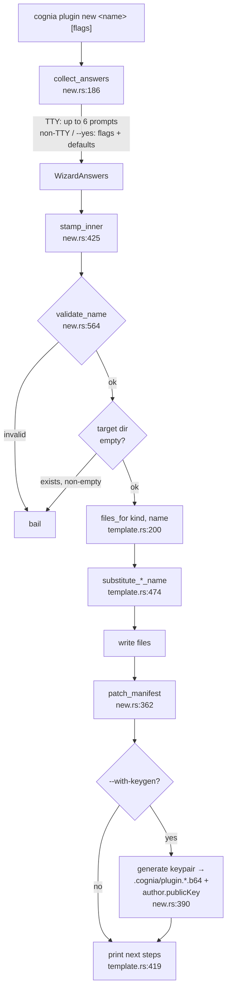

# Scaffolding — `cognia plugin new`

<TLDR>
  `run()` (`crates/cognia-cli/src/commands/new.rs:44`) collects answers (interactive wizard on a
  TTY, flags + defaults otherwise), **copies** an embedded template (`files_for`,
  `crates/cognia-cli/src/engine/template.rs:200` — every file ships inside the binary via
  `include_str!` from six sibling template source directories), **writes** the wizard answers into
  the generated `plugin.json` (`patch_manifest`, `new.rs:362`), and optionally **embeds a fresh
  Ed25519 public key** (`embed_public_key`, `new.rs:390`). Substitution is two plain
  `String::replace` calls per file — the template id and its humanized title. The command rejects
  a non-empty target directory.
</TLDR>

## Flow



## Inputs and defaults

The wizard runs only on a TTY without `--yes`; a flag that was passed is never asked again.

| Input | Flag | TTY wizard | Non-TTY / `--yes` default |
| --- | --- | --- | --- |
| name | positional | prompted (CWD basename suggested if valid) | **required** — bails with a hint |
| kind | `--kind ts\|glance\|wasm\|python\|hybrid\|vscode-extension` | select, 0 = ts | `ts` |
| dir | `--dir <path>` | — | `./<name>` |
| description | `--description` | prompted with a suggestion | `"A cognia {kind label} plugin"` |
| author | `--author` | `git config user.name` as default | `git config user.name`, else `"Anonymous"` |
| author email | `--author-email` | optional prompt | omitted |
| keygen | `--with-keygen true\|false` | confirm, default **true** | `false` (never mints a key unasked) |

`TemplateKind::parse` (`template.rs:24`) also accepts `typescript` / `frontend` for `ts`,
`glance-module` for `glance`, `py` for `python`, and `vscode` / `vs-code` for `vscode-extension`.

### Name validation

`validate_name` (`new.rs:564`): at most 64 characters, starting and ending with a lowercase ASCII
letter or digit, with lowercase letters, digits, `-`, `_` and `.` in between. The failures:

```text
plugin name is empty
plugin name must be ≤ 64 characters
plugin name must be lowercase alphanumeric plus -_. (got `…`)
```

`"0plugin"` and `"foo.bar_1"` pass; `"has space"`, `"!banged"`, `"Uppercase"`, `"trailing-"`,
`"trailing_"` and `"trailing."` fail (unit tests in `new.rs`).

## Templates are embedded sibling sources

The template sources live as sibling directories under `crates/`:

| Kind | Source directory |
| --- | --- |
| `ts` | `cognia-plugin-template-ts/` |
| `glance` | `cognia-plugin-template-glance/` |
| `wasm` | `cognia-plugin-template/` |
| `python` | `cognia-plugin-template-python/` |
| `hybrid` | `cognia-plugin-template-hybrid/` |
| `vscode-extension` | `cognia-plugin-template-vscode-extension/` |

They are pulled into the binary with `include_str!` (one `pub mod` per kind in `template.rs`). The
CLI ships no template directory; scaffolds work offline.

The two TypeScript kinds also get the **vendored `@cognia/*` declarations** under `types/`
(`author_type_files`, `template.rs:183`, expanded from `crates/cognia-cli/assets/author-types.json`).
No `@cognia/*` package is published, so the scaffold resolves `@cognia/plugin-sdk` and
`@cognia/plugin-ui` through `tsconfig.json` `paths` pointing at those files; `build` keeps both
external and the host hands out its own instances. Rebuild the bundle with
`pnpm author-types:bundle`; refresh an existing project with `cognia plugin sync-types`.

Substitution is intentionally dumb (`template.rs:474`):

```rust
fn substitute_ts_name(content: &str, target_name: &str) -> String {
    content
        .replace("cognia-plugin-template-ts", target_name)
        .replace("Cognia Plugin Template TS", &humanize(target_name))
}
// humanize: "my-cool-plugin" → "My Cool Plugin" (split -_ → Title Case)
```

The WASM variant additionally rewrites the underscored artifact name (`cognia_plugin_template` →
`my_plugin`), because cargo-component normalizes `-` to `_` and `wasmMain` must name the emitted
`.wasm`.

Description / author / publicKey are **not** template placeholders — they are patched into the
generated `plugin.json` afterwards by `patch_manifest`, which re-reads, mutates, and pretty-prints
the JSON.

## What each kind generates

| Kind | Files |
| --- | --- |
| TypeScript | `package.json`, `pnpm-workspace.yaml`, `tsconfig.json`, `jest.config.cjs`, `plugin.json`, `src/index.ts`, `src/index.test.ts`, `src/panel.tsx`, `src/panel.test.tsx`, `src/panel.css`, `src/__stubs__/plugin-sdk.ts`, `src/__stubs__/plugin-ui.tsx`, `README.md`, `.gitignore`, plus the vendored `types/` |
| Glance module | `package.json`, `pnpm-workspace.yaml`, `tsconfig.json`, `jest.config.cjs`, `plugin.json`, `src/index.ts`, `src/index.test.ts`, `src/__stubs__/plugin-sdk.ts`, `README.md`, `.gitignore`, plus the vendored `types/` |
| WASM | `Cargo.toml`, `src/lib.rs`, `wit/world.wit`, `plugin.json`, `README.md`, `.gitignore` |
| Python | `plugin.json`, `main.py`, `README.md`, `.gitignore` |
| Hybrid | `plugin.json`, `frontend/index.js`, `backend/main.py`, `styles.css`, `README.md`, `.gitignore` |
| VS Code extension | `plugin.json`, `package.json`, `extension/out/extension.js`, `styles.css`, `README.md`, `.gitignore` |

Every template ignores `.cognia/`, where `--with-keygen` writes the private key; a test walks all
kinds for it. Two more tests hold every template's manifest honest: each declared capability has a
populated contribution field and each populated field has its capability (the pairing comes from
the generated `CAPABILITY_FIELDS`), and every requested permission is known and carries a
`permissionJustifications` entry.

### TypeScript scaffold highlights

`plugin.json` declares `type: "frontend"`, `main: "dist/index.js"`, `activationEvents:
["onStartup"]` and one contribution per capability it claims:

| Capability | Contribution | Implemented in `src/index.ts` with |
| --- | --- | --- |
| `tools` | `tools[]`: `template_echo` | `ctx.agent.registerTool` |
| `commands` | `commands[]`: `template-greet` | `hooks.onCommand` |
| `quick-action` | `quickActions[]`: dispatches `template-greet` from the palette, composer and tray | nothing, it reuses the command |
| `configuration` | `configSchema`: greeting prefix, shout-echo | `ctx.settings.get` / `ctx.settings.onChange`, `hooks.onConfigChange` |
| `workflow` | `workflows.nodes[]`: `action.echo` | `ctx.workflow.registerNode` |
| `workflow-trigger` | `workflows.triggers[]`: `trigger.ticker` | `ctx.workflow.registerTrigger` |

It also mounts a UI slot (`src/panel.tsx`, gated by the `extension:ui` permission rather than a
capability) with its stylesheet in `src/panel.css` (manifest `styles`), keeps a counter in
`ctx.storage`, and registers teardown with `ctx.lifecycle.onDispose`. Its four permissions
(`extension:ui`, `theme:read`, `settings:read`, `extension:workflow`) each carry a justification.
`src/index.ts` repeats the capability list in its inline manifest, because the host merges the
module's manifest over the file's; a test pins the two lists equal.

The `build` script is esbuild with the host's shared modules kept external:

```json
"build": "esbuild src/index.ts --bundle --format=cjs --platform=neutral --target=es2022 --outfile=dist/index.js --external:react --external:react/jsx-runtime --external:react/jsx-dev-runtime --external:@cognia/plugin-sdk \"--external:@cognia/plugin-sdk/*\" --external:@cognia/plugin-ui --external:lucide-react --log-level=info"
```

`react-dom` is deliberately not external: it is not a shared module. `pnpm audit:plugin-externals`
keeps this list in step with the host's whitelist and the CLI's own builder. Jest resolves
`@cognia/*` for real, so `jest.config.cjs` maps both specifiers to `src/__stubs__/`, which carry
only the runtime values the template imports. The template's `package.json` declares every
published package the vendored declarations import (`ai`, `zod`, `dexie`, `valibot`, `react`, the
ACP SDK pinned to the host's version, …) and never an `@cognia/*` package.

### Glance module scaffold highlights

A TypeScript frontend plugin whose one contribution is a tray-panel glance module (ADR-0225 §6).
`plugin.json` declares `capabilities: ["glance", "commands"]`, one `glanceModules` entry (a
counter, titled from the manifest's own `i18n.locales` in English and Chinese) and the two
commands its buttons run. `src/index.ts` publishes with `ctx.glance.update`, republishes on
`ctx.glance.onVisibilityChange` and locale changes, answers the buttons in `hooks.onCommand`, and
keeps the count in `ctx.storage`. There is no React panel: the host draws the module. The
template's `package.json` lists the same published packages as the TypeScript template, because
the vendored SDK declarations import them; a unit test (`template.rs`) pins that every package
those declarations import is declared, and `pnpm sdk:scaffold:test` installs, type-checks, tests,
builds and lints both TypeScript kinds.

`cognia plugin lint` skips the vendored `types/` bundle (marked by
`types/cognia-plugin-sdk.d.ts`), whose internal `@cognia/provider-types` references are the SDK's
own shape, the same rule `scripts/plugin/check-author-imports.mjs` applies in CI.

### WASM scaffold highlights

The manifest pins the contract the host routes on:

```json
{
  "type": "wasm",
  "capabilities": ["tools", "workflow"],
  "wasmMain": "cognia_plugin_template.wasm",
  "wasm": { "apiVersion": "0.2.0", "memoryLimitMb": 16, "callTimeoutMs": 5000 },
  "permissions": ["notification", "secrets:read", "extension:workflow"],
  "engines": { "cognia": ">=0.4.0" }
}
```

`src/lib.rs` implements the `Guest` trait from the WIT world — `init`, `on_event`,
`tool_execute`, `workflow_node_execute` — logging through the host's `logger` import and echoing
payloads back, so a fresh scaffold is observable end-to-end. The `Cargo.toml` carries the
`[package.metadata.component]` block (`package = "cognia:plugin"`, `world = "cognia-plugin"`) and
a size-tuned release profile (`opt-level = "s"`, `lto = true`, `codegen-units = 1`).

### Python scaffold highlights

`plugin.json` declares `type: "python"`, `capabilities: ["tools", "python", "context-panel"]`,
`pythonMain: "main.py"`, `engines.python: ">=3.10"` and an A2UI context panel for sessions.
`main.py` shows, in the order the host exercises it: the module-level lifecycle names
(`on_startup` / `on_config_updated` / `on_shutdown`), a pure `@tool` (`template_echo`) and one that
reaches the host through `cognia.ctx` (`template_note`, an `async def` because `ctx` calls are
coroutines), `get_config()`, `progress()` with a 0-100 percentage, and the panel: a component tree
pushed with `ctx.a2ui` from `template_build_panel`, answered on `onA2UIDataChange` (typing) and
`onA2UIAction` (the click).

The host injects its own `cognia` module before importing `main.py`; nothing is installed from
PyPI. Use the SDK under `plugin-sdk/python` for local type checking and tests. There is no build
step: `cognia plugin build` packages `pythonMain` and any `bundle_include[]` files directly.

### Hybrid scaffold highlights

`plugin.json` declares `type: "hybrid"`, `capabilities: ["tools", "python", "commands"]`,
`main: "frontend/index.js"`, `pythonMain: "backend/main.py"` and `styles: "styles.css"`. The two
halves talk: the frontend registers the `template_word_count` tool and answers the manifest's
`/template-wordcount` command in `onCommand`, computing both with `ctx.python.call("word_count", …)`,
a plain function in `backend/main.py`; the backend's own `@tool` registers `template_echo`. The frontend entry is plain CommonJS, so it can be
syntax-checked with `node --check` and loaded without an npm install.

### VS Code-extension scaffold highlights

`plugin.json` declares `type: "vscode-extension"`, `vscodeMain: "extension/out/extension.js"`,
`styles` and `bundle_include: ["package.json"]`. `package.json` contributes one command
(`cogniaPluginTemplate.hello`) and one setting. The entrypoint exports CommonJS `activate` /
`deactivate` and registers the command through `require("vscode")`, matching the sidecar's
extension-runner contract.

## Post-stamp output

Printed next steps (`next_steps`, `template.rs:419`):

```text
# ts / glance                            # wasm                                    # python
cd <dir>                                 cd <dir>                                  cd <dir>
pnpm install                             rustup target add wasm32-wasip2           python -m py_compile main.py
pnpm test                                cargo install --locked cargo-component    cognia plugin doctor
cognia plugin doctor                     cognia plugin doctor                      cognia plugin lint
cognia plugin lint                       cognia plugin lint                        cognia plugin build
cognia plugin build                      cognia plugin build

# hybrid                                 # vscode-extension
cd <dir>                                 cd <dir>
node --check frontend/index.js           node --check extension/out/extension.js
python -m py_compile backend/main.py     cognia plugin doctor
cognia plugin doctor                     cognia plugin lint
cognia plugin lint                       cognia plugin build
cognia plugin build
```

The glance kind adds a last line: once installed and enabled, open the tray panel, choose
**Edit**, and add the module.

With `--with-keygen`, the CLI confirms `✓ embedded author.publicKey (…)` and points at
`.cognia/plugin.private.b64` — the same files [`keygen`](./signing-and-keys) would create.
`--json` replaces all of this with one machine-readable report (plugin id, type, template kind,
directory, files, key paths).

<Callout type="warn" title="Existing directories are never merged">
  `stamp_inner()` bails with `"<path> already exists and is not empty"`. There is no `--force`;
  pick a new directory or empty the target first.
</Callout>
