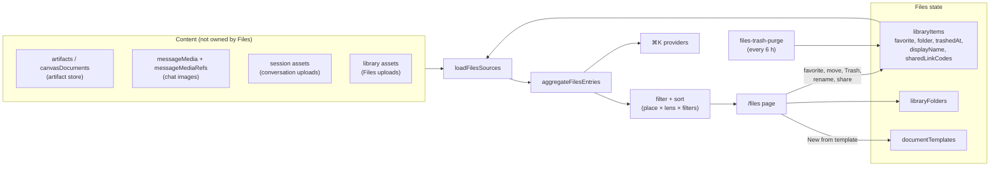

# Files

<Status variant="beta">Desktop and web shipped · workspace files and the phone pending (ADR-0223 §8, §9)</Status>

<TLDR>
  `/files` lists everything conversations produce, plus files uploaded straight into Files, in one
  place you can manage. The content stays in its own stores (artifacts, canvas documents, chat images,
  conversation uploads). Files adds only its own state on top — favorites, folders, a Trash, display
  names, link markers — in two tables, and keeps an item's bytes alive by holding a reference rather
  than a copy.
</TLDR>

Decision records: [ADR-0200](/docs/adr/0200-files-is-a-view-that-keeps-what-you-keep) (the
aggregated view and keep-by-reference) and
[ADR-0223](/docs/adr/0223-files-is-a-space-you-manage) (the managed space). File links ride
[ADR-0222](/docs/adr/0222-a-conversations-files-are-a-view-and-sharing-them-is-a-grant).

## The whole subsystem

## Places × lenses

The secondary sidebar holds **places**: All, five type groups (Documents, Artifacts, Images, Videos,
Uploads), Recents (five, then "Show more"), the folder tree and the Trash. The row of **lenses** over
the list — Suggested, Favorites, Mine, AI-generated, Shared with me — combines with any place. The
Trash ignores lenses and hides the lens row.

| Lens | Shows | Default order |
| --- | --- | --- |
| Suggested | everything | the local suggestion score ([Data](/docs/subsystems/files/data#suggested)) |
| Favorites | favorited items | when they were favorited |
| Mine | made by the person, not shared in | most recent activity |
| AI-generated | made by an agent, not shared in | most recent activity |
| Shared with me | from a collaboration conversation someone else shared | most recent activity |

A column header in the list view overrides the default order (see [Management](/docs/subsystems/files/management#list-and-sort)).

## Kinds

| Kind | Source | One card per |
| --- | --- | --- |
| `artifact` | `artifacts` | artifact |
| `canvas` | `canvasDocuments` | document (a document made outside any conversation is `standalone`) |
| `image` | `messageMedia` | canonical image hash, however many conversations show it |
| `session-upload` | session assets | original content hash, however many conversations it was attached to |
| `upload` | library assets | file uploaded straight into Files (Files-owned) |

Generated videos are not a kind: a video a generation job made carries its job record on the upload
card it already is.

## Where it lives

| Concern | Module |
| --- | --- |
| Row types, kinds, keep rule | `lib/db/files-library-types.ts` |
| Item writes, pins, Trash, share codes | `lib/db/files-library-items.ts` |
| Folders | `lib/db/files-library-folders.ts` |
| Loaders | `lib/files-library/sources.ts` |
| Aggregate (pure) | `lib/files-library/aggregate.ts` |
| Places, lenses, filters, sort | `lib/files-library/filter.ts`, `types.ts`, `suggest.ts` |
| Trash purge | `lib/files-library/trash.ts`, `trash-purge-schedule.ts` |
| Rename, duplicate, zip, upload, download | `lib/files-library/{rename,duplicate,export-zip,upload,download}.ts` |
| Drag and drop, keyboard, deep links | `lib/files-library/{dnd,keyboard,deep-link}.ts` |
| Sharing | `lib/files-library/share.ts` |
| Document templates | `lib/document-templates/`, `lib/db/document-templates.ts` |
| Page and dialogs | `components/files-library/` |
| Hooks | `hooks/files-library/`, `hooks/document-templates/` |
| Store | `stores/files-library/files-library-store.ts` |
| ⌘K | `lib/global-search/providers/files.ts` |

## Not yet shipped

ADR-0223 is accepted, with two sections still to build. Both need host-side Rust work.

- **Workspace files (§8).** There is no `workspace-file` kind and no Workspace files group: the type
  groups are the five above.
- **The phone (§9).** On a phone the page still renders ADR-0200's explanation
  (`FilesMobileUnsupported`), the surface contract still says `companion: hidden`, and ⌘K's Files
  providers return nothing there.

## Pages

- [Data](/docs/subsystems/files/data): the tables, how keeping holds bytes, the aggregate, the Trash and its purge, the
  suggestion score and ⌘K.
- [Management](/docs/subsystems/files/management): layout, selection, keyboard, drag and drop, menus, rename, duplicate,
  zip export and deep links.
- [Templates](/docs/subsystems/files/templates): the document template domain.
- [Sharing](/docs/subsystems/files/sharing): publishing items as an encrypted file link.
