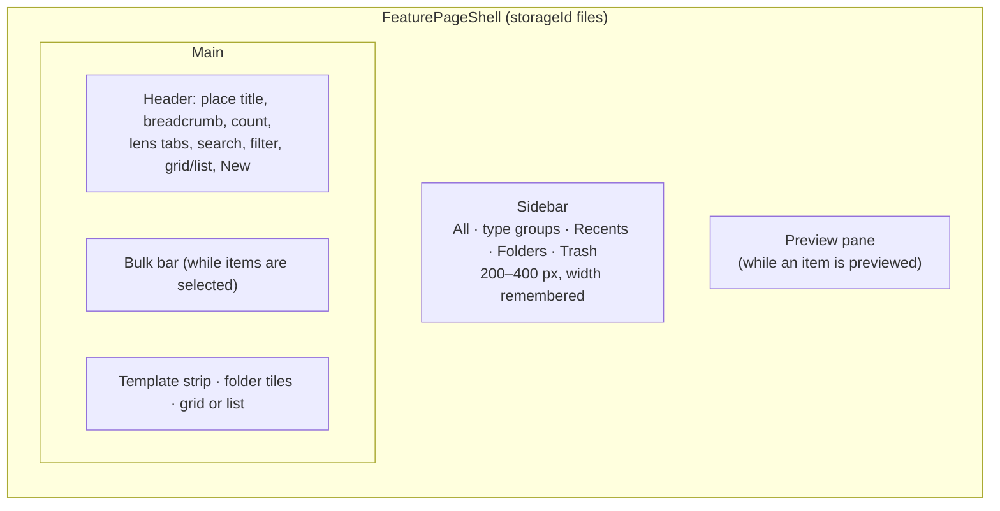
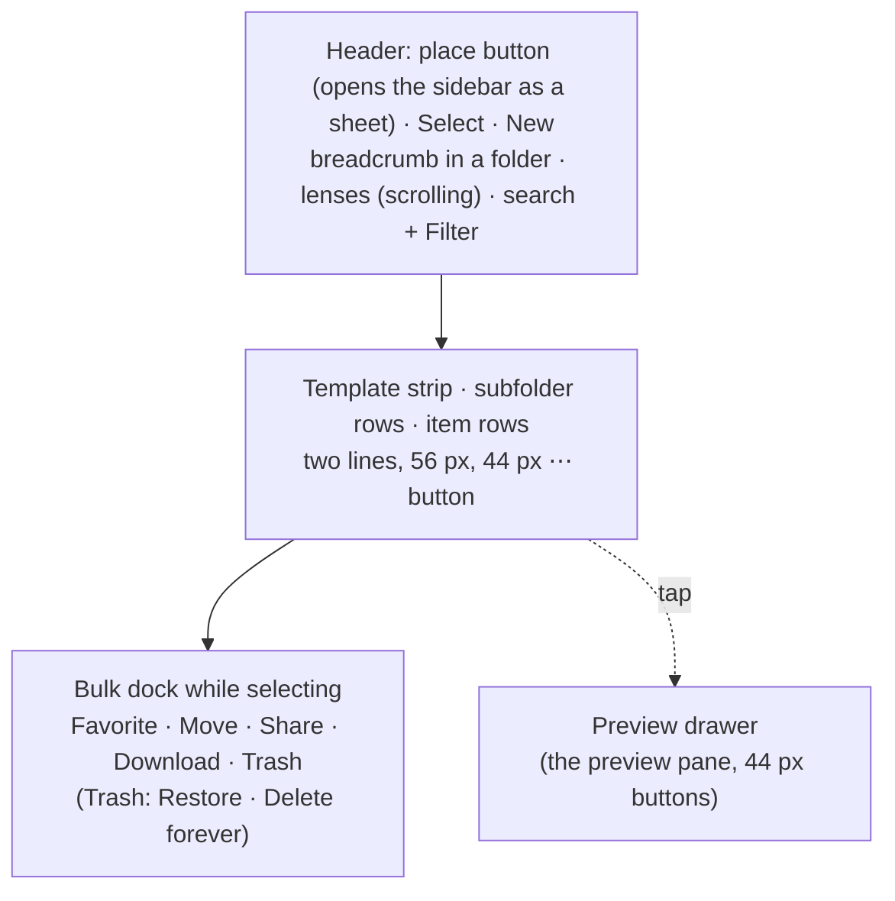

# Management

## Layout

`components/files-library/files-library.tsx` composes the page on `FeaturePageShell`. The sidebar's
width is reported once a drag settles and kept in the Files store, not by the shell. Between the `md`
and `lg` breakpoints the side panes become sheets; narrower than `md`, or in the phone shell, the page
switches to [its phone layout](#on-a-phone). The list pages in steps of 60 items ("Show more"); older
images load 500 at a time.

The sidebar lists All, the type groups, the five most recent items, the folder tree and the Trash
(with a count). A folder row opens its place; its chevron expands it (remembered per device); its menu
— the same on right-click and on the "⋯" button — offers New subfolder, Rename, Color, Icon and Delete.
Deleting a folder moves its contents up a level by default; the cascade option deletes the subfolders
too and takes their items out of Folders (an item nothing else keeps then loses its pin). A folder is
re-parented by dragging it.

## List and sort

The list view is a table: a select-all checkbox, Name, Source (the conversation, "Uploaded", or "—"
once it is gone), Last activity ("Deleted" in the Trash), Size and Type. Source, Size and Type appear
as the main area widens (container queries `@xl`, `@2xl`, `@3xl` on `@container/files`). Inside a
folder its subfolders come first, always by name.

A header click cycles (`nextFilesSort`, `lib/files-library/column-sort.ts`): the column's natural
direction first (ascending for name, source and type; descending for activity and size), then the
reverse, then back to the lens's default order. Names compare with numeric collation and untitled
items sort last.

## Selection

`useFilesSelection` builds on the shared range selection (`hooks/ui/use-range-selection.ts`) over the
whole visible list, not only the rendered page:

| Gesture | Effect |
| --- | --- |
| click | select one item and preview it |
| ⌘/Ctrl-click | toggle the item |
| Shift-click | select the range from the anchor |
| ⌘/Ctrl-Shift-click | add the range |
| checkbox, Space | toggle |
| double-click, Enter | open (preview, in the Trash) |

Changing place or lens clears the selection; a search or filter drops items that leave the view.

## Keyboard

`resolveFilesKey` (`lib/files-library/keyboard.ts`) maps keys on the list container. Nothing fires
while focus is in a text field, a menu or a dialog.

| Key | Does |
| --- | --- |
| ⌘/Ctrl-A | select everything in view |
| Delete, Backspace | move the selection (or the focused item) to the Trash, with Undo on the toast; in the Trash, ask to delete forever |
| F2 | rename, when exactly one item is targeted |
| ↑ / ↓ | move focus and preview; with Shift, extend the selection |
| Escape | clear the selection, then close the preview |

## Drag and drop

`FilesDndProvider` (`components/files-library/files-dnd.tsx`) uses `@dnd-kit/core` with a pointer
sensor that starts after 6 px and `pointerWithin` collision. Dragging a selected item drags the whole
selection. `resolveFilesDrop` (`lib/files-library/dnd.ts`) decides the outcome:

| Drag | Drop on | Result |
| --- | --- | --- |
| items | a folder or the Folders root | filed there (items already there are skipped) |
| items | the Trash | moved to the Trash (trashed items are skipped) |
| a folder | another folder or the root | re-parented, unless onto itself, its current parent or its own subtree |
| anything else | | nothing |

The database checks for cycles again on write. The drag chip follows the pointer (`snapChipToPointer`,
12 px offset), and screen readers hear localized announcements.

Files dragged in from the system upload into the folder in view, or the top level (`files-drop-zone.tsx`).
Dropped directories are walked, up to a cap. Uploads go one at a time, each with its own error toast,
and text is extracted from files up to 50 MiB.

## Item menu and bulk bar

The item menu (`files-item-menu.tsx`) is one model rendered as the "⋯" dropdown and the right-click menu:

- **Normal:** Open · Preview · Use in chat · Favorite · Move to folder · Take out of folder (when
  filed) · Rename (F2) · Duplicate · Save as template (documents, template platform on) · Download ·
  Share… · Move to Trash.
- **In the Trash:** Preview · Restore · Delete forever.

The bulk bar (`files-bulk-bar.tsx`) acts on the whole selection in one write: Favorite or Unfavorite ·
Move to folder · Download as zip · Share… · Move to Trash; in the Trash, Restore · Delete forever.

## Rename

`renameTargetFor` (`lib/files-library/rename.ts`) respects who owns the name:

| Kind | Renamed |
| --- | --- |
| canvas document | at the source (its title) |
| Files-owned upload | at the source (its filename, so the download is called that) |
| artifact, chat image, conversation upload | as `displayName` on the item; the source keeps its title |

Renaming back to the source title clears the display name; an empty name is refused. The dialog
selects the name without its extension.

## Duplicate

`duplicateFilesEntry` (`lib/files-library/duplicate.ts`) always makes the person's own, independent copy:

- a canvas document or an artifact becomes a new canvas document titled with the localized suffix
  (" (copy)");
- an image or a file becomes a Files-owned upload of the same bytes, named "notes (copy).md" — the
  suffix goes before an extension of up to seven characters. Bytes are content-addressed, so the copy
  does not store them twice. The new upload joins the active workspace and is selected.

## Zip export

`buildFilesZip` (`lib/files-library/export-zip.ts`) builds `Files.zip` on the device with fflate:

- each entry is its download (original bytes, or the text of an artifact or document);
- filed items keep their folder path; others sit at the root;
- clashes become `name (2).ext`, `name (3).ext`, compared case-insensitively;
- images, video, audio, archives and PDFs are stored, everything else deflated;
- the export is capped at 512 MiB (`FILES_ZIP_MAX_BYTES`), checked before reading and again while
  reading; items whose content is gone are left out and counted in the toast.

## Deep links

`lib/files-library/deep-link.ts` reads and writes the page's place and lens:

| Parameter | Values |
| --- | --- |
| `section` | `all`, `recent`, `trash`, `group:<group>`, `folder:<id>` |
| `tab` | a lens: `suggested`, `favorites`, `mine`, `ai`, `shared` |
| `item` | an item key; opens its preview |

Defaults are left out of the URL. ADR-0200's `?tab=` values redirect with `router.replace`:
`recent` → the Recents place, `folders` → the Folders root, `images` → the Images group, `all` → All
(`favorites` is still a lens).

## On a phone

`FilesLibrary` picks its layout with `useCompactLayout`: narrower than `md`, or in the Capacitor
shell, it renders `FilesMobileLibrary` (`components/files-library/mobile/`). Both layouts read one
model, `useFilesPage` (`hooks/files-library/use-files-page.ts`): entries, folders, actions, the view,
the selection, the URL (`useFilesDeepLink`), paging and folder counts. Only the drawing differs.

| Gesture | Effect |
| --- | --- |
| Tap a row | Preview it in the bottom drawer (Open, Use in chat, Download, Favorite; in the Trash, Restore and Delete forever) |
| Long-press a row, or Select in its menu | Start selection with that item selected |
| Select in the header | Start selection with nothing selected |
| Tap while selecting | Toggle the item |
| Done, or a new place or lens | End selection |
| Place button | Open the sidebar as a sheet; picking a place or a recent item closes it |

The list is the phone's only layout: the grid/list choice is a desktop preference and is left as it
was. Nothing drags: items move through "Move to folder…" and the dock, and files come in through
New → Upload files (the system picker). Rows have no right-click menu, which Radix would raise on the
same long-press. An empty folder says to use Move rather than to drag. Downloads, single or zip, go
to the system share sheet in the Capacitor shell (`downloadBlob`, `lib/files/download.ts`).

The same layout serves a standalone phone, over its own database, and a paired one, over the
desktop's library ([On a paired device](/docs/subsystems/files/paired)), where the list also pulls to
refresh.

## Store

`stores/files-library/files-library-store.ts` persists per device (`files-library-prefs`, version 2):
view mode, column sort, workspace scope, sidebar width, expanded folders and whether the template strip
is folded. A version 1 blob keeps its view mode and scope. Place, lens, search, filters, the previewed
item and every dialog target (move, rename, delete forever, empty Trash, folder, delete folder, save as
template, share) are session state.
