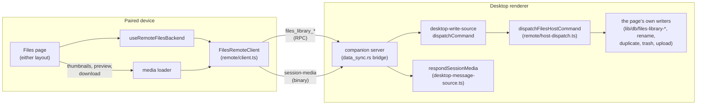

# Files on a paired device

<Status variant="beta">Shipped (ADR-0223 §9)</Status>

<TLDR>
  A paired phone or browser manages the **desktop's** library, live. Nothing is mirrored: the page
  mounts a remote backend that reads the host's list in pages and sends every change as one of 23
  `files_library_*` host commands, which the desktop runs with the same writers its own page uses.
  Bytes ride the existing `session-media` resource, up to 10 MiB. Creating documents and Share stay on
  the desktop, and the page says so.
</TLDR>

## One page, two backends

`FilesLibrary` (`components/files-library/files-library.tsx`) picks the backend from the runtime
target and mounts it with `FilesBackendProvider` (`hooks/files-library/files-backend.tsx`). Everything
below reads it from there — the page model, the actions, the folder dialogs, thumbnails, the preview —
so neither layout knows which library it draws.

| | This device's library | A paired host's library |
| --- | --- | --- |
| Source | `useLocalFilesBackend`: live Dexie reads | `useRemoteFilesBackend`: paged host reads |
| Operations | `createLocalFilesOps` (`lib/files-library/ops.ts`) | `createRemoteFilesOps` (`lib/files-library/remote/remote-ops.ts`) |
| Missing image bytes | never (all local) | `createRemoteMediaLoader` |
| Capabilities | everything; Open leaves Files | `PAIRED_FILES_CAPABILITIES` |

## The surface

The `files` row of `lib/runtime/surface-contract.ts` names `files_library_list` as its operation and
`companion: "remote"`. A paired client therefore sees Files in the rail and ⌘K only while the host
advertises the operation (the host feature `files.library-remote`,
`lib/platform/host-feature-manifest.ts`) and the device holds `client.read`. Only the desktop
advertises the feature: a headless brain installs the same desktop-write source but has no artifact
store, canvas or library, and answers every arm `headless_host`. `offline: "blocked"` — with the host
unreachable the page is closed rather than stale, because nothing is mirrored and no change is queued.

## Commands

All 23 are `target: execution`, bridged through `src-tauri/src/companion_api/rpc/data_sync.rs` to the
desktop renderer and delegated wholesale from `lib/companion/desktop-write-source.ts`, like the `pet_*`
family. The server injects the verified `callerDeviceId` into every one. Reads use `client.read` and
skip the idempotency cache; writes use `client.write` and require an `Idempotency-Key`.

| Command | Does |
| --- | --- |
| `files_library_list` | One page of the library in key order (`pageSize`/`pageToken`), with the list's `revision` |
| `files_library_folder_list` | One page of folders in id order |
| `files_library_search` | Items whose body matches, by the page's own rule; trashed and removed items excluded |
| `files_library_get` | One entry, and a document's text (up to 128 Ki characters) |
| `files_library_read_chunk` | Up to 512 KiB of a [workspace file](/docs/subsystems/files/workspace)'s bytes, by item key |
| `files_library_favorite` / `_move` / `_trash` / `_restore` | The selection, in one write; answers how many items it acted on |
| `files_library_purge` | Ends trashed items only, by the [Trash rule](/docs/subsystems/files/data) |
| `files_library_touch` / `_rename` | Record an open; rename |
| `files_library_duplicate` | Copy, with the device's copy suffix (keyed) |
| `files_library_attach` | Use in chat (keyed) |
| `files_library_folder_create` (keyed) / `_rename` / `_move` / `_style` / `_delete` | Folders |
| `files_library_upload_init` / `_chunk` / `_commit` (keyed) / `_abort` | Uploads |

The host never takes the device's word for an entry. Each call names item keys; the host rebuilds its
aggregate over the device's image window (`imageLimit`) and acts only on the entries it finds — so a
phone cannot claim an item is Files-owned and get it deleted for good, and a key the host no longer
lists is skipped. Trash acts on untrashed items, Restore and Purge on trashed ones.

The four **keyed** writes would otherwise make a second copy, binding, folder or library file when a
reply is lost and the person presses again. They carry a body `idempotencyKey`, and the host's ledger
(`remote/idempotency.ts`, remote pet care's) folds a retry onto the first answer, per
`<callerDeviceId>:<command>:<key>`.

A refusal is `{ ok: false, code }`: a `files.errors.*` code the library's writers raised, passed
through, or one of the remote path's own (`headless_host`, `files_remote_not_found`,
`files_remote_invalid_request`, `files_remote_session_unwritable`). The page maps every code to a
message and an unknown one to the generic failure.

## Reading and refreshing

`useRemoteFilesBackend` reads the whole list page by page (`client.list`). A list page carries the
revision of the list it was cut from; if a later page's revision differs, the library changed mid-read
and the client starts over, three times at most (`files_remote_busy`). It re-reads:

- after each change the device makes (every write but a touch),
- when the page becomes visible or the window regains focus,
- every 30 seconds while it stays visible,
- on pull to refresh (phone layout) and on Retry.

A read that loses a race to a newer one is dropped. A failed read keeps what was shown and raises
`FilesRemoteNotice` with the reason and Retry. Entries carry no search haystack or excerpt over the wire,
so the phone matches titles itself and, after 250 ms, asks `files_library_search` which items match in
their bodies; those keys join the filter as `contentMatches`.

On a paired device ⌘K lists the host's items by title (`loadRemoteFileSearchRows` over
`files_library_list`); the artifact and canvas providers stay empty there, since this client's store
is not the host's library.

## Bytes

There is no new binary route. Thumbnails, previews and downloads read the existing `session-media`
resource (`/api/sessions/{sessionId}/media/{hash}?variant=`) through `mediaResourcesFor`:

1. an item Files keeps (favorite, folder, owned or trashed) under the library's sentinel session
   `library:files`,
2. then each conversation that shows it.

`respondSessionMedia` (`lib/companion/desktop-message-source.ts`) authorizes the sentinel by the
library's own pin in `messageMediaRefs` — there is no conversation row to expose or share-check — and
anything else as before, through an exposed conversation that references the bytes. A held original
(`original:<sha>`, a conversation or Files upload) answers the `original` variant. Rows land in the
device's media cache, so an image read once stays readable offline.

The resource's 10 MiB cap is the device's ceiling (`FILES_REMOTE_MAX_BYTES`): past it the preview says
to open the item on the desktop, Download refuses, and a zip refuses by name before reading anything.

A workspace file's bytes are on the host's disk, not in session media, so they come from
`files_library_read_chunk` instead, under the same 10 MiB ceiling
([Workspace files](/docs/subsystems/files/workspace#on-a-paired-device)).

## Open, Use in chat, upload

- **Open** previews read-only: an artifact or canvas document from `files_library_get`'s text, images
  and files from their bytes. The footer offers the conversation the item came from instead of Open.
- **Use in chat** sends `files_library_attach` with the device's open conversation, which the host
  re-checks (exposed, still taking messages) or replaces with a new one. An image or file is bound to
  that conversation on the host, without copying bytes (`bindEntryToSession`); an artifact or canvas
  document answers `referenced`, and the phone stages it as a reference chip in its own composer from
  the host's text.
- **Upload** hashes the file, stages it in 32 KiB chunks on the attachment staging channel under the
  sentinel session and the device that began it, and commits it into the library (`folderId` when a
  folder is in view). Any type is accepted (`acceptAnyType`); the commit's magic-byte inspection
  still runs. Another device cannot write to, commit or abort it.

## Held back

`PAIRED_FILES_CAPABILITIES` holds two things back, each documented at the type
(`FILES_PAIRED_HELD_BACK`), labelled in the UI and pinned by tests:

| Held back | Why | In the UI |
| --- | --- | --- |
| Creating documents: New canvas document, From template, Save as template, the template strip | The phone cannot edit the host's canvas | Entries disabled with "On the desktop"; the strip is not drawn |
| Share | The share policy, collaboration checks and link records live on the host; a large selection would outlast the 30-second host bridge | Share disabled in the item menu and both bulk bars, saying to share from the desktop |
