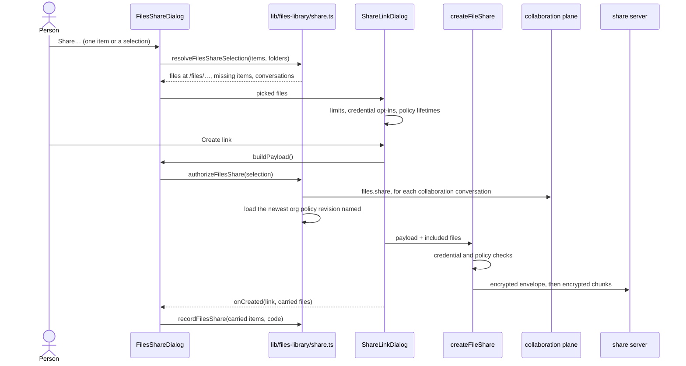

# Sharing

"Share…" on an item, or on a selection from the bulk bar, publishes one link that carries the items as
files. It is ADR-0222's file snapshot — a `file-bundle` share whose files travel as client-encrypted,
4 MiB chunked blobs; the server never sees a name, a path or a plaintext size. Files adds three things
the conversation share does not need: naming items by their place in Files, asking every conversation
they come from, and remembering which items a link carried.

## From items to files

`FilesShareDialog` (`components/files-library/files-share-dialog.tsx`) freezes the picked items when it
opens — a live refresh of the list underneath does not re-read them — and drops any that are in the
Trash. `resolveFilesShareSelection` (`lib/files-library/share.ts`) reads each item's download (a Blob
handle; the bytes are read chunk by chunk only when the link is created):

- **Path:** `/files/<folder path>/<file name>`, the same folder path a zip export uses. Two items with
  the same path become `name (2).ext`, compared case-insensitively.
- **Media type:** the item's own, else one from the file's extension (so a Markdown document is
  `text/markdown`, not the plain text it is stored as), else the stored type.
- **Credentials:** a path the sensitive-file floor flags (an `.env`, a key, …) is marked `sensitive`
  and is carried only if the person ticks it in the dialog.
- **Missing:** an item whose content is no longer stored is named in the dialog and left out.

## Before anything is uploaded

The share dialog (`components/share/share-link-dialog.tsx`, its `picked` source) treats the picked
files as the whole share: a link needs at least one file, and there is no payload preview. It checks
the server's limits up front (`lib/share/blob-crypto.ts`: at most 200 files, 512 MiB per file, 2 GiB of
ciphertext in all) and offers only the lifetimes the effective file-sharing policy allows.

When the person creates the link, `buildPayload` runs first and calls `authorizeFilesShare`:

1. a shared conversation (`shared:` id) an item names that is **no longer stored on this device**
   cannot be asked, so the share is refused as unavailable;
2. every collaboration conversation the items belong to is asked whether its files may be published
   (`assertSharedSessionFileShare`, the `files.share` action and the org policy). One refusal refuses
   the whole link;
3. the newest org policy revision any answer named is loaded, so the next step cannot judge the share
   by an older cached policy.

Then `createFileShare` (`lib/filespace/share-files.ts`) runs its own checks — every sensitive file
confirmed, public snapshots allowed, the lifetime within the policy — and uploads. Unlike a
conversation's share it receives no conversation: authorization already happened above, and the link
is recorded in `sharedLinks` without a `sessionId`.

A refusal at any step is shown in the dialog in the same words a conversation share uses.

## The marker

`onCreated` reports which files the link actually carried (credential files left unticked are not
among them). `recordFilesShare` maps them back to their items and appends the link's code to each
item's `sharedLinkCodes`, dropping codes of links that are gone. Sharing does not keep an item: the
link holds its own copy.

The next load reads the live codes (`loadLiveShareCodes`, `lib/files-library/sources.ts`: not revoked,
not expired) and the aggregate sets `sharedLinks` on each item, which the row and the card show as a
link icon ("Shared by link", "Shared by 2 links"). Only the code is stored on the item; the link, its
key and its owner token stay in `sharedLinks` on the device that made it, so the marker shows there.
Recording the code is best-effort: if it fails, the link still exists and only the marker is missing.

## Limits

- A trashed item cannot be shared: the menu disables Share and the Trash's bulk bar has no Share.
- An unpaired phone shares the way the desktop does, from the item menu and the bulk dock.
- On a paired client Share is held back: it stays in the item menu and the bulk bars, disabled, saying
  to share from the desktop ([On a paired device](/docs/subsystems/files/paired#held-back)).
