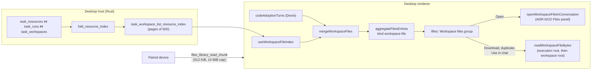

# Workspace files

<Status variant="beta">Desktop and paired devices shipped · dormant on plain web (ADR-0223 §8)</Status>

<TLDR>
  A file an agent wrote into a conversation's workspace is a `workspace-file` item, one per
  conversation, workspace root and path. The list comes from the task-workspace ledger's resource
  index, with code-adoption turns filling in conversations the ledger never saw. Files reads the
  bytes where they are now and never writes to or deletes them on disk. Without a filesystem backend
  the kind is dormant and says so.
</TLDR>

## The whole path

## The resource index

The ledger stores one row per task, run and path in `task_resources`, each with its `ResourceChange`.
`TaskWorkspaceStore::list_resource_index_rows` (`crates/cognia-task-workspace/src/store.rs:726`) joins
those rows to their run and to the `task_workspaces` row that names the owning conversation
(`session_id`). `fold_resource_index` (`crates/cognia-task-workspace/src/resource_index.rs:202`) replays
them in the order they settled (the run's `settled_at`, else its `created_at`), keyed by conversation,
workspace root and path:

- only a change whose origin is the **agent** adds a path;
- a **delete** by anyone removes it, and a **rename** by anyone moves it to the new path (keeping
  `oldPath`);
- a change classified **sensitive**, **generated** (build output) or a **symlink** removes it;
- a path first **created** stays `created` through later edits; `firstChangedAt` is when it entered
  the index, `changedAt` its last change.

A run works in its own root, and its changes reach the workspace only when the person applies its patch
set. So each row is first weighed by that patch set (`PatchOutcome::adoption_of`, read from
`task_patch_sets` with only its state, applied files and applied selection deserialized):

| Patch set | The change | The entry |
| --- | --- | --- |
| none yet, `ready`, or a `conflict` from an apply (nothing written) | pending | `adoption: "pending"`: the file is in the run's `executionRoot` |
| `applied`, or a `conflict` from an undo (still applied), and the path is in the person's selection (an empty selection is all of it; older patch sets without a recorded selection use the files the apply wrote) | applied | `adoption: "applied"`: the file is in the `workspaceRoot` |
| `applied`, path left out of the selection | discarded | skipped |
| `reverted` (undone, or a conflict resolved by keeping the current files) | discarded | skipped |

A discarded change is as if it never happened: the fold skips it, so whatever the path was before it
stands — an undone delete leaves the file listed, an undone create never lists it. A pending change is
the agent's latest output and is listed as such; the preview says "Not applied yet".

The result is sorted newest first. `TaskWorkspaceService::list_resource_index` keeps the last fold
with the database's change fingerprint (`WorkspaceStore::change_fingerprint`: this connection's
`total_changes()` and `PRAGMA data_version`, which moves when another connection commits), so the pages
of one listing, and a re-read on focus while the ledger is unchanged, share one fold; a run's payload is
parsed once for all of its rows. `task_workspace_list_resource_index`
(`crates/cognia-task-workspace-host/src/host_surface.rs:784`) serves it in offset pages of 500
(`resource_index_page`), as a read-only `host.observe` command that runs off the main thread. `listTaskResourceIndex`
(`lib/task-workspace/client.ts:718`) collects the pages, at most 20 000 entries, and drops duplicates.

## Merging with code-adoption turns

`mergeWorkspaceFiles` (`lib/files-library/workspace-files.ts:178`) takes the index as it stands, then
adds files from `codeAdoptionTurns` **only for conversations the index holds nothing for** — an
external agent that edited files without running through the ledger. A conversation the ledger does
hold is never patched from turn rows: what the ledger dropped stays dropped. Turn rows fold oldest
first, skip rejected or reverted turns and files, skip an in-app (`taskWorkspace`) turn still
`pending` — its change lived only in a run root that went with the ledger rows, so the workspace holds
the person's version — and leave out the paths `isSensitiveResourcePath` matches (`.env`, private keys
and the like). Their execution root is the workspace root, and they carry no `adoption`.

Where there is no ledger to ask (the index read failed), `index` is `null` and the turn rows are all
there is.

## The item

`aggregateFilesEntries` makes one card per file (`lib/files-library/aggregate.ts:470`):

| Field | Value |
| --- | --- |
| `key` | `workspace-file:<sourceId>` |
| `sourceId` | 16 hex digits: a 64-bit FNV-1a digest of conversation, workspace root and path (`workspaceFileSourceId`), because item keys are capped at 300 characters. A renamed file is digested under the path it had before its first rename (`identityPath`), so its favorite and folder follow it; a file now standing at that path keeps the id, and of two files renamed from one path the older does |
| `title` | the path's last segment, unless renamed in Files |
| `creator` | `ai` |
| `originAlive` | the conversation still exists |
| `workspace` | `{ sessionId, workspaceRoot, executionRoot, relPath, change, oldPath }` |
| `searchText` | name, relative path and media type |

A kept workspace file (favorited, filed or trashed) stores its location in `snapshot.workspace`, so the
card is rebuilt from the snapshot after the ledger prunes the run.

## Where it shows

`matchesSection` (`lib/files-library/filter.ts:178`) keeps an agent's busy run from burying what the
person made:

| Place | Shows a workspace file |
| --- | --- |
| Workspace files group | always |
| A folder | once filed there |
| All | only under the Favorites lens, once favorited |
| Recents | once opened, favorited or filed |
| Trash | once trashed |

⌘K does not list them.

## Reading the bytes

A path is relative to both roots, and `adoption` picks the one to read (`workspaceFileRoots`): an
applied file from the workspace root only (a copy left in the run's root is the agent's version, not
the file as it is now), a pending one from the run's root only (the workspace root holds the person's
version). Without `adoption` — a turn row, or a card rebuilt from a kept item, whose snapshot never
stores it — `locateWorkspaceFile` tries the run's root, then the workspace root. It skips a root the
host refuses and ignores directories.

A pending file lives only in its run's root. Once that root is archived or removed, the ledger's
capture of the change is the only copy of what the agent wrote, so `locateWorkspaceFile` falls back to
it when the listing named the run (`runId`, from the index, never kept in a snapshot): it probes
`task_workspace_read_resource_capture` with a zero-length read for the size, and returns a `ledger`
source. That command (`TaskWorkspaceService::read_resource_capture`) is named by run and path, not by
blob hash, so it serves only what the ledger recorded for that change: never a credential-shaped path,
never a deleted, generated, symlinked or uncaptured one. `WorkspaceStore::read_blob_range` reads an
uncompressed capture in place and decodes a compressed one once, keeping it for the next slice (up to
64 MiB; a larger one is decoded streaming for each slice), and only the first slice marks the blob
used. An applied file never falls back: a capture is not the file as it is now.

A file in no root it may be under, and not in the ledger either, is gone:
`FilesWorkspaceFileError("files_workspace_missing")`, "This file is no longer on disk." Existence is
checked when the file is used, not when it is listed.

`readWorkspaceFileBytes` reads in chunks through `lib/files/workspace-fs.ts`, up to 256 MiB
(`FILES_WORKSPACE_READ_MAX_BYTES`), and refuses a file over the caller's ceiling before reading it, or
one that grows past it (`files_workspace_too_large`). Download, duplicate (into a Files-owned upload)
and Use in chat (capped at the draft attachment quota) all read this way.

## Opening

`openFilesEntry` routes a workspace file whose conversation is alive to
`openWorkspaceFileInConversation` (`lib/files-library/workspace-files-io.ts:268`):

1. locate the file, or report it missing;
2. load the conversation's FileSpace (`lib/filespace/load.ts`) and map the file's absolute path into
   it;
3. if the FileSpace is deleted or does not contain the path, answer `outside`: Files previews the
   file in place, read-only, without leaving the page;
4. otherwise go to the conversation and open the path in its Files panel through ADR-0222's opener.
   `not-found` becomes `files_workspace_missing`; no backend or offline becomes
   `files_workspace_unavailable`.

A workspace file whose conversation is gone opens in the preview pane, which shows its path and
whether it was created, modified or renamed.

## Files never touches the disk copy

Rename stores a display name. Trash is Files' own state. Duplicate copies the bytes into a Files-owned
upload. A purge forgets the item: with its conversation alive the item is hidden; with it gone the
row is dropped. Nothing writes to, moves or deletes the file on disk.

## On a paired device

The host lists its own workspace files in the library the device reads
(`lib/files-library/remote/host-dispatch.ts`). Their bytes are not session media, so the device reads
them with `files_library_read_chunk` (`client.read`, byte-range):

- the request names the **item key**, an offset and at most 512 KiB (`FILES_REMOTE_READ_CHUNK_MAX`);
  the host resolves the key in its own aggregate, so the device never names a path and the host reads
  only a file it lists itself — from disk, or from the ledger's capture as on the desktop (the wire
  entry leaves the ledger `runId` behind);
- a key that is not a workspace file is an invalid request; a file over 10 MiB is
  `files_remote_too_large`, and past it the preview says to use the desktop;
- `FilesRemoteClient.readWorkspaceFile` (`lib/files-library/remote/client.ts:388`) loops the slices,
  restarts once if the size changes mid-read, then gives up with `files_remote_busy`.

## Dormancy

Plain web has no ledger and no disk to read. The capability `workspaceFiles` in
`lib/files-library/ops.ts` is `true` on the desktop and on a paired device, and
`FILES_WORKSPACE_FILES_HELD_BACK` (`{ reason: "no-fs-backend", remedy: "desktop" }`) elsewhere
(`hasLocalWorkspaceFiles` is `isTauri()`). With it held back:

- the type is documented as dormant on `FilesCapabilities.workspaceFiles`;
- the sidebar keeps the Workspace files group, disabled (`aria-disabled`, `data-held-back`), with a
  hint to use the desktop, and its empty state says the same;
- nothing reads the ledger or the turn table for workspace files;
- `ops.test.ts`, `files-sidebar.test.tsx` and `files-empty.test.tsx` pin it.

## Refresh

`useWorkspaceFileIndex` (`hooks/files-library/use-workspace-file-index.ts:34`) reads the index on
mount, when the window regains focus or the page becomes visible, and whenever the code-adoption turn
table's revision (count and newest timestamp) moves, which a settled turn does. A read that loses the
race to a newer one is dropped.
