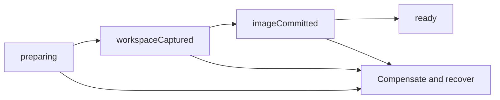

# Cold snapshots and forks

A snapshot pairs a stopped Docker container image with an immutable Task
Workspace checkpoint. The image preserves system packages, global installs and
home-directory files. The checkpoint preserves the host-mounted workspace,
including tracked, untracked, ignored and generated files, empty directories
and file modes.

An active agent or task turn returns `snapshot_busy`. This feature captures
filesystem state only: memory, running processes, services, sockets and tmpfs
are not restored. Git administration is reconstructed from the pinned base;
the source worktree's `.git` pointer must never become the fork's pointer.
The checkpoint manifest records reconstructed metadata and declared exclusions.

## Host API

All commands use the Host's deployment identity and workspace authorization.
Caller-provided Docker labels are not ownership evidence.
The Docker driver records acquisition receipts for runtime ownership. A runtime
created before this feature must be acquired again before it can be snapshotted.

| Command                    | Input                                                                                       | Result                                                                     |
| -------------------------- | ------------------------------------------------------------------------------------------- | -------------------------------------------------------------------------- |
| `sandbox_snapshot_create`  | `request` with `projectId`, `workspaceId`, `provider`, `containerId`, optional `exclusions` | Snapshot record                                                            |
| `sandbox_snapshot_list`    | `projectId`                                                                                 | Snapshot records                                                           |
| `sandbox_snapshot_get`     | `snapshotId`                                                                                | Snapshot record                                                            |
| `sandbox_snapshot_delete`  | `snapshotId`                                                                                | Tombstoned snapshot record                                                 |
| `sandbox_snapshot_pin`     | `snapshotId`, `pinned`                                                                      | Updated snapshot record                                                    |
| `sandbox_snapshot_fork`    | `request` with `snapshotId`, `taskId`, `sessionId`                                          | New workspace and container                                                |
| `sandbox_snapshot_restore` | Fork request plus optional `workspaceId`                                                    | Restored workspace and container; `restoredInPlace` identifies the outcome |

The TypeScript adapter lives under `lib/sandbox/`. The response includes the
fork's `portLease`, so a later preview client can resolve a workspace-relative
port offset without retaining the source workspace's port block.

## Capture and failure recovery

The Host records the creation journal in `task-workspaces.sqlite`:



The ledger tables are `workspace_checkpoints`, `sandbox_snapshots`,
`snapshot_artifact_refs` and `snapshot_operations`. A checkpoint owns its Git
ref pin and content storage. The image is named
`cognia-snapshot-<deploymentHash>:<uuid>` and recorded by immutable image ID.
Interrupted operations are reconciled at startup; a partially created snapshot
is not a ready restore source.

Acquisitions share a lock for their canonical workspace root. Snapshot and
restore transitions require an exclusive lock and return `snapshot_busy` if
an acquisition is active. Durable journal reservations protect the workspace
between transitions. Capture, Git pinning, blob writes and materialization run
outside the ledger mutex; publishing rechecks the journal state and current
budget, so unrelated workspaces remain usable during large captures.

The full capture profile fails if any required content exceeds the budget.
It does not apply the normal workspace capture's generated-file filtering.
Exclusions are an explicit request and remain visible in the record and
manifest, so a caller can explain what a restore will omit.
They are workspace-relative paths or directory prefixes; glob patterns and
escaping paths are rejected. Unsupported special files are listed in the
manifest. Git control metadata is rebuilt rather than copied between roots.

## Fork isolation

A fork receives a new task, workspace, execution directory and ADR-0229 port
lease. It reconstructs the recorded Git commit and checkpoint overlay, then
creates a new container from the snapshot image. Source mounts, leases,
sessions, grants and egress bridges are not copied. Network admission is
checked again; an allowlisted fork gets a fresh egress lease.
The injected agent bundle digest is recorded and checked before restoring a
workspace; bundle drift refuses the fork rather than silently substituting
another runtime bundle.

Only `postStart` and `postAttach` hooks run again. Creation and installation
hooks must not overwrite a checkpoint's already-installed filesystem.
In-place restore is allowed only for an archived/restorable workspace;
otherwise the restore operation creates a fork.
During in-place restore, the previous stopped container and image association
remain available for rollback until both the workspace and new runtime succeed.

## Budgets and deletion

`sandboxSnapshotBudgetBytes` is part of the workspace lifecycle policy and
defaults to 1 GiB. It is independent of `blobBudgetBytes`, also defaulting to
1 GiB. Checkpoint data and committed image storage count against the sandbox
snapshot budget. Over-budget creation fails and compensates.

Unpinned snapshots expire after 30 days. Pinning prevents retention expiry.
Deletion tombstones the record, invokes the preview-revocation integration
hook, and removes the image only after runtime, fork and in-flight references
are gone. Checkpoint pins and blobs are released after image removal. Cleanup
is scoped to the current deployment and never invokes `docker system prune`.

Preview links, preview listeners and UI are a separate delivery. Phase 1a
provides the revocation hook and stable snapshot/fork identities they need.

## Providers and verification

Capabilities are separate flags: `filesystemCheckpoint`, `forkFromCheckpoint`,
`pauseResume` and `memoryResume`. Local Docker supports filesystem checkpoints
and forks. E2B retains pause/resume but refuses checkpoint forks with a labelled
unsupported reason until its API is verified. An older Host omitting capability
flags must not be assumed to support snapshots.

The targeted compilation check is:

```sh
cargo check --offline -p cognia-task-workspace -p cognia-sandbox-pool --tests
```

Co-located tests use `FakeContainerApi` for failure paths and isolation checks.
Real-Docker round-trip tests are marked
`#[ignore = "requires a real Docker daemon"]`; their doc comments give the
exact invocation. They require a daemon and are separate from compile and fake
test evidence. The round-trip test uses the preloaded image named by
`COGNIA_TEST_SNAPSHOT_IMAGE` (default `alpine:3.20`) and never pulls it.
Tests that bind sockets cannot run in a socket-restricted
sandbox. Neither set of tests verifies the separate preview UI.

See [ADR-0231](/docs/adr/0231-sandbox-snapshots-join-rootfs-and-workspace).
