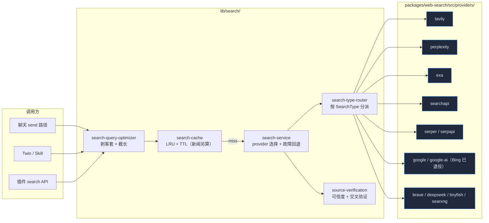

# 搜索系统

Cognia 通过 provider 总线统一提供 AI 联网搜索。上层调用 `search(query, options)`；目录包含十三个 provider（Tavily / Perplexity / Exa / SearchAPI / Serper / SerpAPI / Bing / Google / Google AI / Brave / DeepSeek / TinyFish / SearXNG），Bing 仅保留为已退役记录；不同适配器的搜索类型与安全搜索能力各异。所有 provider 都返回统一的 `SearchResponse` 结构，确保调用方接收一致的结果格式。

应用侧唯一入口是 `lib/search/configured-search.ts:searchWithAppSettings()`；CLI 则注入同形的已解析配置，不依赖 Zustand。该入口统一执行查询优化、PII 脱敏、实时默认参数、安全搜索、Provider 优先与回退、TTL/LRU 缓存、Domain 强过滤、来源可信度策略和用量记录。另有按 Provider 的熔断器（`provider-health.ts`）把近期失败的 provider 排到队尾；每个 provider 的 `defaultOptions` 优先级位于宿主默认值与调用参数之间。底层 Provider 总线位于 `packages/web-search/src/`，上层不再各自实现 HTTP 搜索。

## 总览



## 数据类型

所有 provider 都把自己的原生响应折叠成同一份 `SearchResponse`，定义在 `packages/web-search/src/types.ts`：

```ts title="packages/web-search/src/types.ts"
export type SearchProviderType =
  | "tavily"
  | "perplexity"
  | "exa"
  | "searchapi"
  | "serper"
  | "serpapi"
  | "bing"
  | "google"
  | "google-ai"
  | "brave"
  | "deepseek"
  | "tinyfish"
  | "searxng"

export type SearchDepth = "basic" | "advanced" | "deep"
export type SearchType = "general" | "news" | "academic" | "images" | "videos"
export type SearchRecency = "day" | "week" | "month" | "year" | "any"

export interface SearchResult {
  title: string
  url: string
  content: string
  score: number
  publishedDate?: string
  source?: string
  favicon?: string
  thumbnail?: string
}

export interface SearchResponse {
  provider: SearchProviderType
  query: string
  answer?: string
  results: SearchResult[]
  responseTime: number
  totalResults?: number
  images?: SearchImage[]
}
```

`SearchOptions` 是 provider 通用入参：`maxResults` / `searchDepth` / `searchType` / `includeAnswer` / `includeRawContent` / `includeDomains` / `excludeDomains` / `recency` / `country` / `language` / `safeSearch`。适配器注册表定义可强制执行的安全搜索等级。strict 为强制策略：无法执行的适配器在网络请求前被排除，回退与缓存复用也须符合此约束。Agent 不能放宽宿主的 strict 安全搜索或强制域名策略。moderate 默认为建议级别，除非显式要求强制执行；未执行的建议控制会报告为降级。`UnifiedSearchOptions.preferredProviders` 让用户选中的 Provider 先尝试，同时保留全局优先级回退；`includeDomains` 始终做后置强过滤，没有合规 URL 的响应不会被视为成功。

## 统一搜索入口

```ts title="packages/web-search/src/search-service.ts"
export async function search(
  query: string,
  options: UnifiedSearchOptions = {}
): Promise<SearchResponse> {
  const { provider, fallbackEnabled = true, providerSettings, ...searchOptions } = options
  // 1. 取出启用的 provider 列表
  // 2. 如果指定 provider，把它放队首，其余作为 fallback
  // 3. 依次尝试，第一个成功的返回，失败累积到 lastError
  // 4. 每次尝试都通过 recordUsage() 写回设置 store 做用量统计
}
```

三个对外门面：

- `search(query, opts)` — 主入口；指定 provider 时也允许故障回退。
- `autoSearch(query, providerSettings, opts)` — 不传 provider，按优先级自动挑。
- `searchWithProvider(provider, query, apiKey, opts)` — 一次性调用，不读全局设置。
- `aggregateSearch(query, providerSettings, opts)` — 并行打所有启用的 provider，结果按 URL 归并去重，按 `score` 重新排序后保留 top 20。

故障回退同时覆盖 Provider 报错和无法满足 Domain 强约束的响应。桌面与 Web 调用方应使用 `searchWithAppSettings()`，从而保证缓存命中不会再次发起 Provider 请求或重复计费。

`search()` 按优先级合并每次尝试的参数——宿主 `baseOptions` < provider 的 `defaultOptions` < 调用方显式字段（显式的 `undefined` 占位会被剥掉，不会覆盖下层值）——并查询共享的内存熔断器（`provider-health.ts`）：连续失败超过阈值的 provider 被排到队尾，冷却期满后允许一次半开探测，成功即闭合。持久化调参（`searchProviderHealth`——enabled / failureThreshold / cooldownMs，按 `SEARCH_PROVIDER_HEALTH_LIMITS` 收敛）在每次配置化调用时推入熔断器；缓存 key 会摘要每个候选 provider 的 `defaultOptions`，改动 override 即让相关条目失效。

## 查询优化

用户消息常包含「请帮我看看」「我想了解一下」等客套表达。直接将这些表达提交给搜索引擎会降低召回效果。`search-query-optimizer.ts` 负责以下四项处理：

1. **填充词剥离** —— 中英文头尾的 please/帮我/谢谢之类按正则去掉。
2. **意图保留** —— 检测 `what/how/why/?/什么/如何/?` 之类，保留疑问形态。
3. **截断** —— `MAX_QUERY_LENGTH = 300`；先尝试抽核心句、再退到首句、再退到按词边界截断。
4. **空白清理** —— 多空格折叠。

```ts title="lib/search/search-query-optimizer.ts"
export function optimizeSearchQuery(message: string): string {
  if (!message || message.trim().length === 0) return ""
  const query = message.trim()
  if (query.length <= MAX_QUERY_LENGTH) return cleanQuery(query)
  // 长 query 三级降级：核心句 → 首句 → 按词截
}
```

调用方一般在送给 `search()` 之前调一次 `optimizeSearchQuery(userMessage)`；不需要的场景（程序生成的 query）直接绕过。

## 缓存

`search-cache.ts` 实现了 LRU + TTL 的搜索结果缓存：

- 默认 `defaultTTL = 5 min`；`searchType === "news"` 时缩到 `newsTTL = 1 min`。
- Key 由 query / provider 顺序 / maxResults / type / depth / recency / safe search / answer / rawContent / language / country / domain filter 组合哈希得到。
- 缓存条目保留 Provider 元数据，设置页通过 `invalidateProvider(provider)` 精确清理，不再匹配不可读哈希。
- `CacheStats` 暴露 `hits / misses / hitRate`，调试时可见。

应用绑定在每次使用前应用最新 TTL 和容量；非应用宿主仍可选择不挂缓存。

## 类型路由

`packages/web-search/src/search-type-router.ts` 的 `getEffectiveSearchCapabilities()` 是界面能力标签和适配器资格判断的来源。显式不支持的搜索类型、引擎或强制安全搜索等级在请求前失败，不会静默降级为 general。SearchAPI、SerpAPI 使用描述符定义的引擎；SearXNG 接受实例定义且匹配 `SEARXNG_ENGINE_PATTERN` 的引擎名。未覆盖时 `resolveEngine()` 保留服务商默认引擎。Google AI 模型选项来自 `GOOGLE_AI_GROUNDING_MODELS`，默认值为 `GOOGLE_AI_DEFAULT_MODEL`。

## Provider 接入

每个 provider 都遵循同样的文件结构：

```
packages/web-search/src/providers/<name>.ts
├── searchWith<Name>(query, apiKey, options)        // general
├── searchNewsWith<Name>(...)                       // 可选
├── searchImagesWith<Name>(...)                     // 可选
├── searchVideosWith<Name>(...)                     // 可选
├── searchScholarWith<Name>(...)                    // 可选
└── test<Name>Connection(apiKey)                    // 设置页的连通性按钮
```

对应测试文件 `<name>.test.ts` 用 `vi.mock(global.fetch)` 验证 HTTP 调用形态 + 响应解析。所有 provider 共同跳过 `playwright-scraper`（依赖 Node-only Puppeteer，不适合 `output: "export"` + Tauri webview）。

### Provider 一览

| Provider     | 生命周期                              | 认证                          | 实际搜索类型                            | 可强制安全搜索        |
| ------------ | ------------------------------------- | ----------------------------- | --------------------------------------- | --------------------- |
| `tavily`     | 活跃                                  | API key                       | general、news                           | off、moderate、strict |
| `perplexity` | 活跃                                  | API key                       | general                                 | 无                    |
| `exa`        | 活跃                                  | API key                       | general、news、academic                 | 无                    |
| `searchapi`  | 活跃                                  | API key                       | general、news、images、academic         | off、moderate、strict |
| `serper`     | 活跃                                  | API key                       | general、news、images、videos、academic | 无                    |
| `serpapi`    | 活跃                                  | API key                       | general、news、images                   | off、moderate、strict |
| `bing`       | 2025-08-11 已退役                     | 保留已存 key                  | 不可用                                  | 无                    |
| `google`     | Legacy；2027-01-01 结束；不接受新客户 | API key + cx                  | general、images                         | off、moderate、strict |
| `google-ai`  | 活跃                                  | API key + grounding 模型选项  | general                                 | 无                    |
| `brave`      | 活跃                                  | API key                       | general、news、images、videos           | off、moderate、strict |
| `deepseek`   | 活跃；默认关闭                        | API key                       | general                                 | 无                    |
| `tinyfish`   | 活跃；默认关闭                        | API key                       | general、news、academic                 | 无                    |
| `searxng`    | 活跃；默认关闭                        | 实例端点（baseUrl），无需 key | general、news、academic、images、videos | off、moderate、strict |

能力描述的是已安装的适配器，不保证某个账户或 SearXNG 实例启用了全部引擎。Bing 显示退役标签，不允许启用、编辑或测试，并保留存储的密钥。服务商状态区分已退役、已禁用、缺少密钥、缺少配置与已配置；已配置不代表在线。

SearXNG 端点必须为绝对 URL，不得包含凭据、查询参数或片段。公共端点必须使用 HTTPS。只有私有/回环主机且明确开启「允许私有/HTTP 端点」授权时才能使用 HTTP；私有 HTTPS 同样需要此授权。适配器保留有效部署路径并追加 `/search`，不会静默替换为公共实例。

## Search 与 Reader 独立配置

设置 → 搜索包含独立的「服务商」与「阅读」面板，各自提供「测试搜索」和「测试阅读器」。启用搜索不会启用阅读器。即使服务商的 Search 开关关闭，Reader 仍可复用该服务商已存的 key。Cognia fetch 不依赖搜索服务商；Cognia Search 需要已配置且符合策略的服务商。

工具设置分别控制「优先使用 Cognia 搜索」和「优先使用 Cognia 获取网页」。操作选项缺失时继承旧的 `preferCognia` 值。`resolveWebAccess()` 按各自原生能力与偏好解析路由，输入框独立显示 Search 与 Fetch。能力总开关和当前轮次关闭仍优先生效。

### 阅读器、接收方与费用

| 阅读器      | 接收方                           | 费用与凭据                                           |
| ----------- | -------------------------------- | ---------------------------------------------------- |
| `direct`    | Cognia 自行请求原始网站          | 无阅读服务商 key 或 API 费用                         |
| `platform`  | 微信 / YouTube 原始网站          | 无第三方阅读器或 key                                 |
| `fxtwitter` | FxTwitter；页面 URL 发给该第三方 | 无需 key 的第三方阅读器                              |
| `jina`      | Jina；页面 URL 发给该第三方      | 无需 key 的第三方阅读器；受服务限制                  |
| `tavily`    | Tavily                           | 复用 Tavily Search key；由用户的 Tavily 账户付费     |
| `exa`       | Exa                              | 复用 Exa Search key；由用户的 Exa 账户付费           |
| `deepseek`  | DeepSeek                         | 复用 DeepSeek Search key；由用户的 DeepSeek 账户付费 |
| `tinyfish`  | TinyFish                         | 复用 TinyFish Search key；由用户的 TinyFish 账户付费 |

远程阅读器明确说明「您阅读的页面会发送至服务商」，不重复设置密钥字段。缺少密钥时显示不可用并提供返回对应搜索卡片的链接。上移/下移按钮调整远程回退顺序并支持键盘操作，默认阅读器可选 auto 或指定 ID。auto 先尝试适用的原站/平台及直接阅读，仅在允许外部回退时按优先级尝试已启用且已配置的远程阅读器。严格指定的阅读器不会静默切换。私有目标、raw/非 GET、请求体及调用方目标请求头走受保护的直接通路，不转发给云阅读器；认证或付费墙失败不能成为通过其他阅读器绕过访问控制的理由。

### 新安装与升级默认值

- 新安装：direct、platform 开启；所有远程阅读器关闭；`externalFallback: off`；`distillation: off`。
- 已有设置行但无 `webReader` 的升级：保留 direct、platform、FxTwitter、Jina 的兼容资格（Jina 仅限宿主可达时），外部回退保持 configured；不会推断或启用任何付费服务商阅读器。旧 `alwaysDistill: true` 转为 required。这里保留的是资格，并非历史使用证据。
- 显式 version-1 记录具有权威性。未知未来版本原样保留但不启用；界面显示兼容配置，第一次保存阅读器更改前要求确认替换。
- 新增 DeepSeek、TinyFish、SearXNG 搜索服务商保持关闭，直到用户主动配置并启用。

### 蒸馏模式

| 模式          | 后果                                                                         |
| ------------- | ---------------------------------------------------------------------------- |
| `off`         | 返回提取文本；明确的问题仍可触发尽力蒸馏                                     |
| `best-effort` | 尝试辅助模型；不可用或失败时返回标记为未蒸馏的文本                           |
| `required`    | 没有辅助模型或蒸馏结果时拒绝返回；禁用 raw、非 GET、请求体及调用方目标请求头 |

Agent 不能关闭 required 策略。蒸馏经过已有模型预算与 PII 门禁，可能在服务商阅读费用之外产生模型费用。

### 预算、宿主限制与测试

`packages/web-search/src/operation-policy.ts` 规定：Search 总预算 30 秒，阅读总预算 60 秒，每次阅读器尝试最多 20 秒，每次操作最多 3 次适配器尝试（含重试与回退）。每个 scope 允许 2 个并发 Search 和 2 个并发阅读，各操作类型最多排队 8 个。阅读缓存 TTL 为 5 分钟，复用仍受当前策略与 scope 约束。

普通浏览器受 CORS 限制，无法使用 Jina、FxTwitter 和原站平台阅读；direct 与服务商端点也取决于宿主传输和 CORS 条件。Tauri 与 CLI 使用各自的传输路径。Capacitor 上取消会停止等待并抑制迟到结果，但已发出的原生请求可能继续完成；取消不撤回服务商工作，也不保证退款。

加载、保存和迁移均不会自动运行连接测试或探测。只有明确点击才执行有预算且可能计费的测试。Search 与 Reader 独立显示结果和时间，「测试时间」只证明该次尝试，不保证持续可用；搜索成功不代表阅读成功。

### Provider fetch 包装

`proxy-search-fetch.ts` 每次请求都通过 `setWebSearchRuntimeAdapters` 解析宿主安装的传输适配器。桌面使用 Rust `proxy_http_request` 桥接；没有宿主适配器时使用 `fetch`。开发模式下 `createSearchProviderFetch(providerName)` 会打印请求/响应耗时，帮助定位慢调用。

## 来源可信度与交叉验证

搜出来的结果不见得都靠谱 —— `source-verification.ts` 给每条 `SearchResult` 单独打分：

```ts title="packages/web-search/src/source-verification.ts"
export type CredibilityLevel = "high" | "medium" | "low" | "unknown"

export type SourceType =
  | "government"
  | "academic"
  | "news"
  | "encyclopedia"
  | "official"
  | "social"
  | "blog"
  | "forum"
  | "ecommerce"
  | "unknown"

export interface SourceVerificationResult {
  url: string
  domain: string
  credibilityLevel: CredibilityLevel
  credibilityScore: number // 0..1
  sourceType: SourceType
  isHttps: boolean
  domainAge?: string
  trustIndicators: string[]
  warningIndicators: string[]
}
```

分类的依据：

- **域名后缀** —— `.gov` / `.edu` / `.gov.cn` / `.ac.uk` 直接 `high`；`.com` 看具体 domain；社交平台（twitter / reddit）归 `social` + `low`。
- **协议** —— HTTPS 加分。
- **trust indicators** —— 已知白名单（Wikipedia、Nature、MIT）入 `high`。
- **warning indicators** —— 已知低质域名（content farm、过期 SSL）打入 `low`。

`CrossValidationResult` 把多条结果交叉比对，找支持 / 反对 / 中立证据，给出 `consensusLevel`（`strong / moderate / weak / conflicting`）。这一层主要面向有事实核查需求的 skill，不是所有调用方都必须接。

## 用量统计

`search-service.ts` 里每次调用 provider 都触发：

```ts
void recordUsage(providerConfig.providerId, Date.now() - startTime, true /* or false */)
```

`recordUsage` 调用尽力上报的 `setSearchUsageReporter` 接口，由 `lib/search/search-service.ts` 的应用门面安装更新设置 store 的 reporter；包本身不导入 Zustand。reporter 失败不阻塞操作。计数表示尝试次数，不等于服务商账单。这条数据后续在 Settings → 搜索 provider 列表里以 "请求数 / 失败率 / 平均响应时间" 形式呈现。

## 与上层集成

搜索系统不是独立的 UI 表面，而是被这些位置消费：

- **会话预搜索** —— Composer 只调用一次统一执行器，将结果按不可信外部内容包装后送入模型，并在最终 Assistant 消息中持久化为可点击的 `cognia-web` 来源。
- **独立搜索页** —— `/search` 向共享回答管线注入统一执行器；来源正文进入云端综合模型前完成 PII 脱敏和不可信内容包装。
- **Agent 工具** —— 提升后的 `web_search` 复用同一执行器。`web_fetch` 继续复用 SSRF、平台 Reader、HTML 提取、Jina 回退和缓存，并对出站请求字段及云端摘要正文执行 PII 闸门。
- **Deep Research** —— 保留搜索→阅读→推理状态机，搜索和页面读取委托给共享实现；旧 Exa/Tavily 插件密钥只作为兼容配置。
- **CLI** —— 按环境变量 → credentials → 项目配置 → 用户配置解析搜索凭据，不依赖桌面进程或 renderer store；原生 Search 与 Fetch 可用时分别优先，除非对应操作明确选择 Cognia 偏好。

“研究来源”区分 Provider 偏好与 Domain 约束：Wikipedia、arXiv、GitHub、Stack Overflow 是内置 Domain，自定义项必须提供有效 URL/域名。Provider 允许失败后回退，Domain 始终严格生效。

设置 UI 在 Settings → 搜索 provider 下：每个 provider 一张卡片（生命周期 / 认证 / 引擎或模型 / 优先级 / `defaultOptions` / 显式搜索测试及带日期的 key 池结果），以及独立的「阅读」面板，另有「性能」面板调熔断器参数、「诊断」面板展示各 provider 的实时熔断状态、成功率、平均延迟以及单个/全局重置。

## 关联文档

<Cards>
  <Card title="存储" href="./storage" description="Dexie schema 里的搜索设置位置" />
  <Card title="向量库" href="./vector-store" description="向量检索 vs. web 搜索的分工" />
  <Card title="聊天与技能" href="../chat/chat-and-skills" description="send 路径如何拼搜索结果" />
  <Card title="文档处理" href="./document-processing" description="本地文档解析；与 web 搜索互补" />
</Cards>

## 在哪里入手

| 目标                 | 文件                                                                                                                                                                  |
| -------------------- | --------------------------------------------------------------------------------------------------------------------------------------------------------------------- |
| 新增一个 provider    | `packages/web-search/src/providers/<name>.ts` + `providers/index.ts` 导出 + `search-service.ts` 的 `testProviderConnection` switch + `search-type-router.ts` 的能力表 |
| 改默认 fallback 顺序 | 调整 `getEnabledProviders` 的优先级比较（在 `packages/web-search/src/types.ts`）                                                                                      |
| 加新的 SearchType    | 在 `types.ts` 扩 union + `search-type-router.ts` 加分派 + 各 provider 是否支持                                                                                        |
| 调缓存 TTL           | `search-cache.ts:SearchCacheOptions` 默认值                                                                                                                           |
| 调熔断器             | `provider-health.ts` + `types.ts` 里的 `SEARCH_PROVIDER_HEALTH_LIMITS` 边界；持久化形状 `searchProviderHealth`                                                        |
| 改可信度评分         | `source-verification.ts` 的域名表 + 评分函数                                                                                                                          |
