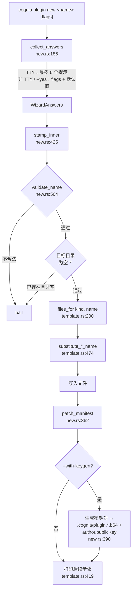

# 脚手架 —— `cognia plugin new`

<TLDR>
  `run()`（`crates/cognia-cli/src/commands/new.rs:44`）收集答案（TTY 上走交互式向导，否则用
  flags + 默认值），**复制**一个内嵌模板（`files_for`，`crates/cognia-cli/src/engine/template.rs:200`
  —— 每个文件都通过 `include_str!` 从六个同级模板源码目录打包进二进制），把向导答案**写入**生成的
  `plugin.json`（`patch_manifest`，`new.rs:362`），并可选地**内嵌一把全新的 Ed25519 公钥**
  （`embed_public_key`，`new.rs:390`）。替换就是每个文件两次普通的 `String::replace` —— 模板 ID
  与可读标题。目标目录非空时，命令拒绝创建项目。
</TLDR>

## 流程



## 输入与默认值

向导只在 TTY 上且未传 `--yes` 时运行；已经通过 flag 提供的字段不会再问。

| 输入 | Flag | TTY 向导 | 非 TTY / `--yes` 默认值 |
| --- | --- | --- | --- |
| name | 位置参数 | 提示（若 CWD basename 合法则作为建议） | **必填** —— 带提示退出 |
| kind | `--kind ts\|glance\|wasm\|python\|hybrid\|vscode-extension` | 选择，0 = ts | `ts` |
| dir | `--dir <path>` | — | `./<name>` |
| description | `--description` | 带建议的提示 | `"A cognia {kind 标签} plugin"` |
| author | `--author` | 以 `git config user.name` 为默认 | `git config user.name`，没有则 `"Anonymous"` |
| author email | `--author-email` | 可选提示 | 省略 |
| keygen | `--with-keygen true\|false` | 确认，默认 **true** | `false`（不会在未要求时生成密钥） |

`TemplateKind::parse`（`template.rs:24`）也接受 `typescript` / `frontend` 作为 `ts` 的别名，
`glance-module` 作为 `glance` 的别名，`py` 作为 `python` 的别名，以及 `vscode` / `vs-code` 作为
`vscode-extension` 的别名。

### 名称校验

`validate_name`（`new.rs:564`）：最多 64 个字符，以小写 ASCII 字母或数字开头和结尾，中间允许小写字母、
数字以及 `-`、`_`、`.`。失败信息：

```text
plugin name is empty
plugin name must be ≤ 64 characters
plugin name must be lowercase alphanumeric plus -_. (got `…`)
```

`"0plugin"` 与 `"foo.bar_1"` 通过；`"has space"`、`"!banged"`、`"Uppercase"`、`"trailing-"`、
`"trailing_"` 与 `"trailing."` 失败（单元测试在 `new.rs` 中）。

## 模板是内嵌的同级源码

模板源码以同级目录形式放在 `crates/` 下：

| Kind | 源码目录 |
| --- | --- |
| `ts` | `cognia-plugin-template-ts/` |
| `glance` | `cognia-plugin-template-glance/` |
| `wasm` | `cognia-plugin-template/` |
| `python` | `cognia-plugin-template-python/` |
| `hybrid` | `cognia-plugin-template-hybrid/` |
| `vscode-extension` | `cognia-plugin-template-vscode-extension/` |

它们通过 `include_str!` 拉进二进制（`template.rs` 中每种 kind 一个 `pub mod`）。CLI 不附带任何模板
目录；脚手架可离线工作。

两种 TypeScript 模板还会在 `types/` 下得到**内置的 `@cognia/*` 声明**（`author_type_files`，
`template.rs:183`，由 `crates/cognia-cli/assets/author-types.json` 展开）。`@cognia/*` 包都没有发布，
所以脚手架通过 `tsconfig.json` 的 `paths` 指向这些文件来解析 `@cognia/plugin-sdk` 与
`@cognia/plugin-ui`；`build` 让两者保持 external，运行时由宿主提供自己的实例。用
`pnpm author-types:bundle` 重新生成这个声明包；已有项目用 `cognia plugin sync-types` 刷新。

替换刻意保持简单（`template.rs:474`）：

```rust
fn substitute_ts_name(content: &str, target_name: &str) -> String {
    content
        .replace("cognia-plugin-template-ts", target_name)
        .replace("Cognia Plugin Template TS", &humanize(target_name))
}
// humanize: "my-cool-plugin" → "My Cool Plugin"（按 -_ 拆分 → 首字母大写）
```

WASM 版本还会改写下划线形式的产物名（`cognia_plugin_template` → `my_plugin`），因为
cargo-component 会把 `-` 规范化为 `_`，而 `wasmMain` 必须指向实际产出的 `.wasm`。

description / author / publicKey **不是**模板占位符 —— 它们在事后由 `patch_manifest` 写入生成的
`plugin.json`：重新读取、修改并美化输出 JSON。

## 每种 kind 生成什么

| Kind | 文件 |
| --- | --- |
| TypeScript | `package.json`、`pnpm-workspace.yaml`、`tsconfig.json`、`jest.config.cjs`、`plugin.json`、`src/index.ts`、`src/index.test.ts`、`src/panel.tsx`、`src/panel.test.tsx`、`src/panel.css`、`src/__stubs__/plugin-sdk.ts`、`src/__stubs__/plugin-ui.tsx`、`README.md`、`.gitignore`，以及内置的 `types/` |
| 速览模块 | `package.json`、`pnpm-workspace.yaml`、`tsconfig.json`、`jest.config.cjs`、`plugin.json`、`src/index.ts`、`src/index.test.ts`、`src/__stubs__/plugin-sdk.ts`、`README.md`、`.gitignore`，以及内置的 `types/` |
| WASM | `Cargo.toml`、`src/lib.rs`、`wit/world.wit`、`plugin.json`、`README.md`、`.gitignore` |
| Python | `plugin.json`、`main.py`、`README.md`、`.gitignore` |
| Hybrid | `plugin.json`、`frontend/index.js`、`backend/main.py`、`styles.css`、`README.md`、`.gitignore` |
| VS Code extension | `plugin.json`、`package.json`、`extension/out/extension.js`、`styles.css`、`README.md`、`.gitignore` |

每个模板都忽略 `.cognia/`（`--with-keygen` 把私钥写在这里），有测试遍历所有 kind 检查这一点。另有两个
测试保证每个模板的 manifest 名副其实：每个声明的能力都有非空的贡献字段、每个非空字段都声明了对应能力
（配对关系来自生成的 `CAPABILITY_FIELDS`），并且每个申请的权限都是已知权限且带有
`permissionJustifications` 说明。

### TypeScript 脚手架要点

`plugin.json` 声明 `type: "frontend"`、`main: "dist/index.js"`、`activationEvents: ["onStartup"]`，
并为每个能力提供一项贡献：

| 能力 | 贡献 | 在 `src/index.ts` 中的实现 |
| --- | --- | --- |
| `tools` | `tools[]`：`template_echo` | `ctx.agent.registerTool` |
| `commands` | `commands[]`：`template-greet` | `hooks.onCommand` |
| `quick-action` | `quickActions[]`：从命令面板、输入框菜单和托盘派发 `template-greet` | 无，复用上面的命令 |
| `configuration` | `configSchema`：问候前缀、回显大写 | `ctx.settings.get` / `ctx.settings.onChange`、`hooks.onConfigChange` |
| `workflow` | `workflows.nodes[]`：`action.echo` | `ctx.workflow.registerNode` |
| `workflow-trigger` | `workflows.triggers[]`：`trigger.ticker` | `ctx.workflow.registerTrigger` |

它还挂载一个 UI 插槽（`src/panel.tsx`，由 `extension:ui` 权限而非能力控制），样式在 `src/panel.css`
（manifest `styles`），在 `ctx.storage` 里保存一个计数，并用 `ctx.lifecycle.onDispose` 注册清理。
四个权限（`extension:ui`、`theme:read`、`settings:read`、`extension:workflow`）都附有说明。
`src/index.ts` 在内联 manifest 里重复了能力列表，因为宿主会用模块的 manifest 覆盖文件里的；有测试锁定
两份列表一致。

`build` 脚本是 esbuild，并把宿主的共享模块保持为 external：

```json
"build": "esbuild src/index.ts --bundle --format=cjs --platform=neutral --target=es2022 --outfile=dist/index.js --external:react --external:react/jsx-runtime --external:react/jsx-dev-runtime --external:@cognia/plugin-sdk \"--external:@cognia/plugin-sdk/*\" --external:@cognia/plugin-ui --external:lucide-react --log-level=info"
```

`react-dom` 故意不设为 external：它不是共享模块。`pnpm audit:plugin-externals` 让这份列表与宿主白名单
和 CLI 自己的构建器保持一致。Jest 会真实解析 `@cognia/*`，所以 `jest.config.cjs` 把两个说明符映射到
`src/__stubs__/`，其中只包含模板在运行时导入的值。模板的 `package.json` 声明了内置声明会导入的每个已发布
包（`ai`、`zod`、`dexie`、`valibot`、`react`、钉在宿主版本上的 ACP SDK 等），且从不依赖任何
`@cognia/*` 包。

### 速览模块脚手架要点

一个 TypeScript 前端插件，唯一的贡献是托盘面板里的速览模块（ADR-0225 §6）。
`plugin.json` 声明 `capabilities: ["glance", "commands"]`、一个 `glanceModules` 条目（计数器，标题取自
清单自带的 `i18n.locales`，含中英文），以及它的按钮要运行的两个命令。`src/index.ts` 用
`ctx.glance.update` 发布数据，在 `ctx.glance.onVisibilityChange` 和语言切换时重新发布，在
`hooks.onCommand` 里响应按钮，并把计数保存在 `ctx.storage` 中。没有 React 面板：模块由宿主绘制。
模板的 `package.json` 列出与 TypeScript 模板相同的已发布包，因为内置的 SDK 声明会导入它们；
`template.rs` 中的单元测试锁定"这些声明导入的每个包都已声明"，`pnpm sdk:scaffold:test` 会对两种
TypeScript 模板执行安装、类型检查、测试、构建和 lint。

`cognia plugin lint` 会跳过内置的 `types/` 声明包（以 `types/cognia-plugin-sdk.d.ts` 为标记），其中对
`@cognia/provider-types` 的内部引用属于 SDK 自身的结构，与 CI 中
`scripts/plugin/check-author-imports.mjs` 的规则一致。

### WASM 脚手架要点

manifest 钉住宿主路由所依据的契约：

```json
{
  "type": "wasm",
  "capabilities": ["tools", "workflow"],
  "wasmMain": "cognia_plugin_template.wasm",
  "wasm": { "apiVersion": "0.2.0", "memoryLimitMb": 16, "callTimeoutMs": 5000 },
  "permissions": ["notification", "secrets:read", "extension:workflow"],
  "engines": { "cognia": ">=0.4.0" }
}
```

`src/lib.rs` 实现 WIT world 中的 `Guest` trait —— `init`、`on_event`、`tool_execute`、
`workflow_node_execute` —— 通过宿主的 `logger` 导入记录日志并回显载荷，所以新生成的脚手架从头到尾都可观测。
`Cargo.toml` 带有 `[package.metadata.component]` 块（`package = "cognia:plugin"`、
`world = "cognia-plugin"`）以及按体积调优的 release profile（`opt-level = "s"`、`lto = true`、
`codegen-units = 1`）。

### Python 脚手架要点

`plugin.json` 声明 `type: "python"`、`capabilities: ["tools", "python", "context-panel"]`、
`pythonMain: "main.py"`、`engines.python: ">=3.10"`，以及一个面向会话的 A2UI 上下文面板。`main.py`
按宿主调用的顺序演示：模块级生命周期函数（`on_startup` / `on_config_updated` / `on_shutdown`）、一个纯
`@tool`（`template_echo`）和一个通过 `cognia.ctx` 访问宿主的工具（`template_note`，因为 `ctx` 调用是协程，
所以是 `async def`）、`get_config()`、以 0-100 百分比报告的 `progress()`，以及面板：由
`template_build_panel` 用 `ctx.a2ui` 推送组件树，在 `onA2UIDataChange`（输入）与 `onA2UIAction`（点击）
上响应。

宿主在导入 `main.py` 之前注入它自己的 `cognia` 模块；不会从 PyPI 安装任何东西。本地类型检查和测试请使用
`plugin-sdk/python` 下的 SDK。没有构建步骤：`cognia plugin build` 直接打包 `pythonMain` 和
`bundle_include[]` 中的文件。

### Hybrid 脚手架要点

`plugin.json` 声明 `type: "hybrid"`、`capabilities: ["tools", "python", "commands"]`、
`main: "frontend/index.js"`、`pythonMain: "backend/main.py"` 与 `styles: "styles.css"`。两半互相调用：
前端注册 `template_word_count` 工具，并在 `onCommand` 中响应清单里的 `/template-wordcount` 命令，两者都用
`ctx.python.call("word_count", …)` 计算，而它只是 `backend/main.py` 里的一个普通函数；后端自己的
`@tool` 注册 `template_echo`。前端入口是纯 CommonJS，可以用 `node --check` 做语法检查，无需 npm install
即可加载。

### VS Code-extension 脚手架要点

`plugin.json` 声明 `type: "vscode-extension"`、`vscodeMain: "extension/out/extension.js"`、`styles` 与
`bundle_include: ["package.json"]`。`package.json` 贡献一个命令（`cogniaPluginTemplate.hello`）和一个
设置。入口导出 CommonJS 的 `activate` / `deactivate`，并通过 `require("vscode")` 注册该命令，符合 sidecar
的扩展运行器契约。

## 生成后的输出

打印的后续步骤（`next_steps`，`template.rs:419`）：

```text
# ts / glance                            # wasm                                    # python
cd <dir>                                 cd <dir>                                  cd <dir>
pnpm install                             rustup target add wasm32-wasip2           python -m py_compile main.py
pnpm test                                cargo install --locked cargo-component    cognia plugin doctor
cognia plugin doctor                     cognia plugin doctor                      cognia plugin lint
cognia plugin lint                       cognia plugin lint                        cognia plugin build
cognia plugin build                      cognia plugin build

# hybrid                                 # vscode-extension
cd <dir>                                 cd <dir>
node --check frontend/index.js           node --check extension/out/extension.js
python -m py_compile backend/main.py     cognia plugin doctor
cognia plugin doctor                     cognia plugin lint
cognia plugin lint                       cognia plugin build
cognia plugin build
```

速览模块会多一行提示：安装并启用后，打开托盘面板，选择**编辑**，然后添加该模块。

使用 `--with-keygen` 时，CLI 会确认 `✓ embedded author.publicKey (…)` 并指向
`.cognia/plugin.private.b64` —— 与 [`keygen`](./signing-and-keys) 生成的文件相同。`--json` 会把以上
输出替换为一份机器可读报告（插件 id、类型、模板 kind、目录、文件、密钥路径）。

<Callout type="warn" title="已有目录永远不会被合并">
  `stamp_inner()` 会以 `"<path> already exists and is not empty"` 退出。没有 `--force`；请换一个目录或
  先清空目标目录。
</Callout>
