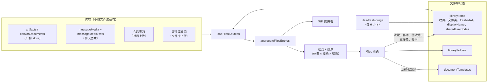

# 文件

<Status variant="beta">桌面端、网页端与手机（独立和配对模式）已交付 · 工作区文件待实现（ADR-0223 §8）</Status>

<TLDR>
  `/files` 把对话产生的所有内容，以及直接上传到文件库的文件，集中到一个可以管理的地方。内容仍留在各自的存储中
  （产物、画布文档、聊天图片、对话上传）。文件库只在其上增加自己的状态——收藏、文件夹、回收站、显示名称、链接标记——
  存在两张表里，并通过持有引用而不是复制来让条目的字节保持存活。
</TLDR>

决策记录：[ADR-0200](/docs/adr/0200-files-is-a-view-that-keeps-what-you-keep)（聚合视图与靠引用保留）和
[ADR-0223](/docs/adr/0223-files-is-a-space-you-manage)（可管理的空间）。文件链接依托
[ADR-0222](/docs/adr/0222-a-conversations-files-are-a-view-and-sharing-them-is-a-grant)。

## 子系统全貌

## 位置 × 视角

二级侧栏放的是**位置**：全部、五个类型分组（文档、产物、图片、视频、上传）、最近（五项，之后是“显示更多”）、
文件夹树和回收站。列表上方的一排**视角**——推荐、收藏、我的、AI 生成、与我共享——可以和任意位置组合。
回收站忽略视角，并隐藏视角栏。

| 视角 | 显示 | 默认排序 |
| --- | --- | --- |
| 推荐 | 全部 | 本地推荐分（[数据](/docs/subsystems/files/data#推荐)） |
| 收藏 | 已收藏的条目 | 收藏时间 |
| 我的 | 本人创建、且不是别人共享进来的 | 最近活动 |
| AI 生成 | Agent 创建、且不是别人共享进来的 | 最近活动 |
| 与我共享 | 来自别人共享的协作对话 | 最近活动 |

列表视图中点击列标题会覆盖默认排序（见[管理](/docs/subsystems/files/management#列表与排序)）。

## 条目类型

| 类型 | 来源 | 每张卡片对应 |
| --- | --- | --- |
| `artifact` | `artifacts` | 一个产物 |
| `canvas` | `canvasDocuments` | 一个文档（不在任何对话中创建的文档属于 `standalone`） |
| `image` | `messageMedia` | 一个规范图片哈希，无论有多少对话显示它 |
| `session-upload` | 会话资源 | 一个原始内容哈希，无论它被附加到多少对话 |
| `upload` | 文件库资源 | 直接上传到文件库的文件（归文件库所有） |

生成的视频不是单独的类型：生成任务产出的视频，会把任务记录附在它本来所在的上传卡片上。

## 代码位置

| 关注点 | 模块 |
| --- | --- |
| 行类型、条目类型、保留规则 | `lib/db/files-library-types.ts` |
| 条目写入、固定引用、回收站、分享短码 | `lib/db/files-library-items.ts` |
| 文件夹 | `lib/db/files-library-folders.ts` |
| 加载器 | `lib/files-library/sources.ts` |
| 聚合（纯函数） | `lib/files-library/aggregate.ts` |
| 位置、视角、筛选、排序 | `lib/files-library/filter.ts`、`types.ts`、`suggest.ts` |
| 回收站清理 | `lib/files-library/trash.ts`、`trash-purge-schedule.ts` |
| 重命名、复制副本、zip、上传、下载 | `lib/files-library/{rename,duplicate,export-zip,upload,download}.ts` |
| 拖放、键盘、深度链接 | `lib/files-library/{dnd,keyboard,deep-link}.ts` |
| 分享 | `lib/files-library/share.ts` |
| 文档模板 | `lib/document-templates/`、`lib/db/document-templates.ts` |
| 页面与对话框 | `components/files-library/` |
| 手机布局 | `components/files-library/mobile/` |
| 选用哪个文件库（本地或配对主机） | `hooks/files-library/files-backend.tsx`、`use-remote-files-backend.ts`、`lib/files-library/ops.ts` |
| 配对主机的命令、客户端与字节 | `lib/files-library/remote/` |
| 页面模型（两种布局共用） | `hooks/files-library/use-files-page.ts`、`use-files-deep-link.ts` |
| Hooks | `hooks/files-library/`、`hooks/document-templates/` |
| Store | `stores/files-library/files-library-store.ts` |
| ⌘K | `lib/global-search/providers/files.ts` |

## 尚未交付

ADR-0223 已接受，还有一部分待实现，需要主机端的 Rust 改动。

- **工作区文件（§8）。** 目前没有 `workspace-file` 类型，也没有“工作区文件”分组：类型分组就是上面五个。

## 页面

- [数据](/docs/subsystems/files/data)：表结构、保留如何持有字节、聚合、回收站及其清理、推荐分和 ⌘K。
- [管理](/docs/subsystems/files/management)：布局、选择、键盘、拖放、菜单、重命名、复制副本、zip 导出和深度链接。
- [模板](/docs/subsystems/files/templates)：文档模板域。
- [分享](/docs/subsystems/files/sharing)：把条目发布为加密的文件链接。
- [在配对设备上](/docs/subsystems/files/paired)：经 `files_library_*` 管理主机的文件库，以及字节、刷新、
  在对话中使用、上传和留在桌面端的功能。
