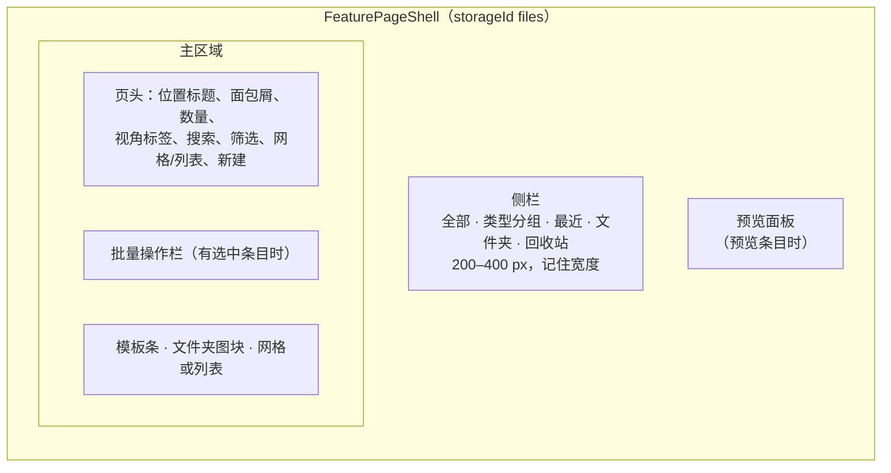
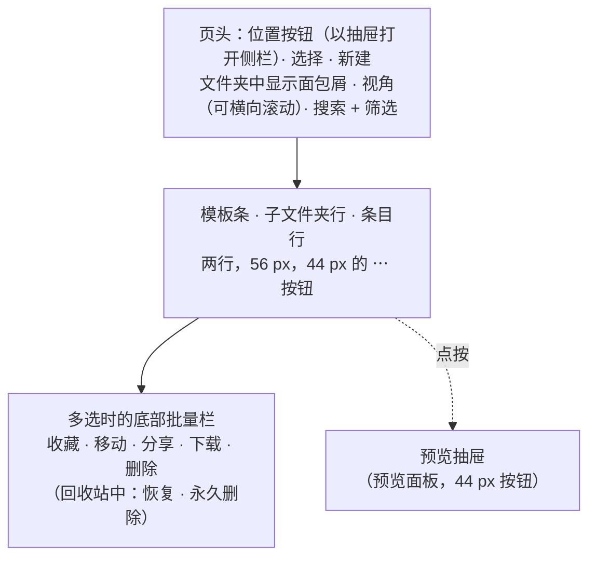

# 管理

## 布局

`components/files-library/files-library.tsx` 基于 `FeaturePageShell` 组装页面。侧栏宽度在拖动停稳后上报，
由文件库的 store 保存，而不是由外壳保存。在 `md` 与 `lg` 断点之间，两侧面板变为抽屉；
窄于 `md` 或在手机外壳中，页面切换为[手机布局](#在手机上)。列表每次加载 60 个条目
（“显示更多”）；更早的图片每次加载 500 张。

侧栏列出全部、类型分组、最近五个条目、文件夹树和回收站（带数量）。点击文件夹行打开该位置；箭头展开它
（按设备记住）；它的菜单——右键和“⋯”按钮相同——提供新建子文件夹、重命名、颜色、图标和删除。删除文件夹时
默认把其中内容上移一级；勾选级联选项会同时删除子文件夹，并把其中的条目移出文件夹（不再被其他方式保留的条目
随之失去固定引用）。文件夹通过拖动改变父级。

## 列表与排序

列表视图是一张表：全选复选框、名称、来源（对话、“已上传”，或对话消失后显示“—”）、最近活动（在回收站中为
“删除时间”）、大小和类型。来源、大小和类型会随主区域变宽而出现（在 `@container/files` 上的容器查询 `@xl`、
`@2xl`、`@3xl`）。在文件夹内，子文件夹总是排在最前，并按名称排序。

点击列标题按顺序循环（`nextFilesSort`，`lib/files-library/column-sort.ts`）：先是该列的自然方向（名称、来源、
类型为升序；活动和大小为降序），然后反向，再回到视角的默认排序。名称按数字感知的方式比较，未命名的条目排在最后。

## 选择

`useFilesSelection` 基于共享的范围选择（`hooks/ui/use-range-selection.ts`），作用于整个可见列表，而不只是已渲染的那一页：

| 操作 | 效果 |
| --- | --- |
| 单击 | 选中一个条目并预览 |
| ⌘/Ctrl 单击 | 切换该条目 |
| Shift 单击 | 选中从锚点开始的范围 |
| ⌘/Ctrl-Shift 单击 | 追加该范围 |
| 复选框、空格 | 切换 |
| 双击、Enter | 打开（在回收站中为预览） |

切换位置或视角会清空选择；搜索或筛选会去掉离开视图的条目。

## 键盘

`resolveFilesKey`（`lib/files-library/keyboard.ts`）在列表容器上处理按键。焦点在文本框、菜单或对话框中时不会触发。

| 按键 | 作用 |
| --- | --- |
| ⌘/Ctrl-A | 全选视图中的条目 |
| Delete、Backspace | 把选中的条目（或当前焦点条目）移到回收站，提示中可撤销；在回收站中则询问是否永久删除 |
| F2 | 只有一个目标条目时重命名 |
| ↑ / ↓ | 移动焦点并预览；按住 Shift 时扩展选择 |
| Escape | 先清空选择，再关闭预览 |

## 拖放

`FilesDndProvider`（`components/files-library/files-dnd.tsx`）使用 `@dnd-kit/core`，指针传感器在移动 6 px 后启动，
碰撞检测为 `pointerWithin`。拖动一个已选中的条目会拖动整个选择。`resolveFilesDrop`（`lib/files-library/dnd.ts`）决定结果：

| 拖动 | 放到 | 结果 |
| --- | --- | --- |
| 条目 | 文件夹或文件夹顶层 | 放入该处（已在其中的条目会跳过） |
| 条目 | 回收站 | 移到回收站（已在回收站中的条目会跳过） |
| 文件夹 | 另一个文件夹或顶层 | 改变父级，除非放到它自身、它当前的父级或它自己的子树中 |
| 其他 | | 无操作 |

写入数据库时会再次检查循环。拖动时的标签跟随指针（`snapChipToPointer`，偏移 12 px），屏幕阅读器会听到本地化的播报。

从系统拖入的文件会上传到当前查看的文件夹，或顶层（`files-drop-zone.tsx`）。拖入的目录会被遍历，有数量上限。
上传逐个进行，每个文件有自己的错误提示；不超过 50 MiB 的文件会提取文本。

## 条目菜单与批量操作栏

条目菜单（`files-item-menu.tsx`）是同一个模型，渲染为“⋯”下拉菜单和右键菜单：

- **普通：** 打开 · 预览 · 在对话中使用 · 收藏 · 移到文件夹 · 移出文件夹（已放入文件夹时）· 重命名（F2）·
  复制副本 · 另存为模板（文档，且模板平台开启时）· 下载 · 分享… · 移到回收站。
- **在回收站中：** 预览 · 恢复 · 永久删除。

批量操作栏（`files-bulk-bar.tsx`）以一次写入作用于整个选择：收藏或取消收藏 · 移到文件夹 · 下载为 zip · 分享… ·
移到回收站；在回收站中为恢复 · 永久删除。

## 重命名

`renameTargetFor`（`lib/files-library/rename.ts`）尊重名称的归属：

| 类型 | 重命名位置 |
| --- | --- |
| 画布文档 | 在来源处（它的标题） |
| 归文件库所有的上传 | 在来源处（它的文件名，下载时也是这个名字） |
| 产物、聊天图片、对话上传 | 作为条目上的 `displayName`；来源保留原标题 |

改回来源标题会清除显示名称；空名称会被拒绝。对话框会选中不含扩展名的部分。

## 复制副本

`duplicateFilesEntry`（`lib/files-library/duplicate.ts`）总是生成属于本人的独立副本：

- 画布文档或产物变为一个新的画布文档，标题加上本地化后缀（“ - 副本”）；
- 图片或文件变为字节相同的、归文件库所有的上传，命名如 “notes - 副本.md”——后缀插在不超过七个字符的扩展名之前。
  字节按内容寻址，所以副本不会重复存储。新上传归入当前工作区并被选中。

## Zip 导出

`buildFilesZip`（`lib/files-library/export-zip.ts`）用 fflate 在本机生成 `Files.zip`：

- 每个条目写入它的下载内容（原始字节，或产物、文档的文本）；
- 放入文件夹的条目保留文件夹路径，其余放在根目录；
- 重名变为 `name (2).ext`、`name (3).ext`，比较时不区分大小写；
- 图片、视频、音频、压缩包和 PDF 直接存储，其余压缩；
- 导出上限为 512 MiB（`FILES_ZIP_MAX_BYTES`），读取前检查一次，读取过程中再检查；内容已不存在的条目会被跳过，并在提示中计数。

## 深度链接

`lib/files-library/deep-link.ts` 读写页面的位置和视角：

| 参数 | 取值 |
| --- | --- |
| `section` | `all`、`recent`、`trash`、`group:<group>`、`folder:<id>` |
| `tab` | 一个视角：`suggested`、`favorites`、`mine`、`ai`、`shared` |
| `item` | 条目键；打开其预览 |

默认值不写入 URL。ADR-0200 的 `?tab=` 取值用 `router.replace` 重定向：`recent` → 最近，`folders` → 文件夹顶层，
`images` → 图片分组，`all` → 全部（`favorites` 仍是一个视角）。

## 在手机上

`FilesLibrary` 用 `useCompactLayout` 选择布局：窄于 `md` 或在 Capacitor 外壳中，渲染 `FilesMobileLibrary`
（`components/files-library/mobile/`）。两种布局读取同一个模型 `useFilesPage`
（`hooks/files-library/use-files-page.ts`）：条目、文件夹、操作、视图、选择、URL（`useFilesDeepLink`）、
分页和文件夹计数。不同的只是绘制方式。

| 手势 | 效果 |
| --- | --- |
| 点按一行 | 在底部抽屉中预览（打开、在对话中使用、下载、收藏；在回收站中为恢复和永久删除） |
| 长按一行，或在其菜单中点“选择” | 开始多选，并选中该条目 |
| 页头的“选择” | 开始多选，不选中任何条目 |
| 多选时点按 | 切换该条目 |
| “完成”，或切换位置或视角 | 结束多选 |
| 位置按钮 | 以抽屉打开侧栏；选择一个位置或最近条目后关闭 |

列表是手机上唯一的布局：网格/列表是桌面端的偏好，保持不变。手机上没有拖动：条目通过“移到文件夹…”和底部
批量栏移动，文件通过“新建 → 上传文件”（系统文件选择器）进入。行没有右键菜单，否则 Radix 会在同一次长按时
弹出它。空文件夹提示使用“移动”而不是拖动。在 Capacitor 外壳中，下载（单个或 zip）会交给系统分享面板
（`downloadBlob`，`lib/files/download.ts`）。

同一套手机布局既服务于独立模式的手机（使用它自己的数据库），也服务于配对的手机（使用桌面端的文件库，
见[在配对设备上](/docs/subsystems/files/paired)），后者的列表还支持下拉刷新。

## Store

`stores/files-library/files-library-store.ts` 按设备持久化（`files-library-prefs`，版本 2）：视图模式、列排序、
工作区范围、侧栏宽度、展开的文件夹，以及模板条是否折叠。版本 1 的数据会保留视图模式和范围。位置、视角、搜索、
筛选、预览中的条目以及所有对话框目标（移动、重命名、永久删除、清空回收站、文件夹、删除文件夹、另存为模板、分享）
都是会话状态。
