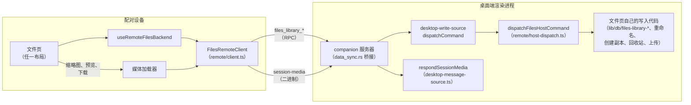

# 配对设备上的文件页

<Status variant="beta">已交付（ADR-0223 §9）</Status>

<TLDR>
  配对的手机或浏览器实时管理**桌面端**的文件库，不做任何镜像：页面挂载一个远程后端，分页读取主机的列表，
  并把每次修改作为 23 个 `files_library_*` 主机命令之一发出，由桌面端用自己文件页的同一套写入代码执行。
  字节走已有的 `session-media` 资源，上限 10 MiB。创建文档和分享留在桌面端，页面会注明。
</TLDR>

## 一个页面，两个后端

`FilesLibrary`（`components/files-library/files-library.tsx`）根据运行时目标选择后端，并用
`FilesBackendProvider`（`hooks/files-library/files-backend.tsx`）挂载。下层的一切——页面模型、操作、
文件夹对话框、缩略图、预览——都从这里读取，因此两种布局都不知道自己画的是哪个文件库。

| | 本设备的文件库 | 配对主机的文件库 |
| --- | --- | --- |
| 数据来源 | `useLocalFilesBackend`：实时 Dexie 读取 | `useRemoteFilesBackend`：分页读取主机 |
| 操作 | `createLocalFilesOps`（`lib/files-library/ops.ts`） | `createRemoteFilesOps`（`lib/files-library/remote/remote-ops.ts`） |
| 缺失的图片字节 | 不存在（全部在本地） | `createRemoteMediaLoader` |
| 能力 | 全部；“打开”会离开文件页 | `PAIRED_FILES_CAPABILITIES` |

## 界面契约

`lib/runtime/surface-contract.ts` 中 `files` 一行以 `files_library_list` 为操作，并声明
`companion: "remote"`。因此，配对客户端只有在主机声明该操作（主机功能 `files.library-remote`，见
`lib/platform/host-feature-manifest.ts`）且设备持有 `client.read` 时，才会在侧栏和 ⌘K 中看到文件页。
只有桌面端声明这个功能：无头大脑也安装了同一个 desktop-write 源，但没有产物存储、画布或文件库，对每个命令
都回答 `headless_host`。`offline: "blocked"`——主机不可达时页面直接不可用而不是显示过期内容，因为既没有镜像，
也不会排队任何修改。

## 命令

23 个命令都是 `target: execution`，经 `crates/cognia-companion-rpc/src/rpc/data_sync.rs` 桥接到桌面端渲染进程，
并由 `lib/companion/desktop-write-source.ts` 整组委派，与 `pet_*` 一族相同。服务器会把经过验证的
`callerDeviceId` 注入每一个命令。读取使用 `client.read` 并跳过幂等缓存；写入使用 `client.write`，并要求
`Idempotency-Key`。

| 命令 | 作用 |
| --- | --- |
| `files_library_list` | 按键序返回文件库的一页（`pageSize`/`pageToken`），附带列表的 `revision` |
| `files_library_folder_list` | 按 id 顺序返回一页文件夹 |
| `files_library_search` | 按文件页自己的规则返回正文匹配的条目；排除回收站中和已移除的条目 |
| `files_library_get` | 单个条目，以及文档的文本（最多 128 Ki 个字符） |
| `files_library_read_chunk` | 凭条目键读取[工作区文件](/docs/subsystems/files/workspace)最多 512 KiB 的字节 |
| `files_library_favorite` / `_move` / `_trash` / `_restore` | 对所选条目一次性写入；返回实际处理的条目数 |
| `files_library_purge` | 只彻底删除回收站中的条目，规则见[回收站](/docs/subsystems/files/data) |
| `files_library_touch` / `_rename` | 记录一次打开；重命名 |
| `files_library_duplicate` | 创建副本，使用设备语言的副本后缀（带键） |
| `files_library_attach` | 在对话中使用（带键） |
| `files_library_folder_create`（带键）/ `_rename` / `_move` / `_style` / `_delete` | 文件夹 |
| `files_library_upload_init` / `_chunk` / `_commit`（带键）/ `_abort` | 上传 |

主机从不采信设备对条目的描述。每次调用只给出条目键；主机按设备的图片窗口（`imageLimit`）重建聚合，
只对其中找到的条目动手——因此手机既不能谎称某项归文件页所有从而让它被彻底删除，主机已不再列出的键也会被跳过。
移到回收站只处理不在回收站中的条目，恢复和彻底删除只处理回收站中的条目。

四个**带键**的写入在回复丢失、用户再次点击时，否则会多出一份副本、绑定、文件夹或库文件。它们在请求体里带
`idempotencyKey`，主机的账本（`remote/idempotency.ts`，即远程照顾宠物所用的那一个）按
`<callerDeviceId>:<command>:<key>` 把重试合并到第一次的回答上。

拒绝的形式是 `{ ok: false, code }`：要么是文件库写入代码抛出的 `files.errors.*` 代码，原样透传；要么是远程
路径自己的代码（`headless_host`、`files_remote_not_found`、`files_remote_invalid_request`、
`files_remote_session_unwritable`）。页面为每个代码给出文案，未知代码显示通用的失败提示。

## 读取与刷新

`useRemoteFilesBackend` 逐页读取整个列表（`client.list`）。每一页带有所属列表的修订号；若后面某页的修订号
不同，说明读取途中文件库变了，客户端从头再读，最多三次（`files_remote_busy`）。以下情况会重新读取：

- 设备自己每次修改之后（记录打开除外）；
- 页面重新可见或窗口重新获得焦点时；
- 保持可见期间每 30 秒；
- 下拉刷新（手机布局）和点“重试”时。

输给更新一次读取的旧回答会被丢弃。读取失败时保留已显示的内容，并显示带原因和“重试”的
`FilesRemoteNotice`。条目在传输中不带搜索文本和摘录，因此手机自己匹配标题，并在 250 ms 后向
`files_library_search` 询问哪些条目的正文匹配；这些键以 `contentMatches` 的形式加入筛选。

在配对设备上，⌘K 按标题列出主机的条目（基于 `files_library_list` 的 `loadRemoteFileSearchRows`）；产物和画布
提供者在那里不返回结果，因为本客户端的存储并不是主机的文件库。

## 字节

没有新增二进制路由。缩略图、预览和下载都通过 `mediaResourcesFor` 读取已有的 `session-media` 资源
（`/api/sessions/{sessionId}/media/{hash}?variant=`）：

1. 文件页保留的条目（收藏、在文件夹中、归文件页所有或在回收站中）先以文件库的哨兵会话 `library:files` 读取；
2. 然后依次经展示它的各个对话读取。

`respondSessionMedia`（`lib/companion/desktop-message-source.ts`）凭文件库自己在 `messageMediaRefs` 中的
固定引用为哨兵会话授权——那里没有可供公开或共享检查的对话行；其他情况一如既往，经引用这些字节且已公开的
对话授权。保存的原件（`original:<sha>`，来自对话或文件页的上传）以 `original` 变体返回。读到的行会进入设备的
媒体缓存，因此读过一次的图片离线也能显示。

该资源 10 MiB 的上限就是设备的上限（`FILES_REMOTE_MAX_BYTES`）：超过时，预览提示到桌面端打开，下载会被拒绝，
zip 导出会在读取任何内容之前点名拒绝。

工作区文件的字节在主机磁盘上，而不在会话媒体中，所以它们改由 `files_library_read_chunk` 读取，上限同样是 10 MiB
（见[工作区文件](/docs/subsystems/files/workspace#在配对设备上)）。

## 打开、在对话中使用、上传

- **打开** 以只读方式预览：产物或画布文档使用 `files_library_get` 返回的文本，图片和文件使用其字节。
  底栏用条目来源的对话代替“打开”。
- **在对话中使用** 发送 `files_library_attach`，附带设备当前打开的对话；主机会重新检查它（已公开、仍可接收
  消息），否则改用一个新对话。图片或文件在主机上绑定到该对话，不复制字节（`bindEntryToSession`）；产物或
  画布文档回答 `referenced`，手机根据主机返回的文本，在自己的输入框里放入引用标签。
- **上传** 先计算文件哈希，再以 32 KiB 分块在附件暂存通道上暂存，范围是哨兵会话和发起上传的设备，最后提交到
  文件库（若正在查看某个文件夹则放入其中，`folderId`）。任何类型都接受（`acceptAnyType`）；提交时的魔数
  检查照常执行。其他设备无法写入、提交或取消这次上传。

## 保留不做

`PAIRED_FILES_CAPABILITIES` 保留了两项功能，每项都在类型上注明（`FILES_PAIRED_HELD_BACK`），在界面上标注，
并由测试固定：

| 保留不做 | 原因 | 界面表现 |
| --- | --- | --- |
| 创建文档：新建画布文档、从模板新建、另存为模板、模板栏 | 手机无法编辑主机的画布 | 入口停用并标注“需在桌面端”；不显示模板栏 |
| 分享 | 分享策略、协作检查和链接记录都在主机上；较大的选择会超过主机桥接 30 秒的超时 | 条目菜单和两种批量操作栏中的“分享”停用，并提示到桌面端分享 |
