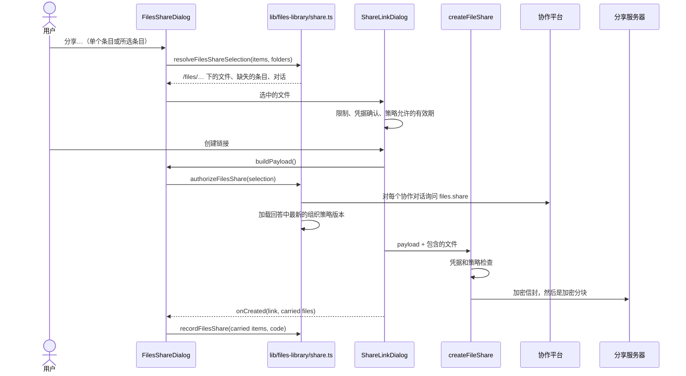

# 分享

在条目上，或在批量操作栏对所选条目点“分享…”，会发布一个以文件形式携带这些条目的链接。它就是 ADR-0222 的文件快照——
一个 `file-bundle` 分享，文件以客户端加密、按 4 MiB 分块的形式上传；服务器看不到任何名称、路径或明文大小。
文件库在此基础上增加了对话分享不需要的三件事：按条目在文件库中的位置命名、询问条目所属的每个对话，以及记住
一个链接携带了哪些条目。

## 从条目到文件

`FilesShareDialog`（`components/files-library/files-share-dialog.tsx`）在打开时冻结选中的条目——列表在下面实时刷新
不会让它们被重新读取——并去掉回收站中的条目。`resolveFilesShareSelection`（`lib/files-library/share.ts`）读取每个
条目的下载内容（一个 Blob 句柄；字节只在创建链接时按块读取）：

- **路径：** `/files/<文件夹路径>/<文件名>`，与 zip 导出使用的文件夹路径相同。两个条目路径相同时变为 `name (2).ext`，
  比较时不区分大小写。
- **媒体类型：** 条目自身的类型，否则按文件扩展名推断（所以 Markdown 文档是 `text/markdown`，而不是它存储时的纯文本），
  否则取存储的类型。
- **凭据：** 被敏感文件底线标记的路径（`.env`、密钥等）会标为 `sensitive`，只有用户在对话框中勾选后才会携带。
- **缺失：** 内容已不再存储的条目会在对话框中列出名称并被排除。

## 上传之前

分享对话框（`components/share/share-link-dialog.tsx` 的 `picked` 来源）把选中的文件视为整个分享：链接至少需要一个
文件，并且没有内容预览。它预先检查服务器的限制（`lib/share/blob-crypto.ts`：最多 200 个文件，每个文件 512 MiB，
密文总计 2 GiB），并只提供生效的文件分享策略允许的有效期。

用户创建链接时，`buildPayload` 先运行并调用 `authorizeFilesShare`：

1. 条目引用的共享对话（`shared:` id）如果**已不在本设备上**，就无法询问，分享会以“无法检查”被拒绝；
2. 逐个询问条目所属的每个协作对话是否允许发布其文件（`assertSharedSessionFileShare`、`files.share` 操作和组织策略）。
   只要有一个拒绝，整个链接就不会创建；
3. 加载所有回答中最新的组织策略版本，使下一步不会用较旧的缓存策略来判断这次分享。

随后 `createFileShare`（`lib/filespace/share-files.ts`）运行它自己的检查——每个敏感文件都已确认、允许公开快照、
有效期在策略范围内——然后上传。与对话分享不同，它不接收对话：授权已在上面完成，链接记录在 `sharedLinks` 中时
不带 `sessionId`。

任何一步的拒绝都会在对话框中以与对话分享相同的措辞显示。

## 标记

`onCreated` 报告链接实际携带了哪些文件（未勾选的凭据文件不在其中）。`recordFilesShare` 把它们对应回条目，把链接的
短码追加到每个条目的 `sharedLinkCodes` 中，同时去掉已失效链接的短码。分享不会让条目变为保留：链接持有自己的副本。

下次加载时读取仍有效的短码（`loadLiveShareCodes`，`lib/files-library/sources.ts`：未撤销、未过期），聚合在每个条目上
设置 `sharedLinks`，行和卡片据此显示一个链接图标（“已通过链接分享”“已通过 2 个链接分享”）。条目上只保存短码；
链接本身、密钥和所有者令牌只保存在创建它的设备的 `sharedLinks` 中，因此标记只在那台设备上显示。记录短码是尽力而为的：
如果失败，链接仍然存在，只是缺少标记。

## 限制

- 回收站中的条目不能分享：菜单中的“分享”被禁用，回收站的批量操作栏也没有“分享”。
- 未配对的手机与桌面端一样，从条目菜单和批量操作栏分享。
- 在已配对的客户端上，文件库尚未运行（[概览](/docs/subsystems/files#尚未交付)），因此没有分享。
