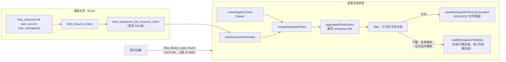

# 工作区文件

<Status variant="beta">桌面端与配对设备已交付 · 纯网页版休眠（ADR-0223 §8）</Status>

<TLDR>
  Agent 写入对话工作区的文件是一个 `workspace-file` 条目，每个对话、工作区根目录和路径对应一个。列表来自任务工作区账本的资源索引，
  账本从未见过的对话由代码采纳轮次补齐。文件页在文件当前所在处读取字节，从不在磁盘上写入或删除它们。没有文件系统后端时，
  这一类型处于休眠状态并会注明原因。
</TLDR>

## 完整路径

## 资源索引

账本在 `task_resources` 中为每个任务、运行和路径存一行，各带一个 `ResourceChange`。
`TaskWorkspaceStore::list_resource_index_rows`（`crates/cognia-task-workspace/src/store.rs:726`）把这些行关联到它们的运行，
以及指明所属对话（`session_id`）的 `task_workspaces` 行。`fold_resource_index`
（`crates/cognia-task-workspace/src/resource_index.rs:202`）按结算顺序（运行的 `settled_at`，没有则取 `created_at`）重放它们，
以对话、工作区根目录和路径为键：

- 只有来源为 **Agent** 的变更会加入路径；
- 任何人的**删除**都会移除它，任何人的**重命名**都会把它移到新路径（保留 `oldPath`）；
- 被归类为**敏感**、**生成产物**（构建输出）或**符号链接**的变更会移除它；
- 最初**新建**的路径在之后的编辑中仍记作 `created`；`firstChangedAt` 是它进入索引的时间，`changedAt` 是最后一次变更的时间。

运行在自己的根目录中工作，它的变更只有在用户应用其补丁集后才进入工作区。所以每一行先按该补丁集来衡量
（`PatchOutcome::adoption_of`，从 `task_patch_sets` 读取，只反序列化状态、已应用文件和应用时的选择）：

| 补丁集 | 该变更 | 条目 |
| --- | --- | --- |
| 尚无、`ready`，或应用时发生的 `conflict`（什么都没写入） | 待应用 | `adoption: "pending"`：文件在运行的 `executionRoot` 中 |
| `applied`，或撤销时发生的 `conflict`（仍处于已应用状态），且路径在用户的选择中（空选择即全部；没有记录选择的旧补丁集按应用写入的文件判断） | 已应用 | `adoption: "applied"`：文件在 `workspaceRoot` 中 |
| `applied`，路径不在选择中 | 已丢弃 | 跳过 |
| `reverted`（已撤销，或以保留当前文件解决的冲突） | 已丢弃 | 跳过 |

已丢弃的变更视同从未发生：折叠时跳过它，因此路径保持它之前的状态——被撤销的删除让文件仍然列出，被撤销的新建从不列出。
待应用的变更是 Agent 的最新产出，照此列出；预览中注明“尚未应用”。

结果按最新在前排序。`TaskWorkspaceService::list_resource_index` 会连同数据库的变更指纹保存最近一次折叠的结果
（`WorkspaceStore::change_fingerprint`：本连接的 `total_changes()` 和 `PRAGMA data_version`，后者在另一个连接提交时变化），
因此同一次列出的各页、以及账本未变时获得焦点后的重新读取，共用同一次折叠；一次运行的载荷只为它的所有行解析一次。
`task_workspace_list_resource_index`（`crates/cognia-task-workspace-host/src/host_surface.rs:784`）以每页 500 条的偏移分页提供它
（`resource_index_page`），是一个在主线程之外执行的只读 `host.observe` 命令。`listTaskResourceIndex`（`lib/task-workspace/client.ts:718`）收集各页，最多 20 000 条，并去掉重复项。

## 与代码采纳轮次合并

`mergeWorkspaceFiles`（`lib/files-library/workspace-files.ts:178`）原样采用索引，然后**只为索引里没有任何记录的对话**
从 `codeAdoptionTurns` 补入文件——即没有经过账本运行就编辑了文件的外部 Agent。账本已有记录的对话绝不用轮次数据修补：
账本丢掉的就保持丢掉。轮次按从旧到新折叠，跳过被拒绝或已撤销的轮次和文件，跳过仍处于 `pending` 的应用内（`taskWorkspace`）轮次
——它的变更只存在于已随账本行一起消失的运行根目录中，工作区里是用户自己的版本——并排除 `isSensitiveResourcePath` 匹配的路径
（`.env`、私钥之类）。它们的执行根目录就是工作区根目录，也不带 `adoption`。

没有账本可问时（索引读取失败），`index` 为 `null`，轮次数据就是全部来源。

## 条目

`aggregateFilesEntries` 为每个文件生成一张卡片（`lib/files-library/aggregate.ts:470`）：

| 字段 | 值 |
| --- | --- |
| `key` | `workspace-file:<sourceId>` |
| `sourceId` | 16 位十六进制：对话、工作区根目录和路径的 64 位 FNV-1a 摘要（`workspaceFileSourceId`），因为条目键限长 300 个字符。重命名过的文件按它第一次重命名之前的路径计算摘要（`identityPath`），所以它的收藏和文件夹会跟着它走；当前位于那个路径的文件保留该 id，两个文件从同一路径重命名而来时由较早的那个保留 |
| `title` | 路径的最后一段，除非在文件页中改过名 |
| `creator` | `ai` |
| `originAlive` | 对话仍然存在 |
| `workspace` | `{ sessionId, workspaceRoot, executionRoot, relPath, change, oldPath }` |
| `searchText` | 名称、相对路径和媒体类型 |

保留的工作区文件（收藏、放进文件夹或移入回收站）会把位置存进 `snapshot.workspace`，所以账本清理掉该运行后，卡片仍能从快照重建。

## 在哪里显示

`matchesSection`（`lib/files-library/filter.ts:178`）防止 Agent 一次忙碌的运行淹没用户自己做的东西：

| 位置 | 是否显示工作区文件 |
| --- | --- |
| 工作区文件分组 | 总是 |
| 某个文件夹 | 放进该文件夹后 |
| 全部 | 只在收藏视角下，且已收藏 |
| 最近 | 打开、收藏或放进文件夹后 |
| 回收站 | 移入回收站后 |

⌘K 不收录它们。

## 读取字节

路径同时相对于两个根目录，由 `adoption` 选择读哪一个（`workspaceFileRoots`）：已应用的文件只从工作区根目录读取（运行根目录里
留下的副本是 Agent 的版本，不是文件现在的样子），待应用的文件只从运行根目录读取（工作区根目录里是用户的版本）。没有 `adoption` 时
——轮次数据，或从保留条目重建的卡片，其快照从不保存它——`locateWorkspaceFile` 先试运行根目录，再试工作区根目录。它跳过主机拒绝访问的根目录，
并忽略目录。

待应用的文件只存在于它的运行根目录中。那个根目录被归档或删除后，账本对该变更的捕获就是 Agent 所写内容的唯一副本，所以当列表给出了运行
（`runId`，来自索引，从不存入快照）时，`locateWorkspaceFile` 会回退到它：先用零长度读取探查 `task_workspace_read_resource_capture` 得到大小，
然后返回一个 `ledger` 来源。该命令（`TaskWorkspaceService::read_resource_capture`）以运行和路径而不是 blob 哈希来指名字节，因此只提供账本为
那次变更记录的内容：从不提供形似凭据的路径，也从不提供已删除、生成产物、符号链接或未捕获内容的路径。`WorkspaceStore::read_blob_range`
直接读取未压缩的捕获；压缩的捕获只解码一次并保留给下一段读取（最多 64 MiB；更大的每段都流式解码），且只有第一段读取会把该 blob 标记为已使用。
已应用的文件从不回退：捕获的内容不是文件现在的样子。

在它可能所在的任何根目录中都找不到、账本中也没有的文件就是已不在：`FilesWorkspaceFileError("files_workspace_missing")`，即“这个文件已不在磁盘上。”存在性在使用文件时检查，
而不是在列出时。

`readWorkspaceFileBytes` 通过 `lib/files/workspace-fs.ts` 分块读取，最多 256 MiB（`FILES_WORKSPACE_READ_MAX_BYTES`），
对超过调用方上限的文件在读取前就拒绝，读取中增长超过上限的也会拒绝（`files_workspace_too_large`）。
下载、复制副本（成为文件页所有的上传）和在对话中使用（以草稿附件配额为上限）都这样读取。

## 打开

对话仍在的工作区文件，`openFilesEntry` 会交给 `openWorkspaceFileInConversation`
（`lib/files-library/workspace-files-io.ts:268`）：

1. 定位文件，找不到就报告已不在；
2. 加载对话的 FileSpace（`lib/filespace/load.ts`），把文件的绝对路径映射进去；
3. 如果 FileSpace 已删除或不包含该路径，就回答 `outside`：文件页在原地只读预览该文件，不离开页面；
4. 否则跳到该对话，通过 ADR-0222 的打开器在它的文件面板中打开该路径。`not-found` 变为 `files_workspace_missing`；
   没有后端或离线变为 `files_workspace_unavailable`。

对话已不在的工作区文件会在预览窗格中打开，窗格显示它的路径，以及它是被新建、修改还是重命名的。

## 文件页从不改动磁盘上的副本

重命名存的是显示名称。回收站是文件页自己的状态。复制副本把字节拷贝成文件页所有的上传。彻底删除只是忘掉这个条目：
对话还在时条目被隐藏；对话已不在时该行被删除。没有任何操作会写入、移动或删除磁盘上的文件。

## 在配对设备上

主机在设备读取的文件库中列出自己的工作区文件（`lib/files-library/remote/host-dispatch.ts`）。它们的字节不是会话媒体，
所以设备用 `files_library_read_chunk`（`client.read`，字节区间）读取：

- 请求只指明**条目键**、偏移量和最多 512 KiB（`FILES_REMOTE_READ_CHUNK_MAX`）；主机在自己的聚合中解析这个键，
  因此设备从不指定路径，主机也只读取它自己列出的文件——从磁盘读取，或像桌面端那样从账本的捕获中读取（线上传输的条目不带账本的 `runId`）；
- 不是工作区文件的键属于无效请求；超过 10 MiB 的文件返回 `files_remote_too_large`，超过时预览提示到桌面端操作；
- `FilesRemoteClient.readWorkspaceFile`（`lib/files-library/remote/client.ts:388`）循环读取各段，读取途中大小变化就重新读一次，
  再变化则以 `files_remote_busy` 放弃。

## 休眠

纯网页版没有账本，也没有可读的磁盘。`lib/files-library/ops.ts` 中的能力 `workspaceFiles` 在桌面端和配对设备上为 `true`，
在其他地方为 `FILES_WORKSPACE_FILES_HELD_BACK`（`{ reason: "no-fs-backend", remedy: "desktop" }`）
（`hasLocalWorkspaceFiles` 即 `isTauri()`）。被保留时：

- 类型层面在 `FilesCapabilities.workspaceFiles` 上注明休眠；
- 侧栏保留“工作区文件”分组，处于禁用状态（`aria-disabled`、`data-held-back`），并提示使用桌面端，它的空状态也这样说明；
- 不会为工作区文件读取账本或轮次表；
- `ops.test.ts`、`files-sidebar.test.tsx` 和 `files-empty.test.tsx` 固定了这一行为。

## 刷新

`useWorkspaceFileIndex`（`hooks/files-library/use-workspace-file-index.ts:34`）在挂载时、窗口重新获得焦点或页面变为可见时，
以及代码采纳轮次表的修订号（条数和最新时间戳）变化时读取索引——结算一个轮次就会让它变化。输给更新一次读取的旧读取会被丢弃。
