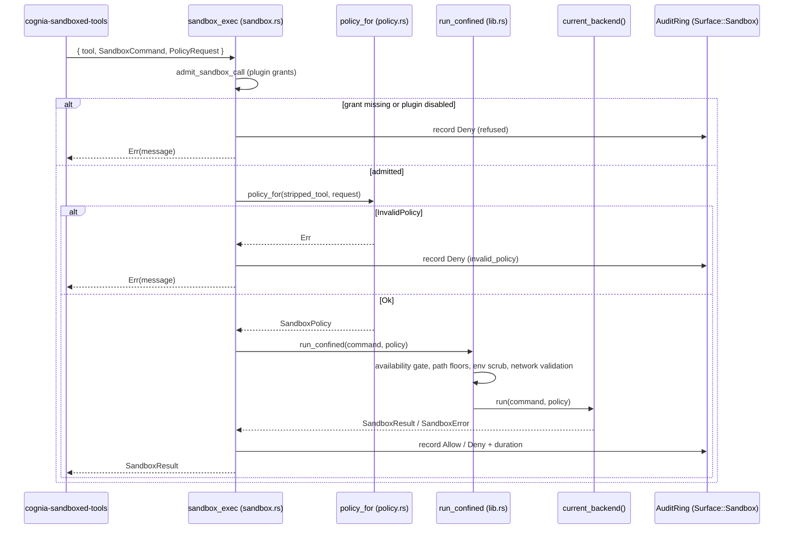

# OS 后端 (T1)

<Status variant="beta" />

<TLDR>
  `crates/cognia-exec-sandbox/` 是 Tier-1 的 OS 执行沙盒。它在 ADR-0196 中从
  `cognia-automation` 拆出，这样终端和 Python 插件宿主不必链接整套 UI 自动化栈就能用到它。
  `sandbox_exec` Tauri 命令（仍在 `crates/cognia-automation/src/sandbox.rs`）先检查插件的授权，
  再通过 `policy.rs:policy_for` 从工具名派生出 `SandboxPolicy`，然后交给 `run_confined`，由它通过
  `current_backend()` 选择各平台后端。**Linux (`bwrap`)、macOS (`sandbox-exec`) 与 Windows
  (`cognia-sandbox-runner.exe`) 都是真实后端**。Windows runner 是随包发布的 restricted-token +
  low-integrity + Job Object crate，并通过 JSON 合约捕获 stdout/stderr。三个 Tauri 命令均已注册
  （`src-tauri/src/lib.rs:762-764`）。Tauri 命令不是唯一的入口：`cognia-sandbox-exec` 为没有
  Tauri IPC 的宿主调用同一个 `run_confined`，CLI 和无头 brain 通过该入口使用这一层。
</TLDR>

## trait —— `traits.rs`

每个后端都实现同一个异步 trait。`health()` 如今已经在线运行（由 Settings 标签页轮询）；`probe_confinement()` 是 `sandbox_health_check` 背后按需触发的主动检查；`run()` /`first_time_setup()` 由 dispatcher 消费。

```rust title="crates/cognia-exec-sandbox/src/traits.rs:49-200 (abridged)"
#[async_trait]
pub trait SandboxedExec: Send + Sync {
    async fn run(
        &self,
        command: SandboxCommand,
        policy: SandboxPolicy,
    ) -> Result<SandboxResult, SandboxError>;
    /// Renderer polls this for the Settings → Sandbox status badge; the
    /// strict-mode policy then refuses tool calls when this is false.
    fn is_available(&self) -> bool;
    async fn first_time_setup(&self) -> Result<(), SandboxError>;
    fn health(&self) -> SandboxHealth;
    /// Runs real commands in the sandbox and checks confinement is enforced.
    async fn probe_confinement(&self) -> ProbeReport { /* default body */ }
}
```

## 数据模型 —— `types.rs`

`types.rs` 持有与平台无关的形状。`SandboxPolicy` 是按工具（`Bash` / `Edit` / `Write` / `TextEditor`）键控的带标签枚举；网络策略是它自己独立的带标签枚举。

| 类型             | 位置               | 说明                                                                 |
| ---------------- | ------------------ | --------------------------------------------------------------------- |
| `SandboxCommand` | `types.rs:29-58`   | `argv`、`cwd`、`env: BTreeMap`、`stdin`、`timeout`（序列化为秒） |
| `NetworkPolicy`  | `types.rs:67-79`   | `Off`（默认）· `Allowlist { hosts }` · `On`                        |
| `SandboxPolicy`  | `types.rs:86-139`  | `Bash { writable, readable, network, max_cpu_seconds, max_memory_mb, max_processes }` · `Edit`/`Write`/`TextEditor { target_files, readable }` |
| `SandboxResult`  | `types.rs:144-163` | `exit_code`、`stdout`、`stderr`、`duration`、`timed_out`、`stdout_truncated`、`stderr_truncated`、独立的 `network` 报告 |
| `SandboxError`   | `types.rs:170-197` | `Unavailable` · `SetupRequired` · `InvalidPolicy` · `BackendFailed` · `Timeout` |
| `SandboxHealth`  | `types.rs:203-218` | `available`、`backend`、`version`、`last_error`                       |
| `ProbeReport`    | `types.rs:227-236` | `backend`、`confined`、`detail`、独立网络 allowlist probe —— `probe_confinement` 的结果      |

```rust title="crates/cognia-exec-sandbox/src/types.rs:66-79"
#[serde(tag = "kind", rename_all = "snake_case")]
pub enum NetworkPolicy {
    Off,
    Allowlist {
        #[serde(default)]
        hosts: Vec<String>,
    },
    On,
}
```

## 策略解析器 —— `policy.rs`

`policy_for` 把去前缀的工具名加上调用方提供的 `PolicyRequest` 转换为 `SandboxPolicy`。它会套用 bash 默认值、拒绝空的 writable 集合，并校验网络形状。运行时提供 `readableRoots` 时，它通过现有路径工具规范化上限与请求的可读路径，再按路径组件比较。这道检查会拒绝前端词法预检无法识别的符号链接逃逸。

```rust title="crates/cognia-exec-sandbox/src/policy.rs:68-99 (bash branch)"
"bash" => {
    let network = parse_network(req.network.as_deref(), req.network_hosts)?;
    let (default_cpu, default_mem) = bash_defaults();
    let cpu = if req.max_cpu_seconds == 0 { default_cpu } else { req.max_cpu_seconds };
    let mem = if req.max_memory_mb == 0 { default_mem } else { req.max_memory_mb };
    let processes = if req.max_processes == 0 { BASH_DEFAULT_MAX_PROCESSES } else { req.max_processes };
    if req.writable.is_empty() {
        return Err(SandboxError::InvalidPolicy {
            reason: "bash policy needs at least one writable dir (cwd)".into(),
        });
    }
    Ok(SandboxPolicy::Bash { writable: req.writable, readable: req.readable, network,
        max_cpu_seconds: cpu, max_memory_mb: mem, max_processes: processes })
}
```

- `bash_defaults()`（`policy.rs:51-53`）→ `(300, 2048)` —— 5 分钟 CPU、2 GB 内存。
- `BASH_DEFAULT_MAX_PROCESSES`（`policy.rs:60`）→ `512`，与容器层使用的上限相同。
- `parse_network`（`policy.rs:128-144`）映射 `"off" | "on" | "allowlist"`；带空 host 列表的 `allowlist` 会被拒绝为 `InvalidPolicy`。
- Edit / Write / TextEditor 会拒绝空的 `target_files` 集合；未知工具为 `InvalidPolicy`。

## 分发 —— `sandbox.rs` 与 `run_confined`

`sandbox_exec`（`crates/cognia-automation/src/sandbox.rs:153-278`）是 `cognia-sandboxed-tools` 插件通过渲染端调用的 Tauri 入口点。它先用 `admit_sandbox_call`（`sandbox.rs:115`）检查插件的 `native:filesystem` 与 `native:process` 授权，再派生策略并调用 `run_confined`（`crates/cognia-exec-sandbox/src/lib.rs:374-420`），最后以 `Surface::Sandbox` 把结果记录到审计环。

`run_confined` 是 Rust 调用方的统一受限执行入口。它依次检查后端可用性（失败返回 `SetupRequired`）、规范化路径并应用禁写和禁读规则、清洗可注入代码的环境变量、校验网络策略。macOS 的 TCP 过滤代理由此处启动；Linux 的 Unix-socket 过滤代理由 `LinuxSandboxBackend::run` 内部创建，因此直接调用后端也受约束。不支持的约束会被拒绝；Linux allowlist 不会降级为 Off，也不会共享宿主网络。

```rust title="crates/cognia-exec-sandbox/src/lib.rs:56-75 (backend selection)"
pub fn current_backend() -> Arc<dyn SandboxedExec> {
    #[cfg(target_os = "windows")]
    { Arc::new(windows::WindowsSandboxBackend::new()) }
    #[cfg(target_os = "macos")]
    { Arc::new(macos::MacOsSandboxBackend::new()) }
    #[cfg(target_os = "linux")]
    { Arc::new(linux::LinuxSandboxBackend::new(None)) }
    #[cfg(not(any(target_os = "windows", target_os = "macos", target_os = "linux")))]
    { Arc::new(UninstalledSandboxBackend::new()) }
}
```

```rust title="crates/cognia-automation/src/sandbox.rs:20-23 (read-only health probe)"
#[cfg_attr(feature = "tauri-host", tauri::command)]
pub async fn sandbox_health_probe() -> Result<SandboxHealth, String> {
    Ok(current_backend().health())
}
```



## 各平台后端

### Linux —— `bwrap`（真实）

`LinuxSandboxBackend` 解析一个 `bwrap` 二进制，并真正以 namespace + bind 标志将其启动，管道传入 stdin 并强制执行超时。后端支持优先使用打包在 `<resource_dir>/bwrap/bwrap` 的版本，但 `current_backend()` 目前没有传入 resource dir，所以实际使用的是 `$PATH` 上的系统 `bwrap`。

```rust title="crates/cognia-exec-sandbox/src/linux.rs:554-592 (isolation baseline, abridged)"
args.push("--unshare-user".into());
args.push("--unshare-pid".into());
args.push("--unshare-ipc".into());
args.push("--unshare-uts".into());
args.push("--die-with-parent".into());
// Detach the controlling terminal so the child cannot TIOCSTI into it.
args.push("--new-session".into());
// bwrap installs the compiled syscall filter on the child right before exec.
if let Some(fd) = seccomp_fd { args.push("--seccomp".into()); args.push(fd.to_string()); }
let ro_system = ["/usr", "/bin", "/sbin", "/lib", "/lib64", "/opt", "/etc"];
// each existing path is added as --ro-bind <p> <p>
args.push("--proc".into());  args.push("/proc".into());
args.push("--dev".into());   args.push("/dev".into());
args.push("--tmpfs".into()); args.push("/tmp".into());
```

| 网络策略 | Namespace 与出口 |
| --- | --- |
| `Off` | `--unshare-net`；无出口 |
| `On` | `--share-net`；不限制宿主网络 |
| `Allowlist { hosts }` | `--unshare-net`、`--cap-drop ALL`；只能通过 Unix-socket bridge 到达宿主过滤代理 |

`LinuxSandboxBackend::run` 为每次 allowlist 运行持有 bridge。它创建权限为 0700 的私有目录、
权限为 0600 的 `proxy.sock` 与独立的 `control.sock`。所有用户 bind 完成后，再将 socket 和可信
helper 只读挂载到保留路径 `/run/cognia-egress/`；与该路径冲突的用户路径会被拒绝。user/pid/ipc/uts
namespace、文件保护、seccomp 与 `--die-with-parent` 保持生效。空 host 列表返回 `InvalidPolicy`。

helper 复用现有 `cognia-external-agent-launcher` 的内部 `--linux-netns-bridge` 模式。
它的绝对路径来自可信位置，不读取命令 env、`PATH` 或用户参数。helper 缺失或版本不兼容时返回
`SetupRequired`。namespace supervisor 验证 loopback 已启用且真实可达，在 `127.0.0.1:0` 监听，
并经 `proxy.sock` 发送一个必须返回 400 的无效请求，无需外部 DNS。它通过 `control.sock` 发送带
版本的 Ready，收到 Go 后才在独立进程组中启动目标。仅在目标 spawn 与 seccomp 安装成功后
确认 Started；宿主收到 Started 后才报告 `netns_unix_proxy`。Go 前失败、EOF 或超时会阻止
目标启动；缺少 Started 则中止运行。调用方提供的代理环境变量或 `COGNIA_SANDBOX_PROXY_PORT`
从不构成 bridge 可用的证明。

supervisor 最后设置 `HTTP_PROXY`、`HTTPS_PROXY`、`ALL_PROXY` 及其小写形式，全部指向 relay，
并清空 `NO_PROXY` 与 `no_proxy`。每条 relay 连接只能到达固定的 `proxy.sock`。目标不会继承监听、
控制或上游描述符，relay 不读取或写入目标的 stdin/stdout。Bwrap 及其 fallback init 的 stdin
均为 `/dev/null`。协议 v2 在 Go 后通过 `control.sock` 传递目标的 stdin 读描述符；宿主仅在
bwrap 启动后创建该管道。supervisor 在 Started 前释放自己的副本，因此目标关闭 stdin 后，
即使目标仍存活，宿主也会收到 EPIPE。管道两端均为 close-on-exec；allowlist stdin 连续五秒
没有写入进展也会失败，不依赖命令超时。清除代理环境变量也无法恢复网络直连。

共用的 `net_proxy.rs` 代理与 `cognia-net` matcher 仅支持 CONNECT 和 absolute-form HTTP。
不支持 SOCKS、raw TCP、UDP 或直接 DNS。DNS 解析与公网地址检查发生在宿主侧；CONNECT 隧道内
的 TLS SNI 不受检查。目标 exec 前安装第二层 seccomp，拒绝 `socket(AF_UNIX)` 及其他非 IP
地址族，仅保留用于本地 IPC 的 AF_UNIX `SOCK_STREAM` `socketpair`。Datagram 与其他
非 stream socketpair 因可重新连接 pathname Unix socket 而被拒绝；supervisor 仍可使用
AF_UNIX + AF_INET。**依赖 pathname Unix IPC
的工具不能在 allowlist 下运行**，即使宿主 socket 已被 bind mount。任一过滤器构建或安装失败都会拒绝执行。

supervisor 充当 namespace init（支持时使用 `--as-pid-1`），将 SIGTERM/SIGINT/SIGHUP 转发至
目标进程组，并通过单一 wait 路径回收。退出、超时、stdin 错误与调用方取消采用相同清理顺序：
终止并回收沙盒，等待代理 shutdown，然后移除 socket 与私有目录。宽限期有上限，之后强制终止；
watchdog 覆盖 setup、stdin、输出读取与 wait。Go 前宿主通过 pidfd 固定实际的 namespace init；
清理时终止它，以覆盖逃离目标进程组的后代，并限制进程回收和最终输出 drain 的等待时间。

- `health().backend == "linux-bwrap"`；`version` 为 `"bundled"` / `"system"` / 空。
- Edit/Write/TextEditor 会对**每个目标文件单独** `--bind`（而非父目录），并强制 `NetworkPolicy::Off`。
- `max_cpu_seconds` / `max_memory_mb` / `max_processes` 由 `limits.rs` 解析，并通过 `pre_exec` hook 应用到 `bwrap` 进程（`RLIMIT_CPU`、`RLIMIT_AS`，以及被 user namespace 限定在沙盒进程树内的 `RLIMIT_NPROC`）。这些限制会在 `bwrap` exec 到目标命令后继承；墙钟看门狗仍是默认超时路径。

### macOS —— `sandbox-exec`（真实）

`MacOsSandboxBackend` 按策略渲染一个 SBPL profile，并运行 `/usr/bin/sandbox-exec -p '<profile>' -- <argv>`。

```rust title="crates/cognia-exec-sandbox/src/macos.rs:545-570 (network in SBPL, abridged)"
NetworkPolicy::Off => out.push_str("(deny network*)\n"),
NetworkPolicy::On  => out.push_str("(allow network*)\n"),
NetworkPolicy::Allowlist { hosts: _ } => match proxy_port {
    // The only reachable endpoint is the loopback filtering proxy.
    Some(port) => push_loopback_proxy_network_rule(out, port),
    // No proxy was provisioned: fail closed instead of opening the network.
    None => out.push_str("(deny network*)\n"),
},
```

- `health().backend == "macos-sandbox-exec"`，`version == "system"`。
- Edit/Write/TextEditor 仅允许 `(literal "<file>")` 写入 —— 单个文件，永不针对整个子树。
- **读被全局放行，随后凭据库作为最后匹配的规则被重新拒绝。** 这不是谁选择的放宽，而是沙盒能不能用的前提。把 `file-read*` 限定到一串系统前缀的 profile，会让当前 macOS 上的每一个受限二进制在 exec 之前就 abort——`/bin/echo` 在完整前缀集下同样死于 `SIGABRT`——因为 dyld 会读取一些位置随版本迁移的运行时文件。一次性后端曾长期带着这份窄清单，于是 `sandbox_bash` 返回 exit `-1` 且没有任何输出，`sandbox_health_check` 报告 `confined: false`，而便宜探针还在显示"Active"。现在 `sbpl.rs` 同时为一次性 profile 和交互式 profile 拥有这组规则，两者不会再各走各的；`push_baseline_secret_read_denies` 把拒绝集锚在 `$HOME` 和应用数据目录上，而不是锚在调用方恰好声明的 readable 根上。
- **allowlist 由内核强制执行。** `run_confined` 启动过滤代理（`net_proxy.rs`），把 `HTTP(S)_PROXY` / `ALL_PROXY` 指向它，并通过 `COGNIA_SANDBOX_PROXY_PORT` 传递其端口。profile 随后只放行发往 `localhost:<port>` 的出站 TCP（`sbpl.rs:282-286`），由代理套用主机 allowlist 并自己完成 DNS 与出站，因此绕开代理直连的命令会被 `(deny default)` 拦下。代理绑定失败时，这次调用以 `BackendFailed` 失败。
- **注意事项：** 资源上限在 macOS 上只应用 `RLIMIT_CPU`（经由共享的 `pre_exec` hook），另有墙钟看门狗。`RLIMIT_AS` 在那里不可靠，`RLIMIT_NPROC` 会把登录用户名下的所有进程都算进去，所以两者都只在 Linux 上生效。

### Windows —— restricted-token runner（隔离能力有限）

`WindowsSandboxBackend` 仅从可信安装位置启动随包发布的 `cognia-sandbox-runner.exe`，
位置由宿主可执行文件旁路径解析。旧时间戳安装标记不授权其他位置；解析后位于安装目录之外的 runner 会被拒绝。
受限令牌、低完整性和 Job Object 限制仍然可用；**文件系统根目录强制隔离刻意保持未启用**。

宿主始终使用 `--protocol-v2`，通过 stdin 写入且仅写入一份 JSON 请求：
`{ "protocol": 2, "request": { ... } }`。嵌套请求必须包含 argv、cwd、env、timeout、
limits、network 和文件系统计划；所有协议结构均拒绝未知字段。缺失字段、v1 信封和未知
版本都会被拒绝。旧 runner 无法理解该 flag/stdin 协议，因此会失败，不会静默忽略 roots。
仅为兼容旧宿主保留 argv 请求：不允许携带文件系统 roots，网络只能为 On/Unspecified。

共用的平台无关文件系统计划包含规范化、去重后的可读目录树、可写目录树、精确可写文件、
受保护的 deny-read/deny-write 底线、运行时读取路径与私有 scratch。拒绝底线优先于授权。
携带计划不代表已执行隔离：Windows 上携带 roots 的请求返回 `SandboxError::Unavailable`，
原因为 `windows_filesystem_roots_unenforced`。网络 `Off` 和 `Allowlist` 在实现强制约束前
也会被拒绝；`On` 明确报告**不受限制**。严格模式不会将这些拒绝重试为宿主执行。
dispatcher、工具插件和原生工具路径会传递拒绝结果，不会重试为无隔离的宿主命令。
主动探针对此未启用能力明确报告 **not confined（未隔离）**。

`--capabilities-v2` 是不启动目标进程、无副作用的探针。JSON 报告包含 `protocolVersions`、
`filesystemEnforcement: false`、
`filesystemReason: "windows_filesystem_roots_unenforced"`、`networkEnforcement: "unconfined"`、
`restrictedToken`、`lowIntegrity` 与 `jobObject`。宿主按 runner 路径与修改时间缓存结果，
并通过 health 的 `windowsCapabilities` 暴露。即使 runner 存在，Settings 也会显示
“隔离能力有限”和文件系统强制隔离“未启用”。

子进程以 `CREATE_SUSPENDED` 启动，在运行前加入 Job Object；加入失败或 `ResumeThread`
失败都会终止子进程。显式 `PROC_THREAD_ATTRIBUTE_HANDLE_LIST` 将继承限制为预期标准流句柄。
stdout/stderr 使用匿名管道并发读取与有界缓冲，保留 `MAX_OUTPUT_BYTES` 截断行为及标记，
不再通过临时文件捕获输出。

在原始路径上实施强制约束的已签名文件系统 minifilter 是**独立的未来项目**，需要 WDK、
驱动签名、提权安装和原生 Windows 验收；本次协议与启动加固不实现驱动。
参见 ADR-0028 的 2026-10-17 修订。

### 兜底 + 测试替身

- `UninstalledSandboxBackend`（`uninstalled.rs`）—— 诚实的“无后端”：`run` 始终返回 `Unavailable`，`first_time_setup` 返回 `SetupRequired`，`health().backend == "uninstalled-<os>"`。用于非 tier-1 的操作系统。
- `MockSandboxBackend`（`mock.rs`）—— 记录每一次 `(command, policy)` 以供断言，返回一个预设结果（通过 `set_next_result` 实现 LIFO 覆写）；`health().backend == "mock"`。

## 第二道门——`cognia-sandbox-exec`

`run_confined` 是一个不带任何 Tauri 参数的普通 `async fn`，但很长一段时间里它唯一的调用者是一个 `#[tauri::command]`。这让这一层"顺带"变成了桌面专属，而不是有人这样决定过：`transport.call("sandbox_exec")` 解析成 Tauri `invoke`，所以 CLI 的 stdio 传输回答 `unsupported command`，伴侣传输压根没有这个名字。而 CLI 会话依然绑定天花板、依然按它裁剪每次请求——这正是"有沙盒的形状、背后什么都没有"。

`crates/cognia-exec-sandbox/src/bin/cognia-sandbox-exec.rs` 就是去掉 Tauri 管道之后的同一段调度体。它从 stdin 读一份 JSON，向 stdout 写一份 JSON：

```text
  stdin  {"tool":"bash","command":{...SandboxCommand},"request":{...PolicyRequest}}
  stdout {"ok":true,"result":{...SandboxResult}}
       | {"ok":false,"error":{"kind":"invalid_policy","reason":"..."}}
  --health  {"ok":true,"health":{...SandboxHealth}}   （便宜，不 spawn）
  --probe   {"ok":true,"probe":{...ProbeReport}}      （真的跑受限命令）
```

请求走 stdin 而不是 argv，因为它携带调用方的环境变量——里面常有令牌——而 argv 通过 `ps` 对全机可读。只要产出了信封，退出码就是 0，包括一次拒绝，也包括子进程非零退出；非零退出意味着协议本身失败、stdout 可能为空，所以"没有信封"绝不能被读成"跑得挺好"。

因为它调用的是同一个 `run_confined`，CLI 会话拿到的约束与桌面逐字节一致，而不是第二份实现：可用性闸、路径规范化、禁写根地板、env 清洗、失败即拒绝的网络约束、过滤代理、seccomp、rlimit 和输出截断，全都还在 Rust 侧发生。渲染端通过 `lib/sandbox/os-exec-bridge` 注册它，见[执行总览](./execution-overview)。

## 外部 Agent 进程策略

使用进程传输的外部 Agent（包括 Codex、Claude Code、OpenCode、Pi 和 Aider）在已保存的
`ExternalAgentConfig` 中携带 `sandboxPolicy`。桌面端与 CLI 都将这个类型化策略经过进程宿主
传给 `cognia-external-agent-launcher`，而不是借助环境变量提示。Agent 编辑器在 Agent 自身的
沙箱选项旁显示这些设置。

| 设置 | 默认值 | 在 macOS 和 Linux 上的效果 |
| --- | --- | --- |
| `network: "full"` | 是 | 保持现有的无限制网络访问（`--network`）。 |
| `network: "allowlist"`、`allowedHosts` | 否 | 只能通过共享过滤代理访问列出的目标（每个主机一个 `--network-allow`）。空列表等效于关闭网络。 |
| `network: "off"` | 否 | 禁止出站网络。 |
| `readableScope: "home"` | 是 | 保持现有的主目录读取权限。 |
| `readableScope: "workspace"` | 否 | 工作区、Agent 状态、解析后的命令及工具链安装目录、包运行器缓存和只读 Git 配置；不再授予整个主目录的读取权限。 |

所有模式都保留受保护凭据的拒绝规则及 Aider 隐式配置拒绝规则。Bot 隔离继续采用更严格的
文件范围。远程客户端不能通过这个策略扩大 Host 的进程启动授权。Host 的默认网络上限仍为
`full`；配置允许列表上限时，只保守接受同样的模式或其子集（忽略大小写及首尾空白），或
`off`，不会根据通配符推断更窄的域名模式。`off` 上限只接受 `off`。Agent 自身的权限设置
（例如 Codex 的 sandbox mode）可以进一步收紧权限，但不能替代外层进程策略。

在 macOS 上，launcher 监督子进程，在启动前创建 TCP 代理，并通过 SBPL 将出站 TCP 锁定到
代理的回环端口。关闭网络时仅保留现有工具宿主 Unix socket 例外。在 Linux 上，允许列表
复用私有网络命名空间和 Unix socket 桥接，通过绑定本次运行的 Ready/Go 握手及目标 seccomp
规则启动；关闭网络则使用 `--unshare-net`。launcher 继承标准输入输出、转发终止信号、等待
子进程、关闭代理，并传递子进程退出状态。代理或桥接初始化失败会阻止启动，绝不退回完全
网络访问。launcher 在调用方环境变量之后设置大小写代理变量，并清除绕过代理的设置；子进程
删除这些变量也无法恢复网络直连。

允许列表支持完整 DNS 主机名、完整 IP 地址和开头为 `*.domain` 的模式。通配符只匹配子域，
不包含域名本身。协议、路径、端口、末尾带点的模式和 IP 通配符均不合法。共享代理支持 HTTPS
`CONNECT` 隧道及 absolute-form HTTP 请求，不支持 SOCKS、UDP 或任意直连 socket。DNS 由 Host
解析；即使允许列表包含相应地址，也会阻止私有、回环、链路本地及元数据目标。不遵循 HTTP
代理变量、依赖 Linux 下不受支持的 Unix IPC，或需要工作区范围外文件的工具可能无法运行。
按需加入模型提供方、认证及下载包所需主机；`off` 同样会阻止在线模型调用和包下载。

**Windows 目前没有外部 Agent 所需的操作系统沙箱。** 现有严格启动检查会拒绝 Windows 上的
本地外部 Agent 进程，不会在无沙箱状态下运行。两个策略字段会被保存但不生效，编辑器会
明确说明并禁用这些控件。上文的 Windows 单次执行 runner 是独立执行路径，不会启用外部
Agent 进程启动。

## 实现状态汇总

| 后端        | `health().backend`（实际） | 状态                   | 真实 OS 执行？                                                                 |
| ----------- | ------------------------- | ---------------------- | ---------------------------------------------------------------------------- |
| Linux       | `linux-bwrap`             | 真实                   | 是 —— 解析并在 namespace/超时 + opt-in rlimit 下执行 `bwrap`。allowlist → 握手成功后的独立 netns + Unix 过滤代理。 |
| macOS       | `macos-sandbox-exec`      | 真实                   | 是 —— 以渲染出的 SBPL 执行 `/usr/bin/sandbox-exec`。allowlist → 由内核锁定到过滤代理。 |
| Windows     | `windows-cognia-sandbox`  | 真实                   | 是 —— bundled restricted-token + low-integrity + Job Object runner，并捕获 stdout/stderr。 |
| Uninstalled | `uninstalled-<os>`        | 拒绝桩                 | 否 —— 始终 Unavailable / SetupRequired。                                     |
| Mock        | `mock`                    | 测试夹具               | 否 —— 记录调用，返回预设结果。                                          |

禁写地板拿**规范化后**的候选路径去比对它的拒绝根，所以这些根也要带上解析过符号链接的写法。在 macOS 上 `/etc` 是 `private/etc`、`/var` 是 `private/var`；如果缺了解析后的那一份，把 `/etc` 或 `/var/run` 声明为 writable 根的请求会通过地板，而 `/usr` 和 `/bin`（在那里是真实目录）却被正确拒绝。

## 测试

`crates/cognia-exec-sandbox/src/` 里文件内的 `#[cfg(test)]` 套件覆盖了纯逻辑 + 可观测面，无需在单元测试时使用真实沙盒（`cargo test -p cognia-exec-sandbox`）：`policy.rs`（默认值、空 writable 拒绝、网络解析、可读上限收紧及符号链接逃逸）、`types.rs:261-320`（serde 往返 + 带标签判别符）、`linux.rs:684-1218`（argv 基线、按文件 bind、share-net、资源限制解析、后端字符串）、`macos.rs:577-1006`（SBPL 渲染、literal vs subpath、转义、代理端口锁定）、`windows.rs:358-557`（runner 可用性、兼容 payload 形状、stdout/stderr JSON 解析）、`uninstalled.rs:89-167`、`mock.rs:127-267`，以及用一个脚本化后端驱动 `probe_confinement` 的 `traits.rs`。真实沙盒集成测试在 Linux + macOS 上通过 `cargo test -p cognia-next --test sandbox_integration`（`src-tauri/tests/sandbox_integration.rs`）运行；Windows runner crate 由自己的单元测试覆盖。

### Linux allowlist 验收

`crates/cognia-exec-sandbox/tests/linux_allowlist.rs` 提供标记为 ignored 的真实 bwrap 验收测试：

```sh
cargo test -p cognia-exec-sandbox --test linux_allowlist -- --ignored --test-threads=1
```

测试要求 Linux、bwrap、util-linux `unshare`、iproute2 `ip`、`/usr/bin/python3`、嵌套的
user/network/mount namespace 与可信 launcher helper。每个 fixture 在独立的一次性 namespace
内运行，不修改宿主网络状态。缺少前提时测试失败，不会跳过。验收覆盖允许的 CONNECT、被拒绝的 host/私有 IP、网络直连和挂载 Unix socket 的绕过
尝试、目标启动前 helper 故障，以及进程/socket 清理。macOS 单元测试或 Linux 交叉编译不能证明
这条真实隔离边界已通过验收。

## 下一步

<Cards>
  <Card title="沙盒工具" href="./sandboxed-tools" description="调用 sandbox_exec 的插件" />
  <Card title="执行总览" href="./execution-overview" description="沙盒如何被开启" />
  <Card title="可观测性与 UI" href="./observability-and-ui" description="健康徽标 + 审计日志" />
</Cards>
