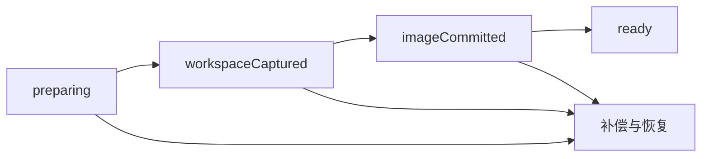

# 冷快照与分叉

快照把停止的 Docker 容器镜像与不可变的 Task Workspace 检查点配对。
镜像保存系统软件包、全局安装和主目录文件；检查点保存宿主机挂载的工作区，
包含已跟踪、未跟踪、被忽略和生成的文件，以及空目录和文件权限。

存在活动 agent 或 task turn 时返回 `snapshot_busy`。此功能只捕获文件系统
状态，不恢复内存、运行中的进程、服务、socket 或 tmpfs。Git 管理数据根据
固定的基线重建，源 worktree 的 `.git` 指针不能成为分叉的指针。检查点
manifest 会记录重建的元数据与用户声明的排除项。

## Host API

所有命令使用 Host 的部署身份和工作区授权。调用方提供的 Docker label
不能作为归属证据。
Docker driver 使用运行时获取凭据确认归属。在此功能上线前创建的运行时，
需要重新获取一次后才能创建快照。

| 命令                       | 输入                                                                                     | 结果                                             |
| -------------------------- | ---------------------------------------------------------------------------------------- | ------------------------------------------------ |
| `sandbox_snapshot_create`  | `request` 包含 `projectId`、`workspaceId`、`provider`、`containerId` 和可选 `exclusions` | 快照记录                                         |
| `sandbox_snapshot_list`    | `projectId`                                                                              | 快照记录列表                                     |
| `sandbox_snapshot_get`     | `snapshotId`                                                                             | 快照记录                                         |
| `sandbox_snapshot_delete`  | `snapshotId`                                                                             | 已标记删除的快照记录                             |
| `sandbox_snapshot_pin`     | `snapshotId`、`pinned`                                                                   | 更新后的快照记录                                 |
| `sandbox_snapshot_fork`    | `request` 包含 `snapshotId`、`taskId`、`sessionId`                                       | 新工作区与容器                                   |
| `sandbox_snapshot_restore` | 分叉请求加可选 `workspaceId`                                                             | 恢复后的工作区与容器，`restoredInPlace` 标明结果 |

TypeScript 适配器位于 `lib/sandbox/`。响应包含分叉的 `portLease`，后续预览
client 可以据此解析工作区端口偏移，无须保留源工作区的端口块。

## 捕获与失败恢复

Host 在 `task-workspaces.sqlite` 中记录创建日志：



账本表为 `workspace_checkpoints`、`sandbox_snapshots`、
`snapshot_artifact_refs` 和 `snapshot_operations`。检查点拥有自己的 Git
引用和内容存储。镜像名称为 `cognia-snapshot-<deploymentHash>:<uuid>`，
账本记录其不可变 image ID。启动时处理被中断的操作，未完成的快照不能作为
ready 状态的恢复源。

运行时获取按 canonical workspace root 使用共享锁。快照与恢复状态转换
需要独占锁；存在活动获取时立即返回 `snapshot_busy`。转换之间由持久化
日志中的预留记录保护工作区。捕获、Git pin、blob 写入和物化不持有账本
mutex；发布结果时重新校验日志状态和当前预算，因此大规模捕获不会阻塞
其他工作区。

完整捕获模式在必需内容超出预算时失败，不沿用普通工作区捕获对生成文件的
过滤规则。排除项必须显式传入，并保留在记录和 manifest 中，让调用方可以
说明恢复会省略哪些内容。
排除项是工作区相对路径或目录前缀；glob 模式和越界路径会被拒绝。不支持的
特殊文件会列入 manifest。Git 控制元数据会重建，不会在不同根目录间复制。

## 分叉隔离

分叉获得新的 task、workspace、执行目录和 ADR-0229 端口租约。系统重建
记录的 Git commit 与检查点覆盖层，再使用快照镜像创建新容器。源挂载、
租约、会话、授权和出口桥接不会被复制。网络准入会重新检查；使用允许列表的
分叉获得新的出口租约。
注入的 agent bundle digest 会被记录，并在恢复工作区前检查。bundle 发生
变化时拒绝分叉，不会静默替换为另一个运行时 bundle。

生命周期钩子只重新运行 `postStart` 和 `postAttach`。创建与安装钩子不能
覆盖检查点中已经安装好的文件系统。只有已归档且可恢复的工作区允许原位恢复；
其他情况下，恢复操作创建分叉。
原位恢复期间，旧的停止容器和镜像关联会保留到工作区及新运行时均成功，
以便失败时回滚。

## 预算与删除

`sandboxSnapshotBudgetBytes` 属于工作区生命周期策略，默认 1 GiB。
它与同样默认 1 GiB 的 `blobBudgetBytes` 独立。检查点数据和提交镜像的
存储计入沙盒快照预算。超预算创建会失败并补偿。

未固定快照在 30 天后过期，固定可阻止按保留期过期。删除先标记 tombstone，
调用预览撤销接入钩子，随后仅在 runtime、fork 和进行中操作引用均消失后
删除镜像。Git 引用和 blob 在镜像删除后释放。清理限定于当前部署，绝不执行
`docker system prune`。

预览链接、监听器与 UI 独立交付。Phase 1a 提供它们需要的撤销钩子和稳定的
快照、分叉身份。

## Provider 与验证

能力分别为 `filesystemCheckpoint`、`forkFromCheckpoint`、`pauseResume`
和 `memoryResume`。本地 Docker 支持文件系统检查点与分叉。E2B 保留暂停
恢复，但在验证其 API 前，以明确的不支持原因拒绝检查点分叉。旧 Host 未提供
能力标志时，不能假定它支持快照。

定向编译检查命令：

```sh
cargo check --offline -p cognia-task-workspace -p cognia-sandbox-pool --tests
```

同目录测试使用 `FakeContainerApi` 验证失败路径和隔离。真实 Docker 往返
测试标记为 `#[ignore = "requires a real Docker daemon"]`，文档注释中给出
准确调用命令。这些测试需要 daemon，与编译和 fake 测试证据分开报告。
往返测试使用 `COGNIA_TEST_SNAPSHOT_IMAGE` 指定的预加载镜像（默认
`alpine:3.20`），不会拉取镜像。
需要绑定 socket 的测试不能在限制 socket 的沙盒中执行。两类测试均不验证
独立交付的预览 UI。

参见 [ADR-0231](/docs/adr/0231-sandbox-snapshots-join-rootfs-and-workspace)。
