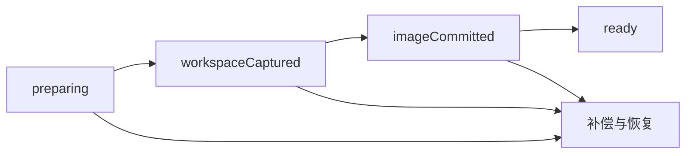

# 冷快照与分叉

快照把停止的 Docker 容器镜像与不可变的 Task Workspace 检查点配对。
镜像保存系统软件包、全局安装和主目录文件；检查点保存宿主机挂载的工作区，
包含已跟踪、未跟踪、被忽略和生成的文件，以及空目录和文件权限。

存在活动 agent 或 task turn 时返回 `snapshot_busy`。此功能只捕获文件系统
状态，不恢复内存、运行中的进程、服务、socket 或 tmpfs。Git 管理数据根据
固定的基线重建，源 worktree 的 `.git` 指针不能成为分叉的指针。检查点
manifest 会记录重建的元数据与用户声明的排除项。

## Host API

所有命令使用 Host 的部署身份和工作区授权。调用方提供的 Docker label
不能作为归属证据。
Docker driver 使用运行时获取凭据确认归属。在此功能上线前创建的运行时，
需要重新获取一次后才能创建快照。

| 命令                       | 输入                                                                                     | 结果                                             |
| -------------------------- | ---------------------------------------------------------------------------------------- | ------------------------------------------------ |
| `sandbox_snapshot_create`  | `request` 包含 `projectId`、`workspaceId`、`provider`、`containerId` 和可选 `exclusions` | 快照记录                                         |
| `sandbox_snapshot_list`    | `projectId`                                                                              | 快照记录列表                                     |
| `sandbox_snapshot_get`     | `snapshotId`                                                                             | 快照记录                                         |
| `sandbox_snapshot_delete`  | `snapshotId`                                                                             | 已标记删除的快照记录                             |
| `sandbox_snapshot_pin`     | `snapshotId`、`pinned`                                                                   | 更新后的快照记录                                 |
| `sandbox_snapshot_fork`    | `request` 包含 `snapshotId`、`taskId`、`sessionId`                                       | 新工作区与容器                                   |
| `sandbox_snapshot_restore` | 分叉请求加可选 `workspaceId`                                                             | 恢复后的工作区与容器，`restoredInPlace` 标明结果 |

TypeScript 适配器位于 `lib/sandbox/`。响应包含分叉的 `portLease`，预览
client 可以据此解析工作区端口偏移，无须保留源工作区的端口块。

## 捕获与失败恢复

Host 在 `task-workspaces.sqlite` 中记录创建日志：



账本表为 `workspace_checkpoints`、`sandbox_snapshots`、
`snapshot_artifact_refs` 和 `snapshot_operations`。检查点拥有自己的 Git
引用和内容存储。镜像名称为 `cognia-snapshot-<deploymentHash>:<uuid>`，
账本记录其不可变 image ID。启动时处理被中断的操作，未完成的快照不能作为
ready 状态的恢复源。

运行时获取按 canonical workspace root 使用共享锁。快照与恢复状态转换
需要独占锁；存在活动获取时立即返回 `snapshot_busy`。转换之间由持久化
日志中的预留记录保护工作区。捕获、Git pin、blob 写入和物化不持有账本
mutex；发布结果时重新校验日志状态和当前预算，因此大规模捕获不会阻塞
其他工作区。

完整捕获模式在必需内容超出预算时失败，不沿用普通工作区捕获对生成文件的
过滤规则。排除项必须显式传入，并保留在记录和 manifest 中，让调用方可以
说明恢复会省略哪些内容。
排除项是工作区相对路径或目录前缀；glob 模式和越界路径会被拒绝。不支持的
特殊文件会列入 manifest。Git 控制元数据会重建，不会在不同根目录间复制。

## 分叉隔离

分叉获得新的 task、workspace、执行目录和 ADR-0229 端口租约。系统重建
记录的 Git commit 与检查点覆盖层，再使用快照镜像创建新容器。源挂载、
租约、会话、授权和出口桥接不会被复制。网络准入会重新检查；使用允许列表的
分叉获得新的出口租约。
注入的 agent bundle digest 会被记录，并在恢复工作区前检查。bundle 发生
变化时拒绝分叉，不会静默替换为另一个运行时 bundle。

生命周期钩子只重新运行 `postStart` 和 `postAttach`。创建与安装钩子不能
覆盖检查点中已经安装好的文件系统。只有已归档且可恢复的工作区允许原位恢复；
其他情况下，恢复操作创建分叉。
原位恢复期间，旧的停止容器和镜像关联会保留到工作区及新运行时均成功，
以便失败时回滚。

## 预算与删除

`sandboxSnapshotBudgetBytes` 属于工作区生命周期策略，默认 1 GiB。
它与同样默认 1 GiB 的 `blobBudgetBytes` 独立。检查点数据和提交镜像的
存储计入沙盒快照预算。超预算创建会失败并补偿。

未固定快照在 30 天后过期，固定可阻止按保留期过期。删除先标记 tombstone，
调用预览撤销接入钩子，随后仅在 runtime、fork 和进行中操作引用均消失后
删除镜像。Git 引用和 blob 在镜像删除后释放。清理限定于当前部署，绝不执行
`docker system prune`。

## 本机预览链接

Settings 与工作区概览中的 Runtime environment 区域复用快照和预览面板。
快照面板支持创建检查点并填写可选工作区相对排除路径，显示创建时间、镜像
大小、固定状态及 phase，并提供固定、删除、分叉和符合条件的恢复操作。
预算用量由 Host 账本提供，包含检查点存储；UI 只累加镜像大小会低估用量。
忙碌或超预算错误保持可见，不会丢弃当前列表。

预览链接服务于本机所有者，或某一台已配对桌面（见
[已配对设备预览](#已配对设备预览)）。没有匿名公开链接。

桌面命令通过可信本地 IPC 执行。Headless 所有者使用经过认证、仅接受
loopback 的内部 service plane；已配对设备 RPC 不能调用这些命令。
Create/open 响应包含临时凭据，因此不写入持久化幂等回执。Headless 打开
操作返回 bootstrap URL；桌面 UI 将该 URL 交给嵌入式浏览器。

| 命令 | 输入 | 结果 |
| --- | --- | --- |
| `sandbox_preview_context` | `projectId` | Host 持有的运行时目标、已批准端口和快照预算用量 |
| `sandbox_preview_create` | `request` 包含目标、端口、audience 和可选 `expiresInSeconds` | 授权和一次性 bootstrap URL |
| `sandbox_preview_list` | `projectId`，可选 `workspaceId`、`pageSize`、`pageToken` | 不含凭据的授权元数据分页 |
| `sandbox_preview_revoke` | `grantId` | 已撤销且 revision 更新的授权 |
| `sandbox_preview_open` | `grantId` | 供嵌入式浏览器使用的新 bootstrap URL |

TypeScript 适配器为 `lib/sandbox/previews.ts`，hook 位于 `hooks/sandbox/`。
UI 提供 5 分钟、15 分钟、30 分钟和 1 小时有效期、实时倒计时、仅复制一次、在嵌入式
浏览器打开和撤销操作。打开复用已有的嵌入式浏览器请求流程；当前界面无法
打开该面板时显示错误，不会静默改用其他浏览器。

`PreviewGrantV1` 在 `task-workspaces.sqlite` 中记录目标运行时 generation、
解析后的端口、端口租约、audience、过期时间和 revision。固定端口必须由
目标当前的 environment spec 批准。`workspace-lease-offset` 根据该工作区
自己的租约解析，因此新分叉使用新的端口块。快照清理在释放产物前调用已接入
的预览撤销器。

链接通过 URL fragment 携带仅可兑换一次、有效期 60 秒的凭据：
`/__cognia_bootstrap#<token>`。Bootstrap 页面通过 POST 将其兑换为
HttpOnly、host-only、SameSite=Strict cookie，清除 fragment 后导航到 `/`。
Token 不出现在 URL query 或列表响应中。持久化浏览历史和 dock 标签页
排除 bootstrap 页面。授权默认有效 15 分钟，最长 1 小时；进程重启后凭据
失效，即使账本仍保留元数据。

预览流量使用独立于 Companion 的 loopback 监听器，origin 是
`http://p-<id>.localhost:<port>`。精确 Host 匹配防止其他名称访问该授权。
计划中的 `http://127.0.0.1:<per-grant-port>` 兼容模式在 UI 中禁用，Host
也会拒绝：cookie 在不同端口之间共享，无法隔离应用会话。无法解析
`*.localhost` 的目标暂不支持，需独立存储或另行验证的主机名替代方案。
每个请求和 WebSocket upgrade 都重新检查授权和运行时权限；撤销和过期
会终止活动响应，包括 SSE 和升级后的流。已有的 `open_port` 转发无需发布
Docker 端口，也适用于 `network=none`。

Client 使用共享分页适配器收集所有列表页；结果不完整或 cursor 重复时拒绝
返回。重新打开授权会替换尚未兑换的 bootstrap 凭据，之前复制的 URL 随即
不能再兑换。

## 已配对设备预览

所有者可以把 audience 选为某一台已配对桌面
（`{ kind: "pairedDevice", deviceId }`），将授权共享给它。创建时该设备必须
仍持有 `workspace.write`；所有者的这一选择就是对该设备、项目和端口的批准。
配对授权没有监听器，也没有 bootstrap 密钥：origin 是设备路由
`/api/sandbox/previews/<id>/`，所有者无法在本机打开（`sandbox_preview_open`
以 `preview_paired_grant_opens_on_device` 拒绝）。

| 路由 | 用途 |
| --- | --- |
| `GET /api/sandbox/previews` | 共享给调用设备、且其仍可访问所属项目的有效授权 |
| `/api/sandbox/previews/{grant}/…` | 该授权的不透明 HTTP 与 upgrade 代理 |

两者都是设备路由：先校验 bearer + DPoP，再检查 `device_can_control` 和授权
所属项目的 `environment_port_access` 审批权限。共享给其他设备的授权返回 404，
与不存在的授权无法区分；控制权限被收回返回 403；已撤销、过期或失效的授权
返回 410。每个请求还会重新检查运行时 generation 与端口批准；流保持打开期间，
中继每两秒重新授权一次设备。撤销、过期或失去控制权限都会关闭活动响应和升级
后的流。入站请求会剥离预览 cookie，出站 cookie 被改为 host-only。

已配对桌面通过与环境端口转发相同的原生 loopback 中继
（`crates/cognia-codeserver/src/relay.rs`）打开授权。中继只接受
`/api/sandbox/previews/<32 位小写十六进制>/`，固定 Host 证书，并用设备密钥为
每个代理请求签名；系统浏览器只看到 `http://127.0.0.1:<port>/`。已配对桌面的
Settings 中列出“共享给此设备”（`lib/sandbox/paired-previews.ts`、
`hooks/sandbox/use-shared-sandbox-previews.ts`）；授权从列表中消失时，其中继
随之关闭。

手机与浏览器刻意保持未启用：WebView 无法附带 DPoP，WAN 通道只传输 RPC 帧，
不传输 HTTP 流。`PairedPreviewSupport` 记录了这一点，所有者选择器会以禁用并
标注“尚未启用”的方式列出这些设备，测试同时固定这两点。

## 审计与指标

每个修改快照的操作（`create`、`delete`、`pin`、`fork`、`restore`）以及每次
预览 `create`、`open`、`revoke` 都会写入以项目为 scope 的审计记录
（`sandbox_snapshot_<op>`、`sandbox_preview_<op>`）。这些命令要求 Host 的
service scope，因此 actor 为 `host-service`。失败的快照操作只记录错误码。
被拒绝的设备请求以设备 id 审计（`sandbox_preview_device_request`）；被放行
的请求只计数，因为一个页面会加载大量资源。撤销会记录原因：`owner`、
`invalidated` 或 `snapshot_deleted`。

`/metrics` 暴露 `cognia_sandbox_preview_events_total{event}`（`created`、
`created_paired`、`opened`、`redeemed`、`revoked`、`device_request`、
`device_denied`）和 `cognia_sandbox_snapshot_operations_total{operation,outcome}`。
两组标签都是封闭集合。

## Provider 与验证

能力分别为 `filesystemCheckpoint`、`forkFromCheckpoint`、`pauseResume`
和 `memoryResume`。本地 Docker 支持文件系统检查点与分叉。E2B 保留暂停
恢复，但在验证其 API 前，以明确的不支持原因拒绝检查点分叉。每个远程
provider 声明自己的能力标志，Host 再将其收窄到自身能驱动的范围。旧 Host 未提供
能力标志时，不能假定它支持快照。

定向编译检查命令：

```sh
cargo check --offline -p cognia-task-workspace -p cognia-sandbox-pool --tests
```

同目录测试使用 `FakeContainerApi` 验证失败路径和隔离。真实 Docker 往返
测试标记为 `#[ignore = "requires a real Docker daemon"]`，文档注释中给出
准确调用命令。这些测试需要 daemon，与编译和 fake 测试证据分开报告。
往返测试使用 `COGNIA_TEST_SNAPSHOT_IMAGE` 指定的预加载镜像（默认
`alpine:3.20`），不会拉取镜像。
需要绑定 socket 的测试不能在限制 socket 的沙盒中执行。

2026-10-17 已在 macOS 26.5 上验证：系统解析器把任意 `*.localhost`（包括多级
子域名）解析到 `127.0.0.1` 和 `::1`，因此 macOS 系统 WebView 能解析每个授权的
主机名；Chromium 自身也会解析 `*.localhost`。预览监听器测试（包括独立的回环
origin）已在 Host 上用真实 socket 运行。尚未验证：Windows 上的 WebView2、Linux
上的 WebKitGTK，以及在原生应用内完整走一遍创建、兑换、打开、撤销（Tauri
agent-debug bridge 不可用）。数字主机名回退仍不可用。单元测试和离线 Rust 编译
不能证明原生 cookie 行为。

参见 [ADR-0231](/docs/adr/0231-sandbox-snapshots-join-rootfs-and-workspace)。
