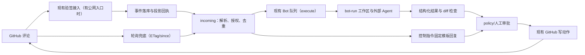
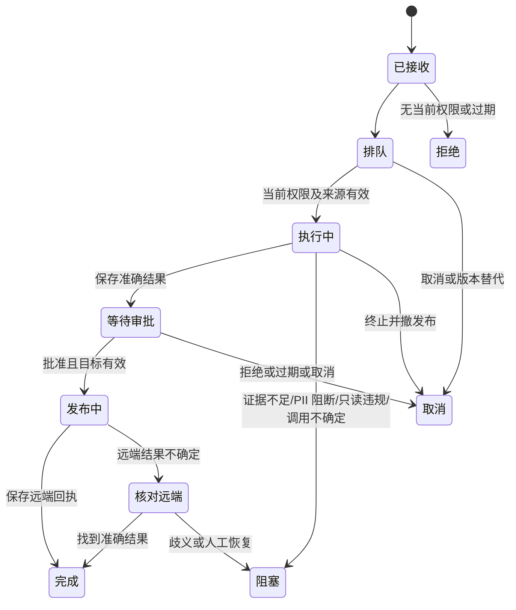

# GitHub 评论触发 Cognia：复用 GitHub Delivery 与 Bot，支持 Desktop 和 Headless

| 项目       | 内容                                                                                                                                                                                                                                                                                        |
| ---------- | ------------------------------------------------------------------------------------------------------------------------------------------------------------------------------------------------------------------------------------------------------------------------------------------- |
| 状态       | 技术评审草案（修订版 r2）；尚未实现、启用或批准上线                                                                                                                                                                                                                                         |
| 作者与日期 | Codex 初稿 2026-10-12；r2 源码核查与决策修订 2026-10-12；Asia/Shanghai                                                                                                                                                                                                                      |
| 诉求       | 支持评论指令、权限校验、上下文收集、任务执行、结果回写与 Headless                                                                                                                                                                                                                           |
| 范围       | 插件/共享包、Bot 运行时、Integration 事件投影、bot-run 工作区、外部 Agent、网关计量、多账号和部署                                                                                                                                                                                           |
| 基线       | 当前共享 dev 工作区；已有无关修改不属于本方案                                                                                                                                                                                                                                               |
| 评审角色   | GitHub 集成、Bot 平台、执行平台、Headless、安全隐私、QA 负责人                                                                                                                                                                                                                              |
| 首批目标   | 只读 `ask`/`review` 加控制指令；白名单作者；Desktop 与 Headless 同等验收；`fix` 为第二阶段                                                                                                                                                                                                  |
| 依据       | [前期研究](../research/2026-10-12-github-comment-trigger-research.md)、[ADR-0018](../content/docs/en/adr/0018-github-delivery.md)、[ADR-0174](../content/docs/en/adr/0174-the-bot-control-plane.md)、[ADR-0224](../content/docs/en/adr/0224-an-always-on-host-is-a-peer-the-user-brings.md) |

**推荐：**新增默认关闭的 `github-comment-bot` 插件，与 `github-devin-bot` 共用一个新的构建期共享包 `packages/github-bot-kit`。插件内分为短时“接收/控制”和可恢复“执行”两部分。GitHub Delivery 继续负责认证、验签和 API；Bot 平台继续负责队列、状态、租约、审批和恢复；外部 Agent API 负责执行，网关负责 PII 与计量。

**原因：**当前已能收到评论事件，但没有评论指令业务；源码核查还发现几处平台缺陷必须先补：事件落库后的投影失败不会重试（B1）、两项 Bot 策略上限只声明不执行（B2）、bot-run 检出用环境凭据且写死 github.com（B3）、Desktop/Headless 默认没有公网 webhook 入口（B8）。

**预期：**白名单内且当前有 write 权限的人在 Issue/PR 中提交 `@<触发词> ask/review`，系统准确记录请求，在 Desktop 或 Headless 执行只读任务，按安装的发布模式（默认自动）回写回答或 COMMENT Review。评论内容不授予任何额外 Host 权限。`fix`（草稿 PR）留在第二阶段。

**改动原则：**只扩展现有机制，不另建任务队列、webhook 服务、凭据库、Agent 引擎或新的 SDK 授权接口。本文接口、默认值和状态均为方案，不能当作当前已支持的功能。

## 1. 验收目标是“评论到结果”的完整链路

| 目标      | 当前基础                                   | 首批目标结果                                                  |
| --------- | ------------------------------------------ | ------------------------------------------------------------- |
| G1 指令   | 原始评论事件，无解析                       | 准确识别正文指令，引用/代码/普通评论/自身输出不调模型         |
| G2 权限   | 账号/仓库范围；`conditions.actors` 可选    | 白名单 + 当前 collaborator write 权限，接收/执行/发布前三处查 |
| G3 上下文 | 仓库范围的只读 `authenticatedRequest`      | 准确指令、Issue/PR、线程、固定 SHA、证据清单、脱敏            |
| G4 执行   | bot-run 工作区和外部 Agent API             | 固定模型、隔离、取消、恢复，Desktop/Headless 同等             |
| G5 回写   | 评论/Review 动作，全部需 bot_approval      | 默认 policy 自动发布，人工模式可选；明确失败状态              |
| G6 恢复   | 事件落库后投影失败不重试；无轮询补扫       | 落库到入队之间崩溃可恢复，不重复执行/发布                     |
| G7 接入   | 两种 Host 都需用户自配公网 URL             | webhook 优先、轮询兜底；无公网入口也可用                      |
| G8 运维   | `maxConcurrentRuns`/`maxRunCostUsd` 未生效 | 两项上限真实执行；就绪诊断、停用、审计                        |

首批纳入 github.com App/PAT、Issue/PR 普通评论、行级评论、提交的 Review 正文、后续指令、私有仓库、自动/人工发布，以及配对 Web/移动端管理。

首批不做：`fix`/`retry`（第二阶段，见 §16）、自动 merge/release、仓库设置修改、任意公众触发、评论选择模型或凭据、访问无关文件、独立 Host 自动 failover。GitHub Enterprise 须对明确服务器版本验证检出/上下文/发布；支持 API origin 不等于完整支持。

## 2. 源码核查：已有能力与缺口

“已确认”指 2026-10-12 检查的当前源码（行号为核查时的位置）；“拟新增”指本方案要求；“待验证”须在对应工作包中证明。历史测试不等于新功能验证。

| 已确认能力                                                                                        | 模块                                                                                                                                       | 本方案处理                                         |
| ------------------------------------------------------------------------------------------------- | ------------------------------------------------------------------------------------------------------------------------------------------ | -------------------------------------------------- |
| `issue_comment.*`、`pull_request_review_comment.*`、`pull_request_review.submitted` 已标准化      | [GitHub Delivery](../../plugins/github-delivery/src/index.ts)（约 945–956 行）                                                             | 直接订阅；review edited/dismissed 未声明，首批不用 |
| 验签（HMAC 常量时间）、spool 去重、唤醒                                                           | [Rust router](../../crates/cognia-scheduling/src/workflow/triggers/webhook_router.rs)                                                      | 不另建 HTTP 入口                                   |
| 事件落库后投影 Workflow/Inbox/Bot                                                                 | [events](../../lib/integrations/events.ts)                                                                                                 | **B1：**投影失败不重试，通用修复                   |
| 触发器匹配、按 `installationId::eventId` 去重入队                                                 | [dispatch](../../lib/bot/events/dispatch.ts)、[router](../../lib/bot/events/router.ts)、[deliveries](../../lib/db/bot-event-deliveries.ts) | 直接复用，不另建 commandKey 去重表                 |
| `ctx.bots.enqueue` 支持 `resource`/`correlation`；`listDeliveries` 先按 `resourceId` 过滤再 limit | [Bot API](../../lib/plugin/api/bots-api.ts)                                                                                                | 线程归属用 `resource.id`，不新增线程索引           |
| `cancelResource(resourceId, exceptRevision)`                                                      | 同上                                                                                                                                       | 编辑替代/删除取消直接复用                          |
| 持久步骤、挂起、审批（human/policy）、绝对期限                                                    | [step](../../lib/bot/runtime/step.ts)、[run](../../lib/bot/runtime/run.ts)、[run-authority](../../lib/bot/policy/run-authority.ts)         | 自动发布走现有 policy 模式                         |
| 所有非 read 的 Bot 集成写入需准确 `bot_approval`，且走 PII gate                                   | [binding broker](../../lib/plugin/api/bot-integration-binding.ts)、[action-runner](../../lib/integrations/action-runner.ts)                | 不新增状态写入豁免                                 |
| Bot 绑定的 GET 已限定在绑定仓库前缀，并按账号 API origin 解析（支持 GHE）                         | [Integration API](../../lib/plugin/api/integrations-api.ts)（约 181–235 行）                                                               | 上下文与权限查询直接用，不扩 Delivery 读取动作     |
| ETag、Link 分页、限流 `retryAt` 的读取器；配置解析；审批后发布流程                                | [Devin github.ts](../../plugins/github-devin-bot/src/github.ts)、[Devin execute](../../plugins/github-devin-bot/src/execute.ts)            | 抽入 `packages/github-bot-kit`（B4）               |
| poll 触发器、cursor、ETag 304                                                                     | [Devin monitor](../../plugins/github-devin-bot/src/monitor.ts)                                                                             | 轮询兜底（B8）复用同一模式                         |
| 外部 Agent：Bot 模式 cwd 固定、invocation 检查点、`recovery_required`、prompt 先 `redactText`     | [external dispatch](../../lib/plugin/api/external-agent-api.ts)                                                                            | 唯一执行器                                         |
| 网关对每个带 ticket 的请求扫描完整历史/tools，PII 命中返回 400 阻断                               | [gateway server](../../crates/cognia-gateway/src/server.rs)、[任务网关](../../lib/ai/agent/external/config/gateway-task.ts)                | **B6：**上下文先脱敏，阻断按 `pii_blocked` 处理    |
| 逐次注入 git 凭据（extraheader，不进 argv/URL/.git/config，隔离环境 helper）                      | [mirror credential](../../crates/cognia-git-mirror/src/credential.rs)、[github workspace](../../crates/cognia-git/src/github/workspace.rs) | **B3：**bot-run 复用                               |
| `RunBudgetGovernor` 单一预算权威、`lib/usage/cost-budget`                                         | [governor](../../lib/ai/agent/execution/run-budget-governor.ts)                                                                            | **B2：**费用上限复用                               |
| GitHub App 投递失败自动重投（15 分钟，App 账号）                                                  | [delivery recovery](../../lib/integrations/github-delivery-recovery.ts)                                                                    | Desktop 离线后补收的一条路径                       |
| Headless brain 注册 Integration 与 Bot 运行时，启动时回收过期租约                                 | [Integration](../../lib/headless/runtimes/integration-runtime.ts)、[Bot](../../lib/headless/runtimes/bots.ts)                              | 复用                                               |
| 线程分组、评论/CI 文本清洗                                                                        | [pr-observe fetch](../../lib/github/pr-observe/fetch.ts)（`groupReviewThreads`）、[sanitize](../../lib/github/pr-observe/sanitize.ts)      | 移入共享包，`lib/` 改为从包导入，避免两份实现      |

| 缺口 | 核查结论                                                                                                                                                                                                                              | 处理                                                     |
| ---- | ------------------------------------------------------------------------------------------------------------------------------------------------------------------------------------------------------------------------------------- | -------------------------------------------------------- |
| B1   | `publishIntegrationEvent` 落库后，lifecycle、Workflow、Inbox、Bot 投影任一失败，重投都在“已存在”处提前返回（`events.ts` 约 151 行）；Bot 的 catch 无日志，审计无法区分“无匹配”与“抛错”；ingress drain 只在唤醒/启动时运行，无周期补扫 | §8.1 通用修复，前置 PR                                   |
| B2   | `maxConcurrentRuns`、`maxRunCostUsd` 被折叠并在 UI 展示，但运行时不读取；`requireApprovalForWrites` 不在 broker，只在 policy 审批模式生效                                                                                             | §7.5 实现两项强制                                        |
| B3   | bot-run 写死 `https://github.com/<repo>.git`、clone/fetch 不带绑定凭据（用环境 git 凭据）、全新 clone 不检出所请求 ref、不能 fetch `refs/pull/N/head`                                                                                 | §7.3                                                     |
| B4   | 共享辅助代码只存在于 devin-bot 源码中；插件无法 `require` 其他插件的代码                                                                                                                                                              | §3.2 构建期共享包                                        |
| B5   | 沙箱 `LaunchScope` 总把 cwd 设为可写                                                                                                                                                                                                  | 首批不改，用运行后 diff 检查（§7.4）；沙箱只读为后续加固 |
| B6   | 网关已逐请求扫描，但只阻断不脱敏；仓库/评论中常见邮箱、作者名                                                                                                                                                                         | §6 上下文先脱敏 + 阻断处理；待验证 Agent 只能经网关出网  |
| B7   | GitHub 事件对 Bot 而言永远 `selfProduced:false`；App 账号未保存 slug/bot 身份；PAT 账号的回写与触发者是同一人                                                                                                                         | §4.3 自身输出过滤                                        |
| B8   | Desktop/Headless 的 integration router 都只绑 127.0.0.1，`/integration` 未公开，需用户自配 public base URL 或隧道                                                                                                                     | §3.3 轮询兜底                                            |

不再列为缺口（初稿误判或已不适用）：

- 初稿要求扩展 Delivery 的评论/Review/文件/diff 读取动作：Bot 绑定 GET 已能在仓库范围内访问这些 REST 路径，包括 `/repos/{o}/{r}/collaborators/{login}/permission`。
- 初稿的 `commandThreadKey` 索引与 `[installationId+commandThreadKey+receivedAt]`：用 `resource.id = owner/repo#N` 加现有过滤即可。
- 初稿 B4“角色回合会复用最近会话”：属实（还会改写该会话 `workingDir`），但本方案只用 `runExternalAgent`，不涉及；该缺陷另行处理（§18）。

[Schema](../../lib/db/schema.ts) 当前为 v238；本方案只有 B1 需要一次 schema 升级，实际版本号在合入时占用。主应用静态导出，webhook 在 Host，不新增 `app/api`。旧 Delivery/Devin 保持兼容，新插件默认关闭。

## 3. 架构：接收/控制与长任务分开

### 3.1 拓扑

一个 Bot 定义有三类触发器：

- `incoming`：event 触发器（webhook 来源）与 poll 触发器（轮询来源），两者产出同一个 `GithubCommandSourceV1`。只做解析、授权、去重、入队与控制指令；不调模型、不建工作区。不设共享 `concurrencyKey`，长任务期间 status/cancel 仍可响应。
- `execute`：manual 触发器，`concurrencyKey: github-cmd:{{resource.scope}}`（每仓库串行），`holdConcurrencyWhileWaiting: false`。
- `reconcile`：定时，核对不确定的远端写入和过期任务。



图1：接入、队列、执行、发布保留原负责模块；新增评论语义、轮询来源与共享包。

| 方案                      | 取舍                                                 |
| ------------------------- | ---------------------------------------------------- |
| 新评论 Bot + 共享包——推荐 | 统一指令/恢复/结果，与 Devin 共享读取与发布代码      |
| 给 Devin monitor 加评论   | 监控业务不同，会强制绑定 Devin/SWE-2                 |
| 只拼 Workflow             | 自定义自动化可用，但权限/控制/不确定写入仍需公共能力 |
| 调 runIssueLoop           | 上下文不符、仅桌面、不支持问答/Review/控制           |
| 单独 Actions Agent        | 需另做部署/凭据/运行时，不属本次目标                 |

### 3.2 共享包 `packages/github-bot-kit`

插件只能 `require` 宿主共享模块（[shared-modules](../../lib/plugin/core/shared-modules.ts)），仓库目前没有“库插件”。要共享的辅助函数必须在**调用方自己的 run 与凭据绑定**里执行（`resolveBotIntegrationBinding` 会校验 run 归属），运行时 RPC 不适用。因此采用构建期共享：

- 零 `@/` 依赖，只依赖 `@cognia/plugin-sdk` 类型；无状态纯函数，由各插件 esbuild 打包内联。产物各一份是无害的：ADR-0195 拒绝打包 SDK 是因为 SDK 带有状态注册表，本包没有。
- 内容：`githubReader`（ETag、分页、限流，从 devin-bot 迁出）、配置解析辅助、Markdown 感知的指令解析器（新）、输出标记渲染/识别（新）、线程分组与文本清洗（从 `lib/github/pr-observe` 迁出，`lib/` 改为从包导入）、上下文预算器（新）、测试夹具（从 `devin-bot.test-helpers.ts` 迁出，放 `testing` 子路径）。
- devin-bot 同步改为从包导入，行为不变，现有测试须继续通过。
- 待验证：插件 `build.mjs` 能解析 `@cognia/github-bot-kit`（必要时加 esbuild alias）；`pnpm build:packages` 与 `plugin:packages:verify` 接受。
- “运行时库插件”（提供方持有状态或资源、调用方借用能力）另立 ADR，不阻塞本方案（§18）。

### 3.3 接入：webhook 优先，轮询兜底

两种 Host 的 integration router 都只绑 127.0.0.1，公网 URL 由账号的 `ingressEndpoint.publicBaseUrl` 提供。没有公网入口时，评论机器人仍须可用，所以：

- **有公网入口**：走现有 webhook（含 App 投递失败自动重投）。
- **无公网入口或 webhook 不健康**：插件 poll 触发器按安装配置间隔（默认 60 秒）读取：
  - `GET /repos/{o}/{r}/issues/comments?since=&sort=updated&direction=asc`：Issue 与 PR 的普通评论；
  - `GET /repos/{o}/{r}/pulls/comments?since=`：行级评论；
  - Review 无仓库级 since 接口：先取最近更新的 open PR，再取其 `/reviews`，按 `submitted_at` 与 cursor 过滤。
- 所有请求用 ETag 条件请求，cursor 存 `writeTriggerState`；按 GitHub 文档授权的 304 不计主限流，灰度实测。
- 两条路径产出同一指令源，按 `sourceKind + sourceId + sourceRevision` 去重（eventId 由此派生，落在现有 `dedupKey`）。
- 轮询看不到删除：执行前与发布前重读来源，404 视为删除并取消。
- 就绪检查分别报告 `webhook_ready` / `polling_only`，不把“只能轮询”当成故障；轮询延迟写入用法提示。
- 自动隧道（复用 `cognia-companion-connectivity` 的 cloudflared）不在首批。

## 4. 指令与评论修改规则

### 4.1 触发词与语法

触发词由安装配置：App 账号默认 `@<app-slug>`；PAT 账号必须显式配置。本文 `@cognia` 仅为示例。原因：`@cognia` 若是 GitHub 上的真实用户名，会通知到无关的人。App slug 与 bot 用户 ID 在账号建立或刷新时用 App JWT 调用 `GET /app` 获取并保存（当前未保存，属于 B7）。

一条评论只允许一个指令。解析忽略代码块、行内代码、引用、HTML 注释和链接目标。触发词须独立出现在未引用逻辑行开头，大小写不敏感；邮箱、带后缀的其他账号名、复制的示例不匹配。正文是数据，不成为 shell 参数；多指令返回用法，不偷偷选第一条。

| 指令              | 首批 | 行为                          | 模型/发布                                        |
| ----------------- | ---- | ----------------------------- | ------------------------------------------------ |
| `ask <问题>`      | 是   | 结合仓库/线程回答             | 只读执行，按发布模式回写评论                     |
| `review [重点]`   | 是   | 审查当前 PR；Issue 返回不支持 | 只读，固定为 COMMENT；不 APPROVE/REQUEST_CHANGES |
| `<自由文本>`      | 是   | ask 别名，提示改代码需用 fix  | 同 ask                                           |
| `status [任务]`   | 是   | 本线程最近或指定任务          | 不调模型，固定模板                               |
| `cancel [任务]`   | 是   | 取消排队/运行/审批等待        | 不调模型；本地取消立即生效                       |
| `help` 或仅触发词 | 是   | 用法与可用指令                | 不调模型，固定模板                               |
| `fix <要求>`      | 二期 | 实现修改并开草稿 PR           | 首批返回“尚未启用”固定模板，见 §16               |
| `retry <任务>`    | 二期 | 经新校验起新尝试              | 首批返回“尚未启用”固定模板                       |

语法错误、保留动作（merge/approve/release/exec/deploy）、目标不支持均不调模型。任务编号是不透明短别名，不暴露 DB/账号。相同仓库、账号、Host 路由只能有一个安装认领同一触发词，冲突时启用失败并说明。

### 4.2 来源、编辑与删除

订阅 `issue_comment` 与 `pull_request_review_comment` 的 created/edited/deleted，以及 `pull_request_review.submitted`。普通 PR 评论看 `issue.pull_request`；行级评论有 path/line/commit。父对象由 API 确认，不信评论 URL。

执行前重读最新评论/review，检查 ID、作者、仓库、父对象、版本；旧版本乱序标 superseded。编辑事件的 sender 必须等于原作者，不能编辑他人评论借其授权。

| 时机            | 行为                                                                                                     |
| --------------- | -------------------------------------------------------------------------------------------------------- |
| 执行前编辑      | 新版本入队，`cancelResource(exceptRevision=新版本)` 取消旧任务                                           |
| 执行/审批中编辑 | 取消旧任务并撤销未发布审批，保留产物；新版本按新指令处理                                                 |
| 完成后编辑      | 不重跑、不撤外部结果；新工作另发评论                                                                     |
| 执行前/中删除   | 取消未发布工作，保留最小 tombstone/审计；轮询路径靠重读 404 发现                                         |
| 发布后删除      | 不删除已发布的回复/review                                                                                |
| 迟到指令        | 超出安装时效（默认 24 小时，按评论最新版本时间）不执行；自动模式回复“已过期”固定模板，人工模式只本地记录 |
| 安装水位之前    | 历史评论始终不执行；管理员重放须显式指定事件并重新授权                                                   |

### 4.3 自身输出过滤（B7）

GitHub 事件对 Bot 永远不是 `selfProduced`，插件必须自己过滤：

- 所有输出带 `<!-- cognia-command:v1:<opaque-id> -->` 标记；解析器跳过带标记的评论。复制标记不获得归属，归属以持久记录为准。
- App 账号：sender ID 等于保存的 bot 用户 ID 时直接跳过。
- PAT 账号：回写身份与触发者可能是同一人，只能靠标记过滤；渲染器保证输出中的触发词不会出现在未引用行首（放入代码块或转义）。
- 来源为 `type: Bot` 的账号默认拒绝。

## 5. 权限由插件判定、Host 把关写入

### 5.1 作者授权（插件侧）

同时满足以下条件才接收：

1. 验签通过（webhook）或来自绑定账号的认证读取（轮询）；账号、仓库与来源 ID 一致。
2. 本 Host 有启用的安装，绑定同一账号与仓库。
3. 作者 ID 在安装配置的白名单内（首批必填）。
4. `GET /repos/{o}/{r}/collaborators/{login}/permission` 返回的用户 ID 与作者一致，基础权限为 write/maintain/admin；未知值拒绝。不信任 `author_association`、昵称或组织成员身份。
5. 来源不是 bot、不是本系统输出（§4.3），且在时效内（§4.2）。

检查实现在共享包中，用 Bot 绑定的只读 `authenticatedRequest`，不新增 SDK 接口。三处重查：接收时、执行开始时、发布前。三处检查都放在被记忆的 step 之外，旧记录不能让撤权后的作者重新有效。401/403/404、超时或限流均不授权；临时故障退避，明确无权则 denied。无权只本地审计，不公开回复。

status/cancel 的目标限定在同一安装、账号、仓库和线程；满足上述条件的人都能控制同线程任务。控制任务不等于批准发布。

团队模式（任何 write 协作者，无白名单）留作后续：接口与检查顺序不变，只是白名单可为空。

### 5.2 写入授权（Host 侧，复用）

所有非 read 的 GitHub 写入都经现有 broker（[binding broker](../../lib/plugin/api/bot-integration-binding.ts)）：动作在 `requires.integrationActions` 白名单内、作用域选择器匹配绑定仓库，且有准确匹配的 `bot_approval`。不新增状态写入豁免或固定模板 Host 能力。

| 发布模式     | 配置                                                                                         | 效果                                                                                                                              |
| ------------ | -------------------------------------------------------------------------------------------- | --------------------------------------------------------------------------------------------------------------------------------- |
| 自动（默认） | 安装授权 `maxAutonomy: autopilot`、`requireApprovalForWrites: false`，权限上限 `acceptEdits` | ask/review 回答、跟踪评论、status/help 回复用 `decisionMode: "policy"`，由现有 policy 自动批准准确内容                            |
| 人工         | 其他授权                                                                                     | policy 请求被现有逻辑降为 human；不发进度评论（只在 Cognia 内可见）；最终回答与 status/help 回复进入人工审批；cancel 本地立即生效 |

`fix` 的发布永远使用 `decisionMode: "human"`，与发布模式无关（§16）。所有集成写入已在 action-runner 经过 PII gate。审批走认证界面；Headless 通过现有 `run://approval-pending` 推送到配对端。

待验证：Bot 模式下 `acceptEdits` 的外部 Agent 遇到权限请求时，按 ADR-0224 A7 的 permission profile 挂起，而不是直接失败。如果会失败，ask/review 的工具集须收窄到不触发权限请求的范围。

## 6. 上下文有上限、有版本、有证据

通过 Bot 绑定的只读 `authenticatedRequest` 读取；仓库前缀与账号 origin 已由 Host 强制，分页跟随 Link 也不会越界。不抓取评论中的任意链接。

| 内容     | 要求                                                    |
| -------- | ------------------------------------------------------- |
| 指令     | 最新准确正文、哈希、版本、作者、父对象、URL             |
| Issue/PR | 标题、正文、状态；head/base 仓库、ref、SHA、draft/fork  |
| 线程     | 固定顺序，触发评论及根评论始终包含，每项标明来源        |
| 代码     | 固定 SHA 和 diff（`/pulls/{n}/files`），路径/行号有依据 |
| 规范     | 安装系统规则；仓库规范只是上下文，不能提升权限          |
| 历史任务 | 本线程的归属摘要/状态，不复用原生会话或跨项目记忆       |
| 必要 CI  | 有限、相关，远端证据与 Agent 自述区分                   |

建议上限：累计抓取 2 MiB、选入 256 KiB、24,000 估算 tokens 或模型窗口 40% 取更小值；指令 16 KiB、单项 32 KiB、50 条评论、300 项文件元数据、128 KiB diff、30 秒收集（不计限流等待）、每类 10 页。实际取 Host/provider 更严格上限，均非实测。

优先级：指令 → 父对象 → 触发行级线程/路径 → 相关代码 → 最近讨论 → CI。记录遗漏数量和截断标记。指令过大直接拒绝并建议拆分；证据不足影响正确性时 `blocked_context`。截断的 Review 不能称作完整审查。

**PII（B6）：**

- 收集到的评论、PR 正文、CI 片段先经 `sanitize`（控制字符/ANSI），再经 `redactText`，与初始 prompt 同一处理。上下文清单记录脱敏数量与脱敏后 digest。
- Agent 运行中读取的代码文件不经插件，模型请求由网关逐请求扫描；命中时网关返回 400 `pii_blocked`，任务判 `blocked`（原因码 `pii_blocked`），跟踪评论给固定模板说明，不自动重试、不放宽 gate。
- 灰度期统计 `pii_blocked` 比例，作为是否需要进一步手段的依据。
- 待验证（WP4）：bot isolation 下 Agent 进程只能经本地网关访问模型 provider，直连 provider 被拒；无法证明的预设不准入。

## 7. 复用执行引擎，补齐工作区与上限

### 7.1 JSON 约定与身份

以下为拟新增的插件内部类型，放在共享包中；普通 JSON，Bot 时间为毫秒，GitHub 版本为 ISO，SHA/digest 为字符串。

```typescript
type GithubCommandSourceV1 = {
  schemaVersion: 1
  ingress: "webhook" | "poll"
  repositoryId: string
  repository: string
  threadKind: "issue" | "pull_request"
  threadNumber: number
  sourceKind: "issue_comment" | "review_comment" | "review"
  sourceId: string
  sourceRevision: string
  sourceBodyHash: string
  actorId: string
  command: "ask" | "review" | "status" | "cancel" | "help"
  request: string
  targetTaskRef?: string
}
type GithubTaskRequestV1 = {
  schemaVersion: 1
  source: GithubCommandSourceV1
  installationConfigDigest: string
  executor: { presetId: string; model: string }
  contextRef: string
  checkout: { sha: string; ref: string; repositoryId: string }
}
type GithubTaskResultV1 = {
  schemaVersion: 1
  status: "completed" | "blocked" | "failed" | "cancelled" | "superseded"
  summary: string
  answer?: string
  findings?: { path: string; line: number; side: "LEFT" | "RIGHT"; body: string }[]
  workspaceDirty: boolean
  publication?: { commentUrl?: string; reviewUrl?: string }
  reasonCode?: string
}
```

身份与去重：

- incoming 调用 `ctx.bots.enqueue` 时，`eventId = gh-cmd:<repositoryId>:<sourceKind>:<sourceId>:<sourceRevision>`，`resource = { kind: "github_thread", id: "<owner/repo>#<N>", scope: "<repositoryId>" }`。
- 同一来源版本重复只产生一个 delivery，由现有 `dedupKey` 唯一索引保证。
- status 查询用 `listDeliveries({ resourceId, triggerId: "execute" })`。

稳定步骤名：`authorize-execute`（不记忆）、`collect-context`、`acquire-workspace`、`dispatch-agent-1`、`capture-result`、`check-workspace`、`prepare-publication`、`publication-decision`、`authorize-publish`（不记忆）、`publish-result`、`record-result`。重大配置变化取消待执行任务，不修改固定摘要。

### 7.2 不新增的 SDK 接口

初稿拟新增的 `integrations.authorizeGithubCommand`、`integrations.reportBotStatus`、Delivery 读取动作、`bots.listDeliveries` 线程过滤、工作区凭据 lease 注册命令，本修订全部取消，理由见 §2、§5。唯一新增的插件可见能力是 `ctx.workspace.acquire` 对 bot-run 的语义修正（§7.3），接口形状不变。

GitHub Delivery 需要的小改动：

- 增加 `replyToReviewComment` 写动作（行级回复，`risk: "write"`，`idempotency: "required"`），供首批行级触发使用。
- 增加 `updateComment` 写动作，供跟踪评论更新使用。
- App 账号保存 slug 与 bot 用户 ID（§4.1）。
- 现有 `commentIssue`/`commentPr`/`reviewPr` 直接复用。

### 7.3 工作区与凭据（B3）

bot-run 获取工作区沿用现有接口，修正四处：

1. **clone host 跟随绑定账号的 API origin**：github.com 或 GHE 实例，不再写死，`allowedHosts` 由 Host 从账号派生，不接受插件传入。
2. **凭据逐次注入**：Host 按绑定账号解析 token（与 issue loop 的 `resolveCredential` 相同路径），通过已有的 `auth_env` + `isolation_env`（`http.<origin>.extraheader`，`GIT_CONFIG_GLOBAL=/dev/null`，`GIT_CONFIG_NOSYSTEM=1`）只作用于本次 clone/fetch。token 不进 argv、URL、`.git/config`，环境 helper 无法覆盖。“绑定 A、环境登录 B”必须实际使用 A。
3. **全新 clone 也检出所请求的 ref/SHA**（当前只有复用缓存路径会检出）；缓存复用时先 fetch，避免旧状态。
4. **支持 `refs/pull/N/head`**：fork PR 的只读审查从 base 仓库 fetch 固定 SHA。

clone/fetch/publish 只在 Host 执行；Agent 不获得 GitHub 凭据、helper、带凭据的 Git 配置或 App 私钥。不新建凭据库或 lease 注册表。ADR-0224 A6 的 Host git 凭据按 host 存储、不区分账号，不用于本路径。

### 7.4 执行器、只读与结果校验

- 唯一执行器是 `ctx.agent.runExternalAgent`（Bot 模式）：cwd 固定为工作区、`COGNIA_BOT_ISOLATION=1`、invocation 检查点、`recovery_required` 不重发。安装配置准确的预设与模型，不悄悄换模型、角色、endpoint 或 Host。Codex/Claude 逐项就绪验收，注册预设不代表可用。
- 不使用 character turn（会复用并改写用户会话）。
- **只读（B5 首批方案）：**ask/review 运行在一次性 bot-run clone 中，`.git` 已写保护。运行后由 `captureBotWorkspace` 检查 diff：非空则 `workspaceDirty=true`、任务 `blocked`（原因码 `readonly_violation`），只发布固定模板说明，不发布任何代码或回答。沙箱级只读（`LaunchScope` 只读 cwd + 独立可写运行时目录）列为后续加固。
- 校验结构化结果的状态、长度、路径、行号；最多 50 项 findings，路径必须存在于固定 SHA 的 diff 或树中。

### 7.5 生命周期、并发与上限（B2）



图2：不确定调用/写入进入核对，不直接第二次执行。语义状态是现有 run/delivery 状态的投影（等待对应 parked/waiting，阻塞对应 blocked）。执行状态与回写状态分开，补发评论不重跑模型。

**并发：**

- 串行由 `concurrencyKey` 保证：execute 每仓库一个；incoming 不共享 key，控制指令不被长任务阻塞。
- 本方案同时让 `maxConcurrentRuns` 真正生效：按安装统计处于 running 的 delivery（parked/waiting 不计），在 delivery runner 认领前检查；各层取最小值；超限的 delivery 保持 pending，不计 attempt。
- 现有 devin-bot 声明的 `maxConcurrentRuns: 1` 生效后行为不变（它本来就靠 key 串行），须回归验证。
- 建议默认：每仓库 1 个执行、安装级 `maxConcurrentRuns` 3、20 个待执行任务；每作者 10 分钟 5 个模型任务、每分钟 30 个控制指令（插件内计数）。

**费用与时长：**

- `maxRunDurationMs`（已生效）建议 30 分钟活跃时间；外部 Agent 自身上限 30 分钟。
- 本方案让 `maxRunCostUsd` 真正生效：外部 Agent 的模型流量都经过本地网关 ticket；网关按 ticket 累计真实 usage（输入/输出/缓存 tokens），上报给该 Bot run 的 `RunBudgetGovernor`，由 `lib/usage/cost-budget` 定价并判定；超限后网关拒绝该 ticket 的后续请求，任务 `blocked`（原因码 `budget_exceeded`）。
- 待验证：网关当前是否已按 ticket 汇总 usage；若无，在 task lease 增加计量，不另建账本。
- 模型无已知定价时不声称硬美元上限：改为 token 封顶，并在 UI 与审计中标注“费用未知”。
- 建议默认 USD 2 与最多两次模型回合（首批 ask/review 一次）；审批等待不计活跃时间，绝对期限沿用现有 7 天或通道更短限制。

## 8. 持久投递与回写覆盖崩溃窗口

### 8.1 事件投影通用修复（B1，前置 PR）

现状：spool → drain → `publishIntegrationEvent`。事件落库后，lifecycle 对账、Workflow 分发、Inbox 投影、Bot 投递依次执行。前两者抛错时 drain 会 nack，但重投在“已存在”处提前返回；Bot 投递的异常被静默吞掉。

修复（不只针对 Bot）：

- 事件行增加投影状态：`projections: { lifecycle, workflow, inbox, bot }`，每项为 `pending | complete | failed(attempts, nextAttemptAt, errorCode)`，加 `projectionVersion` 和到期复合索引。这是一次 schema 升级，旧事件标 `legacy`、不执行。
- 重投或补扫遇到已落库事件时，只执行未完成的投影；已完成的不重复（Workflow 已有 occurrence 幂等，Bot 由 `dedupKey` 保证）。
- 每条投影独立 try，失败记录错误码与诊断，不再静默；审计区分“无匹配”和“失败”。
- Bot 投影在接收时捕获当时启用的接收者（安装 ID、triggerId、pinnedVersion）；注册未就绪记为 pending，不能当作零匹配成功。重放不自动发现新装 Bot；接收者关闭、删除或改绑定时取消。
- `startIntegrationRuntime` 增加周期补扫（30 秒，每轮 100 条）与 ingress drain 定时器（补上只在唤醒时运行的缺口）；5 次失败后 deadletter；未解决投影的事件不被 30 天保留清理提前删除。
- 用同一事务防止多个恢复器重复执行；退出时停定时器与订阅。

### 8.2 跟踪评论与结果回写

- 每任务一条 Issue/PR 普通跟踪评论（自动模式），内容为插件内固定模板：阶段、安全错误码、公开编号、允许的结果 URL、代码块中的用法。不含原指令、代码、日志、秘密、mention，不含私有 Companion 或 token URL。阶段变化时更新，最多每 30 秒一次，不流式公开模型输出。
- 每次写入都是 `waitForApproval({ decisionMode: "policy" })` + `executeAction`，与 devin-bot、pagerduty incident-responder 相同的“审批后写入”模式；自动模式由 policy 即时批准，人工模式不发跟踪评论。
- 最终回答：Issue/PR 普通评论；review 指令为 COMMENT review（绑定准确 commit ID）；行级触发用新增 `replyToReviewComment`，根评论失效则回同 PR 并说明理由。
- 回写身份为绑定账号；不借评论者或环境 Git 身份。

### 8.3 远端结果核对

本地幂等键不能让 GitHub POST 天然幂等。先保存写意图，再请求，保存回执并核对。

| 写入                 | 核对                                                            |
| -------------------- | --------------------------------------------------------------- |
| 创建跟踪评论         | 标记 + 真实发布者；有限历史核对后再 POST                        |
| 更新跟踪评论         | 保存 ID，GET 验证作者/仓库/标记；阶段单调，旧运行状态不覆盖终态 |
| 回答/Review/行级回复 | 唯一结果摘要、标记、线程、发布者；响应丢失先读                  |

POST 超时既不能确认结果，也不能证明未写，标 `writeback_uncertain` 由 reconcile 核对，不盲重试。补发不调模型；终态更新可合并，批准正文不可变。

## 9. Desktop 与 Headless 同等验收

不绕过旧 `isTauri` 限制，新路径不用 runIssueLoop。

| 形态                 | 负责范围                                                                                                        |
| -------------------- | --------------------------------------------------------------------------------------------------------------- |
| Tauri Desktop        | 接入（webhook 或轮询）、排队、检出、执行、发布；应用关闭期间的评论在下次启动时由轮询/App 重投补收，并受时效约束 |
| Linux/macOS Headless | 同一处理器，brain 运行时；前端关闭仍运行；人工审批推送到配对端                                                  |
| 配对 Web/移动端      | 配置、监控、批准、取消，不运行第二份任务                                                                        |
| 独立 Web/移动端      | 显示需要 Host，不启用本地执行                                                                                   |

启用前就绪检查：插件/共享包版本、账号/仓库、白名单非空、真实权限探测、接入模式（`webhook_ready`/`polling_only`）、持久 DB/工作区、绑定 Git 凭据检出、预设/模型/认证、网关出网约束、写权限、发布模式所需授权、人工决策通道（人工模式）。

明确的 `needs_setup` 原因码：`allowlist_empty`、`permission_probe_failed`、`private_clone_unavailable`、`executor_unavailable`、`pii_boundary_unverified`、`publication_grant_missing`、`decision_channel_missing`、`trigger_conflict`。每个任务执行时再检查一次，启用时通过不代表永久有效。

同仓库只指定一个 Host/account 路由。租约只保护同一 DB，无法去重两个独立 Host 同时收到的同一指令，所以拒绝本地重复安装，由运营指定唯一路由。迁移顺序：先关闭旧接收，处理或取消在途任务，再重新安装，最后切入口。首批不做跨 Host 自动故障转移。

## 10. 异常必须有明确恢复或终止结果

| 异常                     | 行为                                                 |
| ------------------------ | ---------------------------------------------------- |
| 验签失败/正文超限        | Rust 在插件、DB、模型工作前拒绝                      |
| 投影失败或注册未就绪     | 投影 pending，补扫/启动后恢复（§8.1）                |
| webhook 不可达           | 轮询兜底；就绪显示 `polling_only`                    |
| 权限查询失败             | 退避，不授权                                         |
| 撤权/移出白名单/移除仓库 | 执行前或发布前拒绝，保留产物                         |
| 上下文不足               | 保留清单，阻塞，不说完整审查                         |
| PII 阻断                 | `blocked`/`pii_blocked`，固定模板说明                |
| 只读违规                 | `blocked`/`readonly_violation`，不发布               |
| 费用/并发超限            | `budget_exceeded` 阻塞；并发超限保持排队             |
| 提示词可能已发送后断线   | `recovery_required`，检查原任务，不二次发送          |
| 发模型前崩溃             | 恢复准备、重新授权、固定 invocation                  |
| 审批拒绝/过期            | 不写入；自动模式可用固定模板报告状态                 |
| 目标/来源变化或关闭      | 不发布，保留过时结果                                 |
| 限流/临时错误            | 遵守 Retry-After/reset，回写独立退避                 |
| 评论锁定/删除/失去写权   | 本地结果保留，回写失败，不转到无关线程               |
| POST 成功、响应丢失      | 按标记核对，歧义阻塞                                 |
| 取消与发布竞争           | 撤销并终止；已写结果记 `cancelled_after_publication` |
| 持久化失败               | 不以内存充当成功回执，下一次外部写入前停止           |
| 迟到指令                 | 超出时效不执行，自动模式回复过期模板                 |

Review 绑定准确 commit ID；最后一次读取与写入之间仍有竞争窗口。检测到版本变动时记 `published_against_previous_revision` 并注明原 SHA，不宣称针对最新版本。

## 11. 存储、迁移、保留与删除

| 数据             | 存储与规则                                                        |
| ---------------- | ----------------------------------------------------------------- |
| 原始投递/事件    | spool/integrationEvents，30 天；有未解决投影的不清理              |
| 投影状态         | 事件行本地字段（B1 schema 升级），不进入普通同步/导出             |
| 轮询 cursor      | Bot trigger state（现有）                                         |
| 配置/上下文/结果 | botRunSteps；大内容用受限产物引用；终态建议 30 天                 |
| 队列             | botEventDeliveries（现有，settled 14 天）；配对镜像不消费         |
| 跟踪/远端记录    | 插件 storage 与 actionJobs，清除正文后保留去重记录                |
| 审批             | 现有 interrupt，绝对期限不延长                                    |
| 秘密             | 现有 secret store；逐次注入，不进普通 DB、prompt、URL、argv、同步 |

新插件不新增表。B1 是唯一的 schema 变更，须在合入时占用下一版本号，并同步 `CORE_TABLE_NAMES`（若涉及）与 `pnpm db:governance:write`。按仓库约定，旧版本数据不迁移：旧事件标 `legacy`。回退时使用兼容新 DB 版本的旧代码构建。

清理上下文/日志/工作区前，须确认没有活跃调用、有效审批、不确定写入或未解决投递引用。删除账号时阻止新任务，已发布到 GitHub 的产物不静默删除。

## 12. 安全

| 风险                | 控制/验收                                              |
| ------------------- | ------------------------------------------------------ |
| 签名真实但作者无权  | 白名单 + 当前权限，不调模型、不公开回复                |
| 注入要求关策略/泄密 | 提示词不授权，秘密只在 Host；写入经 broker 与 PII gate |
| 跨账号/同名仓库     | ID、origin、仓库前缀检查（Host 强制）                  |
| 会话串任务          | 每任务独立 invocation，不复用会话                      |
| 文件/工具泄密       | 网关逐请求 PII 扫描；Agent 只能经网关出网（待验证）    |
| 私有检出错身份      | 逐次注入绑定账号凭据，隔离环境 helper                  |
| 路径/symlink/hook   | bot isolation、`.git` 写保护、快照拒绝 symlink/二进制  |
| 自回复/伪造标记     | §4.3；归属以持久记录为准                               |
| 状态泄露内部信息    | 固定模板、别名，无原始日志/错误/私有 URL               |
| 无限资源            | 字节、分页、token、队列、并发与费用上限（B2）          |

## 13. 观测

复用 Bot 日志/进度、Integration 审计/诊断与现有界面，不另建仪表盘服务。

| 拟指标                                 | 有限维度              | 处理                                     |
| -------------------------------------- | --------------------- | ---------------------------------------- |
| integration_projection_pending         | 投影类型/Host         | 最早到期 >60 秒，检查注册/DB             |
| github_command_admission_total         | 指令/结果/错误码/接入 | 跨账号接受即停止灰度                     |
| github_command_poll_lag_seconds        | Host                  | 超过 2 个间隔检查限流/cursor             |
| github_command_model_dispatch_total    | 预设/模型类别/结果    | 同一调用重复即停止接收                   |
| github_command_blocked_total           | 原因码                | 关注 `pii_blocked`、`readonly_violation` |
| github_command_writeback_total         | 输出类型/结果         | 连续 3 次失败降级，暂停新模型工作        |
| github_command_recovery_required_total | Agent/GitHub 边界     | 不确定写入先核对                         |

仓库名、用户名、正文、run ID 不作为指标标签。关联链为 delivery → run → invocation → approval → job → remote。

灰度须实测：webhook 在线接收 p95≤5 秒；轮询在 2 个间隔内接收；跟踪评论≤15 秒（不计退避）；崩溃后无丢失、无重复。

## 14. 配置与管理复用 Bot 界面

可配置项：

- 仓库、账号、Host
- 触发词、白名单、预设与模型
- 发布模式（自动/人工）、轮询间隔、指令时效
- 并发与费用上限

启用前展示就绪状态与缺少的权限。不恢复旧 Delivery 独立页面。

任务详情展示：来源、公开编号、SHA、遗漏/脱敏数量、阶段、结果、审批期限、URL、回写健康状况、费用（标明是否已知）。

新增的 labels、aria、placeholder、toast、error 文案，都用 next-intl 在 en/zh-CN 拆分源中添加。界面须支持键盘操作、焦点管理，以及加载、离线、失败状态和移动端布局。GitHub 评论模板采用安装语言，默认 English；用户正文与代码原样保留。新插件属于用户可见变更，须附 changeset。

## 15. 工作包（按依赖排序）

角色是建议，不是人员指派；不估人日。每个 PR 独立可合入，新插件在 WP5 之前保持不存在或关闭。

| 包  | 交付                                                                                                                                   | 依赖 | 验证与回退                                    |
| --- | -------------------------------------------------------------------------------------------------------------------------------------- | ---- | --------------------------------------------- |
| WP0 | B1 事件投影通用修复：投影状态、schema 升级、补扫与 drain 定时器、诊断                                                                  | —    | 各投影抛错/重投/多恢复器；关闭补扫，数据保留  |
| WP1 | B2：`maxConcurrentRuns` 运行时强制；网关按 ticket 计量 → `RunBudgetGovernor` 执行 `maxRunCostUsd`                                      | —    | devin-bot 回归；超限排队/阻塞；未知定价标注   |
| WP2 | B3：bot-run clone host 跟随账号、逐次凭据注入、全新 clone 检出 ref、`refs/pull/N/head`；`cargo test -p cognia-git` 定向                | —    | 私有仓库、GHE、“绑定 A 环境 B”；回退到旧检出  |
| WP3 | B4：`packages/github-bot-kit`（读取器、解析器、标记、线程分组、清洗、预算器、夹具）；devin-bot 与 `lib/github/pr-observe` 改为从包导入 | —    | devin-bot/pr-observe 原测试全绿；插件构建解析 |
| WP4 | Delivery 小改动（`replyToReviewComment`、`updateComment`、App slug/bot ID）；B6 网关出网约束验证；A7 acceptEdits 挂起验证              | —    | 动作 schema/幂等；出网对抗测试                |
| WP5 | `plugins/github-comment-bot`：incoming（webhook+poll）、授权、上下文、execute、只读检查、发布、reconcile、时效、自身过滤               | 0–4  | 模拟 GitHub 完整链路与版本失效；禁用插件      |
| WP6 | Headless/Desktop 就绪检查、配对审批、重启恢复                                                                                          | 5    | 两种 Host 各阶段重启；关闭路由                |
| WP7 | UI、双语、package/catalog、文档、changeset                                                                                             | 5–6  | 静态导出、i18n、可达性；隐藏未就绪入口        |
| WP8 | 故障注入与真实公/私仓库验收（§17）                                                                                                     | 5–7  | 违规即停接收                                  |

WP0–WP4 互不依赖，可以并行。新增或修改的模块都须有同位置测试，并且确实在运行时接入；原生接口变更须同步 Tauri 注册/能力与 Headless 服务分类。生成文件不手改，坏了先修生成器。

## 16. 第二阶段：`fix` 与 `retry`（保留设计，首批不实现）

首批收到 `fix`/`retry` 时回复“尚未启用”固定模板。第二阶段启用的前提：首批 P2 灰度通过，并满足以下条件：

- **执行：**可写 bot-run 工作区；需要时使用第二次模型回合。Host 验证器在相同工作区/SHA 上执行安装中经过审查的验证计划。命令不来自评论或模型输出，复用 execution/terminal；累计最多 10 分钟，每条命令保存 128 KiB 脱敏日志。Agent 自述单独展示，不算独立证明。缺少验证计划视为配置未就绪。
- **发布：**`captureBotWorkspace` 快照，用 `waitForApproval({ decisionMode: "human" })` 批准准确快照与 `{branch, message}`，再调用现有 `publishBotWorkspace`（REST 只创建 ref，不 force，前缀 `codex/`）和 `openPr`（草稿）。分支名 `codex/github-comment/<task-alias>`。不直接推目标分支，不 merge。
- **目标：**Issue 的目标为配置的分支或默认分支；非 fork PR 的目标为原 head 分支。fork 在没有独立发布绑定前只保留 fix 产物。
- **沙箱：**评估是否需要 B5 沙箱级只读/可写分离来强化 fix 的边界。
- **retry：**以新评论、新运行关联旧记录，保留旧审计，不重发不确定调用。
- **核对：**分支以快照 commit 为检查点，ref 必须指向准确 commit；草稿 PR 按 head/base/标记/发布者唯一匹配，有歧义时阻塞。
- **验收：**A11、A12、A18（§17）。

## 17. 验收

首批：

| 编号 | 场景                                         | 预期                                           |
| ---- | -------------------------------------------- | ---------------------------------------------- |
| A1   | 普通/引用/代码/多指令/自身输出/带标记评论    | 不调模型，明确忽略或回复用法                   |
| A2   | 白名单作者在 Issue 提问（自动模式）          | 脱敏、只读、一条回答，跟踪评论到终态           |
| A3   | PR 普通/行级/Review 触发                     | 父对象/SHA/线程/回写位置准确                   |
| A4   | 非白名单/read/triage/bot/错账号/伪造标记     | 不调用、不提权，只审计                         |
| A5   | 排队后或发布前撤权、移出白名单               | 执行/发布拒绝，保留产物                        |
| A6   | 落库到各投影之间崩溃或抛错（B1）             | 只恢复一次，不重复执行                         |
| A7   | 发送 prompt 后停止 Host                      | `recovery_required`，不二次发送                |
| A8   | 写成功但响应丢失                             | 唯一回执或阻塞                                 |
| A9   | 乱序、编辑、删除（webhook 与轮询各一）       | 失效/取消，不改固定请求                        |
| A10  | 长任务/审批期间 status/cancel                | 不卡住，正确终止/撤销                          |
| A13  | 私有仓库，绑定 A、环境 B                     | 用 A 检出，无秘密外泄                          |
| A14  | 关浏览器/关 Desktop，各阶段重启（两种 Host） | 持久恢复，期限不变，无前端依赖                 |
| A15  | 多账号/配对镜像                              | 不串会话、不重复执行                           |
| A16  | 敏感文件/工具/日志/路径                      | 网关阻断为 `pii_blocked`，无绕网关出网         |
| A17  | 限流/队列满                                  | 有界退避，控制指令可用，无截断假成功           |
| A19  | 旧 Host/插件/数据                            | 安全不可用或只读，无默认授权                   |
| A20  | 禁用/卸载/到期/存储失败                      | 不新执行/发布，无遗留定时器/进程               |
| A21  | 无公网入口                                   | 轮询在 2 个间隔内接收，`polling_only` 就绪     |
| A22  | 超过时效的迟到指令                           | 不执行；自动模式回复过期模板                   |
| A23  | 并发超限                                     | 超限 delivery 保持排队，不计 attempt           |
| A24  | 费用超限/定价未知                            | `budget_exceeded`；未知定价按 token 封顶并标注 |
| A25  | ask/review 期间 Agent 修改了工作区           | `readonly_violation`，不发布                   |
| A26  | 人工模式                                     | 无进度评论；回答与 status 回复进入人工审批     |

第二阶段：A11（Host 检查/快照/批准 → 准确草稿 PR，不 force/merge）、A12（模型声称通过但 Host 失败、目标变化 → 不发布）、A18（fork → 准确 pull-ref，不推未绑定 fork，保留 fix）。

单元测试放在同位置，模拟 HTTP、时间与 Host 身份。不确定结果与凭据交接，用真实本地 socket、存储和进程中断来证明。断言模型调用次数与远端写入次数，不能只看 UI。

以下是实现后要运行的命令，新增文件的选择器届时补上。按仓库约定只跑改动相关的测试，不跑全量，也不跑 coverage：

```bash
rtk pnpm exec jest --runInBand --coverage=false --runTestsByPath plugins/github-delivery/src/index.test.ts lib/integrations/events.test.ts lib/integrations/action-runner.test.ts lib/plugin/api/bot-integration-binding.test.ts lib/plugin/api/external-agent-api.test.ts lib/plugin/workspace/bot-run.test.ts lib/plugin/workspace/acquire.test.ts lib/bot/runtime/delivery-runner.test.ts
rtk pnpm plugin:contract:check
rtk pnpm plugin:author-imports
rtk pnpm build:packages
rtk pnpm plugin:builtin:build
rtk pnpm plugin:packages:verify
rtk pnpm audit:headless-registry
rtk pnpm audit:colocated-tests
rtk pnpm typecheck
rtk pnpm lint
rtk pnpm lint:static-export
rtk pnpm i18n:build:check
rtk pnpm lint:i18n
rtk pnpm db:governance:write
rtk pnpm docs:build
rtk git status --short --branch
```

原生改动另跑定向 `cargo test -p cognia-git <filter>`、`cargo test -p cognia-gateway <filter>`；IPC 变更做真实 Tauri smoke。Headless 先用真实服务 + 模拟 GitHub，再在已授权的临时公/私仓库验证。配对截图只能证明管理界面，不能证明执行。

## 18. 分阶段灰度、停用与独立任务

| 阶段 | 动作/通过条件                                                          | 回退                         |
| ---- | ---------------------------------------------------------------------- | ---------------------------- |
| P0   | WP0–WP4 合入；旧数据不执行；无默认授权                                 | 各 PR 独立回退               |
| P1   | 插件只记录解析/授权结果，不调模型、不写 GitHub；验证投影与轮询崩溃恢复 | 关接收/轮询，保留证据        |
| P2   | 两种 Host 各一个试验仓库：ask/review 先人工模式，再自动模式；首批验收  | 撤发布授权，取消在途         |
| P3   | 第二阶段 fix/retry（§16）                                              | 只关 fix，保留快照/回执      |
| P4   | 各预设/平台证据评审，扩大仓库范围                                      | 关新接收，核对并保留事故证据 |

停用方式：关闭 incoming 即停止新指令；撤销 autopilot 授权后，新的发布决策回到人工；禁用安装会终止工作；紧急停止会撤销执行并冻结未发送的 job。不确定的远端结果保留待核对。历史事件不自动执行，不自动启用插件或扩大权限。

核查中发现、与本方案无关的缺陷，另开独立任务：

1. 运行时“库插件”概念：在 IPC `expose/call` 之上加声明式契约，并由 `dependencies` 推导 `allowedCallers`。写 ADR。
2. 插件契约 catalog 中 `events.ipc.*` 的 `requiredPermissions` 为空，与运行时实际要求的 `ipc:call`/`ipc:expose` 不一致。
3. `agent-turn` 在没有 `sessionId` 时，会复用该角色最近的会话并改写其 `workingDir`，可能改动用户自己的聊天会话。
4. 非 bot-run 的 `ctx.workspace.acquire` 允许插件传入 `allowedHosts` 扩大 clone 主机白名单，而且不做权限检查。

## 19. 评审决定

| 决策           | 结论（2026-10-12）                                                    |
| -------------- | --------------------------------------------------------------------- |
| Q1 首批范围    | 只读 ask/review + help/status/cancel；fix/retry 第二阶段              |
| Q2 触发者      | 白名单与当前 write 权限同时满足；团队模式后续                         |
| Q3 发布模式    | 可配置，默认自动（policy）；fix 永远人工                              |
| Q4 Host 优先级 | Desktop 与 Headless 同等验收                                          |
| Q6 B1          | 通用投影修复，前置 PR                                                 |
| Q7/Q12 上限    | 本方案实现 `maxConcurrentRuns`；`maxRunCostUsd` 由网关计量 + Governor |
| Q8 只读        | 运行后 diff 检查；沙箱只读为后续加固                                  |
| Q9 凭据        | 复用逐次注入，修 bot-run 检出缺陷                                     |
| Q10 PII        | 上下文先脱敏，网关阻断判 `pii_blocked`                                |
| Q11 共享代码   | 构建期共享包；运行时库插件另立 ADR                                    |
| Q13 状态回写   | 复用 policy 模式，不新增 Host 状态能力                                |
| Q14 授权位置   | 插件侧，接收/执行/发布前三处重查                                      |
| Q15 触发词     | 可配置，App 默认 slug                                                 |
| Q16 接入       | webhook 优先，轮询兜底                                                |
| Q17 迟到指令   | 默认 24 小时时效，超时回复过期模板                                    |

| 评审记录                       | 日期       | 状态                                |
| ------------------------------ | ---------- | ----------------------------------- |
| 源码/架构自检（初稿）          | 2026-10-12 | B1–B6 提出                          |
| 源码核查与决策修订（r2）       | 2026-10-12 | 见修订记录；功能负责人已确认 Q1–Q17 |
| 集成/Bot/执行/Headless/安全/QA | 未安排     | 待人工评审，不声明批准              |

## 依据与验证边界

补充依据：

- 类型与 API：[Bot policy](../../types/plugin/plugin-bot.ts)、[run/step types](../../types/bot/run.ts)、[Bot API](../../types/bot/api.ts)、[Workspace API](../../lib/plugin/api/workspace-api.ts)
- 现有实现：[Devin execution](../../plugins/github-devin-bot/src/execute.ts)、[PagerDuty responder](../../plugins/pagerduty/src/index.ts)、[Headless acquire](../../lib/plugin/workspace/acquire.ts)、[插件加载顺序](../../lib/plugin/core/load-order.ts)、[插件 IPC](../../lib/plugin/messaging/ipc.ts)
- 相关计划与研究：[always-on 计划](2026-10-10-always-on-host.md)、[Bot SDK 范例](2026-09-15-bot-plugin-api-surface.md)、[reference Action 研究](../reports/github-comment-trigger-research-2026-10-12/reference-action.md)

GitHub 官方 API（2026-10-12 核查）：[用户权限](https://docs.github.com/en/enterprise-cloud%40latest/rest/collaborators/collaborators#get-repository-permissions-for-a-user)、[普通评论](https://docs.github.com/en/rest/issues/comments)、[inline 回复](https://docs.github.com/en/rest/pulls/comments#create-a-reply-for-a-review-comment)。这些只支持接口选择，不证明部署可行。

本文拟新增的接口、策略和业务均尚未实现或启用。本轮只修改了计划文档：没有执行模型任务、没有改动 GitHub、没有迁移数据库，也没有对外发布。

## 修订记录

**r2（2026-10-12）**：逐条核对初稿主张与当前源码，并按评审决定 Q1–Q17 修订。

| 变更                                                   | 原因                                                                                                    |
| ------------------------------------------------------ | ------------------------------------------------------------------------------------------------------- |
| 首批缩为只读 + 控制，fix/retry 移到 §16                | fix 占可写沙箱、验证器、快照发布、PR 核对、fork 的大部分风险，单独灰度                                  |
| B1 从“Bot 专属回执”改为通用投影修复                    | 核查发现 Workflow/Inbox/lifecycle 有同样的“落库后失败不重试”问题，drain 也没有补扫                      |
| 删除“请求 3 个运行位”推理，新增 B2                     | `maxConcurrentRuns`、`maxRunCostUsd` 运行时未生效；控制指令不阻塞靠 `concurrencyKey`                    |
| 删除 `authorizeGithubCommand`                          | Bot 绑定 GET 已能在仓库范围内查询 collaborator 权限；写入仍由 broker 把关，Host 接口不增加实质保证      |
| 删除 `reportBotStatus`/`allowIntegrationStatusReports` | 自动模式复用现有 policy 审批即可；人工模式不发进度评论                                                  |
| 删除扩展 Delivery 读取动作                             | `authenticatedRequest` 已强制仓库前缀与账号 origin（含 GHE）                                            |
| 删除 `commandThreadKey` 索引与自建去重                 | `enqueue` 支持 `resource`；`listDeliveries` 先过滤再 limit；`dedupKey` 唯一                             |
| 删除凭据 lease 注册表                                  | 已有 extraheader 逐次注入与环境隔离；另外发现 bot-run 检出的四个具体缺陷                                |
| B5 首批改为运行后 diff 检查                            | 工作区是一次性 clone，真实风险在出网与秘密，已由网关和隔离覆盖                                          |
| B6 改写                                                | 网关已逐请求扫描完整历史/tools；缺口是“阻断不脱敏”与“出网是否只经网关”                                  |
| 删除初稿 B4（角色回合）                                | 只用 `runExternalAgent`；会话复用缺陷另行处理                                                           |
| 新增共享包 `github-bot-kit`                            | 避免复制 devin-bot 与 `lib/github/pr-observe` 代码；仓库没有库插件，运行时 RPC 不适合绑定敏感的辅助函数 |
| 新增轮询兜底（B8）                                     | 两种 Host 的 `/integration` 都不公开，Desktop 通常没有公网入口                                          |
| 触发词可配置（B7）                                     | `@cognia` 可能是真实用户；GitHub 事件不会标 `selfProduced`，PAT 回写与触发者是同一身份                  |
| 新增迟到指令时效                                       | 轮询与 App 重投会带回数小时前的指令                                                                     |
| 验收新增 A21–A26，A11/A12/A18 移到二期                 | 对应新增设计与范围调整                                                                                  |
| 工作包重排为 WP0–WP8                                   | 平台修复（WP0–WP4）可并行，并且先于插件合入                                                             |
