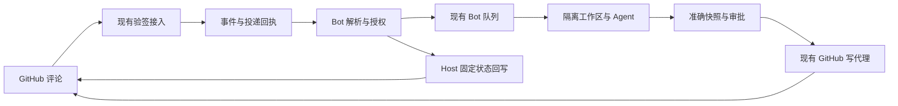
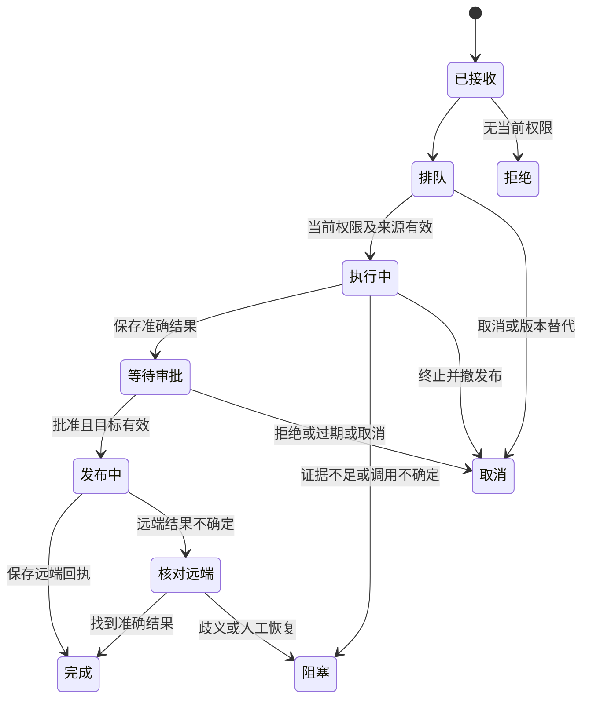

# GitHub 评论触发 Cognia：复用 GitHub Delivery 与 Bot，支持 Desktop 和 Headless

| 项目       | 内容                                                                                                                                                                                                                                                                                        |
| ---------- | ------------------------------------------------------------------------------------------------------------------------------------------------------------------------------------------------------------------------------------------------------------------------------------------- |
| 状态       | 技术评审草案；尚未实现、启用或批准上线                                                                                                                                                                                                                                                      |
| 作者与日期 | Codex；2026-10-12；Asia/Shanghai                                                                                                                                                                                                                                                            |
| 诉求       | 支持 @cognia 指令、权限校验、上下文收集、任务执行、结果回写与 Headless                                                                                                                                                                                                                      |
| 范围       | 插件/SDK、Host、持久化、原生 Git、webhook、外部 Agent、多账号和部署                                                                                                                                                                                                                         |
| 基线       | 当前共享 dev 工作区；已有无关修改不属于本方案                                                                                                                                                                                                                                               |
| 评审角色   | GitHub 集成、Bot 平台、执行平台、Headless、安全隐私、QA 负责人                                                                                                                                                                                                                              |
| 首批目标   | 用户主动启用，绑定一个仓库，明确选择一个执行 Host                                                                                                                                                                                                                                           |
| 依据       | [前期研究](../research/2026-10-12-github-comment-trigger-research.md)、[ADR-0018](../content/docs/en/adr/0018-github-delivery.md)、[ADR-0174](../content/docs/en/adr/0174-the-bot-control-plane.md)、[ADR-0224](../content/docs/en/adr/0224-an-always-on-host-is-a-peer-the-user-brings.md) |

**推荐：**新增默认关闭的 `github-comment-bot` 插件，分为短时间运行的“接收/控制”和可恢复的“任务执行”两部分。GitHub Delivery 继续负责认证、验签和 API；Bot 平台继续负责队列、状态、租约、审批和恢复。

**原因：**当前可以收到评论，但没有完整的评论指令业务；事件到 Bot 的投递可靠性、进度评论授权、私有检出身份、只读执行与全程外发脱敏也需要补齐。

**预期：**有权限的人提交 `@cognia ask/review/fix`，系统记录准确请求，报告进度，在 Desktop/Headless 执行，再按授权发布回答、Review 或草稿 PR。评论内容不授予额外 Host 权限。

**改动：**扩展现有接口及投递/线程索引，不另建任务队列、webhook 服务或 Agent 引擎。本文接口、默认值和状态均为方案，不能当作当前已支持的功能。

## 1. 验收目标是“评论到结果”的完整链路

| 目标      | 当前基础                    | 目标结果                                          |
| --------- | --------------------------- | ------------------------------------------------- |
| G1 指令   | 原始评论事件                | 准确识别正文指令，引用/代码/普通评论不调模型      |
| G2 权限   | 账号/仓库范围和静态作者过滤 | 执行、发布前检查当前 GitHub 写权限及 Host 策略    |
| G3 上下文 | 原始事件和若干读取 API      | 准确指令、Issue/PR、线程、固定 SHA、证据清单      |
| G4 执行   | 工作区和外部 Agent API      | 固定模型、隔离、取消、恢复，覆盖 Desktop/Headless |
| G5 回写   | 评论/Review/PR API          | 一条跟踪评论、批准的结果和明确失败状态            |
| G6 恢复   | 事件落库，Bot 尽力投递      | 落库至入队之间崩溃可恢复，不重复执行/发布         |
| G7 运维   | 通用控制台                  | 就绪诊断、预算、重放、停用、审计和部署验证        |

对应验收：G1→A1/A9；G2→A4/A5/A15；G3→A2/A3/A16/A17；G4→A7/A10/A13/A14；G5→A8/A11/A12/A18；G6→A6/A7/A8；G7→A14/A19/A20。

纳入 github.com App/PAT、Issue/PR 普通评论、行级评论、提交的 Review 正文、后续指令、私有仓库、人工/显式自动发布，以及配对 Web/移动端管理。

首批不做自动 merge/release、仓库设置修改、任意公众触发、模型选择凭据、只装 YAML 零配置使用、访问无关文件、独立数据库 Host 自动 failover。GitHub Enterprise 须对明确服务器版本验证检出/上下文/发布；支持 API origin 不等于完整支持。

## 2. 现有能力与需要补齐的缺口

“已确认”指检查当前源码；“拟新增”指方案要求；“推断”指源码结论；“待评审”有明确 Q 编号。历史测试不等于新功能验证。

| 已确认能力                    | 模块                                                                                                          | 处理                                   |
| ----------------------------- | ------------------------------------------------------------------------------------------------------------- | -------------------------------------- |
| 评论事件、标准化、HMAC        | [GitHub Delivery](../../plugins/github-delivery/src/index.ts)                                                 | 复用并扩展类型化读取/动作              |
| 验签、spool、唤醒、去重       | [Rust router](../../crates/cognia-scheduling/src/workflow/triggers/webhook_router.rs)                         | 不另建 HTTP 入口                       |
| 事件持久化、Bot 尽力投递      | [events](../../lib/integrations/events.ts)                                                                    | **B1：**保存投递意图并恢复             |
| 触发器匹配、Bot 入队          | [dispatch](../../lib/bot/events/dispatch.ts)、[router](../../lib/bot/events/router.ts)                        | 恢复到已记录接收者                     |
| 持久步骤、挂起、审批          | [step](../../lib/bot/runtime/step.ts)、[run](../../lib/bot/runtime/run.ts)                                    | 新语义放现有 step 数据                 |
| 绑定账号与仓库读取            | [Integration API](../../lib/plugin/api/integrations-api.ts)                                                   | 用相对路径，不写死 API origin          |
| 所有 Bot 写要求准确审批       | [binding broker](../../lib/plugin/api/bot-integration-binding.ts)                                             | **B2：**有限固定状态授权               |
| 隔离工作区、快照发布          | [workspace](../../lib/plugin/workspace/bot-run.ts)                                                            | 检出目前写死 github.com，未传绑定凭据  |
| 原生 clone 使用环境凭据       | [Git](../../lib/git/commands.ts)、[native exec](../../crates/cognia-git/src/exec.rs)                          | **B3：**绑定本次账号/run，覆盖私有仓库 |
| 固定 invocation、结果恢复     | [external dispatch](../../lib/plugin/api/external-agent-api.ts)                                               | 复用支持的 preset/model                |
| character turn 找最近角色会话 | [agent turn](../../lib/plugin/api/agent-turn.ts)                                                              | **B4，若采用：**新建任务独占会话       |
| Headless 注册现有运行时       | [Integration](../../lib/headless/runtimes/integration-runtime.ts)、[Bot](../../lib/headless/runtimes/bots.ts) | 补就绪与恢复                           |
| runIssueLoop 限桌面           | [availability](../../lib/integrations/action-runner.ts)                                                       | 新任务不用；它也不读取触发评论         |

**B5：**[沙箱 launcher](../../crates/cognia-exec-sandbox/src/launcher.rs) 总把 cwd 设为可写，必须支持独立只读 checkout。**B6：**初始 prompt 已脱敏、[任务网关](../../lib/ai/agent/external/config/gateway-task.ts) 已有模型范围，但后续 CLI 文件/工具外发也须证明经过 gate。

[Schema](../../lib/db/schema.ts) 有唯一 `[accountId+deliveryId]` 和 `[runId+name]`；[Integration](../../lib/db/integrations.ts) 事件默认30天、审计90天。检查时 schema=238，实现须预留当时下一版本，不能假定239可用。主应用静态导出，webhook 在 Host，不新增 app/api。旧 Delivery/Devin 保持兼容，新插件默认关闭。

## 3. 接收/控制与长任务分开

一个 Bot 定义有 `incoming`、内部/manual `execute` 和定时 `reconcile`。incoming 只解析、授权、去重、入队；不调模型、不创建工作区。这样长任务期间 status/cancel 仍可响应。



图1：接入、队列、执行、发布保留原负责人，新增评论语义与有限状态回写。

| 方案                       | 取舍                                                 |
| -------------------------- | ---------------------------------------------------- |
| 新评论 Bot，复用服务——推荐 | 统一指令/恢复/结果，独立具体模型；增加必要接口       |
| 给 Devin monitor 加评论    | 监控业务不同，会强制绑定 Devin/SWE-2                 |
| 只拼 Workflow              | 自定义自动化可用，但权限/控制/不确定写入仍需公共能力 |
| 调 runIssueLoop            | 上下文不符、仅桌面、不支持问答/Review/控制           |
| 单独 Actions Agent         | 需另做部署/凭据/运行时，不属本次目标                 |

新 `plugins/github-comment-bot/` 的理由是业务不同于 Devin monitor。parser/context/render/handler 留插件；有权限的操作留 Host。API 扩现有 Delivery，归属/持久化扩 Bot，没有第二个消费者前不造通用指令框架。

## 4. 指令与评论修改规则明确

### 4.1 指令语法

一条评论只允许一个指令。Markdown 解析忽略代码块、行内代码、引用、HTML 注释和链接目标。独立、大小写不敏感的 @cognia 位于未引用逻辑行开头；邮箱、@cognia-bot、复制示例不匹配。正文是数据，不直接成为 shell 参数；多指令返回用法，不偷偷选第一条。

| 指令                        | 行为                          | 模型/发布                                          |
| --------------------------- | ----------------------------- | -------------------------------------------------- |
| `@cognia ask <问题>`        | 结合仓库/线程回答             | 只读模型，批准准确评论                             |
| `@cognia review [重点]`     | 审查当前 PR；Issue 返回不支持 | 只读，默认 COMMENT；不默认 APPROVE/REQUEST_CHANGES |
| `@cognia fix <要求>`        | 实现指定修改                  | 可写隔离、检查、批准草稿PR，不直接推目标/merge     |
| `@cognia <自由文本>`        | ask 别名，提示改代码用fix     | 同ask                                              |
| `@cognia status [任务]`     | 本线程最近或指定任务          | 不调模型，固定状态                                 |
| `@cognia cancel [任务]`     | 取消排队/运行/审批等待        | 不调模型，撤未发布授权                             |
| `@cognia retry <任务>`      | 经新校验起新尝试              | 新运行、评论和审批，保留旧审计                     |
| `@cognia help` 或仅 mention | 用法与可用指令                | 不调模型，固定模板                                 |

语法错误、保留动作 merge/approve/release/exec/deploy、目标不支持不调模型；其他自由文本按ask，不先用模型分类。任务编号是不透明短别名，不暴露DB/账号。retry须指定，不重发不确定调用。相同仓库、账号、Host路由只能一个安装认领@cognia，冲突启用失败并说明。

### 4.2 来源和编辑

订阅 issue/inline comments 的 created/edited/deleted 与 review.submitted；App投递review.edited/dismissed时补声明用于失效，不任意新执行。普通PR评论看issue.pull_request；行评论有path/line/commit。父对象由认证API确认，不取评论URL作权限范围。

接收前重读最新评论/review，检查ID/作者/仓库/父对象/版本。旧版本乱序标superseded。新版本要求真实sender/editor等于作者，不能编辑他人评论借其授权；编辑者另发自己的指令。删除是Host对已属任务的安全取消，不是新工作授权；签名route/历史source/task匹配，GET404印证，临时读取失败暂停发布；作者和编辑/删除者都审计。

| 时机            | 行为                                          |
| --------------- | --------------------------------------------- |
| 执行前编辑      | 新固定版本替代pending，原任务原子取消         |
| 执行/审批中编辑 | 请求取消并撤发布，留产物，新需求另发          |
| 完成后编辑      | 不重跑、不撤外部结果，新工作另发评论          |
| 执行前/中删除   | 取消未发布工作，留最小tombstone/审计          |
| 发布后删除      | 不自动删PR/review                             |
| 新后续评论      | 新指令、当前授权、有限历史，不复用别的session |

授权step只是历史证据；工作区/模型/发布前重新检查。

## 5. 权限由 Host 判定，不由模型或评论决定

### 5.1 仓库作者授权

拟新增 `ctx.integrations.authorizeGithubCommand(binding, source)`。Host 解析绑定账号，重读真实评论，再查询 `/repos/{owner}/{repo}/collaborators/{login}/permission`。响应用户 ID 必须匹配作者，基础权限须为 write/admin；maintain 按 write 处理，自定义角色按有效基础权限判断，未知值拒绝。

不信任 author_association、昵称、组织成员身份或单独的 sender 字段。[官方 API](https://docs.github.com/en/enterprise-cloud%40latest/rest/collaborators/collaborators#get-repository-permissions-for-a-user) 支持安装 token、细粒度 PAT 和 Metadata read；配置时用实际账号探测。保留现有已验证的 API version，不因文档示例更新而全局升级。

同时满足以下条件才接收：

1. 验签通过，账号、仓库和来源 ID 一致。
2. 本 Host 有当前启用的安装，绑定同一账号与仓库。
3. 作者当前至少有 write 权限；可选 ID 白名单只能进一步收紧。
4. 来源不是 bot，也不是经过验证的本系统输出。
5. 安装策略、运行时固定权限上限、组织/Host 上限及预算允许该操作。

status/cancel/retry 目标限定在同一安装、账号、仓库和线程。推荐当前有写权限的人都能控制同线程任务，Q1 可改为仅发起人。控制任务不等于批准发布。

状态/帮助读取可缓存权限最多 60 秒，模型开始、retry、新写入决定及发布不得使用缓存。缓存键包含 Host origin、账号、仓库 ID、作者 ID 和凭据代际；撤权、改绑定/配置、暂停时清除。401/403/404、超时或限流均不授权；临时故障退避，明确无权则 denied。无权只本地审计，不用公开拒绝回复制造评论垃圾。

### 5.2 三层授权

| 行为                 | 要求                                             |
| -------------------- | ------------------------------------------------ |
| 固定状态、帮助、错误 | 来源已获授权或任务归属明确，且有固定模板回写许可 |
| 模型回答、Review     | 当前作者授权、只读执行，默认人工批准准确正文     |
| 代码、分支、PR       | 当前授权、验证成功、目标有效，批准准确快照及动作 |

approve 评论、点赞或 GitHub 写权限都不是 Cognia 的 principalId。审批走认证界面；Headless 挂起并通知配对端。工具自动执行和 GitHub 自动发布分开设置。

现有 bypassPermissions 要求安装授权及所有权限上限允许 autopilot；自动发布还需 requireApprovalForWrites=false，保留这套叠加限制。依据：[外部 API](../../lib/plugin/api/external-agent-api.ts)、[运行权限计算](../../lib/bot/policy/run-authority.ts)。

## 6. 上下文有上限、有版本、有证据

通过绑定仓库的相对 API 路径读取；不足处扩展 Delivery 的评论/Review、变更文件/diff、行级线程和版本接口。分页不能离开绑定 origin 与仓库，不任意抓取评论中的链接。

| 内容     | 要求                                                    |
| -------- | ------------------------------------------------------- |
| 指令     | 最新准确正文、哈希、版本、作者、父对象、URL             |
| Issue/PR | 标题、正文、状态；head/base 仓库、ref、SHA、draft/fork  |
| 线程     | 固定顺序，触发评论及根评论始终包含，每项标明来源        |
| 代码     | 固定 SHA 和 diff，路径/行号有依据                       |
| 规范     | 安装系统规则；仓库规范只是上下文，不能提升权限          |
| 历史任务 | 本线程的归属摘要/状态，不复用原生会话或隐藏的跨项目记忆 |
| 必要 CI  | 有限、相关，远端证据与 Agent 自述区分                   |

建议上限：累计抓取 2 MiB、选入 256 KiB、24,000 估算 tokens 或模型窗口 40% 取更小值；指令 16 KiB、单项 32 KiB、50 条评论、300 项文件元数据、128 KiB diff、30 秒收集（不计限流等待）、每类 10 页。实际取 Host/provider 更严格上限，均非实测能力。

优先级为指令 → 父对象 → 触发行级线程/路径 → 相关代码 → 最近讨论 → CI。记录遗漏数量和截断标记。指令过大直接拒绝并建议拆分，不静默截短；证据不足影响正确性时 blocked_context 或要求收窄范围。截断 Review 不能称作完整审查，不额外调用模型做摘要来掩盖缺失。

上下文清单固定来源 ID、版本、哈希、范围、SHA、截断和脱敏数量，脱敏版本有独立 digest。初始提示词及后续文件、工具、日志外发都经过 PII gate。CLI 读代码也是外发路径，只处理初始提示词不等于保护完整；无法证明该边界的执行器不准入。

## 7. 复用执行引擎，补齐工作区和调用约定

### 7.1 JSON约定与身份

以下为拟新增接口；普通JSON，Bot时间毫秒、GitHub版本ISO、SHA/digest字符串。

```typescript
type GithubCommandSourceV1 = {
  schemaVersion: 1
  repositoryId: string
  repository: string
  threadKind: "issue" | "pull_request"
  threadNumber: number
  sourceKind: "issue_comment" | "review_comment" | "review"
  sourceId: string
  sourceRevision: string
  sourceBodyHash: string
  actorId: string
  command: "ask" | "review" | "fix" | "status" | "cancel" | "retry" | "help"
  request: string
  targetTaskRef?: string
}
type GithubTaskRequestV1 = {
  schemaVersion: 1
  commandKey: string
  source: GithubCommandSourceV1
  installationConfigDigest: string
  executor: { presetId: string; model: string }
  authorizationRef: string
  contextRef: string
  checkout: { sha: string; targetRef: string; targetRepositoryId: string }
}
type GithubTaskResultV1 = {
  schemaVersion: 1
  status: "completed" | "blocked" | "failed" | "cancelled" | "superseded"
  summary: string
  answer?: string
  findings?: { path: string; line: number; side: "LEFT" | "RIGHT"; body: string }[]
  snapshotId?: string
  verification: {
    provenance: "host" | "agent_reported"
    command: string
    exitCode: number | null
    logRef?: string
  }[]
  publication?: { commentUrl?: string; reviewUrl?: string; pullRequestUrl?: string }
  reasonCode?: string
}
```

`commandKey=SHA256(hostOrigin,accountId,installationId,repositoryId,sourceKind,sourceId,sourceRevision,bodyHash)`，同时保存原组合供审计。子execute通过ctx.bots.enqueue使用固定身份；同一来源版本重复只产生一个任务。retry用新评论和新运行关联旧记录，不重置审计。

稳定步骤名：authorize-current、collect-context、acquire-workspace、dispatch-agent-1、capture-result、verify、prepare-publication、publication-decision、publish-workspace、publish-result、record-result。修复使用明确递增的invocation，最多两回合。当前权限和来源检查放在被记忆步骤之外；旧记录不能使撤权重新有效。重大配置变化取消待执行任务，不修改固定摘要。

执行资源kind=github_command、id=commandKey、scope=repoId，线程信息在source中；cancelResource只取消选中任务。listDeliveries增加类型化线程/来源过滤，在limit前应用。delivery增加Host派生的commandThreadKey及[installationId+commandThreadKey+receivedAt]索引，倒序查找而非扫描全部历史；旧delivery没有此值，版本替代事务定位。

### 7.2 拟新增 Host/SDK 接口

| 接口                                | 输入/授权                                            | 输出与负责模块                                                                |
| ----------------------------------- | ---------------------------------------------------- | ----------------------------------------------------------------------------- |
| integrations.authorizeGithubCommand | 归属明确的 binding、真实来源 ID、可选任务；Host 重读 | allowed、authorizationRef、来源、时间，或拒绝/临时故障/配置错误；不返回 token |
| integrations.reportBotStatus        | binding、commandKey、phase/resultRef、状态许可       | job ID 与排队/已确认/阻塞状态；不接自由正文                                   |
| Delivery 读取/回复/更新             | 仓库/来源、范围、准确审批                            | JSON、分页/截断、远端回执                                                     |
| bots.listDeliveries 线程过滤        | 所属安装，limit 前过滤                               | 摘要/归属结果，不返回其他安装正文                                             |
| 工作区 pull-ref/凭据                | Host 确认 PR/SHA、短期不透明 lease                   | 工作区或明确配置/凭据/版本错误                                                |
| 外部执行访问/模型路由               | 所属 run/工作区、readOnly/readWrite、固定模型        | completed/failed/cancelled/recovery_required                                  |
| Host 验证器                         | 所属工作区、配置计划摘要，不接受评论 shell           | 命令回执、脱敏日志、退出码                                                    |

Host 授权回执绑定任务、来源、账号和配置，本次建议 60 秒有效，下一边界仍新查询。approvalDetail 仅存引用；assertBotIntegrationAction/publishBotWorkspace 对评论任务检查当前授权、来源/目标与真实回执，不信插件自填内容。旧 Bot 保持兼容。状态许可不批准任意操作；终态回写仍重查安装、路由、授权、模板版本。

同步 SDK catalog、author types、bridge 和能力协商。WP1 预留版本，旧 Host 拒绝就绪，不降级成无保护调用。原生命令沿已有接口与规范元数据，不另建公共 HTTP。

### 7.3 工作区与凭据

通过 bot-run、runId、准确 ref 和绑定 github 槽获取工作区，代码检出与运行时状态目录分离。clone/fetch/publish 只归 Host；Agent 不获得 GitHub 密钥、凭据 helper、Git 配置中的凭据或 App 私钥。

私有仓库不能依赖环境 Git 身份。现有 guarded clone/fetch 增加不透明的短期 credential lease，Host 解析账号凭据、origin、仓库 ID、run、目的目录和操作，Rust helper 只用于该操作，并禁用此路径的环境 helper；启动 Agent 前清除。复用 secret/Git 模块，不再建凭据库。

如需原生 lease 注册命令，只限认证的本地 service principal，不开放给交互客户端。最长 120 秒，取消、完成或绑定变化时撤销；禁止 token 出现在 URL/argv，禁止通配 origin。既有用户 Git 行为不改。“绑定 A、环境登录 B”须证明实际用 A。[原工作区模块](../../lib/github/workspace.ts) 可复用凭据处理经验，但不采用旧 Issue Loop 编排。

### 7.4 执行器、只读与验证

首批使用 ctx.agent.runExternalAgent 的任务归属明确的进程预设路径。配置准确模型，不悄悄换模型、角色、endpoint 或 Host。Devin 的 SWE-2 约束仅在选择 Devin 时适用；Codex/Claude/Devin 逐项就绪和验收，注册预设不证明全部可用。

PluginExternalAgentOptions 拟增加 workspaceAccess=readOnly/readWrite，以及支持预设的明确 Cognia 模型路由，加入 invocation digest 和 Host 权限校验。复用[任务网关](../../lib/ai/agent/external/config/gateway-task.ts)、[Headless 模型 lease](../../lib/gateway/host-task-lease.ts)，Agent 拿任务票据而非主密钥。后续模型、文件和工具消息也在网关脱敏，阻断绕过网关直接连接 provider。不能拦截的原生 provider（例如某条 Devin 路径）明确不可用，由 WP5 证明后再准入。

通用 character turn 必须先补齐任务独占的新会话、调用检查点、取消和不确定结果恢复。首批不使用“最近角色会话”复用，避免跨任务泄漏。

ask/review 要由 Host 沙箱强制只读，不能只靠提示词。[LaunchScope](../../crates/cognia-exec-sandbox/src/launcher.rs) 需支持可读代码目录、单独可写运行时目录、受保护 Git 元数据及禁止的无关目录，并贯通 workspaceAccess。fix 只允许工作区修改与已允许的检查。禁止直接 GitHub 写入、秘密使用、Host 配置修改、remotes 修改和无关文件/网络访问；无法强制这些约束则执行前拒绝。

校验结构化结果的状态、长度、路径、行号、文件模式和测试证据；最多 50 项 findings。完整文本快照遇到二进制、symlink、特殊或超限文件，保留 blocked，不静默丢文件。ask/review 修改代码则阻塞，需另发 fix。

fix 发布前由 Host 在相同工作区/SHA 执行已审查的安装验证计划。命令不来自评论或模型自由输出；验证器复用执行/terminal，检查归属、可取消，累计最多 10 分钟，每命令保存 128 KiB 脱敏日志。Agent 自述单独展示，不能算独立证明。缺验证计划则配置未就绪，检查失败阻止发布，原预算内允许一次修复回合。

### 7.5 生命周期与并发



图2：不确定调用/写入进入核对，不直接第二次执行。

这些语义状态是原ExecutionRunStatus/delivery的投影：等待对应原挂起，阻塞对应原blocked，版本替代保存在类型化输出。执行状态与回写状态分开，本地完成可显示result_delivery_pending/failed，不因补发评论重跑模型。

每仓库一个执行并发键。安装maxConcurrentRuns请求3，留两个短接收/恢复运行位，设1会阻塞取消。Host只允许1时就绪检查说明不足，不声称完整支持。挂起释放执行位但保留来源、SHA、快照；目标移动使旧审批失效。建议20个待执行任务，每作者10分钟5个模型任务、每分钟30个控制指令。控制不占模型预算，所有值在Host上限内可收紧。

## 8. 持久投递与回写覆盖崩溃窗口

### 8.1 在原事件保存 Bot 投递意图

当前先保存事件，再尝试 Bot 投递，失败被捕获，而重复事件提前返回。落库后失败可能永远没有 Bot 任务。因此扩原事件元数据，不另建执行队列。

拟字段：botProjectionVersion=1、state=pending/complete/deadletter/legacy、nextAttemptAt 毫秒、attempts，以及接收者 installationId、triggerId、pinnedVersion、armedAt、accountBindingDigest、outcome、deliveryId。增加到期复合索引，一次协调迁移。回执只存引用和有限错误码，正文仍在事件/队列/步骤。

接收时用持久定义、绑定和水位捕获当时启用的接收者。注册未就绪是 pending，不能当作成功的零匹配。事件与计划在 DB 事务保存，网络/注册异步操作在事务外；定义确实不支持才进入明确 deadletter。重放不自动发现新装 Bot。

恢复器复用适配器、路由、入队。固定 delivery 与回执尽量同事务，跨提交也靠确定 ID 核对。只恢复捕获接收者；关闭、删除或改绑定取消，改版本须明确重新接收。不重复成功的 Workflow/Inbox。

startIntegrationRuntime 安装恢复器，事件/就绪唤醒、启动补扫、每30秒有限扫描。同账号事务防多恢复器；退出停定时器/订阅。每轮100条，5次后 deadletter。未解决回执不被30天清理提前删除。

### 8.2 进度不是任意正文写权限

reportBotStatus(binding,{commandKey,phase,resultRef?}) 不接自由 body、URL、comment ID 或状态主张。Host 依真实持久状态渲染，phase 匹配，编号/链接从归属记录解析。不含原指令、代码、日志、秘密、mention，不发私有 Companion 或 token URL。

显式 allowIntegrationStatusReports，定义、安装和固定运行上限缺省 false，全部允许才生效，独立于 requireApprovalForWrites。status-report 范围只能固定模板创建/更新，不能给 executeAction 跳过审批。不能写状态的账号未就绪。

复用 integrationActionJobs，Delivery 增加受限跟踪操作，Host 渲染/校验，返回{id,url,updatedAt}对象，不用tuple。每任务一条 Issue/PR 普通跟踪评论，行级触发链接原评论；最终批准的行级回复可走新增类型化API，根失效则说明理由回同PR。

显示阶段、安全错误码、公开编号、允许的结果URL和代码块中的用法；阶段变化或最多每30秒更新，不流式公开模型输出或内部思考。

最终回答/Review 准确审批，远端确认后标 published。fix 批准快照后 publish/openPr，在绑定仓库创建草稿 PR，分支 codex/github-comment/<task-alias>；当前发布器限定 codex/，不照抄 Devin。发布记录认证身份，不借评论者/环境公司Git，也不加无关co-author。Issue目标为配置/默认分支，非fork PR以原head分支为目标。fork审查经base refs/pull/N/head获取固定SHA，必要的读取提示由Host验证。

### 8.3 远端结果核对

本地幂等键不使 GitHub POST 天然幂等。先保存写意图，后请求，保存回执并核对。

| 写入                 | 核对                                                                                   |
| -------------------- | -------------------------------------------------------------------------------------- |
| 创建跟踪评论         | commandKey、`<!-- cognia-command:v1:<opaque-id> -->`和真实发布者；有限历史核对后再POST |
| 更新跟踪评论         | 保存ID，GET验证作者/仓库/标记；单调阶段，旧运行状态不覆盖终态                          |
| 回答/Review/行级回复 | 唯一结果摘要、标记、线程、发布者；响应丢失先读                                         |
| 分支                 | 原快照/commit检查点，ref为准确commit，不force                                          |
| 草稿PR               | head/base/标记/发布者唯一匹配；歧义阻塞，不再创建                                      |

复制标记不获得归属。App身份由可靠元数据确定，不假设安装token可访问/user。Host存输出引用，新external webhook不能只靠Bot内部来源标记过滤循环。

POST超时不能唯一确认结果或证明未写，标writeback_uncertain人工检查，不盲重试。补发不调模型；终态更新可合并，批准正文不可变。

## 9. Headless 独立执行，不依赖浏览器在线

不绕过旧 isTauri 限制，新路径不用 runIssueLoop；复用 brain 中的 Integration、Bot、工作区和 Agent 能力。

| 形态                 | 负责范围                                                          |
| -------------------- | ----------------------------------------------------------------- |
| Tauri                | 自己接入、排队、检出、执行、发布；隐藏后台另验                    |
| Linux/macOS Headless | 同一处理器通过原生 service 执行；关闭前端仍运行，审批挂起到配对端 |
| 配对 Web/移动端      | 配置、监控、批准、取消，不运行第二份任务                          |
| 独立 Web/移动端      | 显示需要 Host，不启用本地执行                                     |
| GitHub 临时 Host     | 额外配对 Host，同样验证寿命/持久化，不变成自动评论 Action         |

启用前验证插件/SDK、账号/仓库、真实权限探测、webhook 事件与公开 HTTPS、持久 DB/工作区、绑定 Git 凭据、预设/版本/模型/认证、隔离/隐私、状态/Review/PR 写权限、fix 验证计划、人工决策通道、时钟/保留策略与实例归属。

配置错误显示准确 needs_setup，例如 no_public_ingress、permission_probe_failed、private_clone_unavailable、executor_unavailable、pii_boundary_unverified、verification_plan_missing、status_write_unavailable、decision_channel_missing。每任务再检查，启用时通过不代表永久有效。

沿用 service/Compose 与 secret store，DB、工作区、检查点、master key 持久保存，服务用户权限严格。不依赖桌面 Keychain 或浏览器 localStorage，配置只展示凭据引用和就绪状态。

同仓库只指定一个 Host/account route。租约只保护同 DB，不能去重两个独立 Host 同时收到 webhook。拒本地重复安装，运营指定唯一远端路由；迁移先关闭旧接收、处理或取消任务，再转移支持的数据或重新安装，最后切入口。首批不做跨独立 Host 自动故障转移；离线靠 provider 重投、已有恢复和运营程序。

## 10. 异常必须有明确恢复或终止结果

| 异常                   | 行为                                                 |
| ---------------------- | ---------------------------------------------------- |
| 验签失败/正文超限      | Rust 在插件、DB、模型工作前拒绝                      |
| 插件或注册失败         | 保存 pending 回执，就绪/启动后恢复                   |
| 权限查询失败           | 退避，不借缓存授权模型                               |
| 撤权/移除仓库          | 关闭、取消，撤 lease/审批，保留产物                  |
| 上下文不足             | 保留清单，阻塞，不说完整审查                         |
| 提示词可能已发送后断线 | recovery_required，检查原任务，不二次发送            |
| 发模型前崩溃           | 恢复准备、重新授权、固定 invocation                  |
| 缺运行时/隔离/模型     | needs_setup，修好后明确 retry                        |
| 工具审批等待           | 原机制挂起，暂停活跃计时，绝对期限不刷新             |
| Host 验证失败          | 保留日志，一次修复或 blocked                         |
| 目标/来源变化或关闭    | 不发布，保留过时结果，重新取上下文/审批              |
| 审批拒绝/过期          | 不任意写；固定模板可报状态                           |
| fork                   | 读取/Review；无独立发布绑定则保留 fix 产物           |
| 限流/临时错误          | 遵守 Retry-After/reset，独立回写退避                 |
| 评论锁定/删除/失去写权 | 本地结果保留，回写失败，不转无关线程                 |
| POST 成功、响应丢失    | 核对发布者/标记/回执，歧义阻塞                       |
| 取消与发布竞争         | 撤销并终止，已写结果记录 cancelled_after_publication |
| 持久化失败             | 不以内存充当成功回执，下一外部写之前停止             |

取消/回滚不能保证已发送请求没有外部副作用。GitHub 没有跨来源/head 读取、Git 对象、评论、PR 的事务。每次变更前检查，Review 绑定准确 commit ID，写后核对。最后读取与写入之间仍有竞争窗口；检测到版本变动则 published_against_previous_revision 并注明原 SHA，重新发起任务，不宣称针对最新版。草稿不自动合并。

## 11. 扩展现有存储，明确迁移、保留与删除

| 数据             | 存储与规则                                                        |
| ---------------- | ----------------------------------------------------------------- |
| 原始投递/事件    | spool/integrationEvents，30 天，未解决记录固定保留                |
| 路由回执         | 事件本地字段，不进入普通同步/导出                                 |
| 配置/授权/上下文 | botRunSteps，固定，非永久许可；大内容用受限产物引用               |
| 队列             | botEventDeliveries，配对镜像不能消费                              |
| 结果/验证        | 终态建议 30 天，运行/审批/恢复引用保留                            |
| 跟踪/远端记录    | 检查点/actionJobs，清正文后保留去重记录                           |
| 审批/快照        | 原 interrupt/snapshot，绝对期限不延长                             |
| 秘密             | 原 secret store/短期 helper，不进普通 DB、prompt、URL、argv、同步 |

扩本地 IntegrationEventRow，公开 envelope 默认不变。旧事件为 legacy、不执行；新安装有水位，只默认接收之后创建/编辑的指令。管理员重放须指定事件、重新授权和保存新意图，不能恢复过期审批。

协调下一 schema，增加投递和线程索引并事务迁移；旧 delivery 不回填新任务。验证 Headless 序列化、加密、同步/导出过滤，旧 Host 拒绝新插件。回退采用兼容新 DB version 的旧代码构建，或支持的迁移前备份，不能直接 Dexie 降级打开新库。

无活跃调用、有效审批、不确定写入、未解决投递引用时才清理上下文/日志/工作区，并验证归属；建议非活动配额 5 GiB。保留最小身份防旧事件重发。删账号撤 lease、阻新任务，显式删数据须等活动工作收敛；外部 GitHub 产物不静默删除。

## 12. 安全与预算由 Host 强制

| 风险                | 控制/验收                                                   |
| ------------------- | ----------------------------------------------------------- |
| 签名真实但作者无权  | 当前权限，不调模型、不公开回复                              |
| 注入要求关策略/泄密 | 提示词不授权，秘密只留 Host                                 |
| 跨账号/同名仓库     | ID、origin、scope 检查，拒绝越界                            |
| 会话串任务          | 独占状态/会话/digest，并发不读旧上下文                      |
| 文件/工具泄密       | 全程外发 gate，不安全预设拒绝                               |
| 私有检出错身份      | 绑定 helper，环境 B 不能覆盖 A                              |
| 路径/symlink/hook   | realpath、沙箱、禁止秘密读取，默认拒绝不安全 hook/submodule |
| 自回复/伪造标记     | 真实发布者和所属输出引用，默认拒绝 bot                      |
| 状态泄露内部信息    | 固定模板、别名，无原始日志/错误/私有 URL                    |
| 批准后权限变化      | 固定上限、准确产物，当前权限只能收紧                        |
| 无限资源            | 字节、分页、token、队列、预算与背压                         |

建议每任务活跃 30 分钟、最多两模型回合、每仓库一执行；provider 可强制用量时默认 USD 2 上限。不是实测。未知用量不能称硬美元限制，改 token/time 并标费用未知，或拒绝要求硬金额限制的策略。

修复与验证均计活跃时间，审批等待不计计算时间，但绝对期限最多 7 天或当前通道更短限制。初始上下文 tokens 不是总账单，离线/限流不保证时延。

小 ask 估算：2 次来源/父对象、2 次权限、1–3 次线程/元数据、1 次初始评论和2–4次状态/结果，约8–12 REST 加检出；灰度实测。大 PR 有限分页并明确截断。

## 13. 分别观察执行与回写健康

复用 Bot logs/progress、Integration audit/诊断和既有界面，不另建仪表盘服务。

| 拟指标                                   | 有限维度              | 处理                                    |
| ---------------------------------------- | --------------------- | --------------------------------------- |
| github_command_admission_total           | 指令/结果/错误码/Host | 跨账号接受即停灰度                      |
| integration_bot_projection_pending       | Host/状态             | 就绪但最早到期 >60秒，查注册/DB         |
| github_command_model_dispatch_total      | 预设/模型类别/结果    | 同调用重复即停接收                      |
| github_command_task_seconds              | 指令/终态             | 活跃 >30分钟取消                        |
| github_command_writeback_total           | 输出类型/结果         | 连续3失败降级，暂停新模型工作           |
| github_command_writeback_pending_seconds | 输出类型              | GitHub健康但最终结果 >5分钟未送，人工查 |
| github_command_recovery_required_total   | Agent/GitHub边界      | 不确定写入先核对                        |

仓库名、用户名、正文、run ID 不作为指标标签；受控本地审计可保存必要 ID，常规日志用哈希/错误码。关联 delivery→command→run→invocation→approval→job→remote。

灰度目标须测量：在线持久接收 p95≤5秒，跟踪评论≤15秒（不计退避），崩溃无丢失/重复。控制延迟独立于长任务。排障：readyz/插件→账号/webhook/权限→回执→delivery/step→调用恢复→审批→job/远端。不用 reconcile 解除拒绝或重发不确定调用。

## 14. 配置与管理复用 Bot 界面

选择仓库、账号、Host、预设、模型、指令、作者、验证计划、状态许可、执行和发布模式；启用前明确就绪和缺失权限。不恢复旧 Delivery 独立页面。

详情显示来源、公开编号、SHA、遗漏/脱敏、阶段、测试证据、差异、结果、审批期限、URL和回写健康。取消、检查恢复、重试回写、新任务 retry 走认证控制。配对端读 Host 真实状态，镜像不执行/批准。

新 labels/aria/placeholder/toast/error 用 next-intl en/zh-CN 拆分源，支持键盘、焦点、加载、离线、失败、移动布局。GitHub 模板采用安装语言，默认 English，用户正文/代码原样。运行静态导出、i18n及同位置测试，不添加服务端路由。

## 15. 九个工作包有唯一负责角色

角色是建议，不是人员指派；未获团队投入信息，不估人日。

| 包  | 交付                                   | 依赖/负责              | 验证与回退                           |
| --- | -------------------------------------- | ---------------------- | ------------------------------------ |
| WP1 | 插件语法/配置/类型、SDK/catalog/bridge | Q1–Q5；插件平台        | 语法/旧版本/manifest；保持关闭       |
| WP2 | 事件/运行时/DB/schema/投递恢复         | WP1；Integration运行时 | 崩溃/多worker；关闭恢复器保留数据    |
| WP3 | Host授权、Delivery读取、上下文         | WP1；GitHub集成        | 角色/改名/分页/范围/隐私；关闭接收   |
| WP4 | 状态策略/模板/jobs/更新核对            | WP1/3；发布            | 人工模式进度、丢响应、伪标记；撤许可 |
| WP5 | 绑定Git/只读/模型网关/验证             | WP1/3；执行平台        | 私有/隔离/归属/取消；阻止就绪        |
| WP6 | 接收控制/执行/快照/去重恢复            | WP2–5；评论Bot         | 模拟完整链路与版本失效；禁插件       |
| WP7 | Headless就绪/持久化/服务/退出/配对     | WP2–6；Headless        | 重启/决策/结果；关闭路由             |
| WP8 | UI/双语/package/catalog/文档/changeset | WP1/4/7；前端产品      | 静态导出/可达/配对；隐藏未就绪贡献   |
| WP9 | 故障与真实公私仓库、撤权/fork/取消     | WP6–8；QA              | 下表验收，违规停接收                 |

有权限模块须同位置测试且接入运行。原生接口更新规范 protocol、JSON 对象、Tauri注册/能力、Headless服务分类、生成消费者和Host一致性；不手改生成文件替代修生成器。基线生成器坏则先修负责模块再发布。

## 16. 二十项验收与计划检查

| 编号 | 场景                          | 预期                                  |
| ---- | ----------------------------- | ------------------------------------- |
| A1   | 普通/引用/代码/多指令         | 不调模型，明确忽略/用法               |
| A2   | 有权限用户在Issue提问         | 准确脱敏、只读、批准的一份回答        |
| A3   | PR普通/行级/Review            | 父对象/SHA/线程/回写准确              |
| A4   | read/triage/bot/错账号/伪标记 | 不调用、不提权，审计                  |
| A5   | 排队/批准后撤权               | 执行/发布拒绝，留产物                 |
| A6   | 落库到入队崩溃                | 一份任务恢复                          |
| A7   | 发送prompt后停止Host          | 检查，不二次发送                      |
| A8   | 写成功但响应丢失              | 唯一回执或阻塞                        |
| A9   | 乱序、编辑、删除              | 失效/取消，不改固定请求               |
| A10  | 长任务/审批期间控制           | 不卡住，正确终止/撤销                 |
| A11  | Host检查/快照/批准            | 准确草稿PR，不force/merge             |
| A12  | 模型说过但Host失败、目标变化  | 不发布，区分证据                      |
| A13  | 私有绑定A、环境B              | 用A，无秘密外泄                       |
| A14  | 关浏览器，各阶段重启          | 持久恢复、原期限，无前端依赖          |
| A15  | 多账号/镜像                   | 不串会话、不重复执行                  |
| A16  | 敏感文件/工具/日志/路径       | 全程gate，无逃逸                      |
| A17  | 限流/队列满                   | 有界退避、控制可用、无截断假成功      |
| A18  | fork                          | 准确pull-ref，不推未绑定fork，保留fix |
| A19  | 旧Host/插件/数据              | 安全不可用/只读，无默认授权           |
| A20  | 禁用/卸载/到期/存储失败       | 不新执行/发布，无遗留定时器/进程      |

单元测试同位置放置；模拟 HTTP、时间与 Host 身份。真实本地 socket、存储、进程中断证明不确定结果和凭据交接。断言模型/远端写入次数，不能只看UI。

以下现有命令是后续计划，不是本次执行新功能；实现后补新增文件选择器：

```bash
rtk pnpm exec jest --runInBand --coverage=false --runTestsByPath plugins/github-delivery/src/index.test.ts lib/integrations/events.test.ts lib/integrations/action-runner.test.ts lib/plugin/api/bot-integration-binding.test.ts lib/plugin/api/external-agent-api.test.ts lib/plugin/workspace/bot-run.test.ts
rtk pnpm plugin:contract:check
rtk pnpm plugin:author-imports
rtk pnpm plugin:builtin:build
rtk pnpm plugin:packages:verify
rtk pnpm audit:headless-registry
rtk pnpm typecheck
rtk pnpm lint
rtk pnpm lint:static-export
rtk pnpm i18n:build
rtk pnpm i18n:build:check
rtk pnpm lint:i18n
rtk pnpm build
rtk pnpm docs:build
rtk pnpm test:e2e:web-headless
rtk git status --short --branch
```

原生改动加定向 cargo test -p cognia-git <filter>；IPC 做真实 Tauri smoke；Headless 先真实服务+模拟GitHub，再已授权临时公/私仓库。配对截图只证明管理界面，不证明执行。E2E定位新流程。coverage仅明确要求才跑，不混入共享树无关改动或基线失败。

## 17. 分阶段灰度与停用

| 阶段 | 动作/通过条件                                    | 回退                       |
| ---- | ------------------------------------------------ | -------------------------- |
| P0   | 评审、schema与能力版本；旧数据不跑、无默认grant  | 保持关闭，DB向前兼容       |
| P1   | 只记录解析/权限，不调模型/写GitHub；投递崩溃验证 | 关接收/恢复器，留证        |
| P2   | 两Host各试验仓库，问答/审查人工批准，A1–10/13–20 | 撤接收/状态许可，取消      |
| P3   | 检查计划/快照，A11/12及私有/不确定发布           | 仅关fix，留快照/回执       |
| P4   | 显式工具执行或准确结果自动发布；撤销/预算通过    | 撤策略grant，旧人工不升级  |
| P5   | 各预设/平台证据评审，测目标且无丢失/重复         | 关新接收，核对并留事故证据 |

关闭incoming停新指令；fix关闭收窄；状态撤权停固定回写；自动发布撤权后新决策回人工；禁安装终止工作；紧急停止撤执行/lease并冻结未发送job。不确定远端结果保留核对。历史不自动跑，不自动启插件/增权。旧Delivery/Devin/Workflow/runner兼容，DB回退按第11节。

## 18. 六项评审决定及推荐

| 决策         | 推荐                                                             |
| ------------ | ---------------------------------------------------------------- |
| Q1 语法/控制 | 自由文本默认ask，改代码用fix；当前writer管理同线程，备选仅发起人 |
| Q2 状态许可  | 明确的固定模板许可，不每阶段审批，也不授全写权                   |
| Q3 自动化    | 默认人工发布，工具执行单独配                                     |
| Q4 fork修复  | 无独立绑定/验证前保留手动产物，读取/Review可用                   |
| Q5 执行器    | 已有任务归属明确的外部API，逐预设验收；角色回合补B4              |
| Q6 预算/保留 | 建议默认在Host范围内调整、灰度测量，不作未测保证                 |

| 评审记录                       | 日期       | 状态                          |
| ------------------------------ | ---------- | ----------------------------- |
| 源码/架构自检                  | 2026-10-12 | B1–B6及Headless/fork/隐私明确 |
| 集成/Bot/执行/Headless/安全/QA | 未安排     | 待人工评审，不声明批准        |

以下只是建议安排，非团队承诺：

| 动作                    | 单一负责角色 | 建议DDL    | 证据           |
| ----------------------- | ------------ | ---------- | -------------- |
| 决定Q1–6/灰度仓库       | 功能负责人   | 2026-10-13 | 文档决策       |
| 状态/授权/PII审查       | 安全隐私     | 2026-10-14 | 威胁和对抗测试 |
| 预留DB/API版本          | Bot平台      | 2026-10-14 | 迁移/就绪计划  |
| 模型/预设/凭据/验证矩阵 | 执行平台     | 2026-10-14 | 各Host真实前提 |

## 依据与验证边界

补充：[Bot policy](../../types/plugin/plugin-bot.ts)、[run/step types](../../types/bot/run.ts)、[Bot API](../../types/bot/api.ts)、[Workspace API](../../lib/plugin/api/workspace-api.ts)、[Devin execution](../../plugins/github-devin-bot/src/execute.ts)、[Headless acquire](../../lib/plugin/workspace/acquire.ts)、[always-on计划](2026-10-10-always-on-host.md)、[Bot SDK范例](2026-09-15-bot-plugin-api-surface.md)、[reference Action研究](../reports/github-comment-trigger-research-2026-10-12/reference-action.md)。

2026-10-12核查官方API：[用户权限](https://docs.github.com/en/enterprise-cloud%40latest/rest/collaborators/collaborators#get-repository-permissions-for-a-user)、[普通评论](https://docs.github.com/en/rest/issues/comments)、[inline回复](https://docs.github.com/en/rest/pulls/comments#create-a-reply-for-a-review-comment)，支持接口选择，不证明部署。

前期 8 个套件、133 项测试只证明已有基础机制。本文拟新增接口、策略、索引及业务均尚未实现或启用。本轮仅修改中文报告并讲解，没有执行模型任务、修改 GitHub、迁移数据库或对外发布。

2026-10-12 中文版本检查：Prettier 通过；40 个本地来源链接及计划命令中的测试路径均存在；两张中文 Mermaid 图已重新渲染并视觉检查。临时浏览器和服务器在检查后关闭。
