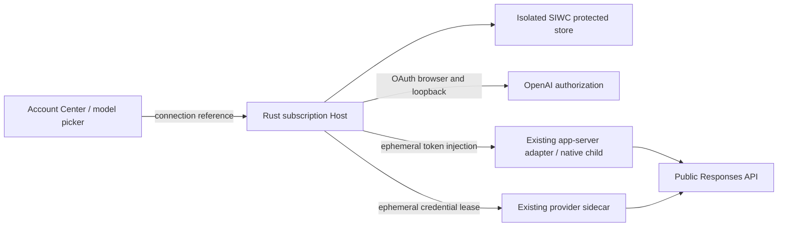
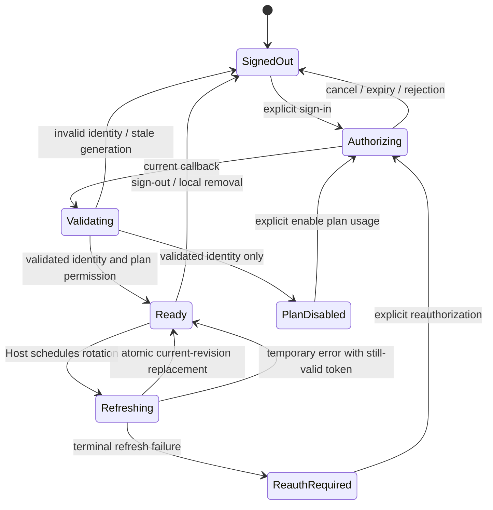
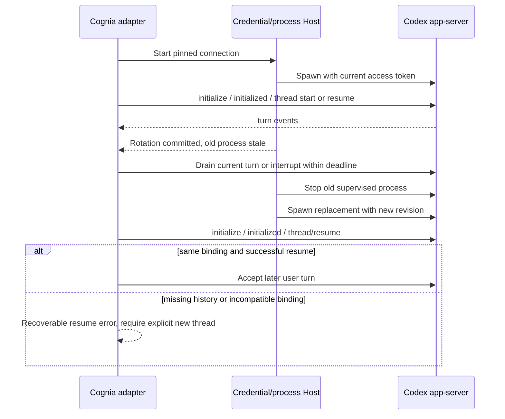

# Add Sign in with ChatGPT as a separate authorization mode

| Field             | Value                                                                                                                                                                                                                |
| ----------------- | -------------------------------------------------------------------------------------------------------------------------------------------------------------------------------------------------------------------- |
| Status            | Implementation authorized on 2026-10-18; independent opt-in SIWC only; real-account activation excluded                                                                                                              |
| Date              | 2026-10-18, Asia/Shanghai                                                                                                                                                                                            |
| Author            | Codex, prepared for the Cognia maintainer                                                                                                                                                                            |
| Depth             | Heavy: native OAuth, protected storage, account identity, process lifecycle, provider protocol, UI, backup compatibility                                                                                             |
| Request           | Verify recent Codex app-server compatibility and prepare a Sign in with ChatGPT migration proposal without switching existing authorization                                                                          |
| Related decisions | [ADR-0025](../content/docs/en/adr/0025-unified-subscription-module.md), [ADR-0048](../content/docs/en/adr/0048-codex-support-expansion.md), [Codex harness adoption plan](2026-08-21-codex-open-harness-adoption.md) |
| Reviewers         | Proposed roles: Host/security owner, subscription/storage owner, external-agent owner, provider/sidecar owner, product/UI owner                                                                                      |
| Release           | Unscheduled; proposed review dates below are planning checkpoints, not accepted commitments                                                                                                                          |
| Evidence          | Repository source and official documentation read on 2026-10-18; no credentials inspected, OAuth performed, tokens refreshed, or paid inference executed for this proposal                                           |

## Recommendation: preserve existing accounts and add an explicitly selected connection

Add `chatgpt_siwc` as a distinct internal authorization mode, with a protected registration store that older Cognia builds cannot mistake for a legacy Codex account. Reuse the existing subscription account center, native lifecycle locks, external-agent adapter, provider routing, and PII gates. Do not convert existing `chatgpt` or `api_key` records, change the active account, or redirect their requests.

The official open-source SIWC flow has a different registration, identity, refresh, and inference contract from Cognia's current Codex device authorization. An endpoint substitution would omit these contracts. Deliver the native app-server path before enabling direct chat-provider use; each route needs its own request and recovery acceptance tests. Reviewers must approve the storage isolation, first supported platforms, billing selection, and a separate real-account canary before implementation activation.

The existing app-server compatibility work can proceed independently. This document does not authorize an SIWC login, CLI authentication change, migration, deployment, or external publication.

**Current execution boundary, confirmed 2026-10-18:** the maintainer approved the full independent SIWC implementation: native login, credential storage, refresh/sign-out, app-server, ordinary chat and synthetic tests. Existing subscriptions, accounts, default selections and authorization files remain unchanged. No real-account login, renewal or inference is authorized for validation. See the [implementation checks](2026-10-18-siwc-implementation.md). The following proposal records the reviewed architecture; its former research-only boundary is superseded by this explicit approval.

### Current review checkpoint

| Item                  | Confirmed status                                                                                                                                                      | What remains open                                                                                  |
| --------------------- | --------------------------------------------------------------------------------------------------------------------------------------------------------------------- | -------------------------------------------------------------------------------------------------- |
| app-server version    | Official changelog and npm stable tag still identify 0.163.0; the installed CLI remains 0.159.2                                                                       | Fixture acceptance does not certify authenticated requests or another OS                           |
| SIWC process contract | Current official app-server documentation still specifies an env-key Responses provider, host-owned renewal, process restart, initialization and pinned-thread resume | No real SIWC authorization or token injection is performed here                                    |
| Refresh timing        | Token reference lists `earliest_refresh_at` but does not define its type, unit or scheduling semantics                                                                | Keep scheduling implementation blocked on a verified contract; do not infer it from the field name |
| Delivery scope        | Independent local implementation approved; existing authorization preserved                                                                                           | Real-account validation and remote-host transfer remain separate decisions                         |

Sources: [official changelog](https://learn.chatgpt.com/docs/changelog), [SIWC app-server contract](https://developers.openai.com/siwc/token-sharing-open-source/codex-app-server), [token reference](https://developers.openai.com/siwc/token-sharing-open-source/token-reference). Rechecked on 2026-10-18 without calling authorization, token or revocation endpoints.

**Implementation evidence:** the [delivery report](../reports/siwc-implementation-2026-10-18.md)
records the resulting native proxy design, tests and remaining acceptance boundaries.
The design sections below retain the original proposal context; the report is the
current implementation reference. In particular, OAuth stays native rather than
being injected into the child, and final-wire enforcement now covers Codex requests.

## 1. Current code provides reusable owners but cannot represent SIWC safely

**Confirmed** means read in the current source or retrieved official documentation. **Inferred** means a consequence of those facts. **Proposed** means a design decision in this document. **Open** means an explicit release or review gate. An accepted historical ADR describes intent; current source wins where its paths or behavior have moved.

| Evidence                                                                                                                                                                                                                     | Confirmed current behavior                                                                                                                                                                                    | Consequence                                                                                                                                                     |
| ---------------------------------------------------------------------------------------------------------------------------------------------------------------------------------------------------------------------------- | ------------------------------------------------------------------------------------------------------------------------------------------------------------------------------------------------------------- | --------------------------------------------------------------------------------------------------------------------------------------------------------------- |
| [`codex/oauth.rs`](../../crates/cognia-subscription/src/codex/oauth.rs), [`constants.ts`](../../lib/subscription/codex/constants.ts)                                                                                         | Uses the first-party CLI client ID `app_EMoamEEZ73f0CkXaXp7hrann`, private deviceauth exchange, and `/oauth/token`; refresh sends the fixed client ID and legacy scopes                                       | A separate SIWC exchange/refresh branch is required; keep the existing constants for legacy records                                                             |
| [`vault.rs`](../../crates/cognia-subscription/src/vault.rs), [`codex/mod.rs`](../../crates/cognia-subscription/src/codex/mod.rs)                                                                                             | Vault schema is 4. Codex validation accepts `chatgpt` and `api_key` only; credential fields do not carry an issued SIWC client ID or granted scopes                                                           | Additional optional fields alone do not establish a safe migration                                                                                              |
| [`vault.rs`](../../crates/cognia-subscription/src/vault.rs)                                                                                                                                                                  | Existing identity matching requires a workspace plus subject, with a legacy email fallback; derivation decodes existing token payloads                                                                        | Reuse lifecycle infrastructure, but do not reuse this decoder as SIWC signature validation or assume SIWC exposes the legacy workspace field                    |
| [`lifecycle.rs`](../../crates/cognia-subscription/src/codex/lifecycle.rs), [`commands.rs`](../../crates/cognia-subscription/src/codex/commands.rs)                                                                           | Host owns account locks, refresh, targeted reauthentication, and cancellable device-flow generations                                                                                                          | Extend these owners for SIWC; do not add a renderer refresh scheduler or a second lifecycle service                                                             |
| [`chat-bridge.ts`](../../lib/subscription/codex/chat-bridge.ts), [`types/subscription/codex.ts`](../../types/subscription/codex.ts)                                                                                          | `chatgpt` uses `chatgpt.com/backend-api/codex` plus legacy identity headers; the other branch uses the API-key route. Presets can override destinations. Resolution can return `null` on ordinary errors      | SIWC must fail explicitly when selected; no generic fallback branch, legacy headers, relay preset, or API-key fallback may receive its token                    |
| [`config/env-builder.ts`](../../lib/ai/agent/external/config/env-builder.ts), [`app-server-client.ts`](../../packages/agent-codex/src/app-server-client.ts)                                                                  | Account-bound agents resolve an account before spawn; the adapter takes a host process plane and environment resolver. Explicit process environment can override legacy account overlays                      | Reuse the adapter; introduce a native credential-reference spawn contract so SIWC secrets do not transit renderer environment objects                           |
| [`ai-sdk-adapter.ts`](../../sidecar/src/providers/protocol-adapters/ai-sdk-adapter.ts)                                                                                                                                       | Existing Codex Responses options already set `store: false` and conditionally retain encrypted reasoning; provider options can be merged                                                                      | Useful foundation, but not proof that final SIWC request bodies meet all restrictions                                                                           |
| [`vault-snapshot.ts`](../../lib/subscription/core/vault-snapshot.ts), [`encrypted-package.ts`](../../lib/subscription/core/encrypted-package.ts), [`subscription-sync.ts`](../../lib/subscription/sync/subscription-sync.ts) | Renderer snapshots reconstruct schema-4 vaults, fetch full credentials, and share export/restore with WebDAV. Package format is `cogniabak-subscription-v1`; restoration upserts accounts and active pointers | SIWC credentials cannot enter this pipeline implicitly; it could copy rotating refresh tokens to multiple writers and expose them to renderer storage workflows |
| [`src-tauri/src/lib.rs`](../../src-tauri/src/lib.rs), [`next.config.ts`](../../next.config.ts)                                                                                                                               | Native commands are explicitly registered; the main app uses static export                                                                                                                                    | OAuth listener, token exchange, verification, storage, and refresh must be Host services, not Next.js API routes                                                |

**Inference:** current Cognia needs an additive authorization contract, not a replacement Codex provider implementation. No evidence reviewed here establishes that the legacy authorization path has been withdrawn or requires an immediate cutover.

## 2. Official SIWC contracts establish a different trust boundary

The following compact contract inventory summarizes the official pages fetched on 2026-10-18. Recheck them before implementation and before a real-account canary because the documented flow is a preview. The implementation choices in later sections are Cognia proposals, not claims of existing support.

| Official source                                                                                             | Verified contract that changes the design                                                                                                                                                                                                                                                                                                                                                                                                                                                                                                                                                                               |
| ----------------------------------------------------------------------------------------------------------- | ----------------------------------------------------------------------------------------------------------------------------------------------------------------------------------------------------------------------------------------------------------------------------------------------------------------------------------------------------------------------------------------------------------------------------------------------------------------------------------------------------------------------------------------------------------------------------------------------------------------------- |
| [Registration and sign-in](https://developers.openai.com/siwc/token-sharing-open-source/sign-in)            | Initial registration uses `dynamic_agent_client`; the callback supplies an issued client ID. Reauthorization reuses that ID. A stable `ext_agent_host_id` identifies the runtime. Authorization uses `/api/accounts/authorize`; code exchange uses `/api/accounts/oauth/token`. Each attempt needs state, nonce, PKCE, and an exact `127.0.0.1` callback URI. ID-token signature, issuer, audience, expiry, and nonce require validation. Identity and plan permission are separate. Requested plan scopes include `offline_access resource.invoke chatgpt.tokens.use.direct`; resource is `https://api.openai.com/v1`. |
| [Accounts and sessions](https://developers.openai.com/siwc/token-sharing-open-source/profiles-and-sessions) | Keep registrations separate even if emails match. Serialize refreshes, retain the issued client ID, and omit scope during refresh. Sign-out attempts refresh-token revocation using discovery metadata; local sign-out without confirmed revocation must disclose that result. An ID-token hint belongs only at the authorization endpoint and must be redacted from diagnostics.                                                                                                                                                                                                                                       |
| [Token reference](https://developers.openai.com/siwc/token-sharing-open-source/token-reference)             | Token responses include granted scope, expiry, replacement refresh token, and `earliest_refresh_at`. Documented access lifetime is one hour; refresh lifetime is 30 days with replacement. Access-token authentication metadata is opaque, not a public workspace identity API.                                                                                                                                                                                                                                                                                                                                         |
| [Models and inference](https://developers.openai.com/siwc/token-sharing-open-source/models-and-inference)   | Read the account catalog from `GET /v1/models`: `models[]`, `slug`, `display_name`, `visibility`. Use `POST /v1/responses` at `api.openai.com`, rather than the ChatGPT backend. Streamed text is provisional until `response.completed`; a terminal failure can follow earlier text deltas.                                                                                                                                                                                                                                                                                                                            |
| [Preview limitations](https://developers.openai.com/siwc/token-sharing-open-source/preview-limitations)     | HTTP uses `store: false`, `stream: true`, full history in array input, and no `previous_response_id`. Several common generation parameters and hosted tools are unsupported. App-server uses HTTP/SSE for this configuration. Local thread resume remains available.                                                                                                                                                                                                                                                                                                                                                    |
| [Codex app-server](https://developers.openai.com/siwc/token-sharing-open-source/codex-app-server)           | Configure a Responses provider using `env_key`, `requires_openai_auth=false`, and `supports_websockets=false`. Cognia owns OAuth renewal; for env-based tokens restart, initialize, and resume the saved thread after rotation. `model/list` may be a client catalog rather than an entitlement check. Only a completed turn proves request success.                                                                                                                                                                                                                                                                    |
| [Errors and recovery](https://developers.openai.com/siwc/token-sharing-open-source/errors-and-recovery)     | Admission may return `{detail: ...}` rather than a standard API error. Eligibility, usage, unsupported capability, routing, and credential failures have different recovery. No implicit billing switch occurs upstream. Confirmed terminal refresh failure requires reauthorization; temporary infrastructure failure must preserve credentials.                                                                                                                                                                                                                                                                       |
| [Self-hosted VMs](https://developers.openai.com/siwc/token-sharing-open-source/self-hosted-vms)             | A VM has its own stable host ID. Its loopback callback cannot be completed through a browser on another computer. Explicit protected credential transfer is documented, with the receiving VM owning refresh. Transferred-session host attribution/revocation has stated limitations.                                                                                                                                                                                                                                                                                                                                   |

## 3. Separate connection identity, authorization, and execution ownership

Use these terms consistently across UI, Rust, TS, process launch, and backups:

| Term           | Proposed meaning and invariant                                                                                                                                                 |
| -------------- | ------------------------------------------------------------------------------------------------------------------------------------------------------------------------------ |
| Registration   | One validated `(issuer, subject, issuedClientId)` mapping, with a Cognia UUID and stable user label. Email is display-only. Same email or subject does not merge registrations |
| Host           | One local/self-hosted runtime installation identified by its own persistent opaque `ext_agent_host_id`; never a credential or an authentication proof                          |
| Session        | One renewable token set, credential revision, lifecycle state, and designated Host refresh owner for a registration                                                            |
| Connection     | A user-selectable reference containing `authMode`, registration ID, and Host identity; no bearer material                                                                      |
| Thread binding | `(connectionId, hostId, isolatedStateRoot, threadId)`; used for resume and checked before every launch/reconnect                                                               |

Proposed invariants:

1. A legacy record is never upgraded into SIWC by parsing its email, token claims, or base URL. The user adds SIWC separately and explicitly selects it.
2. A connection pins identity and billing for its in-flight turn. Switching a picker affects later turns; it cannot repoint an existing stream or resumed thread.
3. SIWC tokens enter only approved native inference/process consumers, never browser storage, persisted agent config, model prompts, ordinary export, or debug output.
4. A selected SIWC failure is visible. Retrying cannot silently select another account, first-party CLI auth, a configured API key, or a relay.
5. Signed-in identity without plan permission is a usable account-management state, but cannot launch inference. Enabling plan use is a distinct explicit action.
6. No runtime consumes a session owned for refresh by another runtime. Initial release has one writer; encrypted sync is not a distributed token-rotation protocol.

## 4. Extend existing owners and inject credentials inside the Host

The Host becomes the SIWC credential authority; the UI and provider adapter pass opaque connection references.



The changed trust boundary is native credential resolution: no SIWC token is returned with a renderer environment overlay. Preserve the existing PII checks on messages submitted by Cognia and results passing through Cognia's own tool rails. Those checks do not prove interception of Codex's internal file/shell results, resumed history, or every request assembled by app-server. That coverage remains an explicit P2/A8 activation gate; this proposal does not claim it already exists.

| Owner                        | Proposed responsibility                                                                                                                                              | Existing extension seam / consumers                                                                                                                          |
| ---------------------------- | -------------------------------------------------------------------------------------------------------------------------------------------------------------------- | ------------------------------------------------------------------------------------------------------------------------------------------------------------ |
| Rust subscription crate      | New SIWC OAuth branch, JWKS verification, registration/session store, host ID, rotation and revocation                                                               | Extend `codex/` and shared vault/lifecycle primitives; a separate protocol module is justified because legacy endpoints and validation must remain unchanged |
| Native process Host          | Resolve reference, validate selected registration/Host/revision, inject only an access token into one supervised child; sanitize inherited auth/provider environment | Existing external-agent process launch; add a typed reference field rather than changing generic environment precedence globally                             |
| `@cognia/agent-codex`        | Keep JSON-RPC mapping, terminal events, interruption, approvals, and resume; coordinate process generation changes                                                   | Existing `AgentProcessHost` and launch-environment seams; adapter receives no refresh token                                                                  |
| Provider sidecar             | Restrict final SIWC Responses request, normalize failures, retain PII/approval policy                                                                                | Existing `provider-protocol` and `ai-sdk-adapter`; native credential lease carries route capability and revision, never persisted provider config            |
| Shared TS subscription layer | Secret-free DTOs, selected connection, cancellation, lifecycle notifications                                                                                         | Existing transport and account events; SIWC rejects legacy secret-returning `getAccount`/`getAccountEnv` access                                              |
| Account Center               | Separate SIWC add/sign-in/sign-out/plan-permission states and connection labels                                                                                      | Existing account-center and account-dialog components; extend Codex tab, do not create another account settings route                                        |
| Backup/sync layer            | Explicit SIWC exclusion and metadata-only portability; dedicated future transfer if approved                                                                         | Existing snapshot/package/sync code; preserve legacy package behavior                                                                                        |

Any new native commands must be registered in the owning command surface, capability/ACL checked, and included in native and paired-Host transport tests. Return named JSON objects, not Rust tuples. Check current command ownership before introducing files; this proposal is not authorization for a second general OAuth framework.

## 5. An isolated credential record protects rollback and old clients

**Recommendation:** leave the legacy schema-4 Codex vault unchanged and store SIWC registrations in an independent protected namespace, proposed `com.cognia.subscription/siwc-v1`. Extend existing secret-store primitives; do not implement a new encryption subsystem. SIWC is still displayed under the Codex/OpenAI account experience, but its store must not be enumerated as a legacy `codex` credential provider.

Merely adding `authMode: "chatgpt_siwc"` to an existing vault is unsafe: old provider validation rejects it; old typed serializers may discard its unknown fields; old TS bridging treats non-`chatgpt` credentials as the API-key branch. A schema bump alone does not prove all reads, restores, or overwrites fail safely.

The proposed protected record has a versioned envelope and two independently managed entities:

| Entity               | Required fields / lifecycle                                                                                                                                                                                                                                   |
| -------------------- | ------------------------------------------------------------------------------------------------------------------------------------------------------------------------------------------------------------------------------------------------------------- |
| Host identity        | `recordVersion`, random `extAgentHostId`, installation/runtime profile identity, creation time; generated once before sign-in, persisted atomically, excluded from portable backup                                                                            |
| Registration mapping | `registrationId`, `authMode: "chatgpt_siwc"`, verified issuer/subject, issued client ID, stable label, optional display email, optional workspace label with provenance; retained on sign-out                                                                 |
| Session              | Host binding, `credentialRevision`, access/refresh/ID tokens, token type, granted scopes, absolute expiry in milliseconds, original `earliest_refresh_at` and normalized scheduling value, received-at time, lifecycle status; atomically replaced or cleared |
| Renderer projection  | Registration/connection IDs, display label, selected Host, `signedOut` / `signedInPlanDisabled` / `ready` / `refreshing` / `reauthRequired`, bounded reason code; no token, raw authorization URL, or arbitrary upstream body                                 |

Validate envelope version before decoding and writing; unknown future versions are read-only with an upgrade-required error. Within a supported version, preserve unknown extension fields during updates. Never deserialize then serialize an unsupported version. Use the existing scoped profile/secret storage model, namespaced locks, and transactional writes. No new Dexie token table is needed; any future non-secret connection projection must receive its own coordinated migration and round-trip tests.

The canonical identity key is the verified registration tuple. An issued client represents its bound workspace; do not manufacture a workspace ID from `sub`, email, or opaque access-token metadata. An optional workspace label is display data with explicit source, and cannot authorize replacement. Reauthorization must match verified subject, issuer, and saved issued client ID. A different workspace/account becomes a separate registration through the add flow.

### Backup, sync, downgrade, and deletion contracts

| Operation                         | Required behavior                                                                                                                                                                                                                                                                                                                                                                                                                                                                                                                           |
| --------------------------------- | ------------------------------------------------------------------------------------------------------------------------------------------------------------------------------------------------------------------------------------------------------------------------------------------------------------------------------------------------------------------------------------------------------------------------------------------------------------------------------------------------------------------------------------------- |
| Existing export/WebDAV snapshot   | Legacy content unchanged. Never fetch or include SIWC token records. Disclose that SIWC requires sign-in on another machine; do not claim a complete credential backup                                                                                                                                                                                                                                                                                                                                                                      |
| Portable SIWC metadata export     | Optional explicit export of label/connection metadata only, tagged as credentials-required. Strip host ID, tokens, hints, active selection, runtime state roots, and refresh ownership                                                                                                                                                                                                                                                                                                                                                      |
| Import old subscription-v1        | Continue current legacy restoration. Cannot create or select SIWC sessions                                                                                                                                                                                                                                                                                                                                                                                                                                                                  |
| Future SIWC package on old client | A distinct format/version and filename must be rejected before any writes; never insert it into `latest-subscription.cogniabak.json`                                                                                                                                                                                                                                                                                                                                                                                                        |
| Import metadata on new client     | Validate whole payload before writes; create inactive, signed-out references, preserve destination Host ID, do not upsert legacy records by email                                                                                                                                                                                                                                                                                                                                                                                           |
| Old Cognia after downgrade        | Must see only existing legacy vaults and legacy-selectable work. Keep SIWC connection/config/session bindings in an isolated versioned catalog, unavailable to old enumeration; do not encode them as an optional field on an otherwise executable legacy config/session. Isolated credentials alone do not prove safe config downgrade. Certify the oldest supported build; if it can resume SIWC work using another connection, downgrade is blocked until an explicit quarantine/export procedure removes that work from old enumeration |
| Remove a registration locally     | Cancel its auth attempt; stop/interrupt its work; serialize with rotation; tombstone its reference, clear its tokens and derived caches. No late callback or process event can recreate it                                                                                                                                                                                                                                                                                                                                                  |
| Sign out                          | Retain mapping and Host ID; stop new work and attempt remote revocation. Clear local credentials with explicit confirmed/unconfirmed revocation result                                                                                                                                                                                                                                                                                                                                                                                      |

Initial delivery excludes refresh tokens from all automatic synchronization. Explicit self-hosted transfer is deferred pending a single-owner handoff protocol and review of the documented VM limitations. This is a release boundary, not a silent omission from an enabled feature. P1 must identify the actual persisted agent/session selectors and prove the catalog fence before freezing their schema; a renderer-only flag cannot protect an old binary. If existing session storage cannot support that fence, Q1 must be reopened with the measured migration cost rather than weakening identity pinning.

## 6. OAuth and refresh extend the existing cancellation discipline

Keep the pending attempt entirely on the Host, including its selected registration, expected issuer/client, exact callback URI, state, nonce, verifier, generation, deadline, and cancellation token. The UI receives an attempt ID and safe status only.



Deletion is an absorbing condition outside the diagram: every completion checks the registration still exists and its generation/revision is current. A transport failure with an expired token is blocked pending renewal; the `Ready` transition above is permitted only while the prior credential is still valid.

1. Start an exclusive loopback listener before opening the system browser. Proposed authorization deadline: 10 minutes; it is a Cognia timeout, not a claimed upstream limit. Stop listener/tasks on cancellation, Host shutdown, or completion.
2. Accept only the expected path, method, bounded request size, and current single-use state. Validate OAuth error callbacks too. For initial registration, require an issued `client_id` and reject a missing ID or `dynamic_agent_client`. For reauthorization, a callback may omit `client_id`: retain the saved ID already pinned to the attempt, and reject a conflicting supplied ID. Reject duplicates, wrong Host, and late callbacks before mutation.
3. Exchange and validate on the Host using a maintained JOSE verifier. Fetch discovery/JWKS from the pinned issuer over HTTPS with bounded cache and key-rotation refresh; never decode-only trust a JWT. Network verification failures are retryable within the attempt deadline. A failing token cannot replace an active registration.
4. Commit registration and session atomically under the lifecycle lock only after validation and a second generation/deletion check. Proposed UI behavior: show the new validated connection and require explicit selection for subsequent use; prior selection persists.
5. For refresh, serialize per session through the designated Host. Use credential revision and account existence checks at commit. Honor provider refresh timing metadata once its semantics are confirmed; never schedule a tight retry from an unrecognized value. A terminal refresh error clears unusable tokens and records a stable reauthentication reason while preserving the mapping.
6. Serialize deletion/sign-out with refresh commit. If deletion wins while network I/O is in flight, discard the response and do not resurrect credentials. Avoid holding synchronous `parking_lot` guards across `.await`; lifecycle async guards need bounded operations and cancellation.

Proposed retry budget is at most three attempts with jittered 1/2/4-second minimum backoff, respecting a longer server `Retry-After`; never retry beyond the action deadline or expiry. Code exchange with ambiguous completion is not blindly replayed: abort/restart authorization while retaining the pending issued client mapping. A local write failure after refresh rotation blocks further use and requests recovery rather than retrying a potentially spent refresh token. No renderer or child process independently refreshes the same token set.

### One Host still needs cross-process ownership

The current [`CodexLifecycleManager`](../../crates/cognia-subscription/src/codex/lifecycle.rs) coordinates only one process. A stable Host ID and revision checks do not serialize two Cognia processes using the same local profile. The future SIWC store therefore requires an OS-backed exclusive writer lock per local profile and registration, owned by the native subscription layer. A second process must wait within a bounded deadline or report that the session is busy; it must not refresh independently. File existence or a PID file alone is not ownership.

Refresh, sign-out, deletion and credential replacement acquire the same lock, reload the persisted revision/tombstone after acquiring it, and retain ownership through network completion and atomic commit. A contender reloads the resulting token set before proceeding. Use cancellable nonblocking acquisition; release the OS lock on success, cancellation, error and process death. Do not hold a synchronous Rust mutex guard across `.await`. A process crash after upstream rotation but before durable commit is an explicit ambiguous state requiring recovery; a successor must not blindly replay the old refresh token. P1 must select and certify the native lock primitive on each supported OS before implementation activation. No lock file or SIWC store is created by the current review.

## 7. Reconnect app-server at a turn boundary and resume only the pinned thread

The existing app-server adapter remains the execution adapter. SIWC config is assembled per supervised spawn, without writing global Codex config or auth files. Proposed provider name is `cognia_chatgpt_plan`; use a stable Cognia app identifier consistently for authorization attribution and `initialize.clientInfo`.

The native launcher supplies the access token through a private child environment key and the official Responses provider settings. It rejects user overrides of the SIWC provider destination, wire protocol, credential key, and authentication mode. Clear inherited competing auth/provider overrides, use a Cognia-managed isolated `CODEX_HOME`, and keep the user's unrelated Codex home untouched. The child never receives the refresh token. Existing legacy environment precedence remains as implemented for legacy connections.



A new access token does not update an already running process environment. Proposed drain deadline is 30 seconds when no active operation requires a shorter interruption; afterward interrupt and replace the child. Surface interruption and preserve partial output. Never replay a prior turn or a side-effecting tool call automatically. Key event subscriptions by process generation, ignore late old-process events, resolve outstanding approvals as cancelled, and prevent duplicate terminal events. A resume failure preserves the thread reference and explains the recovery; it cannot silently start a new thread with another account.

On crash, reopen the same isolated state root and saved connection/thread binding. On account switch, defer new work until the old process is stopped or run a separate supervised instance with a separate state root; never share a process between identities. ACP and direct CLI modes remain legacy-only until separately certified; SIWC selection there returns an explicit unsupported-runtime error.

## 8. Direct chat needs final-wire capability enforcement before activation

The existing Codex chat bridge and sidecar offer reuse, but the new mode must not return a raw token through the current renderer fallback API. Pass a typed connection reference from send-option resolution to the native Host, then obtain a short-lived in-memory access lease inside the supervised sidecar. The lease pins registration, Host, revision, route, capability profile, and expiry; it carries no refresh token and must be invalidated on sign-out/removal. A native lease resolution failure stops the selected route.

The proposed `chatgpt-plan-preview` capability profile is enforced after all AI SDK/provider option merges and before network send. It uses an allowlist of supported serialized fields, rather than depending on UI controls to omit them. Recheck the exact official restrictions at implementation; the fixture captures both the installed SDK version and fetched contract date.

| Capability           | Proposed behavior                                                                                                                                                                                                                                       |
| -------------------- | ------------------------------------------------------------------------------------------------------------------------------------------------------------------------------------------------------------------------------------------------------- |
| History/instructions | Rebuild required local history for every HTTP request. Convert system context through the supported instruction/developer representation; preserve encrypted reasoning/tool linkage where accepted. Never use server-stored conversation continuity     |
| Generation controls  | Unsupported temperature, output-limit, sampling, metadata, background, and similar controls are disabled for this connection; a caller asking for a semantically necessary unsupported feature gets a typed capability error                            |
| Tools                | Serialize allowed client tools through the documented grouping shape; keep existing local permission and consent gates. Reject hosted tools, native computer-use APIs, and `tool_search` when disallowed; do not silently remove a required tool        |
| Inputs               | Validate model-supported text/image/file input. No automatic Files API upload or audio/video conversion path is enabled by selecting SIWC                                                                                                               |
| Service tier         | Default to no override. Enable any tier only after account/model/route acceptance; do not infer support from generic Codex `serviceTier` passthrough                                                                                                    |
| Model catalog        | Native fetch per selected registration; validate catalog shape, preserve ordering, cache by registration/Host with a proposed 5-minute TTL, clear on rotation/selection/removal. UI labels catalog entries as choices, not proof of entitlement         |
| Completion           | Text deltas do not mark a run successful. Map completed, failed, incomplete, interrupted, and truncated/missing-terminal streams distinctly                                                                                                             |
| Endpoint and headers | Pin public OpenAI origin and route. Do not include legacy backend identity headers or arbitrary preset headers. A managed corporate network proxy may transport TLS under existing network policy; a relay URL cannot become the credential destination |

This profile is carried through all ways of sending with that connection, including agents, background titles/summaries, connectors, plugins, retries, and tools that delegate model work. Preserve the checks in [`sidecar/src/host/commands/send.ts`](../../sidecar/src/host/commands/send.ts) and [`outbound-prompt-pii.ts`](../../lib/ai/agent/external/policy/outbound-prompt-pii.ts) for messages, history and tool results that actually traverse those owners. Codex-managed file reads, shell results and resumed context may be assembled inside app-server without traversing Cognia's gates; their outbound PII enforcement remains unverified. A8 must establish an enforceable boundary and its tested coverage, or keep SIWC app-server activation blocked. Do not treat a successful prompt-only redaction test as proof of internal-history/tool-output coverage. No new proxy or policy mechanism is authorized here.

## 9. Classify failures before retrying or asking for another sign-in

Preserve HTTP status, stable upstream code/parameter when present, request ID, and terminal stream status in native diagnostic context. Arbitrary diagnostic text is untrusted and redacted before reaching support logs or UI. Authentication URLs, ID-token hints, payloads, and raw token bodies never enter diagnostics.

| Failure class                                        | Proposed Cognia action                                                                                                                                                         |
| ---------------------------------------------------- | ------------------------------------------------------------------------------------------------------------------------------------------------------------------------------ |
| Consent declined / identity-only result              | Keep active connection unchanged; identity-only registration shows plan-disabled with an explicit enable action                                                                |
| Admission 401 or invalid signed context              | Stop that request, check scopes/registration; do not loop refresh or reauthorize without a diagnosed credential condition                                                      |
| Ineligible user/workspace or serving policy          | Show restriction and account/Host context; no automatic retry or billing fallback                                                                                              |
| App/plan usage limit                                 | Pause new SIWC work, preserve partial output, link usage management; do not manufacture a reset timestamp or label the whole subscription exhausted                            |
| Unsupported capability or wrong route                | Typed configuration error; identify the affected setting/feature. Do not retry identical payloads                                                                              |
| Transient 503 / network failure                      | Preserve credentials; bounded backoff only before side effects or when a replay is known safe. After partial output, surface interruption and require an explicit continuation |
| Terminal refresh rejection / confirmed disconnection | Stop the session, clear unusable secret set, retain registration mapping, offer reauthorization                                                                                |
| Revocation temporarily unavailable                   | Stop local use; bounded retry while secret still exists, then clear locally and report remote revocation unconfirmed                                                           |
| Unknown upstream error/body                          | Preserve sanitized request evidence; fail closed on the selected route; never interpret arbitrary `detail` text as a stable recovery code                                      |

A sign-out action and “Remove from Cognia” retain distinct meanings. Existing local removal must not gain a surprise remote-revocation side effect. Add an explicitly labeled SIWC sign-out action and explain unconfirmed revocation; do not alter legacy account actions as part of this work.

## 10. Initial platform scope is desktop native; remote credentials need a later handoff

| Surface                           | Proposed first release behavior                                                                                                                                                       |
| --------------------------------- | ------------------------------------------------------------------------------------------------------------------------------------------------------------------------------------- |
| macOS / Windows / Linux Tauri     | Native loopback OAuth and protected store, supervised app-server, explicit selection; platform acceptance required on each supported OS                                               |
| Static web / standalone Capacitor | Show unavailable connection capability and Host-selection guidance; no browser token storage, client-secret workaround, or new Next.js API route                                      |
| Paired web/mobile                 | Host-owned SIWC execution may be offered only when the paired command/consent contract exposes a reference and safe status. Browser cannot complete OAuth on a remote Host's loopback |
| Headless/self-hosted Host         | Existing sessions unavailable until explicit approved provisioning/transfer is implemented; no reading of laptop stores or copying host IDs                                           |
| Managed task/container/sandbox    | No SIWC refresh credentials forwarded. Keep existing gateway task credentials and isolation; container is not the registration Host                                                   |

Account Center states include pending browser login, cancellation, verification failure, offline renewal, signed-out mapping, plan-disabled identity, ready, reauthentication-required, wrong Host, and unsupported runtime. Show a stable registration label and Host; email alone is insufficient. Use keyboard-accessible controls, return focus after the browser flow, and announce completion/error through existing live-status patterns. Add new strings to both split English and Chinese sources and run the existing i18n generation/parity checks. Approved OpenAI button branding must be checked against current guidelines before UI delivery.

## 11. Keep observability bounded and make release gates executable

Proposed signals use bounded dimensions `authMode`, `platform`, `route`, `phase`, `outcome`, and normalized error category. Never label metrics with subject, email, client ID, host ID, thread ID, token, or prompt content.

| Signal                               | Trigger and proposed action                                                                                                                   |
| ------------------------------------ | --------------------------------------------------------------------------------------------------------------------------------------------- |
| `siwc_auth_attempt` / duration       | Start, cancel, reject, verify, commit. Any accepted stale callback or identity mismatch blocks release                                        |
| `siwc_refresh` / persistence outcome | Rotation, temporary failure, terminal failure, deletion race. Any lost replacement token, resurrection, or simultaneous writer blocks release |
| `siwc_process_renewal`               | Restart, initialize, resume, missing history; any cross-account resume or duplicate side effect blocks release                                |
| `siwc_inference_terminal`            | Completed/failed/incomplete/interrupted/missing-terminal; usage failure after deltas remains failure                                          |
| `siwc_capability_rejection`          | Rejected field/tool/route before send; invalid final wire body in acceptance blocks release                                                   |
| `siwc_revocation`                    | Confirmed/unconfirmed local sign-out; support directs unconfirmed cases to ChatGPT app-access controls                                        |

Proposed canary abort rule: immediately disable new SIWC turns on any credential leak, cross-registration use, duplicate side effect, or data-loss incident; investigate any unexpected authentication/refresh failure before expanding. These are release criteria, not claims of deployed alerting. Do not set statistical reliability percentages from an unmeasured sample. Record auth, catalog, refresh, and process-renewal latency distributions during canary; baseline is currently unmeasured. No extra OAuth/catalog request is added per fresh-token turn. Process restart cost is measured separately from model latency; avoid duplicate child instances and cancel all background tasks on shutdown.

An incident kill switch disables only SIWC launches, refresh scheduling, and direct inference, clears in-memory leases, and stops affected children. It does not delete mappings/tokens, alter legacy selection, upload data, or revoke remotely. Deliberate user sign-out remains available. Preserve sanitized request IDs locally with the existing diagnostic retention policy; any new persisted audit store requires its own explicit retention review.

## 12. Verify cross-layer contracts before any real-account canary

Goals map to acceptance IDs so implementation can be reviewed without assuming a successful login proves every route.

| ID / goal                                 | Required proof                                                                                                                                                                                                                                                                                                                                                                                                                 |
| ----------------------------------------- | ------------------------------------------------------------------------------------------------------------------------------------------------------------------------------------------------------------------------------------------------------------------------------------------------------------------------------------------------------------------------------------------------------------------------------ |
| A1: existing authorization unchanged      | Legacy `chatgpt`/`api_key` fixture behavior, selected accounts, presets, discovery, and exports remain unchanged; SIWC disabled produces zero new OAuth/inference requests                                                                                                                                                                                                                                                     |
| A2: registration is validated             | Mock issuer/JWKS tests cover wrong signature/key/algorithm/issuer/audience/nonce/expiry, wrong state/client/Host, duplicate callback, cancellation, expiry, and returning identity mismatch                                                                                                                                                                                                                                    |
| A3: storage is isolated                   | New/old build fixture tests prove SIWC cannot be decoded as legacy/API key, unknown versions cannot be rewritten, supported unknown fields survive, local removal wins late completion, and missing store is not replaced by a legacy fallback. Test actual persisted agent/session selectors with the oldest supported binary; an SIWC session/config cannot be enumerated as legacy work or resumed under another connection |
| A4: refresh has one owner                 | Separate native processes racing refresh and refresh versus deletion/sign-out must serialize on the same OS-backed lock; verify reload after contention, lock timeout/cancellation, process death, failed atomic write, ambiguous upstream completion and rotated-token persistence; no token replay or unbounded lock/task leaks                                                                                              |
| A5: app-server renews safely              | Mock process plane rotates credentials, interrupts/drains, reinitializes, resumes the same bound thread, rejects wrong state roots, ignores old generation events, and never repeats a tool or prompt automatically                                                                                                                                                                                                            |
| A6: direct provider wire is valid         | Capture final serialized request after SDK merges for instructions, history, reasoning, tools, files, service tier, endpoint and header allowlist. Test invalid caller options and every terminal stream category                                                                                                                                                                                                              |
| A7: no silent spend/identity fallback     | Selected SIWC errors in chat, agent, connector/plugin delegation, background work and retry/failover never reach API-key, legacy, relay, or another-registration transports                                                                                                                                                                                                                                                    |
| A8: secret/PII boundaries hold            | Native IPC, process args/env logging, crash output, storage/export/backup and authorization URL diagnostics have synthetic-secret fixtures. Distinguish Cognia-submitted context from Codex-internal file/shell/resume context; prove which final outbound bytes each PII gate covers and keep unsupported enforcement paths blocked. No real credential needed                                                                |
| A9: UX and platform behavior are explicit | Account Center integration/E2E covers two identical-email registrations, no-plan consent, offline errors, selection pinning, cancel/late callback, sign-out result, wrong Host, keyboard focus, and both languages                                                                                                                                                                                                             |
| A10: recovery and rollback preserve data  | Restart/crash, downgrade, unknown envelope, metadata import, partial import rejection, kill switch, missing thread, and old WebDAV pointers tested without real credentials                                                                                                                                                                                                                                                    |

Future implementation checks should use co-located Jest and Rust tests at their owning seams, plus a deterministic fake issuer/native process harness. Relevant existing commands verified in manifests are:

```text
rtk pnpm exec jest --runInBand --runTestsByPath <changed-co-located-tests>
rtk cargo test -p cognia-subscription
rtk pnpm --filter @cognia/agent-codex typecheck
rtk pnpm typecheck
rtk pnpm exec eslint <changed-ts-files>
rtk pnpm i18n:build
rtk pnpm i18n:build:check
rtk pnpm lint:i18n
rtk pnpm lint:static-export
rtk pnpm build
```

Placeholder test/file lists above are populated from the implementation diff. No coverage run is required unless explicitly requested. UI verification uses the repository's browser harness; token injection, secure storage, command registration/ACL, and real process lifecycle need the native Tauri harness and platform CI. Browser tests alone cannot certify these boundaries. A later real-account canary requires separate permission for authorization and inference; use harmless prompts and explicitly selected accounts. It must validate model access, completed inference, rotation/restart/resume, cancellation, and sign-out. No such canary was run for this proposal.

## 13. Deliver behind an off-by-default mode and retain a clean rollback seam

| Phase / proposed owner role                           | Dependencies and output                                                                           | Verification / stop condition                                                       | Rollback                                                                                                 |
| ----------------------------------------------------- | ------------------------------------------------------------------------------------------------- | ----------------------------------------------------------------------------------- | -------------------------------------------------------------------------------------------------------- |
| P0: review / maintainer                               | Resolve Q1–Q6 and approve threat/storage contract                                                 | Source/official-contract recheck; no auth changes                                   | Document only                                                                                            |
| P1: storage and OAuth / Host-security owner           | Isolated records, native validation, locks/generations, secret-free DTOs, disabled runtime flag   | A1–A4, A8, A10; fake issuer only                                                    | Disable mode; legacy vaults untouched; keep isolated data readable only by capable build                 |
| P2: app-server / external-agent owner                 | P1; native credential-reference spawn, provider config, rotation/restart/resume                   | A5, A7, A8; no credential extraction into renderer                                  | Stop SIWC children; retain bindings and records; explicit user selection needed for another route        |
| P3: direct chat / provider-sidecar owner              | P1; capability profile, native lease, all outbound-path audit                                     | A6–A8; final-wire fixture drift blocks activation                                   | Disable SIWC direct-provider route while keeping app-server and legacy behavior independently controlled |
| P4: account UX / product-UI owner                     | P1–P3 contracts; localized states, explicit selection, metadata-only portability                  | A9–A10; UI and native platform acceptance                                           | Hide add/select for SIWC; allow safe sign-out; preserve mapping                                          |
| P5: canary / maintainer                               | Separate user approval, reviewed test evidence, current upstream docs, supported native platforms | A1–A10 plus real-account matrix and incident thresholds                             | Mode kill switch; never auto-select old billing or rewrite legacy credentials                            |
| P6: optional wider provisioning / Host-security owner | Separate explicit transfer and multi-Host proposal                                                | Refresh ownership, transfer revocation limitations, destination Host binding proven | Keep remote/transfer unavailable; local desktop remains independent                                      |

Feature controls are proposed as separate master/auth UI/app-server/direct-provider flags, default false, enforced by the Host as well as UI. Disabling flags after use retains protected records without renewing or using them; it cannot be mistaken for a successful remote disconnect. A database downgrade does not need to interpret SIWC data. Never restore an old snapshot over a rotated session; restoration yields a signed-out mapping until explicit reauthorization.

## 14. Alternatives trade small implementation savings for larger ambiguity

| Alternative                                                    | Recommendation and reason                                                                                                                                                                        |
| -------------------------------------------------------------- | ------------------------------------------------------------------------------------------------------------------------------------------------------------------------------------------------ |
| Replace legacy client ID/endpoints globally                    | Reject: changes current users without consent and omits per-registration identity, refresh, and recovery                                                                                         |
| Add fields inside schema-4 Codex accounts                      | Reject for initial release: old readers/writers and existing provider fallback do not guarantee safe handling. Reconsider only with verified reader/writer fencing across all supported versions |
| Reuse another app's auth file or let app-server refresh        | Reject: defeats per-registration ownership and the documented env-token renewal contract; do not mutate external CLI stores                                                                      |
| Expose OAuth tokens to renderer using existing export/env APIs | Reject: incompatible with the new credential boundary; add native reference resolution at the existing spawn/provider owners                                                                     |
| Keep SIWC app-server-only permanently                          | Defer as product choice: useful smaller first canary, but direct chat must remain visibly unavailable until its own gates pass                                                                   |
| Use API-key billing when SIWC fails                            | Reject automatic behavior: user must explicitly select a different connection/billing path                                                                                                       |
| Route through Agents API or a Cognia cloud gateway             | Out of scope: introduces a separate execution/billing/service architecture and is unnecessary for this authorization migration                                                                   |

## 15. Review decisions remain explicit; none authorize a cutover

| Question                           | Options                                                                                                                           | Recommendation and consequence                                                                                               |
| ---------------------------------- | --------------------------------------------------------------------------------------------------------------------------------- | ---------------------------------------------------------------------------------------------------------------------------- |
| Q1: storage isolation              | Independent SIWC protected namespace; shared vault with coordinated multi-version fences                                          | Independent namespace. Slight account-projection work buys rollback without legacy serializers touching SIWC credentials     |
| Q2: first activation scope         | Native app-server canary first; enable direct provider together                                                                   | App-server first, direct provider later after final-wire and all-outbound-path proof. UI must show each route's availability |
| Q3: first supported platforms      | Three Tauri desktop OSs; one named OS canary then expand; include remote/mobile                                                   | One explicitly chosen desktop OS for canary, expand after native CI. Do not advertise unverified platforms                   |
| Q4: export and remote provisioning | Metadata-only export; credentials included in WebDAV; explicit transfer                                                           | Metadata-only initially; a separately reviewed explicit transfer protocol before headless/multi-Host use                     |
| Q5: billing and selection          | Explicit connection binding; auto-migrate/default/fallback                                                                        | Explicit binding. Existing authorization stays unchanged and unsupported features fail with a visible reason                 |
| Q6: OpenAI preview assumptions     | Accept docs as sufficient for production; verify integration availability/branding, JWKS and refresh timing details before canary | Block canary on current official-contract and integration checks; routine re-consent must not assume undeployed parameters   |

`earliest_refresh_at` scheduling semantics and verified identity/discovery behavior need a fixture from the chosen current upstream contract before scheduling is implemented. Workspace labels and revocation UX must not assume undocumented claim shapes or host-specific remote-revocation guarantees. These are blocking contract checks owned in P0/P1, not optimistic defaults.

| Review record                       | Proposed role                      | State                                                                                                                           | Date                           |
| ----------------------------------- | ---------------------------------- | ------------------------------------------------------------------------------------------------------------------------------- | ------------------------------ |
| User scope                          | Cognia maintainer                  | Approved compatibility validation and proposal preparation only; authorization implementation, mutation and activation excluded | 2026-10-18                     |
| Architecture and identity           | Host/security owner                | Pending                                                                                                                         | Proposed checkpoint 2026-10-20 |
| Storage, backup, downgrade          | Subscription/storage owner         | Pending                                                                                                                         | Proposed checkpoint 2026-10-20 |
| Process and provider contracts      | External-agent and provider owners | Pending                                                                                                                         | Proposed checkpoint 2026-10-21 |
| UX, platforms, canary authorization | Product owner / maintainer         | Pending                                                                                                                         | Proposed checkpoint 2026-10-22 |

| Follow-up                                                                              | Single proposed owner role | Proposed review DDL | Completion evidence                                                         |
| -------------------------------------------------------------------------------------- | -------------------------- | ------------------- | --------------------------------------------------------------------------- |
| Resolve Q1–Q6 and select canary OS                                                     | Maintainer                 | 2026-10-20          | Recorded decisions; no implementation activation                            |
| Confirm issuer/JWKS and refresh-timing contract against official current documentation | Host/security owner        | 2026-10-20          | Versioned synthetic contract fixtures and cited fields                      |
| Prove isolated-store enumeration and old-build downgrade behavior                      | Subscription/storage owner | 2026-10-21          | A3/A10 results including WebDAV/export exclusion                            |
| Review native credential-reference process/provider seams and PII reachability         | External-agent owner       | 2026-10-21          | Boundary review covering spawn, leases, resume, retries and delegated sends |
| Approve UX/revocation language and supported platforms                                 | Product/UI owner           | 2026-10-22          | UI acceptance plan and explicit canary approval status                      |

Dates and owner roles above are proposals for review; no person has accepted an assignment or delivery date. All official evidence links appear beside their claims. Repository sources are linked in the current-state and design sections. This proposal has not performed an authorization migration or demonstrated live SIWC interoperability.
