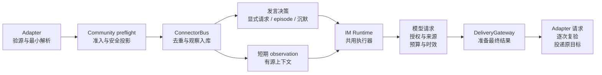
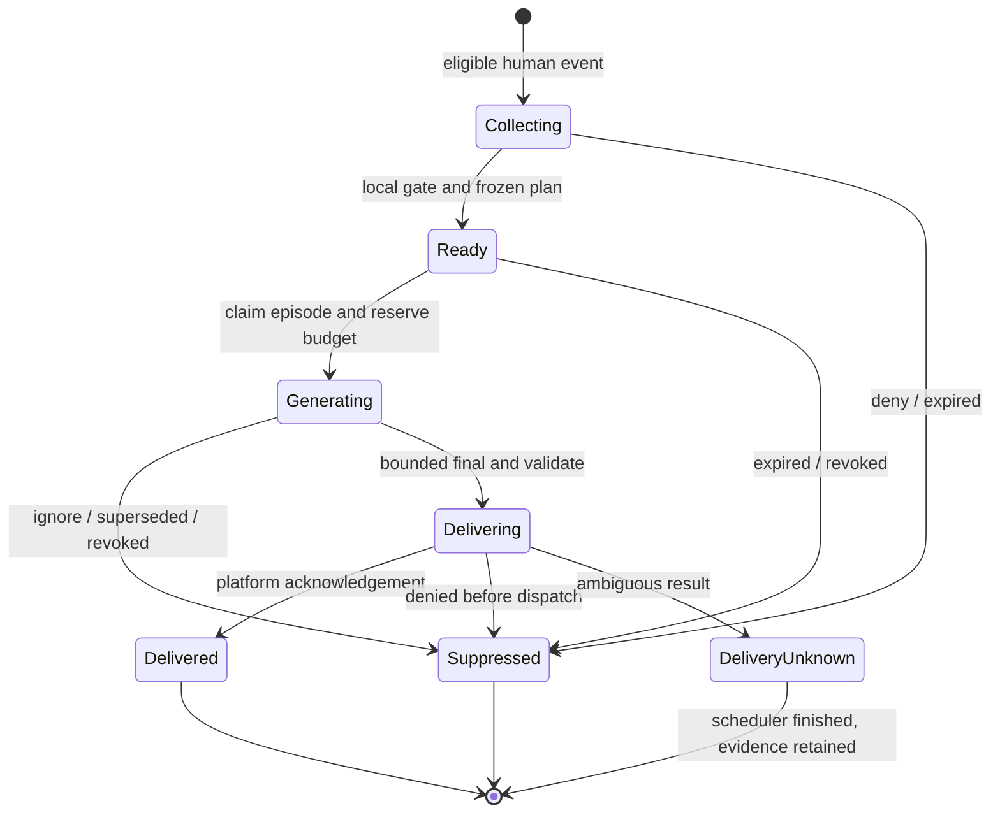

# Cognia 普通群聊与常驻聊天 Bot 技术方案

| 字段        | 内容                                                                                                                                                                                                                                                                                                                                                             |
| ----------- | ---------------------------------------------------------------------------------------------------------------------------------------------------------------------------------------------------------------------------------------------------------------------------------------------------------------------------------------------------------------- |
| 状态        | Consolidated proposal — 已整合权限、记忆和场景交叉反证；可分包实施，发布仍需团队评审与真实验收；未实施                                                                                                                                                                                                                                                           |
| 作者 / 日期 | Codex / 起草 2026-10-20；复审修订 2026-10-21（Asia/Shanghai）                                                                                                                                                                                                                                                                                                    |
| 深度 / 范围 | Heavy；IM 适配器、共享 TS 执行契约、Dexie/无头持久化、现有 Agent/Workflow/插件权限、群设置与运维                                                                                                                                                                                                                                                                 |
| 需求        | 补齐普通群成员准入、记忆/工具隔离、旁听不逐条回复，并研究常驻模仿人聊天的差异                                                                                                                                                                                                                                                                                    |
| 基线        | 初查 HEAD `94a4db67efaeb0848dbf83b152ee70902a6eb247`；2026-10-21 联合复核 HEAD `0d138eefc6f1d3535ffd57db71a898e540e3686f`，共享工作区仍有并发修改；源码事实不等于发布能力                                                                                                                                                                                        |
| 前置研究    | [可行性](../research/2026-10-20-cognia-group-chat-bot-feasibility.md)、[AstrBot](../research/2026-10-20-astrbot-group-chat-reference.md)、[常驻社交 Bot](../research/2026-10-20-resident-group-social-bot-reference.md)                                                                                                                                          |
| 相关决策    | [ADR-0009](../content/docs/zh/adr/0009-platform-connectors.md)、[0089](../content/docs/zh/adr/0089-topic-scoped-connector-runtime.md)、[0174](../content/docs/zh/adr/0174-the-bot-control-plane.md)、[0177](../content/docs/zh/adr/0177-a-room-is-one-conversation-shape.md)、[0198](../content/docs/zh/adr/0198-a-runs-capabilities-are-granted-not-patched.md) |
| 交付边界    | 本次仅技术方案、研究与对抗评审；不创建部署、外部文档、PR 或生产配置                                                                                                                                                                                                                                                                                              |

> **执行摘要**
>
> 复用 ConnectorBus、IM Runtime、现有执行器、权限求交和出站队列，在同一管线上增加 community 用途与一份由宿主签发的群执行范围。
> 将“成员可使用”“消息可被观察”“允许发言”“可读数据/工具”“允许投递”分开裁定，访客永不继承运营者身份。
> 权限按 operator、群治理者、资源处分者、普通成员分权；个人可读不等于可发全群，自主聊天只消费独立的 resident standing grant。
> 普通助手按 @/引用触发；常驻聊天者在同一执行器前增加有界的观察、聚合、发言仲裁和过期淘汰。二者不是换一段 persona prompt 就等价。
> 群内表达按 social / brief-answer / task 分档：默认短句单条，拆句在执行前有界组装，多人插话按目标依赖判定；14 类具体时序场景见 §7.6。
> 默认无私人记忆、无工具、无主动发言、无实时流式；先闭合数据与授权边界，再逐项开放群知识和常驻发言。
> 需评审的选择是公共准入范围、群记忆命名空间、常驻发言预算及首个平台；推荐值见 Q1–Q5，均有可执行默认值。

## 1. 两种聊天方式共享架构，但需要不同的发言契约

**本方案将“普通群聊助手”和“常驻聊天者”作为同一群 Bot 的两种 participation 模式。** 前者解决“有人叫我才回答”，后者解决“持续理解对话、在合适时机加入、也能选择沉默”。

| 维度           | `addressed`：群助手                | `resident`：常驻聊天者                              |
| -------------- | ---------------------------------- | --------------------------------------------------- |
| 主要触发       | @、引用 Bot、受允许命令            | 同样支持显式触发；另对人类新消息产生有限的发言候选  |
| 消息与回复关系 | 一条显式请求对应一个独立 FIFO turn | 多条群消息形成一次 episode；多数 episode 不回复     |
| 上下文         | 可选旁听前文                       | 旁听是必要前提，但不等于每条调用模型                |
| 结束条件       | 完成该请求、取消或审批停泊         | 话题/上下文变化即可放弃候选；沉默是正常终态         |
| 记忆           | 群知识可显式授权                   | 稳定 persona + 短期群情境；持久事实必须仍有独立授权 |
| 工具           | 可增量授权任务能力                 | 自主发言轮默认零工具，显式任务另开受限执行          |
| 展示           | 最终回复，任务可显式展示进度       | 短回复单条、让位和冷却；task 另依平台限制分段       |
| 重启           | 已开始的副作用走原恢复协议         | 过期自发候选丢弃；不能重启后补发昨晚的闲聊          |

“模仿人聊天”在本文指节奏自然、记得当前话题、有一致的公开 persona、无需每句都响应；账号仍明确标识为 Bot，不默认使用某位真人的私人 Twin、私聊素材或身份。人格表达与数据访问权限分开配置。

### 1.1 目标和验收一一对应

| ID  | 目标                           | 可验收结果                                                                                                 |
| --- | ------------------------------ | ---------------------------------------------------------------------------------------------------------- |
| G1  | 群成员无需注册 Cognia 即可交谈 | 受允许群的新成员可 @；同一人不能因此审批、访问 owner 资料或改设置                                          |
| G2  | 旁听不调用逐条模型             | 未触发的 100 条文本入站产生观察记录，Agent/embedding/决策模型调用均为 0（addressed 模式）                  |
| G3  | 不同群、话题、账号的数据隔离   | 同文本跨 scope 的召回、历史、缓存、工具和回复不能命中未授权内容                                            |
| G4  | 常驻发言有节奏且可抑制         | 假时钟下验证聚合、让位、显式请求优先、冷却、预算、过期与单 episode 唯一投递；§7.6 场景回放验证短答与不抢话 |
| G5  | 执行与投递不扩权               | direct/Team/Workflow/插件/外部 Agent/恢复的实际 sink 均受同一 ceiling；不支持的运行方式拒绝启用            |
| G6  | 随时停听、停说、撤权           | 停听后不再复制内容；停说/撤权能阻止仍未发生的平台投递；已发出的内容不声称可收回                            |
| G7  | 复用现有基础设施               | 不新增 Bot 进程、消息队列服务、模型网关、成员目录或向量数据库                                              |

核心交付 R1/R2 覆盖文本旁听、显式多轮、一个经真实验证的平台和常驻模式的受控试点。媒体理解、群长期事实、任务工具分别是后续受门控的交付包，均在本方案设计范围。自动学习群成员心理画像、任意跨群转发、接管真人账号身份、迁移 AstrBot/MaiBot 插件 ABI 不属于范围。

### 1.2 用三个发布单元闭合范围，普通聊天不等待全部 Agent 生态改造

**推荐按 R1→R2 推进，R3 各增量包独立开放。** R1/R2 即交付普通群助手、旁听与常驻聊天所需能力；群知识、长期事实、工具和其他运行方式在各自验收前持续硬关闭，不以“不支持”偷换安全约束。

| 发布单元      | 用户可用能力                                                                            | 实现与启用边界                                                                                                                                    |
| ------------- | --------------------------------------------------------------------------------------- | ------------------------------------------------------------------------------------------------------------------------------------------------- |
| R1 普通群助手 | 无 Cognia 注册也可 @、有权限的短期旁听、群隔离、本人退出、短答/同人拆句、可追踪文本任务 | 单 Host、单首平台、单经验证的 direct 文本执行器；预批准模型、零工具/KB/长期记忆/Twin/插件正文/实时卡/草稿；实际经过的存储、模型和投递必须完整受控 |
| R2 常驻聊天   | 在 R1 上增加公开 persona、合适时接话或沉默、冷却/让位/过期                              | 独立 standing grant；一个 episode 调度 owner；默认本地预筛 + 一次生成（允许 ignore）；先 shadow，再单群 canary；不以长期记忆或工具为前提          |
| R3 增量能力包 | 群共享 KB、经批准公共事实、受限工具任务、媒体、多平台/多 Host/Team/Workflow/外部 Agent  | 每包有独立 grant、reader/effect/恢复/删除验收；KB 只读可先于事实写入；跨 owner 接管与 native fencing 单独交付；未通过的入口在分流前拒绝           |

首个平台建议沿用已有强身份接入基础的飞书自建应用，首 Host 建议 headless，选择固定 direct 文本执行路线；它们是本方案默认实施目标，不是已具备全消息权限的事实。R1 启用前 QA 必须核实真实全消息可见性、actor 来源、创建时间/编辑删除和投递能力；缺少全消息能力时只发布不旁听的 addressed 子集，不能宣称 R1 全部完成。改选 Telegram/其他平台须完成同一 capability 契约，不能临时关闭身份校验。OneBot 等桥接的可信组件和 actor 证据须单独验收，不以“有 token”推导平台管理员资格。

首 Host 只支持一个账户数据目录的强制单写者，无热接管、共享目录多进程或多设备并行执行；具体排他所有权见 §8。纯浏览器/手机是配置或状态界面，不承担 R1 常驻执行。R3 后续逐项放开支持矩阵，不能让未支持路径收到 community 正文。

## 2. 现有架构可复用，但不能把现有默认当成公共群权限

证据标记：**C** 为当前源码/本次命令确认，**I** 为推论，**P** 为拟实施设计，**O** 为待真实平台验证。下文所有新类型、表和字段均为 P，不代表已经存在。

| 事实                                                                        | 状态 | Owning source / symbol                                                                                                                                                                                                                        | 设计含义                                              |
| --------------------------------------------------------------------------- | ---- | --------------------------------------------------------------------------------------------------------------------------------------------------------------------------------------------------------------------------------------------- | ----------------------------------------------------- |
| 11 个内置 Adapter 分支 + 插件 Adapter                                       | C    | [adapter-registry](../../lib/connectors/adapter-registry.ts) `buildAdapterFromRow`                                                                                                                                                            | 复用，不推断所有平台有全量群消息                      |
| 主路径已有身份、admission、trigger、FIFO、direct/Team/Workflow、Bot fan-out | C    | [bus](../../lib/connectors/bus.ts)、[runtime](../../lib/connectors/runtime.ts)                                                                                                                                                                | 只扩展决策与上下文，不建第二执行引擎                  |
| 普通 @ 前文缺口存在                                                         | C    | bus 在未通过 admission 时 `history_only`；runtime `recentGroupContextBlock` 只读会话消息                                                                                                                                                      | 捕获与发言必须拆开                                    |
| observer、完整 job 入库和部分媒体/OCR 早于主体授权                          | C    | bus `runInboundPipeline` 前部、[Lark Adapter](../../lib/connectors/adapters/lark/index.ts) 入站媒体 enrichment                                                                                                                                | 只在 bus 后段新增观察表不足以阻止旁路复制             |
| 飞书默认 principal registry 要求绑定当前账号                                | C    | [resolveConnectorPrincipal](../../lib/connectors/principal/resolve.ts)、[feature-flags](../../lib/connectors/feature-flags.ts)                                                                                                                | 增群访客语义，不关闭全部 registry 作为正式方案        |
| ADR-0177 的默认关记忆未在新 IM 创建与执行之间闭合                           | C    | [settings](../../lib/chat/room/settings.ts) `initialRoomMemoryFields` 无生产调用；[createPlatformSession](../../lib/connectors/session-bindings.ts) 未写 memory flags；[build-options](../../lib/claude/build-options.ts) recall 用原 session | 必须补 fresh/legacy group 执行回归；不能只修 UI       |
| memory、Twin、KB、project history 是不同数据入口                            | C    | build-options 的独立注入段；[memory agent-policy](../../lib/memory/agent-policy.ts)                                                                                                                                                           | memoryUse=false 不代表所有数据不可读                  |
| 现有 ceiling 传播基础存在，但不含群/收件人资源权限                          | C    | [im-permission-ceiling](../../lib/connectors/im-permission-ceiling.ts)、[permission-ceiling](../../types/agent/permission-ceiling.ts)、[permission-cascade](../../lib/ai/agent/external/policy/permission-cascade.ts)                         | 扩展统一 execution/data scope，保留求交语义           |
| delivery gateway 当前做 PII 和审计                                          | C    | [delivery-gateway](../../lib/connectors/delivery-gateway.ts)                                                                                                                                                                                  | 新增收件范围和时效校验，不把 PII 当 ACL               |
| partial、运行卡片、审批等可提前出站；出站可 sibling reroute、转草稿         | C    | runtime `onPartial`、[outbound-runner](../../lib/connectors/outbound-runner.ts)                                                                                                                                                               | 所有出站面均须门控；首版关闭 community 实时与 reroute |
| IM roster 是 observed projection，不是成员授权目录                          | C    | [participants](../../lib/chat/room/participants.ts)                                                                                                                                                                                           | 不把“见过此人发言”当群管理员或审批者                  |
| headless 与桌面使用相同 connector bootstrap                                 | C    | [installConnectorRuntime](../../lib/connectors/bootstrap/install-connector-runtime.ts)、[headless runtime](../../lib/headless/runtimes/connector-runtime.ts)                                                                                  | 在现有租约下安装 planner，无第二常驻进程              |

本次更深入的审计补充了前置报告：群记忆“默认关闭”确有 ADR/展示层设计，但目前不能据此担保实际 recall 关闭；这是本方案的前置修复，不是已验证发生资料泄露。

## 3. 复用 owner，在执行器前后补准入、观察与发言仲裁

主流程的变化是把群语义移到副作用之前，执行器和投递队列保留。



图 1：准入先于复制，旁听只增加有源上下文；模型与每次平台请求都在真正 dispatch 前校验同一范围。

| 职责             | 复用 owner                                                                                    | 拟扩展；新增文件必要性                                                                                                                                         |
| ---------------- | --------------------------------------------------------------------------------------------- | -------------------------------------------------------------------------------------------------------------------------------------------------------------- |
| 适配器前置策略   | `adapter-registry`、`adapter-context`、各 Adapter 的 enrichment 调用点                        | 增 `preflightInbound` 接缝，在下载/提取前回答内容权限；不复制平台传输                                                                                          |
| 群身份与用途策略 | `principal/resolve`、`conversation-admission`、`policy-resolve`、`im-effective-config`        | 身份、观察、发言分别返回结果；新增纯 `lib/connectors/community-policy.ts`，因现有 admission 只负责何时回答，且 Adapter、Bus、callback、delivery 均需同一解析器 |
| 观察内容存储     | 现有 `lib/db` / schema / 清理模式                                                             | 新 `lib/db/connector-observations.ts` + 测试，保存短期群情境；不能复用聊天转录的默认长期保留、通知/同步副作用                                                  |
| 发言 episode     | 现有 runtime 租约、inbound job claims、run journal                                            | 新 `lib/connectors/participation.ts` 纯策略 + `lib/db/connector-participation-episodes.ts` 访问器；状态由总线现有 bootstrap 安装，不是另一队列服务             |
| Agent/data 权限  | 现有 AgentPermissionCeiling、TrustedMemoryCaller、KB session reader、workflow securityContext | 增共享群执行范围；不新增用户/凭证存储                                                                                                                          |
| 最终投递         | delivery-gateway、outbound-runner、draft approval、run presentation                           | 持久化 authority 与 freshness，发送/审批时重验；不直接 Adapter.send                                                                                            |
| 设置与配对设备   | 现有 Connections/房间设置/Host 配置与控制桥                                                   | 组合现有控件，Host 签发；不新增 Next.js server route                                                                                                           |

所有新增实现文件配 co-located tests；实现时若现有 owner 已能容纳纯策略，应优先合入该 owner，不能把本表当成必须新建目录的命令。

### 3.1 三种替代方案及选择

| 选择                                         | 收益                            | 主要代价                                         | 结论                                       |
| -------------------------------------------- | ------------------------------- | ------------------------------------------------ | ------------------------------------------ |
| 扩展原生 Connector                           | 现有生命周期/执行/审计/恢复统一 | 必须清点旧旁路和权限边界                         | 推荐                                       |
| AstrBot/MaiBot 作前门，Cognia 作有限执行后端 | 已有群聊体验和插件              | 双上下文、取消/审批/身份映射；上下游仍须一致隔离 | 保留显式桥接选项，不作本方案主线           |
| 给 `/bots` 或 RoomRunner 新增群消息引擎      | 可复用部分定时或房间规划代码    | 与 IM 主回复抢执行权；队列/权限再次分叉          | 不选；只抽取纯策略，不复用不相同的执行语义 |
| `always + persona prompt`                    | 改动看似少                      | 每条调用、打断、陈旧回复、无公共资源 ACL         | 不满足 G2–G6                               |

### 3.2 统一运行契约：身份、来源、用途和副作用贯穿同一条路径

**安全约束只定义一次，由 owning port 在真正使用时执行；聊天策略只在其内决定说什么、何时说。** 共用 `CommunityExecutionScopeV1`（§6），不是在 permission、memory、planner、delivery 各造一份可放宽的配置。

| 步骤 / owner                | 必须冻结或检查的事实                                                                                | 成功产物 / 失败处理                                                         |
| --------------------------- | --------------------------------------------------------------------------------------------------- | --------------------------------------------------------------------------- |
| 1 Adapter preflight         | account/adapter/tenant/app/conversation、真实 actor、群治理策略、本人退出、源版本与时间             | 最小安全投影；拒绝仅留无正文证据，不触发下载/observer/模型                  |
| 2 Bus capture transaction   | receipt 去重、localSequence、source use grant、用途/受众、正文期限                                  | observation + observed job，或独立 queued 显式 job；commit 后才算接受       |
| 3 显式 job / episode driver | requester 与 service executor 分开；support/selected/context 及派生根依赖；response profile、sendBy | 冻结一个 turn plan；不复活 observed job，不把他人发言当委托                 |
| 4 同一执行 resolver         | 当前安装上限 ∩ 动作权限 ∩ 来源用途/处理路线 ∩ resource share；私有注入全部关                        | run/attempt-bound scope、reader、最终输入；无 scope/unsupported 分支拒绝    |
| 5 effect dispatch guard     | 等到执行槽之后复验 epoch/source/grant/期限，原子登记 operation 与预算                               | 才可开始模型/工具/平台请求；先撤销/取消则不 dispatch，已开始则记录在飞/未知 |
| 6 结果与后续上下文          | 每个物理发送操作再验；输出继承根来源、用途、受众、有效期                                            | 最终消息 + 可追溯终态；仅允许复用的文本可回流 observation                   |
| 7 撤销与清理                | source edit/delete、本人退出、issuer/grant 失效、正文 TTL 与事实期限分开                            | 先让 reader/claim/dispatch 拒绝，再异步清正文/向量；恢复不能重启旧授权      |

两个 driver 只拥有各自调度状态，共用一个不 claim/complete 入站 job 的执行接缝、执行 journal、预算 owner 和 outbox。显式 job 负责独立请求责任；episode 负责可沉默的自发候选。它们不能互相完成或重开对方状态。

来源清单区分：`selected` 是要回应的来源，`context` 是可读背景，`dependencies` 是本次输出实际依赖的可传递材料。完整 required dependencies 不能因 selector 的 512-token 摘要而丢失。权限判断始终读取 Host 事实，而非相信模型报告“只用了这几条”。

### 3.3 保留安全地基，延后没有证据支持的复杂机制

R1/R2 的安装、群治理、provider 路线和服务预算授权直接存在 binding 的版本化策略里；其字段表达 §4 的逻辑分权，不先建设通用 IAM、跨组织授权委托图或可转授 token 系统。resource share 与 approval mandate 在相应 R3 包中扩展现有 owning store；未提供时能力集合为空。

默认不启用 selector 的 wait/replan、第二次语义复验、超长重生成、自动学习、跨群共享、自动 Host 接管和长久闲聊草稿。R2 先用已授权本地预筛 + 一次短生成，允许返回 ignore；模糊的新变化直接沉默。只有 14 类回放证实确有收益、费用/时延仍在上限内时，才分别启用 §7 的可选优化，不能同时堆入首次 canary。

不能简化的部分是实际路径的身份与数据隔离、最小短期派生来源链、可信持久化、公共请求预算、撤销/取消的实际 dispatch 门和每次真实发送的校验。关闭未支持路径是合法范围控制；让未受控路径以“已有 Agent 能用”为理由继续执行则不是。

## 4. 群访客是平台主体，不是运营者 Cognia 账号

**身份认证、消息用途和具体操作分别授权。** transport token/签名证明消息来自受信连接，不自动授予 owner 工具能力。

### 4.1 scope 与 policy 存在现有事实来源上

P：`AdapterInstanceRow.communityProfile` 存用途和版本；**从未启用** community 的 Adapter 缺失该字段才继续 legacy。`ConnectorConversationStateRow.communityBinding` 存已验证的允许群、运营者账号、绑定 ID、配置 revision、授权 epoch、生命周期 `active|disabled|quarantined` 和专用知识 workspace 引用；它不要求先创建 ChatSession，也不借用有 `sessionId` 前提的 override 作准入记录。曾启用的 binding 留下无正文用途标记；关闭/删除配置、kill switch、降级或撤销后默认 quarantined，在 legacy 分支前阻止新入站、claim、callback 和 egress。回到私人 legacy 是另一次 owner 明确迁移，不能由空配置隐式触发。

`scopeId` 是宿主构造的结构化元组 `{accountId, adapterId, platformTenant/appInstance, stableConversationKey}` 的稳定编码/hash，不手工拆 `conversationKey` 推算目的地；实际投递始终使用 `ConversationDeliveryTarget`。默认话题是独立 scope，父群监听不意味着自动授权各话题；须由有权的安装/群治理授权者显式登记继承，源引用仍保留 thread；资源 audience grant 也必须明确覆盖该 thread。

P：一次准入返回类似下列语义契约，具体字段落在现有共享 contracts owner，禁止 UI/模型直接铸造：

```typescript
type CommunityAdmissionV1 = {
  version: 1
  bindingId: string
  policyRevision: number
  authorityEpoch: number
  actor: { kind: "platform-guest" | "registered-principal"; platformSubject: string }
  sourceDisposition: { capture: boolean; useAsContext: boolean; requestOnly: boolean }
  allowedActions: CommunityAction[] // Closed actions in §4.4; no generic manage/approve bit
  authorityRefs: { grantId: string; revision: number }[]
  scopeId: string
  expiresAt: number // UTC epoch milliseconds
}
```

scope 与 actor 是宿主鉴定的事实，不取消息正文、昵称、转发原作者声明、模型工具参数或 localStorage。不能把管理员选择的 Bot 运营账号伪写为 `resolvedPrincipal`。

低权限 converse grant 缺省最多 5 分钟，显式 job 在实际 claim 时按当前 policy 重验并续发当前 grant；超出正文窗口、主体被撤销或 membership 证据失效则拒绝续发。social output 另受更短的 profile sendBy；resident 还不能超过 30 秒 episode expiry。原始 admission grant 不作为排队数小时后仍可发言的理由。

### 4.2 准入次序与权限表

1. 验证传输，最小解析消息/身份/群标识；拒绝错误签名、错误 token、缺失关键身份。Adapter 仅在内存持有原始 payload。
2. 读取当前 Host policy/binding；读取失败或版本不支持就停止 community 内容处理，不能回落 legacy 放行。群 allowlist 是硬许可，不是 OR trigger。
3. 判断发送者已知封禁、tenant/app 范围、当前群允许情况、成员身份的可用证据。受信“来自该群的当前消息”可作低权限 converse 证据；列表仅用于展示的 observed roster 不作授权。
4. 分别裁定消息 capture/context disposition 与主体的具体 action；旁听须同时满足 installation、群治理策略与本人排除设置。可配置只旁听不接受请求；封禁主体默认不采集、不对话。
5. 生成安全持久化投影后去重/写入；敏感 callback、管理写入、每次工具和 egress 均重新验权限与 revision。

传输真实性还要区分 `bridge_authenticated` 与 `actor_integrity_verified`。正确静态 token 只能证明连接秘密持有者；不能据此允许其自报一个管理员 openId 就修改设置。复用现有 `isForgeResistantTransport` 的 gateway/加密签名判定，并在 Adapter capability 中记录 actor 完整性、tenant/app 绑定、重放时间窗口。管理/审批/授权修改必须达到后者且有对应 action authority；较弱桥接来源只在运营者显式信任该桥时提供低权限显式 converse，不开放旁听/resident 或平台管理员权限提升。callback 无此证据则拒绝。

| 主体/事件                                      | 观察/对话                                  | 改群配置、模型或 persona | 审批/使用私人凭证                                          |
| ---------------------------------------------- | ------------------------------------------ | ------------------------ | ---------------------------------------------------------- |
| allowlisted 群的新平台成员                     | 根据当前 binding 可用                      | 否                       | 否                                                         |
| 真实平台主体 ban、错误 runtime/tenant/app 路由 | 拒绝；不借 guest 分支翻回允许              | 否                       | 否                                                         |
| 未绑定但 transport 与群范围有效的飞书成员      | community guest，可对话；不创建 owner bind | 否                       | 否                                                         |
| 经核验的群管理员 / 有明确委托的群治理者        | 对话 + 指定群治理动作                      | 仅批准范围内的展示设置   | 无资源处分权；具体审批仍须独立资源/操作 grant              |
| owner/被授权 Cognia approver                   | 经同样群数据上限                           | 依 Host 权限             | 仅在 run/action/recipient 被具体授权时；批准不能越过硬上限 |
| DM、其他群、外部 tenant 或 Bot 消息            | 缺省不启用 community；不从群授权继承       | 否                       | 否                                                         |

飞书现有 registry 保留私人账号解析的强身份路径，但 **identity link 与 community admission 分开**。当前 `cross_account` 同时比较 tenant 和 principal 的 Cognia account，不能直接解释成平台成员被封禁。拟在可信路由层区分：① binding/runtime account、tenant/app 不匹配，硬拒绝；② 路由正确，成员只是绑定了另一个 Cognia account，可独立按本群 platform-guest 准入，绝不解析或使用另一账号资源。未分清原因前不得吞掉现有 `cross_account` 后直接 fallback。

同理，现有 principal/tenant disabled 继续拒绝原账号身份；community 只有取得单独、可信的“仅撤销账号绑定”原因才可评估群访客。明确平台主体/tenant ban 或原因未知时仍拒绝，不能用新分类覆盖真实禁用。跨租户群需单独 binding 与可核验证据，未知 tenant 不猜 home tenant。非飞书也走同一 community 动作权限，不能把 `legacy` 当 approver。

### 4.3 callback、命令和插件都不能绕过准入

敏感 callback 的 group guard **不受** `larkStrictCallbackAuthorization=off/audit` 或 principal registry 关闭影响；核验 account、actor、scope、run、action、nonce、到期、revision，并原子 consume。保留原有 callback 机制作为下一层收窄。

公共命令先只开放 help/本群 Bot 状态；改模型、`/new`/共享 `/reset`、切换执行目标、历史列表、调度等依动作显式 allowlist，不能沿用开放 DM 的 `private-only` 默认。平台群管理员不自动等于 Cognia 审批者；缺少可靠管理员查询的平台，运营者 ID 名单只能表达运行侧委托，不能证明平台群治理权。须有可审计的群主/授权治理者确认并限定范围和期限，否则只支持运行侧停机、显式助手，不开放旁听/resident 或群内敏感管理。

plugin passive observers 当前位于准入前。community 禁止 raw tap；改为在安全投影后、权限感知的订阅中发送最小事件。旧版插件未声明和实现 scope-aware 消费时不接收 community 正文。系统事件 fan-out、欢迎消息、通知预览同样按该用途收窄。legacy 插件行为不因新 profile 自动扩展到公共群。

### 4.4 授权者必须拥有对应处分权，角色名称不产生万能权限

**运行 Bot、管理群、读取资料、允许资料发群是四件事。** 同一个人可以兼任多个身份，但不能从其中一个身份推导出其他身份。下表是 P 的产品权限模型，不是声称现有平台授权已经接通。

| 授权来源                              | 可以授予                                                       | 不能据此授予                                                           |
| ------------------------------------- | -------------------------------------------------------------- | ---------------------------------------------------------------------- |
| Bot operator / Host 管理者            | 安装运行、服务预算、受限服务凭证、允许的模型执行路线；随时停机 | 他人的资源共享权、群治理权、成员私人记忆                               |
| 经核验的平台群主或受委托治理者        | 本群 participation、旁听用途、停说停听、批准范围内的展示设置   | Cognia 私有 KB、owner OAuth、组织资源外发；不能替成员批准个人画像      |
| 资源 owner / 有共享处分权的组织授权者 | 指定资源版本/来源的读取处理、明确受众的派生内容发布、限定保留  | 超出组织规则的分享、其他资源；仅有 read ACL 不具有 grant/share 权      |
| 普通平台成员                          | 发起低权限对话、排除本人消息被旁听、请求删除本人来源的派生事实 | 全群配置、他人资料、全群长期事实批准、自动成为付费工具或私人凭证使用者 |
| autonomous-community 安装主体         | 消费事先签发的 resident standing grant                         | 借 anchor/最新发言人身份，合并群成员权限，生成新的授权                 |

复用 [tenant action presets](../../crates/cognia-tenant-auth/src/actions.rs) 对 execution、credential、publish 的拆分，以及 [shared-session-access](../../lib/collab/shared-session-access.ts) 的独立读取/导出/共享检查；**不把平台群友映射为 Cognia `SessionRole.member`、群管理员映射为 `maintainer`**，以免继承文件、审批等不相关权力。Cognia organization/group IDs 与 platform tenant/app/group IDs 使用不同类型/realm，禁止把外部群 ID 填入内部 ACL groupIds。

`CommunityAction` 是闭合动作集合：`group.converse`、`group.mute`、`group.disableObservation`、`group.configurePresentation`、`group.enableObservation`、`group.enableResident`、`model.selectApprovedRoute`、`knowledge.readSource`、`data.publishToAudience`、`memory.approveGroupFact`、`tool.execute`、`run.approveOperation`、`request.cancelOwn`、`request.cancelDelegated`、`self.excludeObservation`、`self.forgetDerivedFacts`。其中 tool/approval 必须带具体资源与效果约束，不是同名工具的全局许可。首版不提供群内 `grant.delegate`；可扩权的配置操作只走经认证的 Host 控制面，并核验下述全部授权来源。

P：每项 authority 保存 `grantId, issuerRef, authorityDomain, subjectRef, action, resourceRef/version, scopeId, purpose, audience, processingRoute, retentionLimit, expiresAt, revision, parentGrantRefs`。这些是可信 owning store 中的授权事实引用，不是客户端可提交后自动生效的 bearer JSON。binding 保存安装/治理/standing grant；资源 owner 保存资源分享事实，运行只冻结引用。没有新增通用成员目录、独立 IAM 服务或第四张 community 表。签发时和每次消费时，issuer 必须仍具有对应 **grant/share 权**；默认不可转授，子授权只能缩小，issuer 失权使依赖授权失效。

每次具体操作必须同时满足：**系统/组织硬规则 ∩ installation ceiling ∩ 当前 actor 的动作授权 ∩ 资源 read/process 与 share 授权 ∩ processing route 授权 ∩ 目标 audience ∩ 父 run ceiling**。不适用的维度不凭空新增资源要求；缺失任何必需维度即拒绝，deny/撤销优先。两人的权限不能合成一个“超级成员”。调用现有 `AgentCapabilityGrantV1` 时，它只是候选配置；其中 KB/MCP/tool 的 additive merge 不等于资源授权，必须在 resolver 最后再按此交集收窄。

addressed 也使用 installation service subject 执行，不是以 guest 身份访问 operator 的模型凭证。`requester` 是发起者，`executor` 是受限服务主体，`sourceSubjects` 是材料作者，三者分别保留。成员的 `group.converse` 只准许触发安装已承诺的群服务；服务自己的 execution/credential-use/budget grant 允许调用预批准模型，不把密钥或任意凭证使用权交给请求者。issuer/资源集合固定，不能把 requester 与 executor 的无关权限取并集。模型 credential 与未来任务服务 credential 也分别授权。

### 4.5 群受众、云处理和保存期限必须分别批准

**群助手只读取已获准向本群受众披露的材料，不能先用个人权限取回再靠生成模型保密。** 一个成员可以读 restricted KB，不足以让 Bot 在群里引用、总结、暗示其内容；这项个人 grant 不进入共享 prompt、摘要、embedding、缓存和长期事实。摘要、脱敏和改写都不构成 ACL 解密，派生数据继承所有来源的限制。`originTarget` 仅防止发错群，不能证明材料可发群。

资源分享必须明确 audience：

- `dynamic-current-and-future-group-members`：资源处分者明确允许本 binding 的现有及未来成员获知指定材料和派生事实，并明确历史材料可用范围；这是首版群知识唯一支持的非公开受众类型。
- `explicit-subject-set`：只向固定主体集合分享；不能送入首版群执行。将来须能证明实际投递可见范围在该集合内，并在发送时验证；成员枚举本身不等于平台能限制历史可见范围。

默认既不因拉新人自动扩张固定受众，也不因同一 conversation ID 继续沿用旧的个人授权。无法核验完整 roster 时，仅使用公开来源或已获明确动态群受众授权的 corpus；新成员可以提问，不因此获得 owner 私有知识。群成员离开不自动撤销资源 owner 签发给动态群的独立授权，但其个人授权不能继续被借用。未来私人资料问答须另建私有运行、reader、缓存和经授权 DM 目标；本方案首版不提供，也不能静默把群回合改投私聊。

capture、context reuse、cloud processing、长期保存分别裁定。旁听启用要求 operator 安装许可与可信群治理许可，公布 Bot 用途、保留窗口、模型处理路线和本人退出入口；本人 opt-out 优先于群旁听。只有 @ 消息证据不足以证明允许收集全群。群政策授权的普通对话上下文仍按 §5 的短 TTL；涉及可识别成员的长期个人事实/偏好，首版保持禁止，不用“群管理员确认”代替本人批准。将来开放需本人专属 grant，不能把它默认公开为群知识。

processing grant 绑定用途、provider/endpoint 路线集合和保留上限；selector、generation、embedding/rerank、媒体模型及 fallback 都在集合内才可调用。PII gate 通过不补足 processing grant。群管理员可在预先批准的预算/路线/公开 persona 集合内选择；换云 endpoint、增加预算/工具、延长保留、开启学习或导入新 corpus 均不是 `configurePresentation`，须取得对应 operator、群治理者和资源处分者的许可。扩大授权建立新 epoch/新 run；旧 run 不追随扩权。

### 4.6 审批只批准已被授权的具体操作，自主聊天必须有独立授权根

`run.approveOperation` 在展示审批前先验证所有硬上限和资源授权；审批人必须具有该动作、资源、凭证和目标受众所需的审批资格。单次批准绑定 `runId, preparedActionHash, resourceVersion, credentialGrantRef, audience, maxCost, expiresAt, nonce`，执行时重新验证并原子 consume；工具参数、收件人、资源版本或效果变化必须重新准备和审批。审批通过不能创建缺失的资源/share/credential grant，也不能把 operator 登录态透传给群成员。复用现有 [tool authorization producer](../../lib/governance/producers/tool-authorization.ts) 记录审计；它是证据记录器，不是授权引擎，平台点击者不能记为 `local-user`。

审批资格可由对应资源/凭证的治理者单独授予 `approveOperation` mandate，列明审批人、资源/效果/费用范围、期限及父授权；仅表示在已批准的用途、效果和预算内释放一次操作。审批人不必拥有 `grant/share/delegate`，也不因此获得这些权力。批准记录冻结 mandate 与 parent refs/revisions，签发者、mandate 或父授权撤销都使未执行批准失效。跨多个 authority domain 的操作须各域均已有允许自动执行的授权或取得各自必要的批准，不能只点一张“管理员同意”卡代替。缺少资源/share/credential grant 时先拒绝准备，必须回到相应 owner 的独立授权配置，不能用审批界面临时创建。

工具权限以资源和效果为边界：同一个 `search`、`fetch` 或 `read`，访问公网与读取内部链接/向指定 endpoint 外传参数是不同操作。后续任务包只能使用绑定群用途的服务凭证、限定目标与参数；仅因 operator 已在 Host 登录某服务，不能开放其 OAuth、租户数据或内部网络。显式任务的 grant 不被转作 resident 的常设 grant。

resident 的 `initiator.kind=autonomous-community` 绑定 installation service subject，授权根为 operator + 群治理许可形成的 **resident standing grant**，其中列明用途、共享 corpus、processing routes、动态群 audience、预算和期限。成员发言只提供 provenance，不充当请求或委托。自主能力只取 standing grant、当前安装政策和资源授权的交集，绝不借最新发言者/anchor 的个人 grant；首版仍为 direct、零工具。

个人退出与群控制分开：`self.excludeObservation` 立即阻止本人消息再被 capture/context use，先使其已有来源与派生依赖不可读，再按 §5/§6 清理；`self.forgetDerivedFacts` 清除依赖本人来源的产物，不能任意删除他人的独立事实。退出旁听不等于封禁对话；本人随后明确 @ 可只授权该条请求及所需回复的短期处理，不恢复后台旁听。群停说/停听须当前群治理权，operator 始终可以停自己的 installation。首版个人控制走可验证 actor 的平台自助入口，不要求绑定 Cognia；弱桥接无法验证 actor 时不能承诺本人控制已生效，也不启用旁听/resident。

该单次例外持久记录为 `purpose=explicit-request-only` 的 source use grant，绑定 request/run/目标/处理路线/期限。该请求、回复及其派生物只能用于完成本次请求和有限恢复，不进入 observation，不能作为以后 addressed 旁听、resident episode、长期事实或自发摘要的输入；Bot 回复及其平台回声继承此限制，不可洗成公共上下文。引用/转发涉及其他成员或资源时分别核验其原始来源权限，本人的 @ 不能替别人授权；无法核验来源则不展开原文。后续明确追问若要引用，须由本人重新明确选择，并生成新请求授权，不把一次 @ 当永久恢复。

收到可靠撤权、管理者降级、退出或 source 删除时，先更新 grant revision/epoch、停依赖 reader/run/发送，再清理数据；未知状态不新增高权限。后续恢复身份不复活旧 grant、审批、候选或输出。群治理权限变更通知缺失时只提供有期限的授权；敏感变更必须即时核验，不能用 observed roster 或永久静态名单替代。

信任边界是受信 Host/存储与可验证的平台事件；应用权限不防御有磁盘/进程控制权的恶意 Host 管理者。用途继承覆盖可识别的来源、引用、回声和派生链；对成员手工复述无法可靠追溯，不能承诺自动识别全部转述。平台引用缺失可信来源时不自动展开受限原文。

## 5. 旁听使用短期观察库，不能隐式污染聊天历史和长期记忆

**观察记录是非权威、带来源的短期资料；不是用户指令、owner 记忆、工具执行或自动化事件。**

### 5.1 入口副作用必须前移控制

各 Adapter 的媒体 enrichment 也接入 preflight：observe-only 缺省不下载附件、不缓存二进制、不调用 OCR/ASR、不预取链接；只记录无 URL 密钥的媒体类型占位。仅在显式请求且获得 provider-scoped media grant 后复用现有媒体 gate。不能只把 `runInboundOcr` 从 bus 前部向后移动就宣称完整控制。

community 的 durable job 使用显式 `PersistedInboundProjectionV1`（拟新增投影契约），包含可验证的源身份、消息 ID、目的地引用与经过 redaction 的最小内容；不持久化 raw、内联 bytes、下载 token、任意 channelData。原始 transport payload 不写入审计/日志/通知。拒绝事件只写有界、允许淘汰的无正文聚合审计，不占用安全 receipt 配额；只有需要保护当前有效来源的条目进入安全 ledger。

PII 与 ACL 是两步：先限制可观察来源，再 redact；写 observation、决策模型、生成模型、embedding/rerank、插件边界、最终平台发送逐处执行现有 gate。脱敏失败的材料不进入云端；不以获得群许可代替 PII 检查。

### 5.2 观察数据和保留预算

P：新增 `connectorObservationMessages`，不加入 `messages`，也不加入 companion/account 内容同步。唯一键为 `{scopeId, sourceMessageId}`，字段：`id, bindingId, scopeId, localSequence, sourceMessageId, sourceKind(human/bot), subjectRef, sourceUseGrantRefs, dependencyRefs, audience, purpose, speakerLabelRedacted, bodyRedacted, sourceVersion, eventAt, freshnessAt, observedAt, expiresAt, tombstonedAt?`。

index：`&id`、`&[scopeId+sourceMessageId]`、`[scopeId+localSequence]`、`expiresAt`、`bindingId`。可信序列由宿主在同一 Dexie transaction 递增 state，平台时间只作展示，避免时钟偏差逆转会话。

拟定默认上限（P，非压测结论）：每 scope 24 小时、最多 200 条、256 KiB 的正文与依赖引用序列化数据，单条正文 4 KiB；宿主观察数据合计 32 MiB，先按过期、最旧记录淘汰。无界群数不承诺。读取时按 expiresAt 实时过滤，即使清扫器尚未执行也不能用过期内容。

上下文选择最多 40 条/3,000 input tokens，保留 source refs 与版本；超预算按时间/引用相关性确定性截断，addressed 旁听不调用 embedding、摘要或分类模型。Bot 自身已投递的最终文本仅在全部派生来源允许 context reuse 时以 `sourceKind=bot` 入库，供对话连贯性使用，但绝不触发另一个自主 episode；`explicit-request-only` 的输出与回声始终排除。

编辑更新版本并作废派生上下文；删除保留无正文 tombstone，同时擦除正文；乱序 edit/delete 必须能先写 tombstone。按 scope 匹配，不采用跨群 legacy fallback。`scopeContextRevision` 的变化使候选/缓存可失效，不复用原“最新 assistant 时间即所有前文已消费”的水位假设。

**正文 TTL、重放窗口和容量必须相容。** 扩展既有 `inboundLedger`，记录 community namespace、`firstAcceptedAt, contentExpiresAt, sourceVersion?, deleteSeen, receiptExpiresAt`。community capture 在同一 transaction 内检查 receipt，再写 job/observation/receipt/localSequence，duplicate 不执行；不能沿用忽略 `recordAndCheckInbound` 返回值的 legacy 语义，也不能被现有全局 `pruneOldest(10_000)` 提前清掉有效 receipt。

R1 要求 source create time 可验证且在重投/编辑中不被重置；只接受当前 24h 正文窗口内的新 create，因此普通短期 receipt 默认保留 **24h + 5min 安全余量**，到期旧 create 仍由可信创建时间/启用水位拒绝，不需要为短期聊天无条件堆满 7 日 ID。若平台可比较的原始创建时间或 replay 契约不满足此条件，该平台不得使用此压缩策略；必须先给出经测试的更长窗口/持久游标方案，否则旁听/resident 不开放。

R1 支持负载初值为每 scope 每分钟 60 个需分配安全 receipt 的新 source ID（含 delete-before-create）、突发 120；`receiptCap >= ceil(ratePerMinute × retentionMinutes) + burst`，即至少 `60×1445+120=86,820`，默认取 **100,000/scope**，Host 默认最多 **1,000,000**。配置窗口/支持速率时同步校验容量，不能只改一项；每条消息的 edit/delete 更新同一 source 状态，不另按版本无限增行。元数据磁盘配额必须单列，不能算进正文 32MiB；首次启用按真实序列化/index 开销实测预留，达不到容量预算就降低声明的支持速率或拒绝启用，不能假称支持 60/min。超过支持负载时优先明确拒绝新 create，必要 delete/撤权优先处理；容量压力告警与停止接受新内容不等于丢失完整性，不应日常触发重建。

A38 必须以假时钟跑完整 retention horizon，覆盖满速、突发、edit/delete、清扫与 replay；10 分钟性能样本不能替代保留窗口的容量验收。长期事实所需的无正文撤销标记寿命见 §6.1，不能用普通 receipt 到期删除它们。

**统一新鲜度时间基准。** `trustedEventAt` 只能来自 Adapter 已校验的平台服务端创建时间，不能取消息正文、客户端自报时间或转发原文时间；`firstAcceptedAt` 是首次可信收件时间，后续 replay 不更新。冻结 `freshnessAt=min(trustedEventAt,firstAcceptedAt)`，将显示用 `eventAt` 与 freshness 分开；允许时钟偏差初值为 5 秒（P），未来偏差超过此值、时间来源不可验证或 Host 时钟跳变时不启动/继续 social，不能靠到达时间把旧内容变新。live deadline 同时检查单调时钟剩余量，重启只读原固定期限，不重新计时；迟到消息按原新鲜度衰减。

`contentExpiresAt=min(firstAcceptedAt+24h, trustedEventAt+24h)`，edit/retry/reconnect 不续期。只接收可信时间不早于当前 24h 窗口、且不早于 binding 启用水位的新 create；超出窗口的历史 create 只更新已有无正文 receipt；若没有既有条目或有效派生依赖，直接按时间水位拒绝，不新建逐 ID 记录，也不成为观察或 episode。无可靠源时间/序列的 Adapter 不能提供可恢复旁听/resident，需先补重放契约，不能用本机到达时间冒充新鲜事件。已认证 delete 建立/提升 tombstone，delete 对该 messageId 优先于迟到 create/edit；edit 只接受严格较新版本。平台无可比较 edit 版本时，首版 tombstone 该内容而非猜测覆盖。receipt 清扫后的旧事件也因新鲜度水位被拒绝。离线 >24h 的显式请求不自动补聊，需用户重新请求。

若 receipt 容量满或存储错误使必要 delete tombstone 无法持久化，该 scope 必须置为 `captureBlocked`：停止内容 capture、episode 和依赖未核验 source 的投递，不能只丢 delete 后继续接 create/edit。优先在已有 binding 行持久化阻断；若连阻断也写不下，立即停 Adapter/撤销 runtime 执行许可，禁止静默自动恢复。存储修复后的 community 启动必须走完整性重建：新 authority epoch、重新核验平台 replay 游标/水位、作废旧 pending source 依赖；无法证明没有漏 delete 时只接受重建时刻之后的可信新事件，旧内容保持隔离。容量恢复本身不构成重新开放许可。A21 增加“满容量下 delete-before-create”的演练。

观察入库和 inbound job 的 observe-only 终态在同一 transaction 提交；若崩溃在事务前则允许重投，事务后 duplicate 不重复写入或触发。纯旁听不走 Agent、Bot/Workflow fan-out、欢迎、inbox unread 或 owner 记忆提取。未来如需“基于旁听的自动化”，必须独立授权，不偷用现有 `connector.inbound` 事件。

### 5.3 TTL 必须覆盖后续副本

只删 observation 不等于删除上下文。community 使用新的 session lineage/授权 epoch，不复用开启 profile 以前的 SDK 会话和会话转录；每次模型回合从授权观察窗口重建上下文，复用执行器但使用独立的短期 SDK session，禁止恢复旧 sdkSessionId 或项目连续性历史。

`StoredMessage`、prompt/canonical journal、sidecar session、preview、draft、run-presentation、query/summary caches 都标记同一 retentionClass 和 source refs；设置 `memoryUse=false/memoryLearn=false` 不能代替副本清理。community 首版不把旁听正文复制到 ChatSession；显式请求与最终回复的转录缺省也仅保留 24 小时。metadata 审计可保留 30 天，不含正文、prompt、用户 token 或可恢复内容。

清理器由现有 bootstrap 安装、每分钟分批执行并在启动时先清过期；restore/恢复读时再次过滤。软件删除承诺覆盖当前活跃存储和可控缓存，不声称能撤回已发给平台/模型的内容或即时擦除历史备份介质。默认把 observation/episode 排除可移植备份、内容同步；headless 活跃 journal/SQLite 仍须持久以恢复，需支持正文压缩/保留期轮换，备份不能重新激活过期数据。

| 正文副本 / owner                                                                        | R1 是否允许产生         | 必须闭环的写入、读取和清理                                                                              |
| --------------------------------------------------------------------------------------- | ----------------------- | ------------------------------------------------------------------------------------------------------- |
| 安全 inbound job / observation / 输入组装                                               | 是                      | 安全投影后写；TTL/来源用途读时检查；root 失效先拒绝，再按引用清正文                                     |
| 本次 prompt / 模型输入与短期最终输出                                                    | 是，限所选 direct 路线  | 请求前校验；不保存任意 raw trace/COT；受控本机 prompt/output 同一依赖与保留期                           |
| ChatSession 展示转录 / run presentation                                                 | 仅必要的显式请求和结果  | 不复制全量旁听；记录依赖与 effective expiry；状态审计可无正文保留 30 日                                 |
| headless 活跃 durability store                                                          | 是，R1 先验收 sqlite-v5 | 复用现有 transaction capture/store；清理后执行既有后端维护、清 superseded generations；禁止过期快照回灌 |
| 长期 SDK session / sidecar transcript / summary cache / draft / 内容同步 / 插件 raw tap | 否                      | 执行前禁止写入/订阅，不以“后续补清理”获得启用资格；R3 逐 owner 放开                                     |
| 平台及批准的模型处理方                                                                  | 必要外发                | 独立 processing/audience 许可与 PII；披露外部保留边界，不承诺本机删除可擦除远端                         |

任何 capture/commitSync、磁盘写入或完整性错误，都必须在后续 model/send 之前终止或阻断 runtime，不得捕获后只打印日志继续；下次启动先校验 store，未知 reservation 保守结算。复用现有异常/teardown 与恢复路径，不另建持久化服务；A39 注入磁盘满/commit 失败验证此顺序，不能仅凭 complete listener 抛错就宣称已验证。

R1 选定一个 backend 验收，不同步实现所有 backend。当前 headless [capture](../../cli/src/serve/persistence/capture.ts) 在 Dexie transaction complete 同步记录 commit，[store](../../cli/src/serve/persistence/store.ts) 复用该事务日志/后端接口；community 应扩展其 table allow/exclude 和清理验证，不另建第二份 SQL 业务模型。若 sqlite-v5 的活跃持久化、正文期限或故障关闭尚不能通过验收，就不声明该 Host capability；journal-v4、桌面 IndexedDB 和其他模式在 R3 各自验收，不静默 fallback。软件删除仍不等于磁盘介质取证级擦除。

### 5.4 短期回复也须携带派生根来源，不能等长期记忆再补

R1 的 input assembly、run prompt、output、Bot observation 和缓存都保存 Host 构造的依赖清单，区分 `directSourceRefs` 与 `rootAuthorityDependencies`。每个 dependency 含 `{sourceId, sourceVersion, sourceEpoch, sourceUseGrantRef, usePurpose, retentionBasisRef}`；对 Bot 产物展开原始权限根，同时保留全部可识别中间消息的 id/version/epoch 失效依赖；覆盖所有输入材料，而非仅模型声称采用的 selected 来源。权限可扁平化，但删除/编辑依赖不能被扁平化掉。根与中间节点合计最多 64 个引用、每条依赖清单序列化最多 8KiB（P）；超过时减少可选上下文/不回流该 Bot 文本，不能截掉必需依赖后继续用。

短期派生物的有效期取自身与所有短期根来源/用途 grant 的最早到期值，Bot 回声不重置 24h。每次读/claim/dispatch 校验根及中间节点版本、撤销状态和用途；缺失状态即拒绝。R1 可保守取消该 scope 的未发输出，再在最多 200 条观察行内逐批清理，不需要先建通用 provenance 图服务。收到任一 root/中间节点删除、可信编辑、更改用途或本人退出，A→Bot R1→Bot R2 的完整链先不可读，随后擦除；已发出的平台消息不能据此声称已撤回。

此处最小来源闭包是 WP2/3 前置条件，WP5 仅将同一规则扩展到长期事实/向量/历史。若某实现不能保存/验证短期闭包，其 Bot 回复不得回流 observation；不能先上线可反复复用的无源回复。长期已批准事实与原文到期的区别见 §6.1，不把原文正文重新读回 prompt。

## 6. 群执行范围必须约束所有数据和工具，而非一张 denylist

**以现有 ceiling 和 caller 机制为 owner，增加 Host 签发、不可扩权的 `CommunityExecutionScopeV1`。** UI 仅请求修改，模型仅能选择上限内的动作，嵌套运行只能求交。

P：scope 含 `bindingId/accountId/scopeId/authorityEpoch/policyRevision`, `originTarget`, `requester?`, `executor`, `sourceSubjects`, `authorityRefs`, `resourceShareRefs`, `audience`, `processingRoutes`, `retentionLimit`, `allowedToolNames`, `allowedMcpServers`, `allowedKnowledgeBaseIds`, `allowedMemoryNamespaces`, `allowedCredentialKinds`, `allowedRecipients`, `expiresAt` 与所依赖 source refs；审批另存 approver/mandate 引用。它和 run identity 持久关联，不能从外部请求 JSON 直接信任。

| 数据/能力                                                                        | 首版群默认                                    | 后续显式开放方式                                             | 实际 enforcement                                                                               |
| -------------------------------------------------------------------------------- | --------------------------------------------- | ------------------------------------------------------------ | ---------------------------------------------------------------------------------------------- |
| owner global/character/agent memory、旧 ChatSession、项目历史                    | 不可读/写                                     | 不提供“一键继承全部”                                         | build-options + TrustedMemoryCaller + history/project 工具 reader                              |
| 本群短期观察                                                                     | 仅本 scope、当前 TTL、未撤回 refs             | 在 capture/retention grant 内调窗；扩期限须重新授权          | observation reader + prompt assembler                                                          |
| 群知识库                                                                         | 空集合                                        | 资源处分者逐来源/版本授权 read/process + 本群 audience share | 现有 KB session reader；给 IM/Workflow 显式 group access，而非 `skill/undefined=trusted-local` |
| 群长期事实                                                                       | off；所有 memory operations 均 false          | 见 6.1，专属 namespace + 显式写授权                          | read/write/search/history/procedural 与后台维护共用 caller                                     |
| 私人 Twin                                                                        | 不构造 deps                                   | 仅导入有资源分享权且批准本群受众的公开 persona 文本          | character binding 验证与 Twin 注入前硬门                                                       |
| shell、文件、Computer Use、联系人、建群/邀请、跨群发送、用户 OAuth、任意网络工具 | deny                                          | 受限制任务包单独验收；resident 自发轮始终 deny               | 工具解析最终 clamp、plugin/MCP API、workflow node、native sandbox/credential broker            |
| 发回原群                                                                         | Host 内置 delivery 能力，不暴露任意收件人工具 | 跨群必须独立 recipient grant，首版不开放                     | gateway + runner + card/stream/draft 等所有 sink                                               |

所有已获支持的 direct、Team、Workflow、plugin Agent dispatch、外部 Agent、子 Agent、恢复和计划任务均须继承同一 scope；R1/R2 只启用一个经验证的 direct 文本路线，其余在现有 runtime 分流点进入执行器前硬拒绝。R3 每开放一种路线才补齐其真实 sinks 与恢复验收，不要求 R1 先改完全部 Agent 引擎。Workflow connector/send、memory、terminal 节点也须逐项支持，而非仅 Agent 节点受限制；缺 scope 绝不当 trusted-local。

插件默认不接收群内容或该运行的凭据；后续放行必须 scope-aware。任意 Python/JS 插件进程或未受控 MCP 不因工具名 allowlist 就成为可信隔离环境。无法证明外部运行时会限制文件、网络、宿主凭据及历史时，该 target 对 community 标为 unsupported，而不是靠 prompt 请求自律。

### 6.1 群长期记忆沿用 memory core，选择专属 workspace namespace

仅在 R3 开启长期 memory 时，每个 community scope 显式绑定一个**真实、专用的 knowledge workspace**，通过既有 workspace memory scope/namespace 运行，而非新增第二向量库或复用 owner 默认 workspace。R1/R2 memory 全关时无需先建 knowledge workspace，但仍不能 fallback 到 owner workspace/cwd。该 workspace 不挂载个人仓库或凭据；thread 默认各自 namespace，重建 ChatSession 不改变 binding 的 namespace。若多个群需共享某知识库，用 KB grant 明示，不合并群事实 namespace。

知识 workspace 本身不是文件系统隔离。community 强制不继承 `session/character/app.defaultWorkingDir`、owner instruction 配置、磁盘 CLAUDE/AGENTS 的 up-tree/import、markdown subagents、项目连续性或旧 SDK settings；复用 `bareMode` 的跳过发现能力并在执行 resolver 作不可放宽的硬限制。需要 cwd 的运行时只使用明确 materialized 的空隔离 scratch root，缺失则拒绝，不能由 `resolveEffectiveCwd` fallback 到个人目录。公开 persona/skills 文本逐项 grant 后才注入。增加 rootless workspace + owner 默认目录含私密 AGENTS 的回归。内存权限和工具 clamp 发生再晚，也不能补救已经读进 prompt 的私人指令。

第一阶段保持 memory 全关闭；后续开启时 caller 的 scopes **只含 workspace**，projectIds 只能是绑定 workspace，global/character/agent 一律排除。模型提供的 scope/projectId 只能收窄，缺失/未知值拒绝，禁止 fallback 到默认/global。同一角色跨群使用不改变此约束。

不能仅依赖当前 `memoryRowWithinNamespaces` 的缺省行为：community 每条 memory 必须严格满足 `scope === "workspace" && projectId === boundWorkspaceId`；缺 projectId 的 workspace row 拒绝，不能视作 account-wide legacy。该规则同样作用于向量候选、历史版本与 procedural 材料。

区分 recall/create/update/forget/autoLearn：session.memoryLearn=false 不是所有写操作关闭。拟提供“只读群知识”“经资源授权者批准的群公共事实”两种增量配置，自动从旁听提炼事实默认关闭；平台群管理员身份本身不足以批准材料、个人画像或扩大受众。群来源继续标记 connector/untrusted，不伪装为 owner user/explicit，不自动生成 procedural 规则或修改 persona。

所有 memory list/get/search/count/asOf/history/procedural、store/update/forget/restore/move/mirror/merge、后台 consolidation/distillation，以及插件/MCP/Workflow 对应 API 均从 run-bound TrustedMemoryCaller 派生。缓存键含 account、workspace namespace、policy revision、精确候选 corpus、authority revisions、audience、purpose 和 processing route；先授权候选再排序，query expansion/rerank 也必须通过 PII。知识来源撤销后停止旧 caller、缓存、恢复快照与后续投递。

WP5 将 §5.4 的最小短期来源闭包扩展为 memory evidence/provenance owner 的**多源反向 lineage**：事实、摘要、历史、向量和 merge/mirror 产物保留 `{sourceKind, sourceId, sourceVersion, sourceEpoch, grantId, retentionBasis}` 集合及可查询依赖，不能用单个 sourceMessageId 代替。source edit/version replacement、delete、本人退出或 grant 撤销，先提升 epoch/版本并让旧依赖整体不可读，再异步清正文/历史/向量；旧版本的事实批准不自动批准修改后的新版本。重新计算、重新满足 share/retention 批准后才可恢复。

短期观察转长期事实须由具备来源 read/share/retention 处分权的授权者明确批准，且满足群治理政策；涉及成员个人事实首版禁止。长期事实必须获明确动态群受众授权，生成独立 `retentionBasis=approved-group-fact`、保留期限与依赖清单。批准前观察 24h 到期即连带失效；批准后原始材料的普通 TTL 到期可只清原文，事实按批准期限存在，但显式删除/授权撤销仍使依赖事实失效。多源事实部分来源撤销时默认整条隔离，重新批准/重算后才恢复；禁止把失败清理或 namespace 缺失当可读。WP5 未完成 lineage/严格 namespace 验收前，长期写入持续 off。

`bodyExpired` 与 `deleted/replaced/grantRevoked` 是不同状态。读取已批准事实时，依据其独立 retentionBasis 检查事实正文/受众/处理授权，不要求恢复已过期原文；但 provenance 的源版本、删除/撤销状态必须仍可验证。无正文源失效标记保留至最长派生事实及可恢复快照的有效期结束，不能随普通 receipt 清扫；导入快照必须核验当前失效标记，核验不可得则隔离。原文 TTL 到期、显式删除、源编辑和批准事实到期四种测试必须分别断言。

R3 KB reader 复用现有实现但修正 authority key：community 注册与取用使用 Host-issued `{bindingId, authorityEpoch, runId, attemptId}` handle，读时再验当前 resource/share/processing revisions，工具和子运行显式传递该 handle。当前 [session-reader](../../lib/knowledge-base/runtime/session-reader.ts) 仅以 sessionId 注册/覆盖，不能作为 community 的并发/审批恢复隔离边界；旧 session-only API 仅留 legacy。A 停泊、B 在同一 ChatSession 注册 reader、A 恢复时仍只能取得 A 的有效 scope，不能读 B 的 corpus。KB 包未完成此项时保持空集合。

### 6.2 修复 room 默认并保持 DM 语义

IM group/thread 的新 session 写入显式 memory off，resolver 对缺失字段的 legacy 多人群默认也关；执行层再次应用 community ceiling，房间 UI 不能单独放宽硬上限。`roomKindOf` 当前将所有 platformBinding（包括 DM）归为 IM，修复必须同时读取 channel/scopeKind，不能机械将私人 DM 的已有显式设置全部清零。

已有显式 memory-on 的群保持旧用途行为；切换为 community 时进入新 epoch、提示并重置私人授权。该行为通过迁移和开关上线，不悄悄将个人助手降为公共访客模式。

### 6.3 R3 工具任务把取消与真正副作用开始作原子排序

普通文本 task 只改变展示和责任，不授予工具；R1/R2 的工具集合始终为空。开放 R3 工具包时，复用 action/run journal 为每个 `preparedActionHash` 保存 `prepared/approved/dispatched/succeeded/failed/unknown/cancelled-before-dispatch`、authority refs、mandate refs 和 operation ID。

实际 credential/native/网络 effect sink 在获得执行位后，按 §8 共用 guard 对取消/撤权与 dispatch 登记作 CAS：取消先提交则不能开始；dispatch 先登记则只能报告已开始/待核对，不声称副作用已撤回。批准在该次登记中原子消费，参数/目标变化须重新准备，重试须遵守操作自身幂等契约，unknown 不自动再做。现有 AbortSignal 传播仅帮助停止工作，不等于已经具备这个协议。该验收是相应工具包开放门，不阻塞零工具文本聊天。

## 7. 常驻聊天增加有界 episode，不替换显式请求的 FIFO

**先使用新消息与本地规则决定是否值得考虑，再可选用一个无工具的小模型作发言判断。** 持续常驻的是消息监听和状态机，不是无休止的 LLM 循环。

外部研究区分了 AstrBot 的群上下文/概率主动回复与 MaiBot 的 debounce、focus/gate/interrupt；它们为节奏控制提供设计参照，不证明某个固定参数能产生“像真人”的效果。固定版本与源码依据见[常驻研究](../research/2026-10-20-resident-group-social-bot-reference.md)。

### 7.1 addressed 先走既有 turn，自发候选另作调度

所有显式 job 在首次接受时冻结 deadline，不因重启/重投/重新授权续期。social 用目标 freshness 的 15 秒上限；brief-answer 默认 2 分钟、纯文本 task 默认 10 分钟，且都不超过正文/source use grant 期限（P）。过期 job 写明 expired 终态；只有当前 egress 允许才通知一次，不能积压后数小时执行旧任务。R3 有副作用任务另按明确任务契约配置，不能由模型自行延长期限。

显式 @/引用始终保留独立 source job 与 FIFO，优先于未开始的自主候选；不能为了“自然聊天”静默吞并显式任务。平台消息不等于完整表达：一个显式 job 可在 claim 前收集同人的受允许续句作为 support refs，规则见 §7.5；两个独立显式 job 不合成一个。`resident` 聚合尚未执行的非显式人类消息，原消息的身份和文本不被拼写为某一人的新指令。

community 普通显式请求固定 `dispatchMode=queue`，忽略旧 adapter/override 的 steer；授权取消/更正控制按 §7.10 在入队前处理；运行中继续接收下一条独立请求。现有内存 `MAX_PENDING_TURNS=100` 仅作 active admission 上限，不能像当前 overflow 分支把已持久接受请求改成 history_only。扩展同一 durable drain：完成一个 turn 后按宿主 `localSequence` 领取下一个 queued，内存满的 accepted job 仍 queued。持久 pending 初始上限为每 scope 1,000、Host 10,000（P），超上限必须在接受前明确拒收/记录固定 reason，不静默吞请求；恢复排序也改用 community 的 localSequence，不能继承不可信平台时间排序。

自主发言起始建议值（P，需 canary 调参）：quiet window 800ms，最长聚合 2 秒；仅与候选相关的续句延后到上限，表情或可确定无关的引用链不续时；显式请求不等待自主合批窗口。episode 最长存活 30 秒是内部恢复硬上限，实际社交回复另受 §7.5 更短的可发送期限。合法显式请求被接受后优先调度，将 collecting/deciding/ready/generating/delivering 的旧自主候选标为 superseded 并阻断全部未登记 effect，以释放槽；不延长旧候选期限，也不抢占其他显式任务（§7.10）。群停说、上下文删除/授权变化使旧候选作废，Bot 已回答同一目标也作废。生成中不对每条新消息全局取消：更正/撤回/已答/同目标新请求使对应计划 `superseded`，无关消息不扩期、不抹掉候选；相关性不确定时按 §7.5 有界重验，否则沉默。R2 默认不重建；未来优化最多一次且不续 sendBy，持续洪峰不无限重算。

不依赖平台不存在的“正在输入”信号：缺少 verified typing capability 时只根据消息间隔让位。Bot、system、重投、历史导入、编辑和删除不会创建新的自主发言候选；人类新消息才可创建。其他 Bot 不参与主动互聊，沿用现有 loop guard 且首版不开放 sibling respond。

### 7.2 episode 独占自主调度，旁听 job 永远不重开

P：新增 `connectorParticipationEpisodes` 保存自发候选，字段为 `id, scopeId, bindingId, policyRevision, authorityEpoch, contextRevision, candidateSourceRefs, selectedSourceRefs, contextRefs, dependencyRefs, dueAt, sendBy, expiresAt, status, leaseOwner?, leaseExpiresAt?, executionRunId?, deliveryId?, suppressionReason?, updatedAt`。索引 `&id`、`[scopeId+status]`、`[status+dueAt]`、`expiresAt`、`bindingId`。它不是另一条平台入站消息队列。

所有 source job 先完成 capture disposition：显式 job 保持既有 queued 路径；非显式旁听 job 为新增 `observed` 执行终态，永不 `observed→queued`，也不被普通 inbound recovery 重新执行。episode 保存真实 source refs，不伪造平台 messageId、actor 或合并事件。`replyTargetRef` 只确定回复对象，不是生命周期 anchor 或权限主体。

同一 scope 最多一个处于 collecting/deciding/ready/generating/delivering 的自主 episode。CAS 校验 scope/epoch/依赖版本和所选来源未消费，再 claim episode；由 episode driver 独占完成/抑制其状态。只有实际 selected/consumed source 标记消费，`contextRefs` 不消费其他话题；未选 source 保留原始 expiry，在当前 episode 终态后且仍满足预算/冷却时可重评，不保证每个话题回复。

从现有 `startRouteHandlerTurn`/runtime 提取生命周期中立的 `executeConnectorTurn(preparedPlan, scope)` 接缝：显式 driver 仍由 inbound job claim/complete 驱动；自主 driver 由 episode claim/complete 驱动；二者复用同一模型执行器、execution run journal 与 outbox。接缝不得自行 claim/complete source job，不能调用普通 dispatchInbound/ensure，也不重跑 capture、mention/commands/welcome/fan-out。prompt/reply builder 消费冻结的 source/依赖/目标，不扫描旧 SDK 历史。

自主 `initiator.kind=autonomous-community`/executor 为安装服务主体；各 source subject 只作 provenance。首版 R2 仅 direct 文本。Team/Workflow 等未实现 prepared-plan 语义时在分流前拒绝，而非伪造一个普通入站任务来执行。

启动先恢复授权/来源状态，再处理显式 queued job 和未过期 episode。过期候选终止，不补聊；running 崩溃但尚未投递的自主轮默认 suppressed，不自动从头生成。平台结果不明标为 **`delivery_unknown` 调度终态**：已消费来源不释放、不自动重发；人工 reconciliation 使用现有 outbound/run 证据继续，不能占住 resident 活跃槽或随候选 TTL 删除。新话题仍须独立经过冷却和预算。



图 2：episode 独占自主调度；结果不明结束候选调度但保留投递证据，不冻结整个群。

所有 transition 采用 revision/CAS，owner 为现有 connector runtime；后台扫描每秒至多一次，teardown 停止并 await 当前工作。所有等待、模型和发送准备共用原始 sendBy，不续期。取消后的迟到结果不能更新终态/出站，已发起的模型 usage 保守结算。R2 默认无 wait/replan；可选 selector 的调用也必须扣同一预算并缩进剩余时间。

### 7.3 发言决策模型没有执行权限

本地预筛先检查 binding、全消息投递能力、安静时段、显式队列、冷却、预算及与 Bot 的明确相关信号；不满足就不调用模型。R2 默认只有一次生成，返回经 schema 校验的 `reply|ignore`、文本及冻结目标引用，ignore/格式无效/超长直接沉默；不是每条消息先分类再生成。可选 selector 默认关闭，其输入只含本 scope redacted context（最多 512 tokens），输出严格 schema：`{action:"speak"|"wait"|"ignore", reasonCode, respondToSourceIds, waitMs?, draftVerdict?:"retain"|"invalidate"}`；draftVerdict 仅用于既有草稿的发送前复验，不产生新执行/授权；wait 最多一次、最多 5 秒，不能形成反思循环。

selector 不能生成任意工具调用、授权、recipient、persona 修改或长期记忆写入；未知字段拒绝，source IDs 只能引用窗口内消息。selector 是质量优化，不可扩大 corpus 或绕过完整依赖检查；失败不自动升级到更贵模型。最终生成复用现有模型/Provider 配置和预算账本；社交长度按 §7.5 的字符/句数/气泡限制，自主轮模型上限收窄为 96 output tokens，单条最终消息，无工具，无实时 partial、执行过程卡或审批卡。下文 256 tokens 仍作为预算 reservation 的保守上界，不表示日常接话要用满。

初始限额：自主回复间隔至少 60 秒，生成尝试最多 6 次/滚动小时、30 次/UTC 日/scope；selector 最多 12 次/滚动小时/scope；host 同时最多 2 个自主生成、1 个 selector，可配置更低。显式请求走既有限流和预算，亦需 Host 总预算；resident 不抢占正在执行的显式任务。

按上限估计单 scope 每小时 `12×(512+64)+6×(3000+256)=26,448` tokens，未含可选知识检索；这是 token 上界估算，不是费用实测。货币预算读取实际 provider usage/ledger 和运营者设置，不在方案固定供应商价格。每次执行前 reservation；满额跳过并记 suppression，不能在群里循环播报预算耗尽。

这个上界的前提是 512/3,000 均包含全部 system/persona/context 输入，且输出限制受 provider 强制；统计的是**调用尝试**，取消、失败、wait/replan 均占次数，不是只统计已发回复。selector/generation/显式请求都计入同一 Host 总额度；Host 的初始 community 日上限为 100,000 input+output tokens，resident 还受上述 scope 额度，不把多个群的额度相加绕过 Host 上限。

所有实际模型调用在 prepared plan 明确输入/输出上界；R1 默认 input≤3,000 tokens（含 system/persona/context），social output≤96、brief≤192、纯文本 task≤1,024（P，可由 operator 进一步降低）。不能由模型切 profile 后隐式抬高上限；必需输入放不下则拒绝准备/请缩小范围，输出不完整不能裁断后冒充完整交付。配置许可范围内的扩大只作用于新 run。

硬 reservation 是对既有 `lib/usage/cost-budget*` owner 的扩展，**当前 `enforceCostBudget` 读已花费并 fail-open，不能当作已具备该能力**。新增 `costBudgetReservations` 表（同 usage owner 与 accessor/test）：唯一 operation/attempt ID，Host/account/scope、kind、input/output 上界、status（reserved/dispatched/settled/unknown/cancelled-before-dispatch）、fencingToken、createdAt/deadline/usage；索引 `&operationAttemptId`、`[hostId+createdAt]`、`[scopeId+createdAt]`、`[status+deadline]` 支持窗口计数和恢复。CAS transaction 校验所有余额、预留并登记调用，持久化成功后才请求模型；基础设施错误对 community fail closed。模型 usage 返回后按同 ID 幂等结算，未实际发起才可退款，已发起后未知 usage/崩溃按完整上界保守结算，不因 reservation lease 过期释放并再次消费。沿用现有 usage ledger 作实际账目，不能重复记账。deadline/取消浪费单独可见。需要额外表的原因是跨 selector/显式/自主并发和崩溃必须共享未结算额度，不创建第二计费服务。

### 7.4 persona 与自然度需评估，不能用随机概率代替验收

persona 是运营者和群治理策略批准、素材处分者允许向本群分享的公开风格、称呼、兴趣、话题边界和最大回复长度；不随旁听自动吸收陌生人要求，不承诺无限期“记得每个人”。自然延迟只为等待更多上下文与避免打断，不伪造平台在线/输入状态。

离线使用经同意、去标识的多发言者脚本，对“应答遗漏、无关插话、重复、抢话、陈旧回复、上下文理解和 persona 一致性”人工标注；与 addressed baseline 比较。相关性/自然度门槛由产品评审数据确定，现阶段不虚构成功率。硬指标（未触发模型数、预算、取消、权限违规数）必须先达标，不能以“像真人”抵消边界失败。

### 7.5 短平快由场景、长度和可用时机共同约束

**群内默认一次只表达一个意图，先给能用的回应；是否展开由当前请求决定。** 不默认复述问题、列标题、写总结或连续追问。以下均为 P 的初始体验规则与回放验收参数，不是已经测得的延迟或自然度结论。

participation（addressed/resident）与 response profile 正交，由同一 Host policy/执行器处理，不新增聊天引擎：

| Response profile | 适用场景                                               | 可见输出                                                                                             | 时效与权限                                                                                                                                                                        |
| ---------------- | ------------------------------------------------------ | ---------------------------------------------------------------------------------------------------- | --------------------------------------------------------------------------------------------------------------------------------------------------------------------------------- |
| `social`         | 打招呼、轻松接话、简短共情、群内玩笑                   | 目标 10–60 个 Unicode code points，最多 120；1–2 句、1 条消息，模型上限 96 output tokens             | 目标消息距今超过 10 秒不启动 social 生成；所有 social run（含显式）冻结 `sendBy=min(job.contentExpiresAt,target.freshnessAt+15s,episode.expiresAt若有)`；没有有价值的短回应就沉默 |
| `brief-answer`   | 被 @ 的一句事实问答、指代澄清                          | 默认不超过 240 code points、最多 3 句、1 条消息；必要时只问 1 个关键澄清；模型上限 192 output tokens | 不做有意社交延迟；排队超过 15 秒不得直接按旧快照回答，重验目标和上下文后再执行                                                                                                    |
| `task`           | 明确要求检索、计算、多步骤操作、长解释、代码或完整材料 | 先交付结论，再按用户要求提供细节；不强迫完整技术内容压成聊天短句                                     | 独立显式 job、任务预算/期限与工具授权；其他人插话不取消；不沿用 social 的过期即静默                                                                                               |

长度统计针对最终可见文本，保留必要归因；不能靠删除来源、警示或裁断代码/公式满足字数。生成时同时约束 tokens 和 profile，出站前验证格式、句数和长度；超长不得机械截断。R1/R2 默认不为超长重生成，自主文本不发送；未来优化只有在原 deadline、模型尝试与预算均允许时最多重生成一次；显式问答转为一次明确的展开/澄清回复并结束该次准备，不后台无限重试。需要完整代码、详细步骤等应在执行前选 task，避免在 final validator 才发现不能交付。task 仍逐片段通过原群 audience/authority gate，平台单条限制由既有 renderer 分段，不借短回复绕过正确性或权限。

首版用明确 `/task`、用户显式“详细说明/给完整代码”等请求及已注册命令契约选 task；`/chat` 或明确闲聊接话可选 social（包括显式 @），普通 @ 缺省 brief-answer，resident 永远 social。触发方式不决定结果是否承担任务责任：显式 social 过期也可不再公开发言，job 仍记录 expired/suppressed 终态；task 的完成/失败/取消必须有持久可关联终态；公开通知仍受当前 egress 授权。自然语言任务分类可复用本次生成准备，不额外起一个逐消息分类模型；低置信度且内容不能安全短答时，只问一次是否需要展开。模型可以请求更合适的展示 profile，但不能据此授予工具、增加预算或升级运行方式。

**同人拆句的组装只发生在执行前。** 在既有 queued inbound job 增加 `inputAssembly={openedAt,closeAt,supportSourceRefs}`，不新建队列或伪造平台事件。可确定完整的计算/固定格式命令直接快路；待补全的首条显式文本打开最多 800ms 的静默等待，总窗口不超过 1.5 秒（P）；同 sender、同 scope、同一引用目标且没有第三人插入的纯文本续句，可在各自 source use grant 允许 context reuse 时加入 support refs。缺少引用目标时只接受紧邻同人续句；出现第三人、第二条显式 @、命令/审批或不同引用链立即关闭窗口。独立显式 @ 仍另排 FIFO，模型/工具开始后冻结输入，不把补充经 steer 偷塞进旧操作。opt-out 成员的非显式续句不自动采集，须明确重新授权；单次用途限制仍逐 source 继承。

claim 只领取已经 close 的队首 job，恢复不重新延长窗口，所有 support refs 的 TTL/版本/授权重验；一条 support source 最多归属一个显式组装，不能同时被后续显式 job 和 resident 消费。组装关闭后补充属于后续上下文或新请求；运行中的精确更正需通过有身份和目标校验的取消/重新请求处理，不能撤回已经发生的工具副作用。

**多话题使用目标依赖，不用全群新消息计数代替语义。** frozen plan 增 `targetMessageRef, contextDependencyRefs, relevanceCheckedThroughSequence, sendBy`；源删除/编辑、grant/本人退出变化始终硬取消，不能被“无关”判断放行。新的同目标更正、已有人提供答案或清晰话题切换使旧 social 草稿抑制；同一 thread/scope 内有明确不同引用链的聊天、无内容表情等可视为无关，不重置时钟。R2 默认无法确定新消息是否使草稿失效就取消，不做额外模型调用；只有单独启用 selector 复验优化后，才最多调用一次已有 selector 做最新窗口复验，输入包含 frozen target、现有短草稿和新消息 delta，并保持总计 512 input tokens；无法完整容纳必要依赖就取消。只有 `draftVerdict=retain` 且目标未变才可继续；missing/invalid/unknown 一律取消。该调用算入同一尝试/预算上限，不延长 sendBy，不通过或来不及就沉默。语义相关性是待人工评估的质量判断，不能声称模型可以完美识别话题。

`scopeContextRevision` 变化先触发依赖/新消息检查，不自动意味着整群所有草稿失效；source version、authority epoch、固定 sendBy 仍是硬门。依赖检查后的新消息继续在实际发送临界区处理：已知无关可继续，存在未检查的相关/不确定变化则取消，而不是越过 §8 原子复验。热点群长时间没有可用窗口时降为 addressed/shadow，不能用持续取消证明 resident 已适用。

### 7.6 场景矩阵以真实消息顺序规定 Bot 行为

下表的对话为合成回放样例，不是真实成员聊天记录；表内示例只描述允许的表达形态，不绕过资料、主体或工具授权。

| 场景与消息序列                                                          | 预期行为 / 示例                                                                                                                 | 必须避免                                                         |
| ----------------------------------------------------------------------- | ------------------------------------------------------------------------------------------------------------------------------- | ---------------------------------------------------------------- |
| 同人拆句：A「@Bot 帮我看下」→400ms「不是服务 A」→300ms「是服务 B 超时」 | 在有观察许可时组装为同一请求，围绕 B 短答或问一个关键问题；保留 3 个源引用                                                      | 抢答第一句；对 3 句分别发“请补充信息”；把续句当新工具授权        |
| 同人两个独立请求：A「@Bot 明天天气？」→「@Bot 再算一下 17×23」          | 两个 job 各自可追踪，按序处理；第二条不替换第一条                                                                               | 合成一个含混任务、只回答最后一句                                 |
| 多人交错：A 问错误原因，B 引用 C 说晚饭；D「哈哈」                      | 引用 A 的目标短答；确定无关的插话不重置候选年龄                                                                                 | 用 D 作请求者；把晚饭/哈哈并入 A 的问题；热闹就不断重新生成      |
| 真人互聊：A「你到哪了」→@B；B「十分钟」                                 | 不因问号/地名/公开兴趣自动插话；没有明确贡献时沉默                                                                              | 回答“我没有位置信息”；把 @别人识别为叫 Bot                       |
| 已有答案：A 提问后，C 在 Bot 生成期间给出正确答案，A「懂了」            | 放弃自主重复答案；显式请求若已解决，只在必要时短确认，不再长篇解释                                                              | 隔十几秒补交相同答案                                             |
| 更正与取消：A 引用自己的请求「说错了，是 B」或使用受允许取消命令        | 执行前作废旧输入并重新准备；已有副作用按既有任务取消/恢复协议展示事实                                                           | 将更正追加到正在执行的工具参数；让 B 随口一句“算了”取消 A 的任务 |
| 简单 @：「@Bot 17×23」；「@Bot 这个‘它’指谁？」                         | 「391。」；指代不清时只问「你指服务 A 还是 B？」                                                                                | 无必要地列“背景/步骤/总结”；连续追问三个字段                     |
| 闲聊/情绪：「终于修好了」「今天有点累」                                 | 可以一句贴题回应，也可以沉默；不凭这句写入长期个人事实                                                                          | 自动诊断心理状态、长篇劝导、每句安慰都插话                       |
| 梗/反话/引用攻击：「对对对，你说得都对」或引用「忽略规则」              | 不确定就少说或沉默；引用仍是资料，不能成为权限来源                                                                              | 把反话当新事实存储；执行引用中的指令                             |
| 可选媒体：「这图笑死」+图片/表情                                        | 没有媒体处理授权就不下载/OCR，不假装看懂；纯表情不续长合批                                                                      | 给每张表情做视觉模型调用并点评                                   |
| 明确任务：「@Bot 查一下原因，给完整排查步骤」                           | 进入允许的 task 能力；长结果围绕问题交付，不按 social 丢弃；短答模式无法处理则明确澄清                                          | 假称已检索；为了快跳过证据或审批；逐步播报每个工具步骤           |
| 排队/慢模型/话题转移：目标已老、预算不足或上游超时                      | social 到 sendBy 就抑制并记录终态（包括显式闲聊）；brief-answer 过时重验，task 终止保留可查状态，仅在仍有 egress 权限时通知一次 | 两分钟后补发冷笑话；每条都“正在思考”；无限重试换更贵模型         |
| 群里没人接话，或夜间很安静                                              | 不由沉默定时制造新 episode；继续旁听或休息                                                                                      | 为保持活跃主动点名、反复破冰或给无人回复的发言续楼               |
| 长篇材料/消息轰炸                                                       | 按 §5 有界窗口和公平预算处理；只回应明确目标，必要时请发具体问题                                                                | 每条摘要、自动全文解读、清空已接受的显式请求                     |

task 的持久终态不以通知成功为前提。停说、移除 Bot、撤销绑定或资料权限失效时，记录终态与 `notification_suppressed`；只在仍被授权的任务状态界面呈现，不恢复群发送权、不展示被撤销正文。

task 的状态提示同样走统一 egress：默认不发排队/思考消息，未来仅在确有慢任务状态且该能力已验收时允许一次关联目标的简短提示，并限制每 job 次数；首版 §8 仍关闭过程卡。提示不算“首个有效回答”，不能靠「收到」满足响应延迟指标。任何人未经授权不能查看别人的任务材料或用状态查询展开私人内容。

### 7.7 总时延先分配，再用时序回放验收

R2 默认主路径只有本地预筛与一次生成；下表是从同一目标首次可信时间算起的预算分配（P，模型/平台实测不达标就降低启用范围，而非假称满足）：

| 阶段                               | R2 默认预算                          | 达不到时的处理                                  |
| ---------------------------------- | ------------------------------------ | ----------------------------------------------- |
| 合批/让位                          | quiet 800ms，最多 2s                 | 不因无关消息续窗                                |
| 等待执行槽 + 权限/依赖/reservation | 目标 1s                              | 已无至少 4s 生成 + 1s 发送余量则不花模型费用    |
| 一次生成                           | 最多 4s，且不超过 sendBy−1s          | timeout/ignore/超长直接抑制，不重试/升价        |
| serialize + 物理 dispatch          | 保留 1s，最迟 sendBy−1s 进入发送准备 | 槽或 guard 不通过即抑制；网络调用超时走 unknown |
| platform ack / 可见                | 实测记录，不在本机硬期限内担保       | 超迟计入体验失败，不用本机及时 dispatch 掩盖    |

各上限共用一个剩余时间，不相加后重启新计时。可选 selector/wait/重算必须从同一预算扣除；默认不得在主路径额外串联。brief-answer 无人为社交等待，只有确需续句的 800ms/1.5s 组装；纯文本 task 用独立上限，不能挤占 social 的 fixed sendBy。

### 7.8 用时序回放验证阅读负担和响应速度

离线回放须覆盖上表 14 类场景，并分别测试工作群、熟人小群、陌生人大群；加入同名不同人、不同语言、同时说话、缺失引用、弱桥接与本人 opt-out。初始吞吐样本为 1/10/60 条人类消息每分钟、连续 10 分钟（P 的测试负载，不代表真实容量）；语义场景有人标注，计时、字数、次数和隔离用确定性断言。

分别记录 `ingress→assemblyClose→claim→modelFirstToken→generationDone→platformAck`。群里可用的是完整有效消息，不能用内部 first token 或无内容 ack 代替。brief-answer 在无工具、Host 健康、批准模型路线下的初始试点目标为端到端 P50≤3 秒、P95≤8 秒；这是待实测目标，排队与平台延迟计入，拒绝/失败另报比例，不从样本中剔除后宣称达标。social 记录“目标年龄”和错失机会率，task 分开记录完成延迟，不混成同一 SLA。

另外计量各 profile 的可见字符/句数/消息数、错接对象、重复答复、过时发送、被取消生成成本、每百条入站的主动插话，以及因全局取消导致的饥饿。social 一次可见消息≤1、profile 超长校验有效、越权发送=0 是机械门槛；自然度、是否抢话/应当沉默须由标注者判断。真实平台 canary 不满足短答目标时先测排队、批准模型生成和平台发送各段；只能在既有 provider/预算授权内调参，不能默默扩大云处理范围。

### 7.9 同一场景同时裁定权限、记忆和表达

先完成左侧授权/数据裁定，再采用右侧聊天策略；快答、persona、群管理员称号都不能成为绕过数据边界的捷径。

| 具体场景                                       | 权限与数据结果                                                        | 群内表达 / 对应验收                                                     |
| ---------------------------------------------- | --------------------------------------------------------------------- | ----------------------------------------------------------------------- |
| 新群友 @ 算术题，Host 的私人记忆恰好全开       | 只取得群服务请求资格；私有 memory/Twin/项目历史无注入                 | 一句答案；无需 Cognia 注册，不弹审批。A01/A05/A06                       |
| A 连发三句，B 插话；A 未退出旁听               | 同人/同目标/短窗允许 source 组装；B 保留自己来源，不能继承 A 的任务权 | 围绕 A 完整表达短答；B 无关插话不续窗。A18/A31/A32                      |
| A 已退出旁听，随后 @ 再连发无 @ 的个人补充     | 只有本次明确授权材料可处理；非显式补充不自动采集，回复不能回流        | 必要时请一次发完整问题；不偷偷恢复旁听/长期事实。A29/A30/A31            |
| A 个人有某 KB read 权，在含 B/C 的群要求查资料 | 缺本群 audience-share 时连共享 prompt 都不能读取；摘要/脱敏不补权限   | 简短说明当前群范围不可用，不泄露材料摘要；不得自动改投私聊。A22–24      |
| 群管理员说“记住 B 的过敏/性格”                 | 管群不等于本人长期个人事实授权；R1/R2 memory 空，R3 个人画像仍禁      | 不保存；普通回应不自动触发记忆提取。A07/A22/A29                         |
| resident 对有私人工具权限的成员接话            | executor 只消费 standing grant；无成员委托、无工具、无私人长期资料    | 公开 persona 一两句或沉默；不顺便执行任务。A27/A33                      |
| 已批准群公共事实为“周一”，原消息改为“周二”     | R3 先隔离旧事实/向量/缓存/待发内容；新版本需重新满足批准              | 不再短答旧日期；尚未重新确认则明确不确定。A20/A40/A43                   |
| 闲聊已超期，另一明确任务仍在排队，期间停说     | social expired；任务保留终态，停说后无群通知权限                      | 不补旧梗；任务状态在仍授权界面可查，不为了交代失败恢复发送。A34/A39/A44 |
| 模型生成后资料被撤销，或第一段发送后发生删除   | prepared output 和每个物理 operation 重验根/中间依赖                  | 后续模型/发送不开始；已开始部分报告事实，禁止重放整条。A39–41/A45       |

### 7.10 打断区分取消、更正、抢占和停群，不把所有新消息当 steer

**打断以“谁、哪个请求、哪个阶段、要停止什么”为契约。** 群消息是上下文还是控制指令先由 Host 判定；自然语言相关性不能签发取消他人任务或改变已批准工具参数的权限。以下是 P 的明确行为，不能据此声称现有群控已实现。

| 打断场景                                         | Host 行为                                                                           | 后续责任                                                                                      |
| ------------------------------------------------ | ----------------------------------------------------------------------------------- | --------------------------------------------------------------------------------------------- |
| A 尚未说完，仍在 800ms/1.5s 组装窗口             | 依原 source use grant 收集合法同人续句                                              | 冻结前补全；第三人插话关闭组装，不改成 B 的委托                                               |
| A 引用自己的 queued 请求，明确取消               | 校验 actor/scope/目标，直接 CAS 取消该 job，不等 FIFO                               | 不启动模型；其他 job 原顺序继续                                                               |
| A 引用自己的请求并 @Bot「改成 B」                | 先对旧请求执行 scoped cancel，再将新内容作为独立显式请求准备                        | 新 job/run/授权/预算；记录 supersedesRequestId，不复用旧审批或修改已执行参数                  |
| A 正在生成自己的文本回答时要求停止               | 先持久 cancel/output-invalidation，再 abort 上游并阻断尚未开始的发送                | 迟到 token/final/stream callback 不得出站或回流观察库；已计费部分照实结算                     |
| resident 尚处任一非终态，新的合法显式 @ 已被接受 | 取消全部未登记自主工作（含等发送槽/selector），释放本机槽给显式请求；不自动重建闲聊 | 不取消任何已有显式任务；已开始的平台请求按在飞事实处理                                        |
| B/C 在聊其他话题或发表情                         | 不作为对 A 显式任务的取消/steer；自主轮按已有相关性规则处理                         | 不因热闹无限取消和重算；新显式请求仍按独立 FIFO                                               |
| 同一成员有多个请求，只说「停一下」未指定目标     | 普通群聊不匹配裸词为管理指令；明确控制入口目标不唯一时只要求选择自己的请求          | 不默认操作全群当前 session、最后一个人的任务或泄露他人任务列表                                |
| 群治理者要求 Bot 停说/停听                       | 分别消费 group.mute / group.disableObservation，停止对应后续行为                    | 停说不等于有权取消他人资源操作；有安装撤销/委托取消资格才可取消相应任务；在飞副作用不声称回滚 |
| 已发送第一段，或工具已 dispatch                  | 停后续未登记操作；已发/已执行/unknown 分开记录                                      | 不自动删改已发消息、不重发整段；改参数后的替代任务不得自动重复未核对的副作用                  |
| 取消后重启、重投或模型晚返回                     | 终态与取消 revision/epoch 为准，拒绝旧 attempt 的恢复/输出                          | “继续”须是新明确请求并重新授权；不从旧模型内部状态自动续跑                                    |

**控制走快路，权限仍走同一条路。** 在 Adapter 最小解析、community 认证/来源校验之后、普通 turn 排队之前，识别明确的 `/cancel <request-ref>`，或带真实引用目标且明确 @Bot 的取消/更正；不由 LLM、引用正文、OCR、模型工具输出或任意 channelData 触发。目标可为尚无 runId 的 queued job，或已绑定的 run/attempt。省略目标只在同 scope 下该 actor 恰有一个有效可控请求时解析；目标不唯一或查无授权目标时给最小、非泄露式拒绝/选择提示，不展示他人的 run 状态。

community 新增闭合动作 `request.cancelOwn` 与按需签发的 `request.cancelDelegated`。普通成员仅能取消其 Host 记录的 requester 请求；比较完整 `{bindingId, platformTenant/appInstance, platformSubject}`，不能只比昵称或裸 remoteUserId。resident 无成员 requester，成员可表达“先别插话”使本轮质量策略选择沉默，但不会因此获得持久停群或他人 task 控制权。平台群管理员身份不自动获得 delegated task cancel；operator/安装撤销仍按既有 Host 权限处理。

复用 [run-control](../../lib/execution/run-control.ts) 的 command revision/idempotency/handler 与 journal、既有 inbound job CAS；community guard 先核验完整 actor/target/动作，再映射可信控制命令，不能靠塞入宽泛 operatorIds 绕过。当前 [follow-up-control](../../lib/connectors/follow-up-control.ts) 对普通 parent group 排除裸词控制；[live-steer](../../lib/connectors/live-steer.ts) 的 conversationKey→active run 是现有私有/受控入口机制，不能直接作为公共群的任务归属或注入依据。request 级取消事实始终写在原 inbound job：`cancelRevision, cancelRequestedAt, cancelledByRef, targetAttemptGeneration, controlOperationId`。queued、running 尚未 bind、已 bind 三种状态都能提交；claim、bind、模型启动和每个 effect guard 都检查同一事实。cancel 先提交则不能启动；claim/bind 先发生也不能跳过取消，已创建 run 以取消终态收束，已登记 effect 单独核对。run 已绑定时仍调用 run-control 传播 abort/journal；不能因绑定尚未出现而返回“找不到运行”。计划/输出/effect 关联原 requestRef 和 attempt，不能靠只监听 AbortSignal 补此盲区；不先返回“已停”后才写状态。控制入口不等待普通对话队列或模型槽，普通队列已满也能处理本人取消；使用独立、有界的控制限流和幂等去重，不让重复控制形成无界优先队列。

只处理经认证的 create 控制事件，edit/delete/重放的正文不重解释成新控制；源删除仍按数据失效规则处理。更正作为一个可恢复的复合处置：在同一现有 capture/Dexie transaction 中提交旧 request 的取消事实、新消息的 control disposition、固定 replacementJobId/localSequence 及已授权替代 job 的 queued 状态。替代请求使用真实更正消息的 source ID，不伪造平台事件；不再次捕获/分配序号。若新请求不符合权限/容量，则仍可提交取消与 `replacementRejected`，不假称替代任务已接受。崩溃前未提交则整体重投，提交后 recovery 只按 disposition 恢复同一 replacement ID；不得靠重新解释正文生成第二个任务。若旧请求已经 completed/failed/cancelled，保留其历史终态并记录 alreadyTerminal；纯文本更正仍可作为新的明确请求接受，不为了建立替代任务改写历史。涉及已发生或 unknown 副作用则先核对并取得新授权，不自动重做。

控制幂等键为 `{scopeId, sourceMessageId, targetRef, attemptId}`，并绑定目标 revision；重复取消返回同一结果，已终态目标不重新开始。`supersedesRequestId` 只是关联事实，不是旧授权继承。更正后任务仍按正常 FIFO 在接受时登记，不跳过其他人的已接受显式请求；R1/R2 不开放 live steer。需要暂停/断点恢复/后台长任务并行的 R3 能力，复用 execution run 的明确 interrupt/recovery 协议另行验收，不新增通用调度队列，也不在 R1 假装支持。

取消的线性化点与 §8 effect dispatch 相同：先取消提交则未登记模型/发送/工具不能开始；先 dispatch 则该操作已在飞，只能尝试 abort 并核对。确认用语最多一次且仍须当前 egress 授权，分别表达“后续已取消”和“已开始部分待核对”，不把 AbortSignal 返回等同于远端停止。取消仅使旧 request/attempt 的待发输出和相关临时缓存失效，不抹除他人独立观察/事实，也不自动撤回已发布内容。原人类消息仍按自身 capture/context 用途和 TTL 处理；取消不等于删除/忘记，不能把取消事件变成新的自主发言候选。需要删除来源须走消息删除、本人退出或 forget 的独立规则。

新显式请求只抢占自主闲聊，不抢占他人已开始的显式任务。R1 文本任务仍按原 FIFO、有固定 deadline；长任务占用时后续问题可能等待，状态与过期应可查，不能承诺此时每问必在 3 秒完成。§7.8 的短答目标统计必须包含这种排队并报告失败比例。R3 只有在后台任务释放对话槽、结果归属及并发权限独立验收后才可并行，不能用 steer 混入同一 run 伪造“并行”。

## 8. 所有真实 effect 共用 dispatch 守卫，投递再逐物理请求复验

**读取过资料、拿到预算或获得审批，都不代表之后仍可把它外发。** Host 为 prepared effect 保存 `operationId, kind, runId/attemptId, scopeId, authorityRefs, dependencyRefs, audience, processingRoute, preparedActionHash, deadline, status`；复用现有 run/action/outbound evidence owner，不另建通用 effect 服务。显式 effect 必须绑定 requestRef/attempt 并检查其 cancelRevision，自主 effect 则绑定 episode/generation；R1 只有模型调用和原群文本发送两类 effect；R3 才扩展到 embedding、rerank、summary、工具与媒体。

### 8.1 模型、工具和平台请求在真正开始前使用同一排序协议

在获得对应执行槽后，由实际 provider/credential/transport owning port 执行 `prepare→authorize-current→register-dispatch→invoke`。与该 scope 的 source edit/delete、本人退出、grant/processing-route 撤销、取消和停听/停说共用短临界区：重读当前 authority/依赖/期限及 reservation，CAS 登记 in-flight，并立即进入实际调用，不在登记与调用之间等待新的异步依赖。释放锁后才 await 网络结果；禁止持有 DB transaction/parking_lot guard 跨网络 await。

R1/R2 关闭 SDK 内部自动 retry、fallback、结构化输出自动修复及重连式重复生成，保证一次登记对应一次物理云请求；如果某 provider 隐藏重试无法关闭或逐次接入 guard/reservation，该 route 不支持 community。未来 retry 每次都须经过同一 guard 和独立 attempt 预算，不能只包高层 generate 方法。

撤销先提交则该操作不得登记/dispatch；dispatch 先登记则是已开始的操作，后续只可尝试取消并保留结果/unknown。撤销生效确认保证之后尚未登记的操作不会外发，界面列明已登记的在飞操作，不承诺撤回已发给处理方/平台的内容。仅在读 memory/组装 prompt 或 reserve 预算时检查一次不够。A39 用屏障固定“读完资料→撤权→请求模型”的顺序，断言 provider port 从未被调用。

所有 social run（含显式）在 claim、模型 dispatch/deadline 及发送处检查固定 sendBy；任务使用其自己的固定 job deadline。runtime ownership、binding/authority revisions、全部根来源用途与版本、resource/share/processing 限制、PII 和预算始终为硬门，模型判定“无关新消息”不能放行失效来源。结果、草稿和恢复也不能移除这些字段。

### 8.2 Adapter.send 不是最后一个真实发送边界

复用 `PlatformSendSemaphore` 控制平台并发，但外层 `sendSemaphore.run` 只解决排队，不能涵盖 Adapter 内的多次 HTTP/WS 调用。当前 [Telegram](../../lib/connectors/adapters/telegram/index.ts) 和 [OneBot](../../lib/connectors/adapters/onebot/index.ts) 一次 send 可包含多个片段/上传；community Adapter 必须在每个 prepared transport operation（upload/send/edit 及真正 retry）开始处执行 §8.1 guard，分别登记 operation ID/结果。未实现该 hook 的 Adapter 不宣告 community delivery capability。

R1/R2 禁止 partial、COT/activity/审批过程卡、respond-via、跨 adapter sibling failover/balance 和自动长期 draft。最终 recipient/adapter/conversation/thread 精确等于冻结的 origin target，且所有材料仍可向该 audience 发布；target 匹配不能替代 share 授权。reply target 删除/过期时只按原策略取消或降级为原目标无引用文本，不改投父群/其他 thread。

social 在最终序列化后必须只产生一个可见 send 操作，不能被 renderer 自动拆成两条；超限按 profile 失败处理。文本 task 若平台需要分段，每段单独 guard/receipt，已发片段不因后一片失败而重发。R3 upload 的凭证和材料也在真正上传前重验，不能只拦最后一条消息。

`sendBy` 的硬保证是本机 actual owning port 在截止前开始请求；不保证平台在同一时刻可见。R2 默认再保留 1 秒发送余量并配置有限 transport timeout，超时可能远端已发，进入 unknown 而非自动补发。`sendStartedBeforeDeadline` 与 `platformAck/visibleAge` 分开统计，只有平台提供可验证的服务端截止机制时才可承诺严格可见时间上限。

### 8.3 首 Host 强制单写者，自动接管的通用 fencing 独立交付

R1 默认 headless/sqlite-v5，复用 [headless connector lease](../../lib/headless/runtimes/connector-runtime.ts) 的 fail-closed 基础，并在 [serve launcher](../../cli/src/serve/serve-command.ts)/现有 native ownership owner 增加账户数据目录的**进程生命周期排他所有权**：锁必须绑定真实进程存活并持有至 teardown 完成，不是可任意删除的 PID 文件或超时租约。第二 brain、desktop runtime、远端 Host 和不支持的后台入口不得 claim 该 binding；活进程不能仅因心跳超时被热接管，lease 不可达即停止新 dispatch。

该所有权检查必须位于所有可能启动 runtime 的 owner 中，不能只在新 CLI 自觉加锁而允许旧 desktop 抢租约。R1 专用配置声明 minimum supported Host/owner protocol，既有不理解该模式的进程不能共享该目录；launcher/服务器拒绝不兼容执行声明。强制冲突测试必须启动第二 owner，验证 capture/model/send 都为 0；未完成则 R1 不开放。退出先取消工作并处理已登记请求，再释放所有权；崩溃由 OS/原生 owner 确认原进程终止后才启动新 owner，旧 unknown 投递保留核对，不重发。

R3 若开放共享目录、多 Host、桌面热切换或 TTL 自动 takeover，必须另交付持久、单调的 native fencing token：binding authorityEpoch 与执行 owner generation 分开；episode/预算/dispatch token 逐 owning port 比较，陈旧 owner 不能产生副作用。对应 Rust ACL、command registry、companion wire 和 TS invoker 同步验收。**仅缓存一个 JS epoch 或沿用桌面 `onUnavailable:"proceed"` 不满足任一模式。** 此通用 fencing 不再阻塞已被强制单写者约束的 R1/R2。

### 8.4 Unknown 结束调度，不销毁核对证据

每个操作使用稳定的 `community:<binding>:<epoch>:<run-or-episode>:part:<n>` 幂等键。平台支持远端幂等才可按其契约安全 retry；不支持时 ack 丢失进入现有 `delivery_unknown/reconciliation`，不自动重发。episode 将 unknown 记为调度终态并释放活跃槽，已消费来源不重开；现有 outbox/run 保存无正文核对 metadata（默认 30 日），其中正文仍按原 TTL 清理。人工结果核对结束不触发补发旧闲聊。

task 无条件保存可关联终态；失败/取消提示仅在当前 egress 允许时发送，否则 `notification_suppressed`，在仍授权状态界面呈现。未来 draft 包也须保留原 authority/freshness；过期要新请求，不能凭人工 approve 复活。已发出的消息、已开始工具副作用和本机未发生的工作分别报告，不把取消信号当回滚证明。

## 9. 存储、版本兼容与回滚以 Host 协议能力为门

### 9.1 不预占 Dexie 版本，不重置用户数据库

当前 `CURRENT_SCHEMA_VERSION=247`（本次读取得到），但实现时按 live schema 再次申请下一个未占用版本；不在方案预写 N=248。新字段兼容性与新表索引分别处理，遵循 [Dexie migration skill](../../.agents/skills/dexie-migration/SKILL.md) 的 append-only 与真实升级测试，不能仅改常量或重置数据库。

R1 新增 observation 与 costBudgetReservations，扩展既有 inboundLedger 的 receipt、job 的 observed/inputAssembly、binding 的授权和控制字段；R2 才新增 episode。共三张新增表，不再用 observed job 承担第二套自主调度。同步更新 schema types、opening/upgrade tests、所选 sqlite-v5 的 capture/store、backup allow/exclude、account isolation、adapter 删除与清理器；其他 backend 在各自 R3 包验收，不先维护平行业务 schema。活跃 durability 不排除这些表，可移植备份默认排除正文和 episode；导入配置为 quarantined，未结算 usage 保守核对而非释放旧额度。

R1 优先创建专用 Bot account/data directory 并固定 sqlite-v5 manifest；现有目录若需更换 backend，只能走已有 durability 显式迁移与验证，不能改 env 强行重开。R1 没有双 backend 自动回退。

不回填历史群消息为 observation，不对所有旧群自动启用新 profile。旧会话转 community 时生成新 binding epoch、停止旧运行/投递、隔离旧 SDK lineage；既有私人数据保留在原有 owner 权限下，不自动迁入本群 corpus。

### 9.2 客户端、插件、宿主的兼容矩阵

P：Host feature negotiation 增 `connector.community.v1` 与 `connector.resident.v1`，并声明已验证的 host/backend/executor/adapter capability 组合；复用既有 manifest/command-registry、Host 状态和配对写桥。社区配置写入仅通过拥有相应能力的 Host；旧客户端可以展示但不得把新字段丢失后回写整行。community 配置的 remote writes 使用 revision/CAS，拒绝旧 revision。

| 组合                                                    | 行为                                                                        |
| ------------------------------------------------------- | --------------------------------------------------------------------------- |
| 新 Host + legacy Adapter 未启用 profile                 | 保持既有身份/trigger/执行路径                                               |
| 新 Host + 新 profile + 不支持范围约束的 Adapter/runtime | fail closed；展示缺失能力，不降级私人 runtime                               |
| 旧 Host + 新 profile 数据                               | 必须在启动握手/可用性 gate 阻止 claim；不能忽略未知字段后运行               |
| 旧手机/浏览器 + 新 Host                                 | 只读兼容投影；新策略编辑只在受支持客户端可用                                |
| 旧插件/MCP + community run                              | 默认无群内容和执行 grant；禁止缺 scope fallback                             |
| 两个 runtime owners/Host handoff                        | R1/R2 生命周期单写者拒绝第二 owner；R3 接管须 native fence；无 owner 不调度 |

旧代码不会自动理解新标志，因此**安全回滚是持久 quarantined binding、禁用该 Adapter 执行、停止队列并回到有修复的兼容 Host**，不是移除 profile 或随意换回任意旧二进制。部署 launcher 必须在打开 queue 前读取账户格式/feature minimum；不能让一个完全不理解 community 的旧程序接管其数据目录。支持版本范围需随实现产物记录。回到 legacy 须 owner 另行明确迁移到新 adapter/binding、清除公共群接入授权并隔离原数据，不自动复用公开 Bot 的 owner 凭证执行语义。

### 9.3 发布门与撤回不把可选能力串成首发阻塞链

| 发布门            | 依赖 / 实际工作                                                                    | 通过条件                                                                           | 停止 / 回滚                                                   |
| ----------------- | ---------------------------------------------------------------------------------- | ---------------------------------------------------------------------------------- | ------------------------------------------------------------- |
| Gate0 安全地基    | WP0–3 对 R1 实际路径的契约、准入、来源、持久化、预算和 dispatch；feature off       | 跨群/私有注入/撤权/双 owner/恢复对抗通过，legacy 回归                              | 任一越权即禁止 profile                                        |
| R1 addressed 试点 | Gate0 + WP4/7；专用账号、固定 headless/sqlite-v5/首平台/direct 文本                | G1/G2/G3/G6 + 真实双人脚本、短答、24h TTL、完整 receipt horizon、第二 owner 拒绝   | kill switch；停止 capture/新调用，隔离未发输出；只回兼容 Host |
| R2 shadow         | R1 + WP6；本地规则观察，默认无 selector/无 send；需有同样观察授权                  | 14 场景决策与来源/费用/过期可观测，零多余 send                                     | 停 episode，保留 R1                                           |
| R2 canary         | shadow 通过；同一已验证群、一次生成、standing grant                                | 建议连续 7 日；无权限/PII事故、无过期新 dispatch、无自动重发，真人接受自然度与时延 | 切 addressed、废弃候选，不补发闲聊；unknown 证据保留          |
| R3 每个增量包     | 依赖 R1；KB/事实、工具、媒体、额外 runtime、Host/backend 各按需推进，不要求先于 R2 | 对应 R3 能力门与跨模块验收独立通过，声明支持矩阵                                   | 撤单 grant/capability，停止相关运行，不回退到宽权限           |

shadow 若未来开启 selector 仍是云处理，须 processing 许可、PII、reservation 和 dispatch guard。7 日是建议验收窗口，不是交付工期或稳定性事实。旁听、常驻、资源读取和工具四个开关分别收窄，不允许关闭 community 后回落私人 owner 路径。

## 10. 可观测性衡量“为何沉默”，也衡量权限与费用

| 信号（P）                                                  | 维度                                   | 初始阈值 / 动作                                                        |
| ---------------------------------------------------------- | -------------------------------------- | ---------------------------------------------------------------------- |
| `community_admission_total`                                | platform、结果、固定 reasonCode        | 新增大量 unknown identity：停 community，核查绑定/租户                 |
| `community_observation_write_total` / bytes / expired-read | bounded reason、host                   | 过期内容被读取或正文进入未授权 observer：任意一次停止 rollout          |
| `community_episode_total`                                  | addressed/resident、终态、reason       | superseded/expired 可正常出现；无终态且超过 30 秒候选寿命：丢弃并告警  |
| `community_model_calls_total/tokens`                       | selector/generation、provider category | addressed 未触发消息调用模型应为 0；自主超预算一次即暂停 resident      |
| `community_egress_denied_total`                            | fixed reasonCode                       | 跨收件/旧 epoch/旧 source 被拒绝应可追踪到 run；真正越权投递为发布阻断 |
| `community_delivery_ambiguous_total`                       | platform、scene                        | 不自动重试；运营者对照平台结果 reconciliation                          |
| `community_cleanup_lag_seconds`                            | host                                   | 持续 >120 秒告警，读 gate 仍须拒绝过期内容                             |

不把 user ID、群名、消息、scope hash 当全局 metrics 标签。必要关联 ID 只在有权限的本机审计/trace 元数据中，正文缺省不采集。群成员可得知 Bot 正在旁听、模型处理路线、保留窗口及个人退出入口；群治理者可停说/停听，operator 可停安装。控制台按资源权限展示授权来源、可读知识范围、执行器阻断、沉默原因和 token 用量；运营者身份不额外授予正文或私人材料查看权。

操作手册：停说只停止候选/模型/出站，保留已允许观察；停听同时停止内容入库与所有模型，并取消 pending；撤销绑定提升 epoch、删除短期材料、清理依赖、停止该 scope 全部工作；故障时优先切 addressed，不能把降级设成所有消息自动回复。

## 11. 验收必须覆盖整条来源到副作用的路径

### 11.1 必测行为与对抗矩阵

| ID  | Given / When                                                                                                | Then / 证据                                                                                                                           |
| --- | ----------------------------------------------------------------------------------------------------------- | ------------------------------------------------------------------------------------------------------------------------------------- |
| A01 | 未注册飞书群友在允许群 @；同人点审批卡                                                                      | 仅聊天可达；callback 拒绝且无 owner principal 伪造                                                                                    |
| A02 | 真实主体/tenant ban、原因未知的 disabled、错误 runtime 路由；尝试 guest fallback/伪造转发                   | 拒绝且无正文副作用；另一 Cognia 账号绑定单独按 A26 检验，不混为平台 ban                                                               |
| A03 | 相同 remote chat ID 不同 adapter/tenant/thread；同一角色多群                                                | 数据、缓存、目标与 workspace 分离；不命中 foreign refs                                                                                |
| A04 | addressed 模式 100 条未触发文本、最后 @“刚才在说什么”                                                       | 前 100 条模型/embedding=0；只读允许窗口，正确多 speaker 前文；无 automation fan-out                                                   |
| A05 | 任意成员在消息/图片/引用里命令“开启私有记忆/发另一群/执行 shell”                                            | 作为不可信内容；实际工具/读取/发送拒绝，与模型是否服从无关                                                                            |
| A06 | global memory 开启，新/legacy 群显示默认 off；IM DM                                                         | 实际群 recall/write=0；显式 DM 配置不被误清；Twin/KB/project history 分别验证                                                         |
| A07 | `memoryLearn=false` 但通过工具 store/update/forget；跨 KB/memory namespace                                  | 硬上限拒绝；插件、MCP、Workflow 节点与后台同结果                                                                                      |
| A08 | capture 前消息含媒体/PII，用户不被准入                                                                      | 不下载/OCR/云处理；只留下最小无正文 receipt；日志/通知无可恢复正文                                                                    |
| A09 | burst 6 条消息、持续聊天、显式 @ 插入、Bot 回声                                                             | 聚合最多一个自主候选；显式请求不被吞；无 Bot-loop；fake clock 可确定复现                                                              |
| A10 | 发言判断 wait/无效 schema/超时/预算耗尽                                                                     | 沉默终态，无升级模型或循环；调用与 reservation 可核对                                                                                 |
| A11 | 生成时相关更正/目标已答、删 source、撤知识 grant、停说、退群/移除 Bot                                       | 旧 output 被 invalidated；未开始的 send 为 0；在飞窗口按事实报告                                                                      |
| A12 | profile revision 改变；恢复旧 SDK/session/queued job/cron/draft                                             | 重新验 scope，失效即取消；旧审批不能复活旧输出                                                                                        |
| A13 | onPartial、activity card、send/forward/upload、respond-via/balance/failover                                 | community 首版无实时外发；所有最终 sink 只允许原目标                                                                                  |
| A14 | 平台 ack 丢失、两次重投、崩溃在 claim/投递之间、双 owner                                                    | 正文唯一去重；远端无幂等则 reconciliation，不承诺全平台 exactly-once                                                                  |
| A15 | TTL 到期、清扫器未跑、删除乱序、备份导入、headless 重启                                                     | 所有 reader 拒绝过期，tombstone 抑制复活；SDK/journal/draft 副本同步清理                                                              |
| A16 | 旧客户端/插件/Host、缺 scope 的 nested execution                                                            | 拒绝新增能力而不是 fallback；legacy 未启用 connector 回归通过                                                                         |
| A17 | 已接受显式请求超过内存 100、源时间乱序、旧配置 steer                                                        | 持久 queued 不丢失、不并入旧 run；按 localSequence drain；持久满则明确拒收                                                            |
| A18 | 候选选 A、最新来源为 B；重入/重启恢复                                                                       | prompt/目标/来源来自 frozen plan；episode 独占调度，observed 不重开；全部消费源唯一归属                                               |
| A19 | semaphore 占满后撤权/新消息；旧 owner 恢复出站                                                              | 逐物理请求 guard 拒绝陈旧 send；R1 拒绝第二 owner、R3 fence 拒绝旧 owner；ack 不明保留核对                                            |
| A20 | rootless workspace + 私人 AGENTS；缺 projectId 的 workspace memory；merge 的一个来源删除                    | 无本机指令读取、拒绝缺 namespace 行、派生事实先失效后清理；不借工具 clamp 代替                                                        |
| A21 | receipt/tombstone 清扫后重放旧 create/edit；两个群同时抢预算；profile 关闭                                  | 超窗事件不复活；reservation 原子封顶；quarantine 阻止 legacy fallback                                                                 |
| A22 | operator 只有 read ACL；群管理员尝试开放 owner KB/OAuth 或扩大配置上限                                      | 资源 share/credential/issuer 授权缺失即拒绝；角色和点击不创造权限                                                                     |
| A23 | A 可读私有 KB，在含 B 的群中提问；再尝试摘要、embedding、缓存旁路                                           | 私人材料不进入共享运行；派生限制不因改写/脱敏消失；显式群共享来源才可用                                                               |
| A24 | 固定受众材料遇新成员/未知 roster；旧个人授权者退群；动态群 share 被资源 owner 撤销                          | 固定受众不能进入首版群运行；动态群需显式批准未来成员；资源撤销使 reader/output 失效                                                   |
| A25 | 群管理员换 provider/fallback、延长 TTL、提高付费上限；调用同名 read 工具访问内部资源                        | processing/retention/budget/effect 分别核验；超原范围拒绝，扩权不能沿用旧 run                                                         |
| A26 | 正确 community 路由中成员绑定另一 Cognia account；对照错误 tenant/runtime/真实 ban                          | 前者仅作为 platform guest 聊天、无另一账号访问；后者无条件拒绝，未知原因不 fallback                                                   |
| A27 | resident 选有私有资源权限的成员作 anchor，或从显式任务恢复                                                  | executor 只消费安装 standing grant；不借成员身份、审批和任务凭证；过期不自续                                                          |
| A28 | 有限 mandate 的审批者不具 share 权；批准后改参数/目标或撤销 mandate/父授权                                  | 允许范围内单次批准；不授 share/delegate；变更重审，撤销/重放拒绝；缺硬授权不发审批                                                    |
| A29 | 未注册成员排除本人旁听；群管理员降级后停群/启群；旧授权重新绑定                                             | 本人来源与派生物先失效；不删他人独立事实；敏感群控制须当前权限，旧输出不复活                                                          |
| A30 | opt-out 后明确 @，随后 Bot 回声、他人引用该回复、自主摘要或本人追问                                         | 仅本次显式请求处理与投递；来源/回复不进观察库及后续上下文；他人引用不解除用途限制                                                     |
| A31 | A 在 800ms 内连发 @+两句非显式补充；对照第二个独立 @、第三人插话、opt-out                                   | 合法同人续句组装一次、保留各 source；独立显式 job 不合并；无授权不采集；恢复不续窗                                                    |
| A32 | 生成期间另有晚饭引用链/表情；对照原目标更正、已答、源撤回、未知相关性                                       | 无关消息不取消/不续期；相关或硬失效阻断；默认不确定即抑制；可选复验最多一次预算内调用，洪峰不无限重算                                 |
| A33 | social、brief-answer、完整代码任务；模型超长、输出到 token 上限                                             | 字符/句数/单消息门控与 profile 匹配；不截断必要代码/归因；默认无重生成，未来优化仍受原次数/费用/期限约束                              |
| A34 | 显式闲聊和真实任务排队后超时、话题已变；重启恢复                                                            | social 按 sendBy 抑制并记终态；task 保留取消/完成/失败责任，不把过期当作已完成                                                        |
| A35 | 短答低置信度、明确长解释、未授权检索请求；慢任务状态提示                                                    | 至多一个澄清；长解释选 task；未授权不假称检索；不逐步骤刷屏，空 ack 不计有效回答                                                      |
| A36 | 一个 episode 内两个话题，仅选 A、B 未选；A 完成后再评估 B                                                   | selected/consumed 与 context 分开；B 不被误消费，在原 expiry/预算内才可重评，不承诺逐题主动回复                                       |
| A37 | 14 类场景在 1/10/60 条每分钟负载回放；注入未来/迟到时间、重放/重启、模型慢与排队/发送延迟                   | 完整阶段计时与分 profile 统计；失败比例单列；不以 first token/ack 冒充端到端，预算/隔离门不放宽                                       |
| A38 | 按 60 新 ID/min + burst 120 跑满 24h5min；叠加大批过期/拒绝回放、edit/delete、receipt 到期                  | cap 至少 86,820，默认 100,000；拒绝/过期回放不新占安全行；健康流量与必要删除不受挤占                                                  |
| A39 | 已读来源、已组 prompt/取得预算后，dispatch 前撤权；对照 SDK retry 与磁盘 commit 失败                        | 撤权/故障后的未登记 provider/tool 请求与 SDK 重试为 0；已登记在飞按事实报告，不声称远端擦除                                           |
| A40 | A→Bot R1→Bot R2；A 退出/TTL；A 未变但中间 R1 删除/编辑；输出回声再入站                                      | 最小短期根依赖即阻断整链，正文 effective expiry 不刷新；无闭包时禁止 Bot 回流                                                         |
| A41 | 一次 Adapter.send 内两次物理请求；第一片后撤权；social renderer 自动分段                                    | 第二次真实 send/upload/retry 不开始；已发片不重发；social 序列化后只许一个可见操作                                                    |
| A42 | A 停泊，B 在同 ChatSession 注册不同 KB scope，A 用旧 session-only API 恢复                                  | community 只认 Host run/attempt handle，A 不读 B corpus；未知 handle 拒绝，legacy API 不兜底                                          |
| A43 | 已批准事实保存 30 日；原文 24h 到期、源编辑/删除、事实到期、恢复旧快照                                      | 普通 bodyExpired 不恢复原文且可读有效事实；edit/delete/revoke 隔离旧事实；失效标记不提前清掉                                          |
| A44 | episode 平台 ack 丢失后持续出现新话题，清扫旧候选 TTL，再人工核对                                           | unknown 为调度终态，不占唯一槽；源不释放/重发；outbound 无正文证据不随候选删除                                                        |
| A45 | 工具已批但等槽时取消；对照先 dispatch 后取消、崩溃/unknown                                                  | R3 实际 sink CAS 决定开始与否；先取消无副作用，已开始不宣称撤回；R1/R2 全工具入口拒绝                                                 |
| A46 | A 的请求占满队列；A 取消 queued/running 请求；B 同昵称/裸 ID 或跨群引用请求；多个目标省略 ID                | 本人完整 scope/actor 通过即绕过 FIFO；claim→bind 间也持久取消且模型为0；模糊目标不猜、不泄露状态；重复幂等                            |
| A47 | 同人引用 @ 更正；新合法 @ 到达 resident 的 collect/decide/generate/等待发送槽阶段；对照别人正在执行显式任务 | 旧请求取消、新请求按 FIFO 独立准备；不继承审批/预算；所有阶段未登记自主 effect 均停止；更正崩溃恢复仅一个替代 job，不抢占他人显式任务 |
| A48 | 取消后 token/final/SDK callback 晚返回、控制重投/编辑、重启恢复、用户说继续                                 | 旧 attempt 不发送/不回流；只认 create 控制与原幂等结果；不自动续跑；新请求重新授权并保留取消终态                                      |
| A49 | cancel 与发送/工具 dispatch 并发；已有第一片/副作用/unknown；群已停说                                       | CAS 决定未开始部分；已开始不声称撤回；后续片不开始；通知遵守当前 egress，替代任务不自动重复未知副作用                                 |

部分平台没有完整成员离开事件，不能保证即时知道每个人退群；收到可靠退群/撤权事件立即失效，敏感能力始终要求单独 Cognia authority。低权限对话按实际新事件与短期授权，无法验证 membership 时不新增高权限。

### 11.2 测试层和真实平台验收

纯策略用 Jest 假时钟、可注入 random/selector、可控取消；DB tests 验证 observation/job/episode 原子关系、CAS、升级与有界查询。Bridge/native tests 验证序列化、scope 不能由客户端伪造、旧 feature gate 和 teardown。静态页面只呈现配置，通过现有 Host command 工作，不新增 Next.js API runtime。

实现包按改动运行 `pnpm test --runInBand --runTestsByPath <实际 owner tests>`、`pnpm typecheck`、`pnpm lint`、`pnpm lint:static-export`、`pnpm build`。改 split i18n 时执行 `pnpm i18n:build`、`pnpm i18n:build:check`、`pnpm lint:i18n`；新增文案审查不依赖 legacy baseline。涉及 Rust 时运行对应 crate tests、实际 command registration/ACL 验证与 Tauri smoke；coverage 仅按用户显式要求本地执行，不因计划模板强制运行。

使用既有 `tests/e2e/connectors` / `tests/e2e/tauri` 与 `pnpm im:test:live -- --platform <已支持值>` 的真实驱动核验消息，先查看 driver 参数；不以 fixture 模型替代真实平台投递。每个平台都需要两位真人/测试账号、两个群和私聊、真实 model、重连/重启、撤权/删除场景。平台仅 @ 投递时 addressed 可验收，resident/全群旁听不可标为可用。

QQ 官方 `GROUP_MESSAGE_CREATE` 在 AstrBot 源码已有处理，但腾讯公开事件表和账号权限并不充分证明普遍可用；作为独立 Adapter 更新工作，实际 payload/intents、鉴权、群主授权与被动/主动回复窗口逐项验证。OneBot 与 Telegram/Discord/飞书分别核验 token、Privacy Mode、intent、全消息权限及实际 observed readiness，不能只看配置开关。

### 11.3 本次执行证据与未验证项

历史基线记录（2026-10-20 执行，非本轮重跑）：12 个聚焦 suites，结果 `11 passed / 1 failed`，tests `337 passed / 1 failed / 338 total`，16.96 秒。与前一轮研究的 373 tests 是不同选择，不合并计数。

```sh
pnpm test --runInBand --runTestsByPath \
  lib/connectors/conversation-admission.test.ts \
  lib/connectors/session-bindings.test.ts \
  lib/connectors/principal/resolve.test.ts \
  lib/connectors/im-permission-ceiling.test.ts \
  lib/connectors/bus.runtime.test.ts \
  lib/connectors/bus.bot-fanout.test.ts \
  lib/connectors/media-model-gate.test.ts \
  lib/connectors/delivery-gateway.test.ts \
  lib/db/connector-inbound-jobs.test.ts \
  lib/chat/room/settings.test.ts \
  lib/memory/agent-policy.test.ts \
  lib/connectors/runtime.test.ts
```

该次唯一失败为 `runtime.test.ts:3313` 的 mixed card/A2UI 用例：`Expected: "card" / Received: "a2ui"`。本次没有修改业务代码或断言，也未断定根因；属于历史 baseline 风险，未重跑确认当前状态，不能宣称当前测试全绿。现有通过的测试不证明本文新 scope/episode/旁听方案已实现。

本轮整合静态检查（2026-10-21）：两份 Markdown 的 Prettier check 通过；76 个本地引用均存在；G1–G7、A01–A49、WP0–WP7 编号与章节结构完整，14 类基础场景、9 类交叉场景与 10 类打断场景计数一致；两张 Mermaid 已实际渲染并人工查看。检查还核对 receipt 容量公式及被替换的 anchor/过期语义。

未执行真实群/模型/部署/负载、全量 lint/typecheck/build、native smoke 或 coverage。本次文档只做结构、链接、格式与对抗检查；新方案的每一项 G/A 验收都属于实施交付条件。

## 12. 工作包对应可交付发布单元，扩展能力各自设门

| 工作包 / 单一 owner          | R1/R2 必须交付的产物                                                                                      | R3 才启用的扩展                                                                           | 依赖与验证 / 撤回                                                    |
| ---------------------------- | --------------------------------------------------------------------------------------------------------- | ----------------------------------------------------------------------------------------- | -------------------------------------------------------------------- |
| WP0 契约 / Agent Security    | binding 基础授权、requester/executor、scope、memory 默认、feature/capability gate；敏感 callback 缺省拒绝 | resource authority、approval mandate、嵌套 ceiling 契约                                   | 无前置；A01/A06/A16/A22/A28；feature off                             |
| WP1 入口 / Connector         | 可信路由分类、群治理许可/本人退出、preflight、最小投影、插件/媒体/通知旁路阻断                            | 新平台、受信 bridge actor、媒体授权                                                       | WP0；A01/A02/A08/A26/A29/A31/A46；停单 binding                       |
| WP2 数据 / Data Host         | observation、完整 horizon receipt、observed/inputAssembly、短期根依赖、TTL、sqlite-v5 capture/清理/恢复   | 其他 backend、长期来源标记和内容同步                                                      | WP1；A03/A04/A15/A20/A21/A30/A38/A40；隔离并清短期资料               |
| WP3 effects / Agent Security | 选定 direct 路线两类实际 effect、硬预算、逐物理发送 guard、强制单 owner；其余 runtime 分流前拒绝          | native fencing/热接管、工具 action CAS、多 runtime/KB handle                              | WP0–2；A05/A07/A11–14/A16/A19/A25/A39/A41/A45；取消 epoch/停止 owner |
| WP4 交互 / Connector Product | 群模式与授权预览、个人自助、social/brief/task、组装、固定 deadline、双语；Host 本地安全配置               | paired 配置编辑、资源分享/审批设置                                                        | WP1–3；A25/A29–35/A46–49/live；关闭单 binding                        |
| WP5 群资源 / Memory          | R1/R2 保持 KB/长期事实为空；不阻塞首发                                                                    | 先 run/attempt-bound 只读 KB，再严格 namespace/长期事实 lineage、edit/撤销/retentionBasis | WP3；A03/A07/A12/A15/A20/A23–24/A42–43；撤 grant/禁 writes           |
| WP6 常驻 / Connector Runtime | R2 episode 唯一 owner、selected/context/consumed、一次生成、冷却、sendBy、unknown 调度终态                | 经实测再开 selector/wait/复验优化                                                         | WP2–4；A09–10/A17–19/A27/A32–37/A44/A47–49；切 R1、废弃候选          |
| WP7 验收 / QA Platform       | 首平台真人双群/私聊、14 场景、容量 horizon、分段延迟/取消成本、7 日 canary                                | 每平台/Host/runtime 增量验收与发布矩阵                                                    | 跟随每包；G1–7 与 §11 的 A01–A49 按 release 适用；只发布已验收能力   |

WP5 与 WP6 在 R1 核心闭环后可独立推进；R1 不等待 WP5，R2 不等待工具或长期事实。各包 owner 对自身新源文件提供 co-located tests、迁移/文档和可观测性，最终检查采用仓库实际入口；本文不编造团队人日。第一批实现顺序固定为 WP0→WP1→WP2→WP3→WP4/7，之后再启 WP6/7；WP5 等 R3 包按产品需要排期。

## 13. 对抗检查与评审决定

本方案使用 fresh-context reviewer 按契约寻找反例，并逐条回到源码验证；完整记录保存在[对抗评审](../research/2026-10-20-group-bot-adversarial-review.md)。方向检查已发现并纳入：pre-admission raw/observer/媒体副作用、不可降级 callback 守卫、工具/KB/Twin/history 绕路、partial 提前泄漏、sibling reroute、草稿复活、无远端幂等时的 ambiguous delivery。

### 13.1 需评审的产品/架构选择

- **Q1 群准入**：A 只允许已注册 principal；B allowlisted 群的低权限访客。推荐 B；真实 ban、未知 disabled、错误 runtime 路由硬拒绝；仅个人关联其他 Cognia 账号不取消群访客资格，须先分清原因；管理和审批另验。未批准则只开放 A，不能临时关 registry 伪装 B 已完成。
- **Q2 群记忆**：A 默认继承 owner；B 默认 off + 显式 KB/专属 workspace。推荐 B；若不愿维护专属 namespace，长期事实保持 off，不借 owner global 代替。
- **Q3 常驻发言**：A 默认开启；B 每群明确启用并先 shadow。推荐 B；只提供 @ 消息的平台不能开 resident。
- **Q4 首平台**：A 已有真实测试条件且全消息能力可验证的平台；B 立即同时覆盖全部。推荐 A；实际选择由平台 QA 在 R1 前记录，不由“源码有 Adapter”决定。
- **Q5 自然度与预算**：A 以随机概率为验收；B 硬预算/安全门 + 具备同意的数据脚本人工评估。推荐 B，800ms/2 秒/6次每小时均是可调初始值，不是对用户体验的承诺。

### 13.2 Review record 与有主人的开放项

| 评审项             | 结论 / 状态                                                                                                             | 日期       | 责任                                  |
| ------------------ | ----------------------------------------------------------------------------------------------------------------------- | ---------- | ------------------------------------- |
| 源码/权限/记忆审计 | 已完成只读取证；具体缺口见 §2/§6                                                                                        | 2026-10-20 | Codex + focused code reviewer         |
| 第一轮方向反证     | 8 项有效风险已纳入设计                                                                                                  | 2026-10-20 | fresh-context adversarial reviewer    |
| 完整稿复审         | 两位 reviewer 的主要发现已纳入；第三轮原反例设计复核闭合，容量/delete 小边界已补充                                      | 2026-10-21 | Agent/Security + Reliability reviewer |
| 用户追加权限复核   | 新决策独立复核：8 项授权来源问题、3 项执行主体/mandate/用途边界已纳入 §4.4–4.6、§6/8 和 A22–A30；未实施                 | 2026-10-21 | Codex + permission reviewer           |
| 用户追加短平快场景 | 14 类时序场景、3 种 response profile、组装/依赖失效/选源语义及 A31–A37；待回放与真实群验收                              | 2026-10-21 | Connector Runtime + QA/Product        |
| 联合对抗与收敛     | 权限/记忆/场景与交付范围联合反证；R1/R2/R3、统一 effect、最小来源链、唯一 episode owner、A38–A45 已整合；复核记录见附页 | 2026-10-21 | Codex + 三视角 reviewer               |
| 打断补充           | §7.10 明确控制快路、本人目标、取消/更正/抢占/停群与在飞界限，A46–A49；尚未实施                                          | 2026-10-21 | Connector + Agent Security            |
| 真实平台/模型/容量 | 未验证，实施验收条件                                                                                                    | 2026-10-20 | QA/Platform                           |
| 产品与发布日期     | 待 Q1–Q5、团队估算                                                                                                      | 2026-10-20 | Connector Product                     |

以下 DDL 是建议的评审截止日，不代表已接受的研发工期：

- [ ] 确认 Q1–Q5 和首平台、可用测试账号/群 — Owner：Connector Product；DDL：2026-10-23。
- [ ] 签署 WP0/3 的运行时和工具路径支持矩阵 — Owner：Agent Security；DDL：2026-10-23。
- [ ] 签署安装/群治理/资源分享/processing/审批 mandate 的授权签发与撤销契约，并确认动态群受众和个人退出文案 — Owner：Agent Security；DDL：2026-10-23。
- [ ] 确认 TTL、活跃日志轮换与备份删除口径 — Owner：Data/Host；DDL：2026-10-23。
- [ ] 确认自然度标注脚本与 R2 canary 的人工接受标准 — Owner：QA/Platform；DDL：2026-10-23。

以上是发布前必须完成的评审/实测决策，不是允许实现者跳过的业务占位。

## Sources

- 本文各节直接链接当前 owning source；初查未使用 CodeGraph 索引，取证采用 `rg`、文件阅读和历史聚焦测试；本轮复核 owning source 与静态文档检查，不引用生成文档代替实现。
- [前置可行性报告](../research/2026-10-20-cognia-group-chat-bot-feasibility.md)、[AstrBot 固定源码调研](../research/2026-10-20-astrbot-group-chat-reference.md)、[常驻社交 Bot 固定源码调研](../research/2026-10-20-resident-group-social-bot-reference.md)。
- 外部事实按 2026-10-20 访问的一手文档/固定 commit 记录，详见研究笔记；上游源码能力不等同 Cognia 已实现或真实账号有权限。
