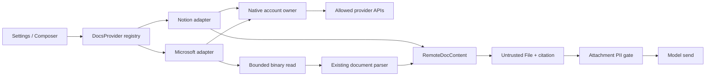

# Notion 与 OneDrive / SharePoint 云文档接入方案

| 项目        | 内容                                                                                                                                                                      |
| ----------- | ------------------------------------------------------------------------------------------------------------------------------------------------------------------------- |
| 状态        | 研究完成，待设计决策；尚未实现新 provider                                                                                                                                 |
| 日期 / 作者 | 2026-10-22 / Codex                                                                                                                                                        |
| 深度        | Heavy：UI、共享 TypeScript、Rust 身份所有者、IPC、安全与多账号                                                                                                            |
| 需求        | 研究其他云文档提供商，优先 Notion 和 OneDrive/SharePoint；说明复用点、接入方案和验证计划                                                                                  |
| 证据        | [持续证据账本](../evidence/2026-10-21-feishu-document-support-audit.md)、[ADR-0134](../content/docs/en/adr/0134-remote-document-providers.md)；当前源码与官方文档重新核查 |
| 评审角色    | 文档接入负责人、native/auth 负责人、隐私安全负责人、产品负责人                                                                                                            |
| 发布安排    | 未排期；本文的阶段顺序是建议，不构成上线承诺                                                                                                                              |

## 1. 继续使用 DocsProvider，先补身份和下载边界，再增加两个 provider

建议新增 `notion` 与 `microsoft` 两个 provider。OneDrive 和 SharePoint 文档库共用 Microsoft Graph、账号与文件读取实现，UI 中按来源区分；不为 SharePoint 复制一套认证系统。

现有 registry、命名空间、搜索面板、附件暂存、引用绑定、untrusted 包装和发送前 PII gate 都值得复用。必须先补多账号结果绑定、断连后的晚到结果拦截、完整性说明；Microsoft 还需要受约束的二进制读取边界。

Notion 首期建议提供**高级连接：用户自己的只读 internal connection token**。公开 OAuth 分发需要另行确定可信服务端，不能把发行方 client secret 放进静态网页或桌面包。OneDrive 首期采用桌面 public-client PKCE；SharePoint 作为同一 provider 的第二阶段，单独请求站点权限。

此方案的交付目标是“选定账号 → 搜索或识别链接 → 读取 → 显示损失 → 暂存 → 预览 → 经 PII gate 发送”。写文档、全工作区同步、媒体下载、数据库全量导出和跨端远程文档代理不在首期范围。

## 2. 当前架构可复用，但注册成功不代表完整接入

本文的 **Confirmed** 指当前源码或已执行检查；**Inferred** 指调用链推论；**Proposed** 指尚未实现的设计；**Open** 指评审或真实环境才能解决的问题。

| 当前所有者                                                                                                                                           | Confirmed                                                                                    | 复用方式与边界                                                                            |
| ---------------------------------------------------------------------------------------------------------------------------------------------------- | -------------------------------------------------------------------------------------------- | ----------------------------------------------------------------------------------------- |
| [types.ts](../../lib/docs-providers/types.ts)、[registry.ts](../../lib/docs-providers/registry.ts)、[index.ts](../../lib/docs-providers/index.ts)    | 内建注册只有 Lark、Google；接口包含账号、纯 `matchRef`、可选 `search`、文本 `fetch`          | 扩展现有 registry；不把文档提供商塞进 IM `PlatformAdapter` 或备份 destination             |
| [use-remote-doc-search.ts](../../hooks/chat/use-remote-doc-search.ts)                                                                                | debounce 250 ms、最多请求 20 条结果、AbortController、link-only 分支、账号选择               | 复用搜索调度；目前没有 cursor / load-more 合同，不能宣称列出全部文档                      |
| [use-remote-doc-staging.ts](../../hooks/chat/use-remote-doc-staging.ts)、[dispatch.ts](../../lib/chat/attachments/dispatch.ts)                       | 文本变为普通 `File`，经过已有附件入口、untrusted 包装、PII gate、长度确认                    | 保留整条路径；provider 不直接拼 prompt、不自行调用模型                                    |
| [attachment-citations.ts](../../lib/chat/mentions/attachment-citations.ts)                                                                           | 引用随真正暂存的附件建立，失败或被拒绝的附件不被引用                                         | 保留绑定机制；现有 citation id 只有 `providerId:doc.id`，新增账号隔离见下文               |
| [limits.ts](../../lib/docs-providers/limits.ts)                                                                                                      | 正文上限 200,000 characters；表格 10 tabs、500 rows、50 columns；损失要求 flag + 文内 marker | 复用预算与可见截断；不能把 char cap 当作第三方语义完整性的证明                            |
| [google_docs_auth.rs](../../crates/cognia-connectors/src/google_docs_auth.rs)                                                                        | host 持有加密连接记录、授权/凭据代际、单次 claim、断连顺序及 host-owned job                  | 复用不变量和回归用例；固定 Google storage key、token 结构及 revoke 行为不能直接当通用实现 |
| [Google auth](../../lib/docs-providers/providers/google/auth.ts)、[deep-link relay](../../lib/docs-providers/oauth-deep-link.ts)                     | 已有 loopback、state、PKCE、typed transport 路径                                             | Microsoft 可复用 relay 思路；Notion public OAuth 不能仅替换 URL 就宣称等价                |
| [HTTP owner](../../crates/cognia-net/src/http_client.rs)、[TS bridge](../../lib/connectors/tauri/commands.ts)                                        | 共享 proxy、超时、限流；response body 是 String，Rust 用 `.text()`                           | JSON API 可复用底层网络配置；Office/PDF 字节不能经过这个文本响应合同                      |
| [document-processor.ts](../../packages/document/src/document-processor.ts)、[office-parser.ts](../../packages/document/src/parsers/office-parser.ts) | 支持 ArrayBuffer、懒加载 Office/PDF 等 parser、解析诊断                                      | 复用解析器，不新写 Office parser；须核对隐藏表、资源上限与损失信息能否贯穿 adapter        |
| [attachments.rs](../../crates/cognia-connectors/src/attachments.rs)、[http_download.rs](../../crates/cognia-net/src/http_download.rs)                | 有受限二进制读取/加密缓存、以及受限流式落盘能力                                              | 可提取最低层 bounded-byte reader；不能伪造 IM adapter 或把私有文档写成普通临时下载文件    |
| [DocsProvidersCard](../../components/settings/connections/docs-providers/docs-providers-card.tsx)、[reach.ts](../../lib/docs-providers/reach.ts)     | 设置页显式渲染 Lark/Google 行；host reachability 独立于 registry                             | 必须新增连接 UI / 本地化和可达性测试，单纯注册不会出现可用连接配置                        |
| [mcp-chat.ts](../../lib/external-services/providers/mcp-chat.ts)、[mcp.ts](../../lib/external-services/providers/mcp.ts)                             | managed MCP 的 discovered resources 可注册文档源；搜索只是缓存资源本地筛选，fetch 只取 text  | 保留为另一接入层级；tool-only server 不会自动变成原生云文档 provider                      |

### 2.1 多账号 picker 的现有调用链需要先封住

**Confirmed source / Inferred behavior**：搜索 hook 切换账号后只设置 loading，没有立即移除旧 items；[composer-popover.tsx](../../components/chat/composer-popover.tsx) 用当前 accountId 构造这些 items 的选择参数。静态调用链因此存在“A 的结果仍显示，切到 B 后立即选择，用 B 去 fetch”的窗口。独立 reviewer 也观察到同一链路；本轮没有新增运行时复现，不能称为已修复。

当前 `RemoteDocRef` 没有账号绑定、`DocsProviderAccount` 只有 id/label，staging fetch 也没有传 AbortSignal。Google 的单 `default` 特例不能成为新多账号 provider 的通用模型。P0 必须用行为测试复现并修复这些前置条件。

## 3. Notion 首期读取页面，公开 OAuth 与数据库导出分阶段处理

### 3.1 认证要区分 internal connection、PAT 与 public OAuth

**Confirmed external**：Notion public OAuth 的 code exchange 要求 client ID + client secret 的 Basic authentication，并支持 refresh token；internal connection 是静态 token，页面需向连接授权。[Authorization](https://developers.notion.com/guides/get-started/authorization)

**Proposed**：首期作为 advanced/BYO 模式，要求用户创建只读 internal connection，只开启读取内容能力，并明确共享要读的页面。token 仅写入 host 加密记录，UI 只显示连接/工作区标签和权限说明。创建连接可能需要工作区 owner，设置引导必须说明这一成本。

**Confirmed external**：PAT 是工作区内用户身份凭据，Notion API capability 包含读写，不等于细粒度只读；官方不建议用 PAT 给多用户产品做认证。[Personal access tokens](https://developers.notion.com/guides/get-started/personal-access-tokens) 因此不把 PAT 作为普通用户默认接入，也不把 API 只发 GET/搜索请求描述为 token 自身只有读取权限。

**Open / Q1**：面向普通用户的一键 OAuth，推荐将 confidential exchange 放在独立可信服务端，凭一次性、短 TTL、绑定 host challenge 的交付句柄回到 host；refresh secret 也由服务端保护。需要额外的服务运维、隐私与威胁模型评审，未授权部署。官方当前文档并未为本设计建立无 secret 的 native public-client PKCE 路径，不能据此宣称协议绝对不支持，只能将该路线列为未证实。

### 3.2 直接用当前 Markdown read API，显式处理 unknown 内容

**Confirmed external**：当前版本为 `Notion-Version: 2026-03-11`，可 `GET /v1/pages/{page_id}/markdown`，返回 markdown、truncated、unknown_block_ids；Markdown v2 是 opt-in preview。[Retrieve page Markdown](https://developers.notion.com/reference/retrieve-page-markdown)

**Proposed**：固定上述 API version、使用稳定 v1 Markdown，先读页面 metadata/title，再读正文，返回 `kind: doc`、`sourceType: notion:page`、`format: markdown`。不建立一个完整的递归 blocks→Markdown renderer。增强 Markdown 中的自定义标签作为不可信数据处理，保留可读正文/结构；不执行 HTML，不为图片、embed 或链接自动发起请求。

**Confirmed external**：unknown 可以来自体量截断或子块权限不足，两者不能只凭 id 数组区分；可以用 unknown id 继续请求，权限不足时返回 object_not_found。[Markdown guide](https://developers.notion.com/guides/data-apis/working-with-markdown-content)

同一官方合同还说明文件类 URI 会变成预签名 URL。因此“不下载图片”不能防止把临时访问凭据送给模型。**Proposed normalization**：Markdown 的 image/file/video/audio/PDF、custom-tag media 的 href/src 和 provider file URI，在生成 File、预览、日志或模型出口前一律替换为无 URL 的类型/caption 占位；已知 signed URL 即使出现在普通链接位置也整条去除，不能只去 query（path 也可能含凭据）。无法确定是否为文件访问凭据的 opaque external link 保守替换，保留可读标签；canonical Notion page link 可保留。normalizer 只解析结构，不请求 URL；PII gate 不承担识别 signed URL 的责任。归一化的损失进入支持范围/quality 说明。

**Proposed**：以 visited set、深度及总请求预算有界补取，按原 placeholder 位置展开，禁止无序拼尾和重复插入。超过预算、无法访问、未知标签无法保真、或 upstream truncated 未被证明消除时，保守标 partial，正文保留缺失位置说明。若顶层不准访问则失败且不暂存。子块 404 不重试其他身份；429/网络重试耗尽时，默认失败，只有明确的缺失占位和 partial 契约才允许暂存部分结果。

### 3.3 搜索按标题，数据库行页面可读，数据库整体不伪装为文档

**Confirmed external**：`POST /v1/search` 匹配已授权 page / data_source 标题，支持 cursor；它不是 REST 全文搜索。数据源查询是另一接口。[Search by title](https://developers.notion.com/reference/post-search)

**Proposed**：`@notion:` 仅搜索 page，最多提供当前 picker 的 20 条可选结果；adapter 内按 cursor 有界补齐，不承诺完整索引。普通页面与数据库中的页面条目使用同一 page read 路径。database/data_source 容器不作为首期可选正文；关系/rollup、整表 CSV、视图过滤、评论、媒体内容和 meeting transcript 均不自动扩展。

链接识别只接受验证过的 Notion 官方域及 UUID 形态，规范化 32 位/带连字符 id；query 中 view id、fragment block id 不得误作 page id。裸 UUID 仅在明确 `@notion:` 命名空间解析；自定义域先不支持，不把任意 URL 当可认证 API 请求。

## 4. Microsoft 用一个 provider 覆盖 OneDrive 和 SharePoint 文档库

### 4.1 public-client PKCE 可以复用现有桌面回调设施

**Confirmed external**：Microsoft 支持 authorization code + PKCE；桌面是 public client，system-browser desktop redirect 可配置 loopback。tenant 选择涉及 common / organizations / consumers 及具体 resource tenant。[Authorization code flow](https://learn.microsoft.com/en-us/entra/identity-platform/v2-oauth2-auth-code-flow)、[Desktop configuration](https://learn.microsoft.com/en-us/entra/identity-platform/scenario-desktop-app-configuration)

**Proposed**：系统浏览器 + loopback + state + S256；发行方注册支持 personal + work/school 的 desktop app，保存安全的 client ID，不要求 client secret。重用既有 relay，验证 redirect 的注册形式、路径和动态端口；不将 native redirect 冒充 SPA redirect。OIDC 身份校验必须验证 issuer/audience/signature/nonce；MSAL 原生适配与现有 Rust OAuth primitive 的取舍见 Q3，禁止仅 decode JWT 后信任 claims。

多账号记录使用内部 opaque accountId，绑定经验证的 authority/cloud、home identity 与 resource tenant；email 仅作标签。guest 切 resource tenant 应形成明确绑定，不能 silently 用另一个 tenant/account 兜底。首期 global cloud；21Vianet / sovereign clouds 另设 authority/API host 和验证，不因用户时区为中国就自动切换。

### 4.2 权限分为个人文件、站点发现、共享链接三类

| 操作                     | 当前官方事实                                                                                                         | Proposed policy                                                                               |
| ------------------------ | -------------------------------------------------------------------------------------------------------------------- | --------------------------------------------------------------------------------------------- |
| OneDrive 搜索、读文件    | drive search / content 的 delegated 最低为 `Files.Read`；搜索可能匹配名称、metadata 和正文                           | 初始申请 `openid profile offline_access Files.Read`；无应用级 app-only 权限，不主动申请写权限 |
| 按已知站点列 drives      | `/sites/{siteId}/drives` 的 delegated 最低为 `Files.Read`                                                            | 已知 siteId 可以是 advanced 配置；不据此声称站点 URL 解析也只要同一 scope                     |
| 站点 URL 解析 / 搜索站点 | get-by-path、site search 列出的 delegated 权限是 `Sites.Read.All`；personal account 不支持                           | 用户启用 SharePoint 时独立增量授权，保留已有效的 OneDrive grant；组织策略可能要求管理员处理   |
| 分享链接解析             | `/shares/{shareIdOrEncodedSharingUrl}` 文档列出的 delegated 最低为 `Files.ReadWrite`；redeem header 可能授予持久访问 | 首期不承诺任意 `1drv.ms` / sharing link 一键读取；不隐式升到写权限，不发送 redeemSharingLink  |

依据：[Drive search](https://learn.microsoft.com/en-us/graph/api/driveitem-search?view=graph-rest-1.0)、[Content download](https://learn.microsoft.com/en-us/graph/api/driveitem-get-content?view=graph-rest-1.0)、[List drives](https://learn.microsoft.com/en-us/graph/api/drive-list?view=graph-rest-1.0)、[Site by path](https://learn.microsoft.com/en-us/graph/api/site-getbypath?view=graph-rest-1.0)、[Site search](https://learn.microsoft.com/en-us/graph/api/site-search?view=graph-rest-1.0)、[Shared items](https://learn.microsoft.com/en-us/graph/api/shares-get?view=graph-rest-1.0)。

`/shares/.../driveItem/content` 在下载文档中列为可读端点，与 sharing metadata 文档的权限表不能简单合并为“所有分享链接只需 Files.Read”。这条路线需单独实测 metadata、权限和副作用，未验证前不作为首期 link resolver。`Sites.Selected` 不能直接替换当前 site-search / drive-search 文档列出的应用权限；Selected 授权的专门企业接入属于后续方案。

### 4.3 正文用 Graph 文件下载加现有解析器，不把 Office 当文本响应

**Proposed**：`@msdoc:` 覆盖 OneDrive Personal、OneDrive for Business、SharePoint document library 的支持格式文件。资源稳定 key 编码 `driveId + itemId`，account/tenant 绑定另存为受检索上下文约束的标识。`sourceType` 区分 driveItem MIME；docx 为 doc、xlsx 为 sheet，其他支持文件用现有 resource kind，不为此扩张所有 kind switch。

search 先用 `/me/drive/root/search(q=...)`；SharePoint 后续在用户明确添加的 document libraries 中按 drive 搜索。正确转义 OData query；只向 Graph allowlist origin 发送 token；`@odata.nextLink` 校验 origin/path 后继续，并限制页数，绝不把它当任意可代理 URL。空结果不能证明文件不存在。picker 只展示已实现可读取的格式，搜索范围标为所选盘/文档库，不能宣称全租户全文覆盖。

首个 Microsoft 增量支持 docx、md/txt/csv；第二增量放开 xlsx、pptx、带可提取文字的 PDF，逐格式取得 parser 验收证据。SharePoint 支持文档库文件；sitePages `.aspx`、Lists、OneNote、SharePoint Embedded、IRM/密码文件、扫描 PDF OCR、旧 Office 格式不在首期。隐藏工作表不自动送模型，表/行/列 cap 沿用当前云表格政策；现有 Excel parser 默认遍历 SheetNames，不能直接默认调用后声称满足隐藏表政策。

**Confirmed external**：Graph `/content` 返回到短期预授权下载 URL 的 302；跟随下载 URL 无需 Authorization。[Download contract](https://learn.microsoft.com/en-us/graph/api/driveitem-get-content?view=graph-rest-1.0)

**Proposed**：native owner 固定 Graph resource 路由获取内容，验证 redirect 链与下载目的地址，去掉跨 origin Authorization；客户端不提交任意 download URL、不关闭 TLS 校验。下载 URL 是 bearer credential，不存入 citation、日志、同步或 prompt。到期只从原 Graph 资源重新取得一次，不直接重放失效 signed URL。

新增 typed binary read 命令，输入 accountId、expected authorization epoch、driveId、itemId，输出有界字节/base64、MIME、实际字节数与经清理的文件 metadata，或 typed error；不返回任意本地路径。调用者不能传 URL/headers/token。复用 native proxy config 和受限读循环；普通文本 `connectors_http_request` 保持兼容，不改变所有 connector/plugin 消费者。

新命令须同步 canonical `protocol/companion-commands.json`、generated descriptors、native command 注册、output registry、窄 ACL、service dispatch 与 closed event catalog。初始仅可信本地主窗口/internal host 调用；不为 paired client 授予 token 或管理连接权限。旧 host 无命令时显示能力缺失，不能改走无约束代理。

## 5. 共享合同只增加隔离与质量信息，保留当前文本附件出口

全流程继续汇入附件管线；native 身份所有者不接受文档正文中的指令。



### 5.1 账号 binding 随结果创建，不能在点击时重新解释

**Proposed additive contract**：`DocsProviderAccount` 增加可选 `authorizationEpoch`；新 provider 返回的 ref 增加 `accountBinding: { accountId, authorizationEpoch }`，provider call options 支持 expected epoch；epoch 是不可推测的非凭据 nonce，正常 token refresh 不改变它，断连/换身份/新授权成功必须改变。

搜索和链接解析结果进入 picker 时绑定当时选定账号；账号切换立即清旧选择，任何晚到结果必须同时匹配 request token、accountId 与 epoch。旧结果不能绑定到当前账号后继续 fetch。provider 按 expected epoch 执行 native fetch，staging 在 fetch 后、acceptFiles 前再检验 epoch；异步 preparation 完成后、提交前再次检验。

2026-10-22 P0 源码验证修订：当前 citation 绑定与 `attachments.add` 都是同步提交；最终 `isCurrent` 与这段提交之间没有 `await`。因此复用 `beforeCommit` 异步账号复核，再用 `isCurrent` 同步检查 composer/session generation 与账号快照，拒绝旧提交即可，不引入没有实际异步窗口的 rollback/回执抽象。若未来 add/commit 改为异步，必须增加隔离事务与精确 attachment ID 回滚，不能让未完成校验的附件成为可发送/持久化草稿。fetch、preparation、beforeCommit 以及 A→B→A 的回归覆盖均见 [P0 实施报告](../reports/2026-10-22-cloud-documents-p0-boundaries.md)。

新增可选 `subscribeAccounts(listener)`，让搜索/设置监听无凭据变更信号并重取快照。事件不是 authority，不携带 tokens；重新打开面板也必须取 host 状态。现有 Lark/Google 可先保留旧合同，P0 的 UI 结果绑定则对所有 provider 生效。

资源 id 不使用 email、共享 URL 或 secret。citation id 对新 provider 包含 opaque account scope 与资源 stable id，避免同文件跨身份被错误合并；不把 authorization epoch 写入历史引用。现有 Lark/Google citation id 保持可读，不批量重写历史消息。标题和 canonical URL 也应走现有 mention/outbound privacy policy 审核，不能因正文通过 PII gate 就声称 metadata 已经被清理。

### 5.2 完整性信息覆盖服务截断和解析损失

**Proposed**：保留 `truncated` 与文内 marker，新增可选结构化 `completeness: { status: complete | partial, reasons: [...] }`；reason 使用有限枚举，例如 upstream-truncated、budget、inaccessible-block、unsupported-content、parse-degraded。新 provider 的 partial 必须同时置 `truncated: true`，供旧 consumer 安全降级；升级后的 UI 用准确的“部分内容未读取”提示。

政策排除的媒体正文、子页面正文、隐藏表、评论、transcript 需用支持范围说明/占位解释，不称全文保真。parser diagnostic 表明损失而无法可靠展示缺失时拒绝；禁止只取 `.content` 丢掉 parse status。若正文没有可用文本，返回 empty / unsupportedType，不生成看似成功的空附件。

### 5.3 生命周期复用 host fencing，不复制 Google 的远程撤销语义

每个 `(provider, accountId)` 一个 versioned 加密 record：身份绑定、authorization epoch、credential version、credential variant、pending claim、断连 tombstone。内部 token 与 OAuth token 是不同 variant；普通 settings 只存无凭据偏好。

复用 Google 的短锁、条件提交、先 tombstone 再异步 cleanup、renderer 消失不丢失 host 工作的模式。将与提供商无关的 generation/storage transition 提取为小型 native core，由现有 Google facade 保持原 key/命令/事件兼容；Notion/Microsoft adapter 分别决定 credential validation / exchange / refresh / cleanup。新文件仅用于真正独立的 provider 及 native ownership seam；不建立第二个全局凭据框架。

提取前先把现有 Google controller 用例变成 conformance suite，并验证提取后 Google 行为不变。Microsoft refresh singleflight 的 key 必须包含 account、tenant、credential version；旧代际失败不得清除新授权。Notion internal token 不自动 refresh，用户替换 token 等于新授权代际。

2026-10-22 P0 先固定现有 Google controller 的 conformance：Refresh 保持 picker epoch；Begin、Commit、Disconnect 拒绝旧授权链，Invalidate 即使 epoch 不变也必须拒绝无 token 的状态。尚无第二个原生 provider，因此本轮不提取通用凭据 core，也不迁移 Google key/命令/事件。Lark 保留 adapter ID 绑定与成员检查，不能宣称具有同一 adapter 内重授权的原生 epoch 保证。

**Confirmed external**：Microsoft `revokeSignInSessions` 会影响用户多应用 refresh tokens / browser sessions，并需要另一个高权限；不等于 Cognia 单连接撤销。[revokeSignInSessions](https://learn.microsoft.com/en-us/graph/api/user-revokesigninsessions?view=graph-rest-1.0)

**Proposed**：普通断连只保证本机 tombstone、停止新读取、清凭据和未完成读取结果；UI 明确本机断开与远端 consent 撤销的区别。不得调用该全局 revoke API。Notion internal token 删除也不等于工作区撤销，用户需要去 Notion 管理 token。Google 现有 remote revoke 保持其自己的 policy。已发送消息/已主动暂存的历史附件不会因为断连自动消失；本功能不声称撤回已发送给模型的数据。

当前 Google snapshot 实际含 token，不能声称 token 从不经过 renderer。本方案的新 binary read 输入不含 token；native core 的对外 metadata snapshot 应与内部凭据区分，Google 兼容 wrapper 的安全边界需要单独列出，不能借扩展静默破坏现有契约。

## 6. 首期限制、失败处理和资源预算必须可测试

以下数字都是 **Proposed initial budgets**，不是测得的性能或外部 API 配额；P0 fixture benchmark 可以据证据修订，并在实现前更新本方案。

| 项目        | 初始政策                                                | 超出时                                                       |
| ----------- | ------------------------------------------------------- | ------------------------------------------------------------ |
| 正文        | 沿用 MAX_DOC_CHARS = 200,000                            | 标记 partial + 文内 marker + UI 提示                         |
| 搜索        | 20 可选结果，最多 5 页，30 s 总预算                     | 停止；说明结果上限，不宣称“无更多结果”                       |
| Notion 补取 | 最多 20 个内容请求、深度 8、visited 去重、60 s 总预算   | 可明确说明损失才返回 partial，否则失败                       |
| 二进制下载  | 20 MiB 实际接收上限、60 s、并发 2                       | Content-Length 预检 + 流式硬 cap；失败不保留明文             |
| Office 解包 | 展开总量 100 MiB、2,000 entries、单项 20 MiB、解析 15 s | 在解包前/过程中检查；worker 超时终止；做不到则该格式不能上线 |
| 重试        | 幂等读取最多重试 2 次，遵守 Retry-After 和总预算        | 不重放 consent / sharing redeem；用户取消立即丢弃晚到结果    |
| 缓存        | 首期不做跨请求正文/下载 URL 缓存；字节仅短时内存        | 成功/失败/取消释放；不复用 IM 的默认 7 天缓存策略            |

下载域白名单由 Graph/租户 metadata 建立，并须在真实租户验证域集合；每跳 HTTPS、无 userinfo、无 loopback/private/link-local，限制 redirect 次数，DNS 与连接目的地都须约束。不能只检查 URL 字符串或把通用 HTTP proxy 的宽松第一方信任模型当成云文档 URL 的安全证明。

2026-10-22 P0 实施边界：复用已有 lossless `proxy_http_request`，增加可选严格下载策略与 `proxy_get_active.downloadPolicyVersion` 能力检查；首个真实调用点是 Tauri HTTPS 链接预览图片。严格模式使用上表下载预算，每跳 origin/DNS 校验并 pin 连接，拒绝无法证明远程 DNS 目的地的代理路由；浏览器/Capacitor 或旧宿主在 I/O 前拒绝。取消竞态收尾增加 `requestAdmissionVersion: 1` 的 prepare/claim 握手，严格下载升级为 `downloadPolicyVersion: 2`，取消与清理按 host 生成的单次 token 隔离；容量或过期只会拒绝旧 claim，不能恢复其网络权限。普通请求仅在旧 host 缺少能力字段时保留旧合同，明确的未知版本拒绝。它是公开字节读取基础设施，不是 Microsoft 授权下载入口；第 4 节 account/drive/item-bound Graph 命令、租户域集合与 parser 格式验收仍属 P2。

错误映射继续使用 `DocsProviderError`：401 / invalid grant → notAuthorized；明确 forbidden → noPermission；404 → notFound（提示“未找到或不可访问”，不猜出资源是否存在）；429 → rateLimited；不支持/损坏/加密内容 → unsupportedType；其他超时/网络 → network。额外机器诊断码可以扩展有限枚举，不能直接展示/log 原始 response body、signed URL 或 token。权限失效时不能切换其他账号或拿旧缓存返回成功。

搜索 query 会发给所选提供商，属于明确的检索行为；须复查现有 PII 策略是否适用于该外发边界。附件正文送 LLM/embedding 始终走现有 gate；拒绝或 gate 故障时不得旁路发送。

## 7. 原生直连是推荐路径，MCP 作为有明确标签的替代层

| 选项                                    | 优点                                                     | 代价 / 拒绝理由                                                                          | 建议                                    |
| --------------------------------------- | -------------------------------------------------------- | ---------------------------------------------------------------------------------------- | --------------------------------------- |
| 两个原生 DocsProvider                   | 复用 picker、附件隐私与完整性合同；支持范围可控          | 需要连接 UI、native auth / download 与维护                                               | 推荐核心方案                            |
| Notion 官方 hosted MCP                  | 已有 OAuth 和 search/fetch 工具，可先满足 agent 工具场景 | 当前 resource registry 不能把 tools 自动投影成文档源；会引入不同权限、搜索语义和工具授权 | 独立标注 MCP，不声称等价原生 provider   |
| 给 MCP tools 新建 DocsProvider facade   | 能复用 MCP gateway 与其 credential/policy                | 仍需固定 schema、工具 allowlist、取消、完整性与账号隔离适配，不是零开发                  | 后续可评估，不作为本轮必需前置          |
| 把 Notion 发行方 secret 放桌面 keyring  | 部署简单                                                 | 安装包中的共享发行方 secret 无法保密；keyring 只能保护运行时存储                         | 不采用                                  |
| 所有提供商共用一个大 OAuth 抽象         | 看似减少代码                                             | Notion internal、公有 OAuth、Microsoft public client、Google revoke 语义不同             | 只抽 host lifecycle core 与 bounded I/O |
| 独立 SharePoint provider / 借用备份凭据 | 接入表面较快                                             | 重复 Graph 生命周期，或把备份授权扩大为文档读取                                          | 不采用                                  |

Notion 官方当前文档列出 search/fetch 及多种写工具，授权后可读写被授权内容；客户端须按实际 discovery 与权限限制调用。[MCP tools](https://developers.notion.com/guides/mcp/mcp-supported-tools)、[MCP connection](https://developers.notion.com/guides/mcp/get-started-with-mcp) 本轮没有连接该服务，不能判定其 resources 能力集合，也不把文档描述当作实测 tools/list。

## 8. 验收从身份、损失与泄漏风险推导，按层分别出证据

| 目标                        | 验收义务                                                                                                                                                                                                                                                           | 所有层 / 主要证据                                                                           |
| --------------------------- | ------------------------------------------------------------------------------------------------------------------------------------------------------------------------------------------------------------------------------------------------------------------ | ------------------------------------------------------------------------------------------- |
| AC1：新增来源可配置可发现   | register / prefix / settings / i18n 均可达；重复 prefix 拒绝；无账号/被禁用/不支持 host 明确提示                                                                                                                                                                   | registry、设置 RTL、composer；现有 Lark/Google 不回归                                       |
| AC2：身份固定、不串账号     | A→B 切换 debounce 前/请求中/晚返回/立即 Enter/点击；相同文件 id 不同 drive、同 email 不同 tenant、guest tenant；旧 ref 不重绑                                                                                                                                      | co-located hook/provider/citation 测试，独立 realms + 实际 Rust owner                       |
| AC3：断连不复活             | callback/refresh/fetch 在断连前后暂停；重连新账号；duplicate state/claim、落盘失败、renderer teardown、host restart                                                                                                                                                | native controller fault injection + 双窗口真实 Tauri；断连期间晚 fetch 不暂存               |
| AC4：Notion 内容可解释      | title search cursor、page UUID/link、空标题、普通/数据库行 page；unknown 多层、cycle、重复、404、429、超预算；自定义 tags、child-page/media 占位和文件 signed URL 归一化                                                                                           | 官方合同 fixture + 真实只读 internal connection test workspace                              |
| AC5：Graph 文件可解释       | personal/business search 分页；盘/站点/文档库边界；规范 URL 与不支持 sharing link；scope不足不增权；302→字节 hash 一致                                                                                                                                             | HTTP fixture、真实 Personal + M365 test tenant、Graph permission 记录                       |
| AC6：字节与解析安全         | 0x00 / invalid UTF-8 / ZIP bytes 保真；假 Content-Length、超大 chunk、redirect token剥离、private DNS、nextLink 域切换、过期 signed URL                                                                                                                            | Rust wire fixture + parser 真文件；禁止 `.text()` 二进制路径                                |
| AC7：有损内容不冒充完整     | xlsx 多表/隐藏/空表、row/tab/col caps；docx 标题表格、pptx 页面、PDF 文本；损坏/密码/ZIP bomb/超时；diagnostics 贯穿到 UI/marker                                                                                                                                   | 真实文件 fixture + parser / provider integration；解析不了则不能开放格式                    |
| AC8：隐私与引用沿用既有策略 | PII reject/error fail closed；untrusted instructions 不执行；Notion signed URLs 在 custom tags、Markdown media/普通链接位置均不进入 File/preview/log/outbound；标题/URL/error无凭据；拒绝/移除附件后引用消失；不同账号引用不合并；切换 chat 与并发本地附件不串事务 | staging→dispatch integration、PII reviewer、log capture；不靠 mock 假装最终 outbound 已净化 |
| AC9：平台与兼容性真实       | web/mobile/headless 显示原因；新 native 命令旧 host 拒绝并提示升级；未授权 companion 不可获取连接/下载；Google key/命令/事件不变                                                                                                                                   | command/ACL/event catalog/service dispatch 合同 + static-export + native smoke              |
| AC10：可停止与可回退        | 单 provider flag 关闭，取消清理；不删除其他 provider 数据；新 record 旧版不读取，升级重新启用无凭据 resurrection                                                                                                                                                   | settings/native migration 测试、故障恢复与 kill-switch 演练                                 |

### 8.1 自动化先测最低所有层，真实账号是独立门槛

先在既有 co-located tests 添加失败用例，再实现；新模块伴随测试。框架 fixture 与真实 parser 文件集分开；不要让 fake Markdown/CSV 绕过 Office 字节解析。

实现阶段至少执行下列命令族，实际新增测试路径在对应 PR 中补齐：

```sh
rtk pnpm test --runInBand --runTestsByPath lib/docs-providers/registry.test.ts lib/docs-providers/index.test.ts hooks/chat/use-remote-doc-search.test.tsx hooks/chat/use-remote-doc-staging.test.tsx lib/chat/mentions/attachment-citations.test.ts lib/external-services/providers/mcp-chat.test.ts
rtk cargo test -p cognia-connectors google_docs_auth
rtk cargo test -p cognia-net
rtk cargo test -p cognia-companion-rpc
rtk cargo test -p cognia-companion-bus
rtk pnpm companion-api:gen
rtk pnpm companion-api:check
rtk pnpm audit:colocated-tests
rtk pnpm i18n:build
rtk pnpm i18n:build:check
rtk pnpm lint:i18n
rtk pnpm lint
rtk pnpm typecheck
rtk pnpm lint:static-export
rtk pnpm build
```

新 native lifecycle 的过滤测试、binary 命令的 service admission/dispatch 测试、parser 真文件测试也必须加入，不能只运行旧 Google tests。coverage 按本仓 local opt-in 政策，不默认运行覆盖率；CI 现有 changed-file 门槛仍适用。E2E 使用现有 `pnpm test:e2e` 入口和实际注册的 project，具体 fixture/spec 在实现时按 cognia-e2e 选定，本文不虚构当前不存在的测试文件。

native 验收通过 `tauri-agent-debug` 启动真实 shell、保留 helper-v3 ready/截图/console/network evidence；`pnpm dev` 或 jsdom 不算原生验收。最少测试：新建连接、搜索、链接读取、preview、取消、双窗口断连、重启恢复、删除 chip、发送前 PII 拒绝。凭据只从用户选择的测试账号提供，不读私有生产文档。

真实提供商矩阵：Notion 两个不同工作区或连接（一个页面授权不足）；OneDrive Personal；M365 OneDrive Business；同一 M365 tenant 的 SharePoint 文档库；resource guest tenant 后续独立放行。MFA / Conditional Access、admin consent 拒绝、失效 token 与失效文件权限分别记录；某一环境通过不能替代其他环境。

### 8.2 本轮只验证现有复用合同，不给新提供商盖通过章

2026-10-22 实际执行：

```text
rtk proxy pnpm --config.verify-deps-before-run=false test --runInBand --runTestsByPath lib/docs-providers/registry.test.ts lib/docs-providers/index.test.ts hooks/chat/use-remote-doc-staging.test.tsx lib/external-services/providers/mcp-chat.test.ts
Test Suites: 4 passed, 4 total
Tests:       39 passed, 39 total
```

这证明现有 registry/staging/MCP fixture 合同基线，不证明新账号绑定、Notion、Microsoft、native OAuth 或 live provider 可用。首次普通 pnpm test 触发了包管理器自动依赖同步，已停止；上面这次显式关闭该行为后成功。共享树有其他 dependency/security 改动，本轮没有手工编辑或回退这些 manifests/lockfiles，也不把依赖同步结果作为本方案交付。

本轮未运行完整 build/typecheck/native/provider 验收。上轮账本中的 root-gate、RPC 编译与真实账号残余项继续保留，不能从旧测试数量推断当前整仓 green。

## 9. 分阶段开放，按提供商回滚，不改变现有凭据

| 阶段                                  | 单一负责人角色           | 依赖 / 输出                                                                                                                        | 进入和成功条件                                                                   | 停止 / 回滚                                                                      |
| ------------------------------------- | ------------------------ | ---------------------------------------------------------------------------------------------------------------------------------- | -------------------------------------------------------------------------------- | -------------------------------------------------------------------------------- |
| P0：合同与 spike                      | 文档平台负责人           | 无；修复 account-bound picker，定义 quality、epoch、intake rollback；native core conformance；Notion Markdown 与 Graph bytes spike | Q1–Q4 有结论；AC2/3/6 有红→绿；Google/Lark 当前合同不回归                        | 身份混淆、secret 暴露或缺失内容静默出现即停止；不开放新 provider                 |
| P1：Notion advanced                   | Notion adapter 负责人    | P0；internal token 设置、title search、page Markdown、unknown 标记；新增 provider module 有独立 vendor 合同理由                    | AC1/2/3/4/8/9/10，本地和真实只读 test workspace 均有证据                         | `notion` 单独关闭；清本机凭据、保留 tombstone，不声称远端撤销                    |
| P2：OneDrive 核心                     | Microsoft adapter 负责人 | P0；public-client auth、native bytes、docx/md/txt/csv；注册与权限说明                                                              | AC1/2/3/5/6/8/9/10，以及 AC7 的 docx/文本适用子集；Personal 和 Business 各自通过 | `microsoft` 独立关闭；清本机 token、保留 tombstone；保持 Google backup/docs 独立 |
| P3：SharePoint 与更多文件             | Microsoft adapter 负责人 | P2；站点增量 consent、library 配置、xlsx/pptx/PDF                                                                                  | AC5/7/10；M365 library 和每种格式的真 fixture + native 验收                      | 可分别停 SharePoint / 某格式；OneDrive 基本读取保留                              |
| P4：普通用户 Notion OAuth / 远程 host | 集成服务负责人           | Q1 明确授权服务方案后单独立项                                                                                                      | 服务端凭据/一次性交付/refresh/隐私/部署及跨端实测均通过                          | 未完成前保留 advanced 限定，不宣传一键或跨端支持                                 |

新增 prefs / encrypted records 采用版本字段、namespaced key；不迁移现有 Lark/Google/backup 账号，不升级 Dexie 保存云正文。未知版本 fail closed，不清除原始记录；关闭 flag 只取消本 provider 在途任务。回滚后未识别的记录保留加密且不可激活，明确本机删除入口；不得回滚 tombstone 让旧 callback 写回。

首期不 GC tombstone：断连清除 credential/pending，仅保留必要的 opaque identity 和拒绝旧写入的 epoch。重新授权创建新 epoch；accountId 不复用。删除凭据不删除 fence。记录缺失时所有非 Begin 的旧代际写入必须失败，不能自动创建记录或导入旧凭据；后续若要 GC，先独立证明缺失记录/重启/旧客户端不会恢复授权，再评审存储政策。

初期不承诺常驻监控或同步 SLA。使用当前诊断/日志体系增加 `docs_provider_operation`，字段限 provider、operation、outcome、latency bucket、byte bucket、completeness reason、error class；不含 query、标题、URL、账号、tenant 或 token。单次越预算立即返回受限错误；一次账号错绑或 secret 泄漏即停该 provider 并由 security owner 处理。连续三次 auth/storage invariant 失败提示重新连接并导出脱敏诊断；采样/遥测遵守现有用户设置，不增加云接收方。

## 10. 评审决策是接入模式与权限，不是是否跳过验证

| 决策                          | 选项与建议                                                                                                                                                  | 影响                                                                             |
| ----------------------------- | ----------------------------------------------------------------------------------------------------------------------------------------------------------- | -------------------------------------------------------------------------------- |
| Q1：Notion 首发受众           | **建议 advanced/internal token 先行**；若要求普通用户一键 OAuth，先批准独立可信服务端方案。PAT 不作为默认多用户产品认证                                     | 改变 UX、运维、权限与上线门槛；不能把服务端问题隐藏为以后补                      |
| Q2：Microsoft 首期链接范围    | **建议 drive search + 可确定的 canonical reference / 已知 library**；分享短链后续做独立权限 spike，不自动申请写 scope                                       | 支持范围更窄，但与只读授权一致；UI 必须明确不支持的链接                          |
| Q3：Microsoft token/OIDC 实现 | **建议先做 bounded spike，优先使用受维护且可适配本 host 的验证库**；比较原生 MSAL adapter 与现有 Rust OAuth/OIDC primitives，无新增 Node sidecar 为默认前提 | 没有 issuer/nonce/account-cache 正确性证据，P2 不得开始产品化                    |
| Q4：SharePoint scope          | **建议第二阶段显式 Sites.Read.All consent**；已知 siteId advanced 入口单独校验。严格 Selected-only 企业部署另行设计                                         | 不可把站点搜索文档不支持的权限模型包装为已经支持                                 |
| Q5：跨端                      | **建议首期 Tauri only**；standalone web/mobile/headless 仅显示原因，远程 host 读取后续独立合同                                                              | 保持 static export，不为此新增 Next.js runtime server 或暴露 host credential API |

| Review record                            | 结果 / 状态                                                                                                                                                        |
| ---------------------------------------- | ------------------------------------------------------------------------------------------------------------------------------------------------------------------ |
| 2026-10-22 当前源码 + ADR / 官方接口核查 | 已完成；API 引用以本次读取为准，实施前重新核对                                                                                                                     |
| 2026-10-22 独立只读 failure hunt         | 已完成；身份错绑、citation 作用域、binary、parser losses、token snapshot、MCP 能力边界纳入本文；全文初审的 signed URL、tombstone、首发验收三项问题已修正并复查通过 |
| 2026-10-22 现有合同测试                  | 4 suites / 39 tests passed；不是新 provider 的实测                                                                                                                 |
| 产品 / 安全 / native 负责人评审          | 待处理；Q1–Q5 是设计决策，未视为已批准                                                                                                                             |

以下为建议评审检查点；日期未与人员排期确认，不是承诺：

| TODO                                                  | 单一 owner role    | 建议 DDL   | 交付与阻塞条件                                                           |
| ----------------------------------------------------- | ------------------ | ---------- | ------------------------------------------------------------------------ |
| 确认 Q1 / Q2 / Q4 / Q5                                | 产品负责人         | 2026-10-23 | 固定首发能力/权限/平台，未确认前不扩大实现范围                           |
| 完成 Q3、native core / binary / parser bounded spikes | native/auth 负责人 | 2026-10-26 | 记录成功/终止条件；需要测试账号时先指定 disposable scope，不接触生产内容 |
| 审核元数据隐私、权限、redirect/DNS 和授权交付         | 隐私安全负责人     | 2026-10-27 | 不可验证的高风险项阻塞相应阶段，不能自行接受残余风险                     |

## Sources

仓库依据见第 2 节各 owning module、ADR-0134 和持续证据账本；本地路径均相对 canonical proposal。Notion / Microsoft 官方来源直接附在对应断言附近，核查日期 2026-10-22。外部文档只建立 API 设计依据，真实账号、租户策略、CORS/redirect/native 可用性仍须通过第 8 节验收。
