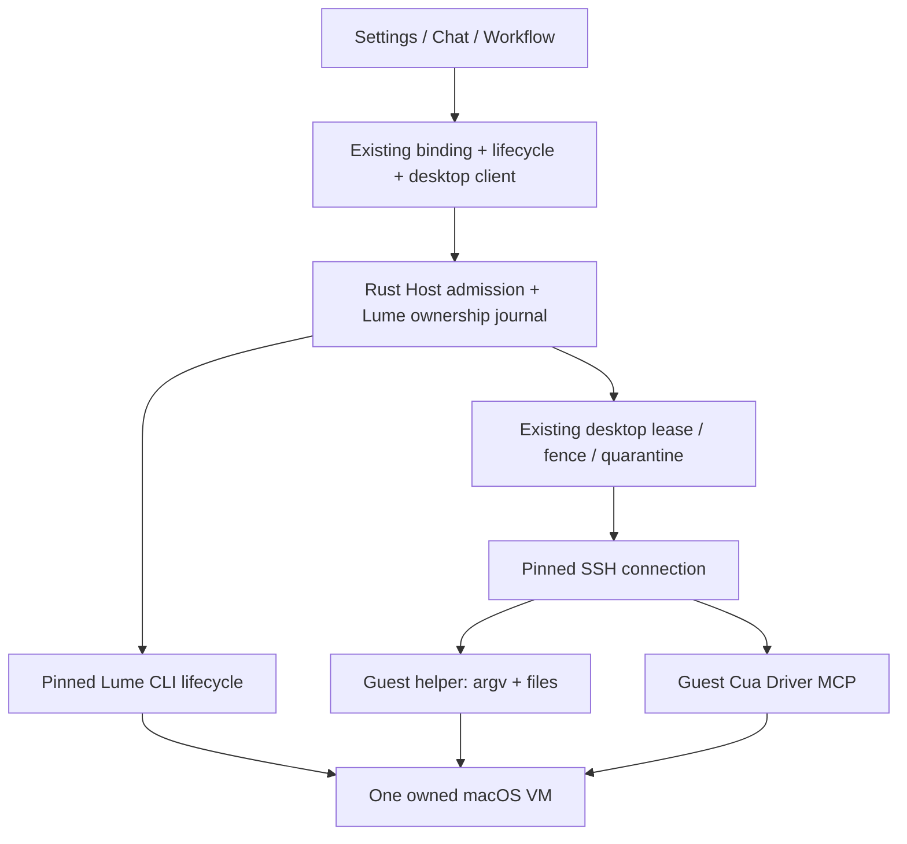
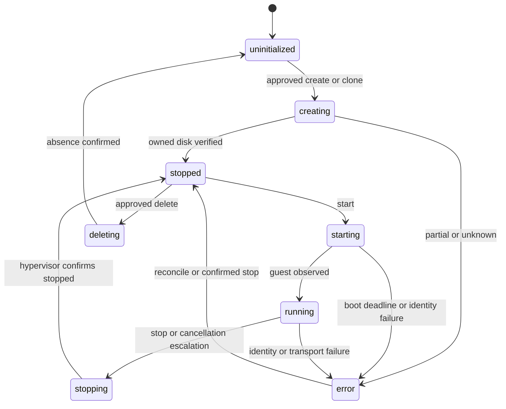
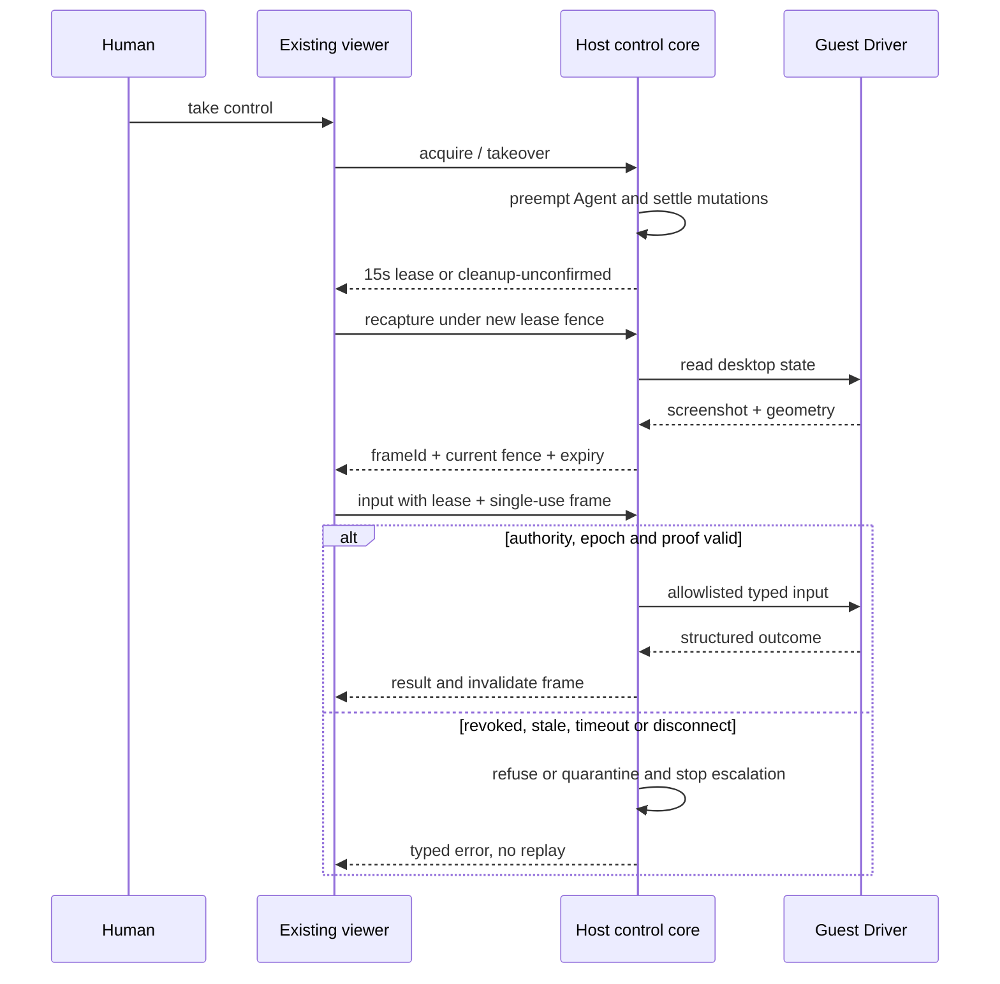

# Lume 接入 Cognia：沿用 sandbox connection、在同一 VM 内执行 Shell 与 GUI

| 项目        | 内容                                                                                                                                                                                   |
| ----------- | -------------------------------------------------------------------------------------------------------------------------------------------------------------------------------------- |
| 状态        | 完整技术方案，待评审；没有产品实现或真实 VM 验收                                                                                                                                       |
| 作者 / 日期 | Codex / 2026-10-23，Asia/Shanghai                                                                                                                                                      |
| 深度        | Heavy：共享类型、Dexie projection、Rust Host、SSH/guest 协议、GUI、权限与恢复                                                                                                          |
| 需求        | 复用现有 sandbox 架构，覆盖 Lume VM 生命周期、SSH、GUI 和验证流程                                                                                                                      |
| 交付范围    | 首期 Apple Silicon macOS Tauri 的本地 macOS guest；同一 connection 的受管 Shell、文件和桌面                                                                                            |
| 评审角色    | Sandbox maintainer、Native maintainer、Security reviewer、Desktop QA；均为建议角色                                                                                                     |
| 上线方式    | 默认关闭；Host 版本、guest 镜像、helper、Driver 组合验收后，按 connection 启用                                                                                                         |
| 关联        | ADR-0020、0028、0160、0196、0221、0233；[Lume 调研](../research/2026-10-23-lume-current-capabilities.md)、[workspace/Lima 方案](2026-10-20-extensible-workspace-execution-and-lima.md) |

## 1. 推荐沿用现有 connection 架构，增加 Lume 生命周期与 guest Driver 实现

**将 `lume:cua-driver` 注册为现有 `SandboxProviderAdapter` 的新实现，由 Rust Host 持有 VM 身份、SSH 凭据和恢复日志。** TypeScript 继续负责 connection 投影、capability 展示与 session binding；所有实际操作由 Host 复核，不把 Lume CLI、SSH 或管理端口暴露给 renderer。

**VM 管理、Shell/文件、GUI 分别采用 Lume CLI、SSH 上的受管 guest helper、SSH 上的 Cua Driver MCP。** 三者必须指向同一 `resourceId + generation + bootEpoch`。GUI 沿用 Cognia 的权限门、控制租约、单次 frame proof、输入互斥与 quarantine，不另建一条模型直连 MCP 通路。

**首期完整 GUI 使用现有截图式 viewer 与受管输入。** 首次 guest 设置采用独立的人类 native-viewer 准备模式，该模式的剪贴板同步必须单独获批；自动化运行时关闭 native display、VNC 和剪贴板同步。流式 VNC 是后续独立增强，不是生命周期、SSH、GUI 交付的前置依赖。

**保持能力声明真实。** 不用 stop 冒充 suspend；不把 SSH 连接关闭当作进程树已停止；不把 VM CPU 核数当作 CPU 秒预算；不自动把整个 Cognia Agent、外部 CLI、MCP 和 browser 的所有能力迁入 VM。

需要评审的主要选择是：首期本地范围、CLI 管理方式、VM 所有权与超时停止授权、截图式 GUI，以及限制性 policy 的拒绝规则。第 15 节给出建议答案；这些选择不阻碍本文形成完整可实施方案。

### 1.1 目标与验收一一对应

| 目标            | 当前事实                                          | 完成标准                                                                   | 验收       |
| --------------- | ------------------------------------------------- | -------------------------------------------------------------------------- | ---------- |
| G1 生命周期     | 2 个已注册 provider/driver pair，Lume 为 0        | 创建/附加、启动、连接、健康、停止、删除可恢复且不会误操作其他 VM           | A1–A5、A15 |
| G2 SSH 与文件   | Lume 无 workspace adapter                         | argv/stdin/退出码/输出限额、文件往返、取消与失败回收契约成立               | A6–A9      |
| G3 GUI          | `cua-driver` 未注册，原生路由面向 computer-server | 截图、点击、输入、快捷键、滚动、拖拽经既有权限/租约/审计执行               | A10–A13    |
| G4 同机绑定     | 已有 `cua-desktop` 同机语义                       | Shell、文件、GUI 身份一致；旧 generation、断线、未知动作均拒绝，宿主零回退 | A8、A14    |
| G5 可运维与兼容 | 旧 Lume 行仅可读                                  | 旧数据无自动领养、升级不自动启用、回滚保留数据与清理入口                   | A15–A18    |

### 1.2 边界限定交付含义

- 本方案交付受管 sandbox Shell、文件读取/传输、Computer Use 和人类 viewer；`cua-desktop` 仍使用现有 session → character → app 设置解析。
- 第一版仅本地 Apple Silicon Tauri；Windows/Linux/Intel Mac、standalone Web/Capacitor 只显示不可用原因。paired Web/mobile 与 headless Mac 扩展必须另行验证 Host RPC 授权及运输，不继承本地 IPC 权限。
- Linux guest、完整 Agent/PTY/workspace MCP 迁移、OCI EnvironmentSpec 实现、自动代码验收/merge、内存快照、suspend/resume、GPU passthrough、VM-wide 出网 allowlist 不在首期；已有 [workspace/Lima 方案](2026-10-20-extensible-workspace-execution-and-lima.md) 与 ADR-0221 继续拥有那些扩展。
- 首期拒绝 repository 提供的 VM provisioning 脚本、任意 Host mount、用户私钥/SSH agent 转发和自动复用其他用户/任务组使用过的 guest。

## 2. 当前复用点真实存在，但还没有可直接启用的 Lume 通路

以下为 2026-10-23 当前工作树证据。`Confirmed` 表示读取源码或执行了只读命令；`Proposed` 是本方案新增设计；`Open` 是必须由实机验收解决的发布条件。

| 状态      | 当前责任与证据                                                                                                                                                                                             | 接入时如何复用 / 修正                                                                                |
| --------- | ---------------------------------------------------------------------------------------------------------------------------------------------------------------------------------------------------------- | ---------------------------------------------------------------------------------------------------- |
| Confirmed | [adapter-registry](../../lib/sandbox/adapter-registry.ts) 只注册 Docker、E2B 的 computer-server pair                                                                                                       | 增加 `lume:cua-driver` factory，保留其他 pair 的现有行为                                             |
| Confirmed | [lifecycle-contract](../../lib/sandbox/lifecycle-contract.ts) 有 11 个 operation、typed refusal、running guard、可选 signal                                                                                | 扩展 outcome/options；补齐 signal 传递与 Host 二次授权                                               |
| Confirmed | [connection-lifecycle](../../lib/sandbox/connection-lifecycle.ts) 有 per-connection Promise queue；GUI 明确不走该 dispatcher                                                                               | 生命周期/SSH 复用 dispatcher；GUI 继续走 `desktop.*`，不能只实现 `adapter.gui`                       |
| Confirmed | [capability matrix](../../lib/sandbox/connection-capabilities.ts) revision=4；`lume: caps({})`；`cua-driver` 全 false                                                                                      | 采用 provider/driver pair 的能力定义，避免为 Lume 放开其他 provider 的 cua-driver                    |
| Confirmed | [binding](../../lib/sandbox/binding.ts)、[session-runtime](../../lib/sandbox/session-runtime.ts) 约束 `cua-desktop` 的 Shell/GUI 同 connection                                                             | 冻结 Host resource generation；补齐工作目录/文件映射与远端 guest shell 语义                          |
| Confirmed | [connection hook](../../hooks/automation/use-sandbox-connections.ts) 的创建、start、resume、placement 仍有 Docker 假设                                                                                     | 新增 discriminated create input 和 provider outcome 归并，不能把 VM 身份塞进 containerId             |
| Confirmed | [runtime availability](../../lib/sandbox/runtime-availability.ts)、[session desktop hook](../../hooks/automation/use-session-sandbox-desktop.ts) 仍依赖本地 Tauri / Docker config                          | 改为 pair + Host qualification + readiness 投影，保持无法使用时的拒绝                                |
| Confirmed | [CuaSandboxRegistry](../../crates/cognia-automation/src/cua_sandbox/registry.rs) 持有 `Arc<CuaRemoteClient>`，依赖 Docker inspection                                                                       | 把 desktop transport 接缝抽到该 registry 内；Docker lifecycle 方法保留，不把 registry 复制一份       |
| Confirmed | [cua_route](../../crates/cognia-automation/src/automation/cua_route.rs) 包住远端动作，但具体调用 computer-server 协议                                                                                      | 从 provider-neutral desktop driver 分派；所有未知远端动作保持 UnsupportedPlatform                    |
| Confirmed | [desktop_session](../../crates/cognia-automation/src/cua_sandbox/desktop_session.rs)、[ControlLeaseCore](../../crates/cognia-remote-desktop/src/control.rs) 已有租约、frame、fence、preemption、quarantine | 沿用 15 s lease / 5 s frame proof；Lume 接入同一个互斥与失效域                                       |
| Confirmed | [sandbox-client](../../lib/automation/sandbox-client.ts) 是 client-local internal commands；[viewer hook](../../hooks/automation/use-sandbox-desktop.ts) 支持 `OpenSandboxDesktop`                         | 复用 viewer/session 接口；新原生 client 不伪装远程能力已经存在                                       |
| Confirmed | [VNC bridge](../../crates/cognia-remote-desktop/src/bridge.rs) 有一次 ticket、origin、Host 认证，但主要是字节转发                                                                                          | 不能用于绕过 frame/lease 的 Lume 交互；首期采用截图 viewer                                           |
| Confirmed | [terminal SSH](../../crates/cognia-terminal/src/ssh.rs) 有 russh、known_hosts、keyring 模式；属于另一 domain crate                                                                                         | 复用协议与凭据模式、workspace dependency 版本；不依赖整个 terminal，不直接复用 TOFU 作为 VM 身份证明 |
| Confirmed | [desktop guest binary](../../crates/cognia-desktop-guest/src/main.rs) 当前仅 Linux，禁止任意用户命令；[exec sandbox](../../crates/cognia-exec-sandbox/src/lib.rs) 已有 macOS backend                       | 在现有 guest crate 新增 Darwin 专用 binary/helper；复用可用策略原语，不削弱 Linux 固定操作契约       |

补充确认：[sandboxed file tools](../../plugins/cognia-sandboxed-tools/src/index.ts)当前以network-off的cat/bash执行文件IO；[PluginSandboxAPI](../../packages/plugin-contract/src/lib/plugin/api/sandbox-api.ts)没有typed file操作。第7.1节明确新增该接缝及其真实permission guard，不能宣称已有直连文件工具。

相关 ADR 分工：ADR-0020/0028/0160 拥有桌面与同机工具语义；ADR-0196 约束 Rust 分层；ADR-0221/0233 拥有既有 pool/cloud 管理行为。本文不把 Lume VM 映射成 Docker container 或 E2B billed desktop，也不把未实施的 Lima proposal 当成已存在的前置模块。

## 3. 三个通道共享一个 Host 身份和控制域

`connectionId` 是现有 UI/session 指针；`resourceId` 是 Host 生成的 VM ownership record；`generation` 在销毁重建、重新领养或身份更换时递增；`bootEpoch` 在启动、guest reboot、SSH/Driver 重连或 Host 恢复后递增，用于失效旧句柄。



图 1：新增 Lume 管理与 guest transport，复用现有 connection 和 desktop 控制域；renderer 不直接接触 VM 管理、SSH 或 Driver。

### 3.1 Rust 模块职责保持在现有层级内

| 位置                                                                       | 责任                                                                                | 新文件的理由                                                                                             |
| -------------------------------------------------------------------------- | ----------------------------------------------------------------------------------- | -------------------------------------------------------------------------------------------------------- |
| `crates/cognia-automation/src/cua_sandbox/lume/`（新增）                   | CLI driver、Host ownership/operation journal、SSH、qualification、resource recovery | Docker registry 没有 VM 镜像、SSH 信任及跨启动持久所有权；独立 provider 模块避免污染 Docker 实现         |
| `cua_sandbox/desktop_session.rs`、`registry.rs`、`automation/cua_route.rs` | 抽出窄 `SandboxDesktopDriver` 接缝，沿用会话、互斥和租约                            | 这里已拥有动作路由与控制，不能由 Lume 自建重复 broker                                                    |
| `cua_sandbox/lume/driver_mcp.rs`（新增）                                   | 受限 MCP client、schema fingerprint、Driver action 归一化                           | computer-server WebSocket 与 MCP 是不同协议，不能复用字符串命令映射                                      |
| `cognia-desktop-guest` 新增 `cognia-lume-guest` binary 与 Darwin 模块      | 固定 SSH entrypoint，执行结构化 argv/文件请求、取消、deadline、输出 framing         | 既有 main 是 Linux 固定 handoff/supervision；新 binary 保持它的行为不变，复用现有 crate 与可移植验证代码 |
| `lib/automation/lume-client.ts`、`lib/sandbox/lume-adapter.ts`（新增）     | typed internal IPC client 与 `SandboxProviderAdapter` 实现                          | 已有 sandbox-client 的 DTO/commands 是 Docker-specific；独立 provider client 不复制通用 lifecycle        |
| 原 settings、viewer、session hooks、共享类型                               | Lume 配置、诊断、bootstrap、状态与绑定                                              | 扩展现有页面和 primitives，不新增 VM 专属 Agent 页面或 Next server                                       |

`SandboxDesktopDriver` 是 Host 内部 trait，承载 typed capture、screen geometry、受限 input、session cleanup；computer-server 与 guest Driver 各实现一次。`RemoteDesktop` 保存原有 control/session 状态与 `Arc<dyn SandboxDesktopDriver>` 绑定；所有驱动调用保留 preemption 检查。不把 computer-server `WsRequest` 作为新 trait 的公共输入。

使用现有 Rust 分层和 `cognia-secrets`；`src-tauri` 仅注册命令、组装服务和 shutdown。新 binary 的 Darwin 依赖通过 target-specific Cargo 配置加入，并检查既有 `cognia-desktop-guest → cognia-exec-sandbox` same-layer allow 边。不新增顶层 VM 服务或新 crate。

### 3.2 生命周期优先直接调用固定 CLI，不依赖共享 HTTP daemon

Host 发现用户安装的 Lume，固定 canonical executable path、version 与 artifact hash，执行 argv 数组；每次启动后确认路径/版本未漂移。不得从 repository PATH、guest 内容或 renderer 任意路径选择程序。首期不自动安装或更新 Lume。

选 CLI 的原因是无需增加共享的无鉴权 localhost 管理 API；可明确拥有 long-running `lume run` 的 child/PID 与日志。0.6.1 的 `run` 默认前台等待 VM，`--detach` 会另起进程，本方案不用 detach；自动化模式使用 `--display none --vnc disabled`，不启用 clipboard。停止有 graceful / force / timeout 选项。[Run 0.6.1](https://github.com/trycua/cua/blob/lume-v0.6.1/libs/lume/src/Commands/Run.swift)、[Stop 0.6.1](https://github.com/trycua/cua/blob/lume-v0.6.1/libs/lume/src/Commands/Stop.swift)

管理路径限于 Host-owned storage，显示名不能成为可执行路径。`get --format json` 返回值按固定版本 fixture 解析，不能假定永远是单 object；发现的 IP/port 只是本次 observation。Host 不采纳 renderer 保存的 `host/port` 或凭据 URL。

替代方案：HTTP 可做未来同一 lifecycle trait 的另一 transport，但须验证 owned daemon、监听边界和授权；直接给模型注册 Lume MCP 会绕过 Host 状态、授权和审计，拒绝采用。引入完整 Cua SDK 自动安装/管理则增加第二套 lifecycle，本方案不需要。

## 4. Host 保存权威记录，Dexie 只保存安全 projection

以下类型与命令均为 **Proposed**，不是已经存在的 API。

```typescript
type LumeResourceRefV1 = {
  resourceId: string
  generation: number
  bootEpoch: number
}

type LumeConnectionProjectionV1 = {
  provider: "lume"
  contractVersion: 1
  vmName: string
  resourceId?: string
  generation?: number
  bootEpoch?: number
  qualification: "unqualified" | "qualified"
  qualificationRevision?: number
  hostRevision?: number
  readiness?: {
    vm: boolean
    ssh: boolean
    workspace: boolean
    driver: boolean
    permissions: boolean
    gui: boolean
  }
}
```

`LumeSandboxConfig` 保留旧字段作为兼容输入，再添加上述可选字段；新建受管连接写 `contractVersion: 1`。CPU、memoryMiB、diskBytes、display、imageRef 是 Host config 的安全展示字段；Host 存真实配置，不从 projection 重新授权。`SandboxAdapterOutcome` / `SandboxConnectionOperationResult` 增加 `lume?: LumeResourceProjectionV1`，不复用 `managedDesktop`、`containerId`、`port`。

| 数据              | 权威位置 / 关键字段                                           | 规则                                                                                                                                                                   |
| ----------------- | ------------------------------------------------------------- | ---------------------------------------------------------------------------------------------------------------------------------------------------------------------- |
| 连接投影          | 既有 `sandboxConnections` row                                 | 同步/导入只能产生 unqualified row，不能恢复凭据、ownership 或授权                                                                                                      |
| Provider config   | Host app-data 内 `lume/config-v1.json`                        | 固定 executable、storage、image/helper/Driver lock、资源默认值、enabled flag                                                                                           |
| VM ownership      | `lume/resources-v1.json`                                      | owner/account scope、connectionId、resourceId、generation、vmName、storage canonical path、VM config/disk/NVRAM 身份、image provenance、bootEpoch、retention、revision |
| Operation journal | `lume/operations-v1.json`                                     | operationId、idempotencyKey、资源 generation、intent、phase、deadline、unknown outcome、cleanup obligation；不存命令正文、文件内容、token                              |
| Trust / secrets   | `cognia-secrets` 与 Host 私有 known_hosts                     | 按 owner/resource/generation 保存私钥引用、初始 bootstrap secret、SSH fingerprint；不进入 Dexie、URL、日志或备份                                                       |
| Qualification     | Host resource record 的 versioned receipt                     | 精确绑定 Host OS/arch、Lume version/hash、image、helper hash、Driver version/schema hash、policy profile 与测试结果                                                    |
| Workspace         | 现有 Task Workspace / 用户明确选择的 Host root；guest replica | 只记录映射与源 revision；guest 输出先变为待导出文件/changeset，不无提示覆盖原文件                                                                                      |

文件权限目录 0700、文件 0600；原子替换、fsync、拒绝 symlink，跨进程 OS file lock 防止两个 Cognia Host 同时控制同一 owned storage。可参考 existing managed journal 的 private IO，但不把 E2B 的报价、TTL、template 合同搬给 Lume。

初期不新增 Dexie table/index，扩展 optional config 和 read-time normalization 即可；`capabilitiesRevision` 必须在实现时从当前 live 值分配，不在方案中预占下一版本。若后续确需新增索引，再执行 dexie-migration 流程。

### 4.1 接口必须带资源身份、操作身份和有界结果

| Proposed internal command                                  | 主要输入                                                                                   | 输出 / 约束                                                                                |
| ---------------------------------------------------------- | ------------------------------------------------------------------------------------------ | ------------------------------------------------------------------------------------------ |
| `lume_sandbox_diagnose`                                    | connectionId 或受限 provider config ref                                                    | executable/平台/容量/兼容性诊断，不启动 VM                                                 |
| `lume_sandbox_begin`                                       | connectionId、expected generation、operationId、idempotencyKey、operation、经确认的 planId | 有界时间内返回 operation handle；create/start/stop/delete/connect 进入 journal             |
| `lume_sandbox_operation_get` / `cancel`                    | operationId、resource ref                                                                  | typed phase/result；cancel 只请求取消，cleanupConfirmed 以前不显示已停止                   |
| `lume_sandbox_inspect`                                     | resource ref                                                                               | lifecycle、readiness、capability projection、Host revision、sanitized stage error          |
| `lume_sandbox_exec_begin`                                  | resource ref、native bindingId、operationId、argv/cwd/env/stdin/timeout/policy             | 返回operation handle；operation_get读取最终SandboxExecResult，unknown cleanup为typed error |
| `lume_sandbox_read_file` / `upload_file` / `download_file` | resource ref、workspaceBindingId、relative path、byte/hash bounds；写操作带 control proof  | 文本读取沿用 contents；二进制沿用现有 8 MiB transfer budget/sha256 语义                    |
| 既有 `cua_sandbox_desktop_*` / `desktop.*`                 | connectionId；新客户端另带期望 resource epoch                                              | Host 从 connection registry 解析 driver；调用现有 permission/lease/frame 路径              |

所有write endpoint明确区分authority：Agent由native runtime binding与policy授权，人类file upload由human session/lease授权，二者都进同一mutation mutex；只有屏幕GUI input要求single-use frame proof，不能强迫普通文件IO携带截图，也不能仅凭UI按钮就绕过文件scope。

新 `lume_sandbox_*` 只注册为 `target: client`、`transports: [internal]`。同步修改 `protocol/companion-commands.json`、生成物、Rust handler、`src-tauri/permissions/all-app-commands.toml` 与限定现有 app window 的 capability；不把命令开放给远端网页/插件任意调用。旧 clients 不会得到 Lume 可用能力。

当前 dispatcher 的 `SandboxOperationContext.signal` 没有从 operation options 传入：补 `signal + operationId` 到 `SandboxOperationOptions`，adapter 将 AbortSignal 转为显式 native cancel；JS Promise 被丢弃或 invoke 超时不算 native 取消。长任务轮询使用 Host revision，过期 UI 响应不能覆盖新结果。

### 4.2 Capability 同时受实现、qualification、readiness 和调用策略约束

普通执行的有效能力为 `implementedPair ∩ hostEnabled ∩ qualifiedProfile ∩ observedReadiness ∩ ownership`；该公式**不用于阻止准备或恢复操作**。Host 每次执行按下表区分权限，避免“先有 receipt 才能创建用于产生 receipt 的 VM”的循环。静态 capability 表只声明实现，不作为资源资格凭据。

| Admission class  | 可用操作                                                | 必要授权与 readiness                                                  | feature/qualification 失效时                                                                                                                                                    |
| ---------------- | ------------------------------------------------------- | --------------------------------------------------------------------- | ------------------------------------------------------------------------------------------------------------------------------------------------------------------------------- |
| Provisioning     | plan/create/clone/attach/start-for-setup                | 平台/版本/storage预检；Host取得的单次human plan授权；ownership intent | 普通入口关闭；已批准的有界操作可终结或取消                                                                                                                                      |
| Qualification    | setup viewer、SSH trust、helper/Driver probe、cold boot | 专用qualification grant，固定候选版本/资源/步骤；不得运行用户任意任务 | 只在显式诊断会话可用，不能借此开放workspaceExec                                                                                                                                 |
| Normal execution | session bind、exec、typed file ops、GUI                 | 完整profile receipt、所需通道readiness、group/binding lease、policy   | 立即拒绝新mutation并撤销既有控制                                                                                                                                                |
| Recovery         | inspect、cancel、stop、export、delete                   | ownership、精确generation、清理/导出授权；delete仍需明确销毁确认      | 授权入口保持可用；inspect/stop/delete不依赖SSH/Driver或已失效receipt。export仍要求已验证的只读SSH/helper与workspace；无通道则export-unavailable并保留disk，force stop由Host执行 |

readiness 各通道独立：未启动资源可create/start，已停止资源可delete，SSH/Driver失联资源仍可inspect/stop。UI按操作解释原因，不能将上述类别合并为单一enabled布尔。

| Operation                      | 首期静态实现 | 动态 gate                                                                    |
| ------------------------------ | ------------ | ---------------------------------------------------------------------------- |
| create                         | true         | install/version/storage/resource preflight + 明确 provisioning plan          |
| connect                        | true         | ownership 绑定与 SSH trust；不隐式创建/启动                                  |
| start / stop / delete / health | true         | exact generation；delete 明确销毁确认；health 可在 error 状态运行            |
| workspaceRead / workspaceExec  | true         | SSH/helper/workspace ready，policy 可满足，exclusive group，quarantine=false |
| gui                            | true         | Driver/schema/permissions/capture ready，输入还须现有 consent/lease/frame    |
| suspend / resume               | false        | typed unsupported-operation；clone/磁盘持久化不等于内存 suspend              |

修改现有 `DRIVER_RESTRICTIONS` 为 pair-sensitive 实现约束，或明确给 `lume:cua-driver` 单独有效矩阵；不能删除通用 cua-driver deny 后让 Docker/E2B 获得未实现能力。`lume:computer-server` 仍无 adapter。

### 4.3 Host group binding 把冻结身份贯穿现有 runtime 和每个请求

Host journal 增加 `groups` 和 `bindings`：group记录 `groupId/owner/approved session set/resourceId/generation/state`；binding记录 `bindingId/groupId/sessionId/workspaceBindingId/sourceRevision/policyDigest/resourceRef/leaseExpiresAt/revoked`。group由Host在批准的任务/session组入场时生成，caller不能用自报groupId获得加入权；同一guest最多一个active group。human takeover属于该group的控制会话，不代表创建或加入另一个Agent组。

新增 `lume_sandbox_bind`：接受现有session runtime提出的connection、session与workspace引用及策略，Host复核ownership、任务/session授权、源revision和资格，原子登记group/binding，返回opaque `bindingId`、冻结的 `resourceRef`、guestRoot和协商能力。`bindingId`本身不是bearer授权，后续请求仍校验native principal、group允许的session和lease。无合法workspace的GUI-only绑定只取得GUI能力。

具体连线如下，不要求新的Tier或第二套session resolver：

1. `SandboxSessionRuntime.bindSession`在Lume preflight中调用bind，将native binding冻结到`RuntimeRecord`与fingerprint；晚完成/已superseded的bind立即调用unbinding。`setWorkspaceRoot`发生变化时重新admit，不能复用旧workspace授权。
2. 将provider options从`ManagedDesktopAdapterOptions`抽成向后兼容的`SandboxAdapterOptions`，加入`lumeBinding / operationId / signal`；`runSandboxConnectionOperation`把这些字段传到factory与context。`SandboxExecRequest`或options携带workspace/native binding；适配器不得在执行时只读最新row来选择机器。
3. `decorateComputerUseContext`为Lume增加optional `sandboxBindingId + sandboxResourceRef`，同步到共享TS/Rust `CallContext`、验证schema和native dispatcher。旧Docker上下文保持兼容；Lume缺失字段、epoch过期或binding不属于当前session必须拒绝，不能重新解析“当前选中VM”。
4. 人类viewer通过`lume_sandbox_viewer_open`获取绑定到当前resource epoch的human session，复用`OpenSandboxDesktop`。GUI capture/input和文件UI都携带该session及expected epoch；Agent用runtime binding。读、写、exec、GUI在Host统一校验。
5. 活跃exec每5 s renew一个15 s operation lease；只读`operation_get`不延长lease。bind lease只在显式会话续约时延长。detach、session deletion、账号退出、Host重启、resource epoch变化立即撤销，未确认的活跃mutation进入停止/隔离流程。

`lume_sandbox_unbind`结束binding，但不会仅因一个viewer关闭就删除共享guest。group完全退休后，状态变为`retired-dirty`：无论有没有活跃进程，都不能分配给不相关新group。保留磁盘供原group导出；不同group只能从干净seed重clone，取得新resource/generation。多个聊天只有被Host明确批准为同一group才可共享；mutex不能替代该边界。

新增负例：两个不同session group并发bind同一connection应有一个收到`group-busy`；旧group所有文件/进程不应出现在新group的guest中；旧runtime在VM替换后即使row更新也必须失败。

### 4.4 准备授权和紧急取消有明确入口，不等待前端长队列

新增`lume_sandbox_plan`生成有时效的配置/下载/存储/资源/clipboard/stop/delete摘要；新增`lume_sandbox_authorize`复用Host取得人类回答的consent broker，签发绑定plan digest、owner、resource generation、operation范围和expiry的单次grant。不能接受renderer传来的`confirmed:true`，也不能用Agent普通tool grant授权VM领养或销毁。配置保存、`trust_accept`与`qualify`分别拥有受限schema；只有Host验证通过才写资格receipt。

TS client维护`connectionId → active operation handle + queued intents`。normal create/start先调用native begin，发布handle并释放前端队列，再独立等待operation_get；Host仍序列化真实生命周期。Stop/Cancel/Delete先使queued intents失效，并通过queue外的`lume_sandbox_urgent_stop`或`operation_cancel`直接到Host，不能排在正在等待boot/provision的Promise后面。

Host的urgent入口先写cancel/preemption epoch并触发CancellationToken，不先等待resource/lifecycle mutex。worker在CLI spawn前后、poll/SSH/MCP await边界检查取消，取消不可中断的创建阶段时记录unknown/partial outcome；随后worker退出并交给reconcile/stop。Delete等待取消与stop收敛后才进入破坏性阶段。active task registration在begin返回前完成，处理“Stop发生在handle返回前”的竞态。

长exec通过`lume_sandbox_exec_begin → operation_get/renew/cancel`返回最终`SandboxExecResult`；不使用默认30 s IPC deadline直接等待600 s命令。每次poll有5 s budget；read/transfer若保留同步接口，其transport timeout要大于native 30 s加cleanup headroom并写入`transportCommandTimeoutMs`。signal只是cancel触发源，任务结束以Host记录为准。

## 5. 生命周期状态复用既有枚举，准备状态单独表达

不为 Lume 新增另一套公开生命周期。`needs-ssh-trust`、`needs-permissions`、`quarantined` 是 readiness/health stage，不能误写成 VM 已停止或 healthy。



图 2：VM 状态与服务 readiness 分开；只有 Host 观察到停止/不存在，才允许清除 cleanup obligation。

| 操作             | 正常行为                                                                                                | 幂等与失败处理                                                                                            |
| ---------------- | ------------------------------------------------------------------------------------------------------- | --------------------------------------------------------------------------------------------------------- |
| create           | 人类确认 image/IPSW、存储、资源和下载规模；写 intent；固定名称创建/clone 停止的 seed；校验 ownership    | 相同 key 返回同一 operation；超时先 inspect，不自动重复 create；部分磁盘记录为 error，留恢复/明确清理入口 |
| attach / connect | 列出用户选择的 VM；校验停止状态、配置、SSH trust与所有权；领养须独立确认                                | 默认建议 clone 到 owned storage；原 VM 不改不删；直接领养必须授权重启、停止和最终销毁范围                 |
| start            | 保留/申请 Mac guest slot；启动有监督的前台 CLI；重新发现 IP、验证 host key、helper/Driver；失效旧 frame | running 的同一资源只重连；名称相同但身份不同拒绝；CLI exit=0、API 202 或 IP 出现都不代表全通道 ready      |
| connect          | 对已运行 owned guest 重建受信通道和 bootEpoch                                                           | 不启动 stopped VM；Driver 权限不足时仍可报告 SSH ready，但 gui=false                                      |
| health           | inspect VM + SSH/helper ping + Driver权限/schema + 解码实际截图；各层单独状态                           | 只读、有 deadline；不可自动安装、授权、启动 VM 或重放输入                                                 |
| stop             | preempt admission，撤销 lease/frame，取消活跃执行；graceful 后按事先授权 force                          | 重复 stop 后 inspect stopped 视为成功；失联保持 error/quarantine，不能仅 kill SSH 后记成功                |
| delete           | 先停止、按身份删除 owned guest 数据，确认不存在，再删除连接记录/清理密钥                                | 默认保留 VM；显式删除时展示数据丢失。失败保留 row、journal、凭据清理权限及占用 slot，不 orphan            |

自动 create 默认从冻结的干净 seed clone，seed 从已验证 IPSW 或 digest 固定的 image 构建；临时 guest 的可写层不会回写 seed。选用 0.6.1 为首个候选验证版本，不把“文档支持”当作可发布版本。固定版本的已知问题若阻断资格，选择通过相同 suite 的后续 release/明确 opt-in nightly；无组合通过则保持 unavailable。

Host shutdown 先停止接纳动作，取消/等待受管子任务并关闭 SSH/MCP。persistent VM 的默认策略是保留磁盘、停止 guest；若经用户选择在退出后继续运行，须进入专门的保留状态且明确 Host 不再提供取消/限时保证。首期自动化模式不提供“退出后继续执行任务”。

### 5.1 并发、所有权与恢复不能仅依赖前端队列

- frontend Promise queue 只管理一个 JS realm。Host 用 ownership file lock + per-resource async mutex 序列化 create/start/delete；VM slot admission 计入能够核实的全部Lume storage和本Host reservation。Lume不能可靠枚举其他VM manager的全部guest，因此不声称发现所有外部VM；Virtualization.framework/Lume的容量拒绝是最终依据，重新inspect并释放reservation，不忙循环。
- desktop mutation mutex 覆盖 Shell mutation、文件写入和 GUI input；stop/delete/takeover 先提升 preemption epoch，再等待取消与互斥。长 Shell 不阻止撤销权；takeover 未确认 cleanup 前只显示等待，不能先发人类输入。
- 锁顺序固定为 admission → resource lifecycle → desktop mutation；短 registry map lock 仅取 Arc；不得持有 `parking_lot` guard 跨 await，不能在 mutex 内循环等待另一把逆序锁。
- Host 重启先加载 journal，再 inspect owned VM：确认身份、失效所有旧 credential/session/frame、重新验证 SSH 与 guest。未完成 mutation 的 VM 进入 durable quarantine；不自动恢复原命令或模型回合。
- Lume CLI 遗留运行进程只有 PID/start-time/executable/storage/VM identity 全部相符才可重新关联；无法关联就拒绝控制并提示人工处理，不按名称 kill 不明进程。
- IP 改变但 VM ownership 与 SSH key 保持一致可更新 observation；host key、VM machine-id、disk/NVRAM文件身份（不是正常运行会改变的内容hash）、非批准的immutable config或软件签名/hash改变，立即撤销资格并进入重新领养流程。CPU/RAM/display的受管变更只允许stopped状态，递增配置revision并使相关资格失效。

## 6. SSH 只承担受管通道，命令参数通过 stdin framing 传输

Host 使用现有 workspace 锁定版本的 russh primitives 建立非 PTY channel；如需新 Cargo dependency，应读取 owning manifest 并做 lockfile/security review。不开通 SSH agent、X11、remote forwards、host sockets 或用户 `~/.ssh/config` 的隐式代理/命令。会话只连接 Host 当前确认的 guest IP/SSH port。

首次 bootstrap 在 guest native window 完成，核验 guest 展示的 SSH host-key fingerprint，经用户确认后绑定 resource/generation；没有可信 fingerprint 就保持 `needs-ssh-trust`，不使用 `StrictHostKeyChecking=no`。每个 clone 生成独立 SSH host key、guest instance nonce、Host client key，不能复用 seed 的 host key 或 bootstrap 密码。客户端私钥留在 Host secret store；只把公钥装入 guest。

初始 default password 只能用于明确的 bootstrap 步骤，不写日志；完成后轮换并禁用 password SSH login。guest-local 图形登录密码与 Host SSH client key 分开，不能因禁用 SSH password 而破坏图形 autologin。**固定 0.6.1 的 native display 自动开启双向剪贴板，省略 `--clipboard` 不能关闭它。** 因此首期选择一个明确的有授权准备流程：Host consent 额外展示 `native-setup-clipboard` 权限；用户选择“清空 Host 剪贴板并开始准备”后才清空剪贴板并启动 native viewer，不保存原内容。准备期间的双向同步是明确接受的边界，用户不得在此阶段复制 Host secrets；产品不声称此模式隔离 Host 剪贴板。拒绝该权限则不启动 native 准备，可导入用户另行准备的 guest，但仍须完成 trust 与冷启动资格。

准备会话为 owner-only、单个 human setup lease，禁止 Agent、Shell、workspace mutation 和其他 viewer。退出/取消/租约到期先停止接纳，再关闭 native viewer 与 VM，确认退出后销毁 setup grant；不能只靠窗口隐藏声称同步已结束。自动化模式重新启动时验证没有 clipboard sync 进程/配置并做 Host/guest sentinel 检查。该设计保留现有 native viewer，不引入一条未实现的“可关闭同步”配置。[Driver VM 指南](https://cua.ai/docs/cua-driver/guides/vms-and-remote)、[Lume Run 参数](https://github.com/trycua/cua/blob/lume-v0.6.1/libs/lume/src/Commands/Run.swift)

### 6.1 Guest helper 让 argv、路径与二进制内容不经过 shell 拼接

SSH exec 的命令为固定、由 Host release 定义的 helper absolute path + 固定 `serve-stdio` 参数；安装路径不接受 renderer 内容。MCP 另开 channel 执行固定 Cua Driver entrypoint。任意用户 argv 不得附加到 SSH command string。

helper 的版本化协议使用 length-prefixed UTF-8 JSON header + bounded binary payload；每个 request 带 operationId、resource generation、bootEpoch、deadline、workspaceBindingId。仅允许 `hello / exec / cancel / stat / read / write-new / write-cas / replace / insert / finish`。helper 不拥有 Host 管理权限，返回值视为 guest 数据；Host 不把 guest 自报 identity/cleanup 当作对恶意 guest 的证明。

| 字段 / 行为 | 首期契约                                                                                                                                                                              |
| ----------- | ------------------------------------------------------------------------------------------------------------------------------------------------------------------------------------- |
| exec        | argv 非空、单独参数；cwd 必须落在冻结的 guest workspace；env allowlist + injection scrub；stdin 字节精确保留                                                                          |
| 限额        | header ≤64 KiB；stdout/stderr 各 ≤2 MiB 且独立 truncated；文本 read ≤2 MiB；文件 transfer ≤8 MiB；大文件明确拒绝，不静默截断                                                          |
| 默认时限    | SSH connect 10 s；hello 10 s；GUI call 10 s；exec 默认 120 s、上限 600 s；read/transfer 30 s；均为 Proposed 初始预算                                                                  |
| 错误        | typed `missing-credentials / host-key-mismatch / identity-mismatch / deadline / cancelled / cleanup-unconfirmed / policy-not-attested / permissions-required / protocol-incompatible` |
| 退出状态    | 正常非零退出是 result；transport failure、未知效果与 cleanup 未证实是 error；不得编造 exitCode=0                                                                                      |
| 编码        | 文本结果明确 UTF-8；二进制只走 byte framing 或兼容 base64 DTO；大小在解码前后均校验                                                                                                   |

可复用 `cognia-exec-sandbox` 的 env 过滤、path canonicalization、output caps、Darwin SBPL 与 process primitives；它当前的 macOS implementation 有 read-loadability 放行、RLIMIT_CPU、没有 per-tree process quota，也不能提供严格 per-process memory ceiling。新 helper 必须显式描述这些能力，不能照搬“全部隔离”的标签。[macOS backend](../../crates/cognia-exec-sandbox/src/macos.rs)、[proc group](../../crates/cognia-exec-sandbox/src/proc_group.rs)

### 6.2 请求的 policy 不满足就拒绝，不从 Docker 的核数规则推断

`MicrovmRequest` 由现有 Host/session policy 单调收窄，Host 在 guest spawn 前复核映射。首期资格 profile 仅承诺 **独立 VM 作为一个 execution group 的 Host 边界**，可选 SBPL 作为 guest 内的纵深防护，不承诺 guest 内不同任务相互隔离。

| 要求                      | 首期处理                                                                                                                     |
| ------------------------- | ---------------------------------------------------------------------------------------------------------------------------- |
| Host 文件隔离             | 无共享 Host mount；Host 只导入/导出已批准 workspace 文件；guest 得不到其他 Host 路径                                         |
| 更窄 guest 读取/写入约束  | helper 文件 API 逐路径约束；任意 exec 的严格 guest 内 readable ceiling 未验证前拒绝相应要求，不能把 API 路径检查当作进程约束 |
| network=on                | 显示开放网络，属于用户批准的 VM profile                                                                                      |
| network=off / allowlist   | VM-wide 保证未实现，拒绝；进程 SBPL/proxy 即使可用也不证明 GUI apps、guest root 或其他进程整体断网                           |
| maxMemoryMb > 0           | 仅可在 live inspect 证明整个 VM memoryMiB ≤请求上限时接受；不得把 macOS 不生效的 RLIMIT_AS 当作保证                          |
| maxCpuSeconds > 0         | 首期拒绝该严格预算；RLIMIT_CPU 的 per-process 语义或 VM vCPU 数都不是整个执行组 CPU 秒预算                                   |
| maxProcesses / 任务间隔离 | 无已验证实现则拒绝；不能用登录用户级 RLIMIT_NPROC 影响整个图形会话                                                           |

默认 policy 若包含不受支持的限制，该 connection 对该任务不可选，并展示完整未满足清单；不修改用户已配置的限制以让任务运行。UI 提供明确的 VM profile 配置和能力解释，不自动降级为 unrestricted exec。

### 6.3 取消需要 guest 清理与 Host 最后停止权

每个 guest 只分配给第4.3节Host记录中一个已批准 execution group；组内同时间一个受管mutation。组退休必须停止并隔离旧disk，不会因mutex空闲就允许新组领养旧环境。guest helper 在 EOF、deadline、cancel 时停止接纳请求，best-effort TERM/KILL 自有进程组并回收 output reader；持久记录未确认清理义务。

macOS 无 PID namespace，脱离进程组的后代或被攻陷 guest 可以伪造清理回执。因此，严格 timeout/cancel 必须将 guest 强制停止作为最终隔离屏障：先给 helper 2 s 清理预算，再在 15 s 预算内执行已授权的 `lume stop --force` 并 inspect stopped。即使 guest 声称已清理，存在执行不确定性时仍走 Host stop；停止不成功则 durable quarantine、拒绝一切新 mutation。

该停止权在 VM 自动化 profile 创建/领养时明确确认，提示取消可能导致 VM 内未保存内容丢失；未授权停止权的外部 VM 不具备首期 workspaceExec 资格。取消不删除磁盘，不自动重放命令。正常结束且要求“无存活后代”的任务，同样必须经验证的 guest 约束或 VM stop 才能获得该保证；结果不能超额承诺。

## 7. 文件使用显式 workspace replica，不把 Host path 直接交给 guest

沿用现有 Task Workspace 的 source/revision/changeset authority；standalone sandbox 用户须先选择一个 Host root。冻结 `workspaceBindingId → hostRoot + guestRoot + sourceRevision`；guest 默认工作区如 `/Users/lume/CogniaWorkspaces/<bindingId>`，真实用户名由 Host 配置确定。

- Host file tools 的 path 先 canonicalize 并映射到该 root；guest path 再做 component-based traversal、symlink/no-follow、文件类型与大小检查。不存在的目标通过已验证父目录安全创建；拒绝 symlink、hardlink、多根/大小写/APFS Unicode 冲突、FIFO/device、跨 root 路径。
- argv 是程序参数，不能遍历所有字符串替换 Host path。cwd 与 typed file arguments 使用映射；显式 shell script 在 guest 中解释，提示词/工具描述提供 guestRoot，不承诺任意 Host script 自动移植。
- 上传采用临时文件 + hash + no-clobber publish；下载必须绑定 expected resource generation，先落 Host staging。替换现有源文件以 changeset/adopt 或明确覆盖确认完成；并发源 revision 改变时拒绝覆盖。
- 不复制 `.env*`、SSH 私钥、浏览器 cookie、Host 模型/provider key；保留现有数据治理与凭据路径 floor。用户明确需要的敏感文件走既有逐项授权，不通过 blanket workspace 导出绕过。
- 文本read/edit/write使用下述typed file-operation通路；二进制传输扩展现有sandbox-file-transfer UI。`lume cp`不作为稳定0.6.1的依赖，因为其支持须按具体版本验证。

### 7.1 真实文件工具走 typed IO，不能被VM-wide network gate误伤

当前[`sandboxReadFile / sandboxWriteFile`](../../plugins/cognia-sandboxed-tools/src/index.ts)把文件动作构造成cat/bash argv，同时固定`network:off`。若原样送入第6.2节的exec gate，所有Write/Edit/TextEditor都会失败；不能把这类任意argv识别为“安全cat”后绕过policy。

在[PluginSandboxAPI](../../packages/plugin-contract/src/lib/plugin/api/sandbox-api.ts)增加版本协商后的optional `fileOperation(ref, request)`。typed request含`read / write / replace / insert`、logical path、expected content hash、内容/替换参数、deadline与read/write scope，**没有command、env或网络目标字段**。Host从native binding获得workspace/group/policy，固定helper执行有界文件IO，不启动用户程序、不加载文件内容作为代码、不提供网络API。operation-local“文件处理不产生网络请求”与“整个VM禁网”是两种要求；若session要求VM-wide Off/allowlist，bind阶段仍拒绝Lume，不能靠typed IO绕过。

`plugins/cognia-sandboxed-tools`仅在该runtime协商出`fileOperationsV1`且Host method存在时，调用typed API；旧Host/旧plugin组合对Lume显示upgrade-required，不能退到Host文件系统。Docker/OS/E2B原有文件tool路径保持原实现；没有协商的新能力不改变它们的network/path语义。修改`lib/plugin/api/sandbox-api.ts`的真实permission guard及contract/catalog/schema，新增方法要求`native:filesystem`并沿用路径scope与审计；catalog的shadow模式不能代替guard。

Edit/insert在guest helper内对expected hash执行原子read-modify-write，避免renderer先read再write产生TOCTOU；内容不匹配/多匹配、超限、并发变化保持既有工具错误语义。Write只可覆盖授权的guest工作文件；源Host文件仍须通过changeset/adopt发布。至少验证真实chat中的view/create/write/replace/insert，再验证typed请求不能携带argv、修改SSH目录或绕过受限policy。

## 8. GUI 复用既有控制协议，guest Driver 仅作为新 backend

官方通路是 guest 图形会话内运行 Cua Driver，Host 以 SSH 承载 MCP stdio。首次 Accessibility、Screen Recording、System Events Automation 与 Tahoe capture consent 必须在 guest 图形会话完成；SSH 中重启 CLI 不等于授予权限。[官方 VM/SSH 指南](https://cua.ai/docs/cua-driver/guides/vms-and-remote)

### 8.1 Bootstrap 与自动化运行严格分开

1. 显示 Host/version/storage 诊断及准备计划；准备干净 guest。
2. 进入`setup`模式：取得第6节的owner-only、单次`native-setup-clipboard`授权；用户确认清空Host剪贴板后开启native viewer，不挂载Host目录。该模式接受native viewer的双向clipboard边界，并禁止模型GUI/Shell/file mutation；人类完成登录、SSH trust、公钥、固定helper/Driver的安装与权限。
3. 读取 Driver permission status，确认 app-owned daemon attribution；执行只读 list_apps 和实际 desktop capture，核对 Driver 签名/版本/schema。
4. 退出 setup，关闭 bootstrap viewer；停止后用无 display/VNC/clipboard 的自动化配置启动。重新确认全部通道后才出具 qualification receipt。

### 8.1.1 冷启动要恢复图形登录与同一app-owned daemon

受支持seed固定一个GUI账户/UID，启用经过验证的autologin、关闭guest FileVault与自动锁屏/睡眠；这些是该专用automation guest的明确profile，不能自动修改用户领养VM。bootstrap轮换密码时同步更新guest-local autologin配置，不将密码送到Host日志或CLI argv。不能满足该profile的VM保持`needs-login`，SSH ready不会使gui=true。

在guest图形会话准备阶段安装一个Cognia-owned user LaunchAgent：固定plist label、RunAtLoad、ProgramArguments以LaunchServices打开已验证路径/签名的`CuaDriver.app`；它是app启动器，不另启一个`mcp --direct`或无app身份的daemon。安装/卸载属于授权准备动作，移除仅删除Cognia拥有的entry。Driver当前macOS `autostart`只打印manual recipe，不能把一次`autostart enable`成功当作注册完成。[Driver CLI](https://cua.ai/docs/cua-driver/reference/cli/serve-and-configure)

每次cold boot检查console GUI UID、launchd gui-domain、app-owned daemon、permissions attribution和实际capture；daemon退出只允许有界重启同一已签名app。SSH/MCP重连不自动grant权限；logout、lock、FileVault开启或TCC失效都撤销gui资格并回到人类setup。Host不从SSH模拟登录或自动输入密码。

P3必须证明：关闭bootstrap viewer并完全stop后，headless cold boot、强制停止恢复、Host重启后，仍可重建同一受权GUI会话；否则不发布该组合。Native setup测试单独记录明确批准后的clipboard行为，automation测试则必须证明Host/guest剪贴板sentinel不跨边界。

镜像/软件安装不运行“latest”远程脚本作为产品运行时步骤。准备工具获取 release metadata、校验 artifact hash/signature，并显示具体版本；签名变化使 TCC 复用失效，回到准备步骤。SIP-on 为默认目标，官方 SIP-off 镜像只可作为用户明确选择的测试 profile，绝不自动关闭 SIP。

### 8.2 Driver tool schema 映射为 Cognia 动作，支持度逐项协商

Host 初始化 MCP、检查 protocol version、`tools/list` schema fingerprint，建立 allowlist；每个 transport/session 的 scope 固定到 resource epoch。只调用已验证的工具，不把所有 Driver tools 暴露给模型。官方工具集区分点/像素、window target、元素 token 和 session；macOS 没有 Linux 的 mouse_button_down/up 通用能力。[Driver MCP reference](https://cua.ai/docs/cua-driver/reference/mcp-tools)

| Cognia 操作                                 | Driver 通路                                            | 限制与结果                                                                        |
| ------------------------------------------- | ------------------------------------------------------ | --------------------------------------------------------------------------------- |
| screenshot / screen geometry                | `get_desktop_state`、`get_screen_size`                 | 解码实际 bytes，验证 dimensions/scale/display identity；旧 capture 不能授权新输入 |
| click / double / right                      | `click`、`double_click`、`right_click`                 | 只用已确认 desktop target；unknown schema/action 拒绝                             |
| type / key chord                            | `type_text`、`press_key`、`hotkey`                     | 中文、多行、Unicode、CMD/CTRL/ALT 映射分别验证；不经 Host clipboard               |
| cursor / scroll / drag                      | `get_cursor_position`、`move_cursor`、`scroll`、`drag` | 严格转换坐标、方向、单位；复合动作逐段检查 revoke，不能自动重试                   |
| AX inspection                               | `get_window_state` / `get_accessibility_tree`          | 首期只读归一化；Cognia element ref 与 Driver token 不等价，不返回伪造可执行 ref   |
| key/button hold、window pattern、未协商动作 | 无匹配实现则 unsupported                               | 禁止分解成语义不同的动作或回到宿主                                                |

坐标通过 `captureId → imagePixels + logicalPoints + backingScale + displayId + bootEpoch` 绑定；viewer 缩放/letterbox 先换算 screenshot pixels，driver adapter 再转换到当前 schema 规定的坐标。resize/显示器变化、MCP 重连、guest 重启、人类 takeover 都使旧 frame/element tokens 失效。加入 (0,0)、四角、Retina scale、非 1:1 viewer、窗口外坐标的验收。

Driver 返回 `verified:false`、`effect:unverifiable/suspected_noop` 时保留结果语义；MCP transport success 不等于输入落地。只允许新观察与显式后续决策，不自动重复 click/type。一个 hotkey/drag 若无法中途撤销，Host 等待其有界结束；结果不明即 quarantine，必要时停止 guest。

### 8.3 人类和 Agent 共享同一个 lease、frame 和 mutation fence



图 3：已有 Host 控制协议负责授权与取消，Driver MCP 只是最后一段执行；human 与 Agent 不会同时写桌面。

viewer 沿用 `SandboxDesktopSession` / `OpenSandboxDesktop` 和 `useSandboxDesktop`，默认 1 Hz 截图、5 s frame validity、15 s lease、5 s renewal。截图及 binary data 有限额，不向 renderer返回 SSH/VNC/Driver credential。settings、chat dock、多窗口共享同一 Host 控制域；blur/hidden/unmount/账号切换撤销本地 lease，Host 仍有独立过期与撤销检查。

连续 VNC 流后续可复用 existing bridge 的 ticket/origin/lifecycle，但其“字节通路”不能证明 frame-fenced input 或 view-only。只有服务端只读凭据或 Host 完整 RFB 输入过滤得到验证后才可增加 observer stream；controller input 仍走受管 Driver。首期不发布“可交互 noVNC”。

## 9. 安全边界是 Host 与一整个 guest，不能宣称隔离同 guest 的敌对任务

| 威胁 / 边界                                        | 必须执行的控制                                                                                                                       |
| -------------------------------------------------- | ------------------------------------------------------------------------------------------------------------------------------------ |
| renderer 伪造 vmName、IP、generation 或 capability | Host 根据 authenticated local principal 与 journal 查 ownership；忽略 caller credential/endpoint；每次 request 复核 epoch            |
| 同名 VM 被用户替换                                 | storage、config、disk/NVRAM、SSH key 组合校验；变化撤销资格。Host 用户可恶意修改整个记录不在威胁模型内                               |
| 恶意 guest / root                                  | Guest 不能获得 Lume/Host credentials；无 Host mount/socket/agent forward；cleanup 最终由 Host stop；guest报告不等于 Host attestation |
| shell/file/GUI 绕过同机约束                        | source binding 冻结到 resource epoch；Host 校验整个请求，不使用 renderer 的 current selection 动态换机                               |
| 输入重复与未知效果                                 | mutation journal、preemption、single-use proof；不盲重试；unknown cleanup 持久 quarantine                                            |
| 默认凭据、clone 信任复用                           | 首次 fingerprint 确认、每 clone 轮换 host/client keys与nonce、删除 bootstrap secret、禁用 password SSH                               |
| 开放网络触达 Host/LAN                              | 明示 network=on；不声称 LAN 隔离。guest root 能访问 Host 网络服务的风险是该 profile 的已知限制；需要更强策略则拒绝                   |
| 截图 / AX / 文件进入模型                           | 继续现有 Computer Use consent、PII gate 与截图隐私路径；任何新增 outbound text/model 调用都必须复用 gate；不新增上传服务             |
| 本地 native viewer 或 guest 手动操作               | setup 与自动化互斥；Host 无法阻止拥有相同 macOS 用户权限的其他客户端直接操作，明确属于可信 Host/operator 边界                        |

日志只含 bounded stage/code/duration/version/qualification revision；禁止 argv、env、stdout、文件正文、AX 文本、VNC URL、SSH secret 和原始上游 stderr。用户主动导出的诊断包经过 scrub。截图默认只留 viewer 内存；若用户选择保留证据，沿用 private evidence/deletion owner，设置时限和大小，删除 session 不应误删共享 VM。

## 10. 兼容、同步、升级与回滚都不能自动扩大权限

| 场景                                 | 行为                                                                                                                      |
| ------------------------------------ | ------------------------------------------------------------------------------------------------------------------------- |
| 旧 Lume config 仅有 vmName/host/port | 保留显示为“待领养”；无 resource record 不发操作，不信任旧 endpoint                                                        |
| 新代码读取旧 revision                | 只刷新 implemented capability；runtime authority 仍须 Host receipt，不自动启动或授权                                      |
| 新配置在旧代码中打开                 | 旧 pair 仍无 adapter；去除 Docker legacy mirrors，保证不会用 VM 名称执行 docker start/delete                              |
| config 备份/同步/import              | 只恢复选择与非敏感声明；清除 Host-local resource authority、qualified/readiness/lease/SSH refs；重新在当前 Host 绑定      |
| Host 与 renderer/插件版本不匹配      | 显式 contractVersion negotiation；unknown version/fields fail closed，显示 update-required                                |
| Lume/Driver/helper/image 更新        | 新 version lock + 失效相关资格 + 重新跑相应验收；不更新运行 guest，不自动切 stable/nightly                                |
| 账号退出 / 切换                      | 先停止接纳，撤销 session/lease，保留待清理义务；新账号不能看/用旧账号资源；同一 macOS UID 的系统管理员不在隔离承诺内      |
| 关闭 Lume feature                    | 禁止新建/启动/执行/GUI；仍提供受限 inspect/stop/delete/export 恢复能力，不能因 flag 关闭遗失 VM                           |
| 回滚二进制                           | 先用当前版本停 guest、撤销通道/凭据和保存文件；旧版只看到 dormant row。若存在未完成 cleanup，阻止声称安全回滚，先解决残留 |

connection row 删除走现有 remove ownership 顺序：native teardown 成功后才删除 projection。支持“停止并保留”作为默认操作；“删除连接并销毁 VM”必须明确，不能把移除 UI 行当作已完成资源删除。

## 11. 容量与性能预算是待验证目标，不能复制云桌面的 TTL 承诺

官方要求 Apple Silicon、macOS ≥13、约 8 GB 空闲内存、每个 macOS guest 约 50 GB 加 IPSW，并限制同时两个 macOS guest；Driver 的平台要求独立核验。[Lume overview](https://cua.ai/docs/lume)

首期建议 1 个受管运行 guest、4 vCPU、8 GiB RAM、100 GiB sparse disk；全机 macOS guest 数不得超过上游限制。以上是 Proposed 默认值，不是性能测量。内存 admission 预留 Host 8 GiB，并与实际 pressure/probe 核对；磁盘按预计实际 image/IPSW、clone、构建写入和安全余量计算，sparse/CoW 不保证不会耗尽物理磁盘。

| 项目                  | Proposed budget / 门槛                                                                | 违反后的动作                                                            |
| --------------------- | ------------------------------------------------------------------------------------- | ----------------------------------------------------------------------- |
| provisioning          | 单任务，阶段进度，默认 45 min deadline；下载/安装不算 warm start                      | timeout 后 reconcile partial data，用户选择继续或清理                   |
| warm boot + SSH ready | 180 s deadline；20 次 fixture 验收记录 p50/p95，无现成 baseline                       | 保留 disk，报告失败 stage；不无限 retry                                 |
| Driver ready          | 30 s 自动探测；首次人类授权不计入自动时限                                             | needs-permissions，等待明确恢复                                         |
| screenshot/input      | 1 Hz viewer；单次 10 s；目标 p95 capture≤2 s/input ACK≤1 s（实机测量前仅目标）        | 降低观察频率，停止堆积；未知输入 quarantine                             |
| 排队 / 连接           | 每 VM 1 writer、≤3 observers、≤16 pending requests；固定数量 SSH channels             | busy，丢弃过期只读 frame 请求，不排队重放输入                           |
| 低磁盘                | 可用空间 <max(10 GiB, 预计下次写入量) 停止新 provisioning/exec；现有任务通知/有界停止 | 保留文件，禁止自动清 cache/VM                                           |
| 操作记录              | live + 未解决义务不清理；完成记录默认留 30 天/最多 10,000 条                          | 只清理已终结 content-free records；未解决记录达到上限阻止新建并要求处理 |

Host调用Lume/Driver时保持自己的sanitized环境，不改用户全局配置；资格测试核对可用的telemetry/update-check关闭选项。任何默认外部请求都须在准备计划中披露；禁止运行时自动更新、自动安装扩展或把内容送到额外服务。用户安装的Lume/Driver与Cognia分发的Darwin helper分别记录artifact来源、license/SBOM与签名，不重新分发Apple恢复镜像作为Cognia自有镜像。

Lume VM 没有本方案已验证的 provider-side TTL：Host crash 后无法保证按时停止。首期不提供“即使 Host 死亡也满足硬任务时限”承诺；要求 crash-safe lifetime 的任务拒绝该 provider。持久磁盘与下载是本地资源成本，不产生本方案内的云 VM 计费。

本次前序只读检查发现 PATH 无 `lume`，所在 Data volume 可用约 5.8 GiB；这仅是查询时快照，不是安装断言。实施前重测容量并准备测试 guest；本次方案不执行磁盘清理、安装、下载或启动。

## 12. 可观测性围绕 phase、refusal 与 cleanup，不记录用户内容

| Signal / audit                   | 有界维度                                               | 告警 / operator 动作                                                       |
| -------------------------------- | ------------------------------------------------------ | -------------------------------------------------------------------------- |
| `sandbox.lume.operation`         | op、phase、result code、version、elapsedMs             | 单次超过阶段 deadline 进入 reconcile；同阶段连续 3 次失败暂停该 connection |
| `sandbox.lume.readiness`         | vm/ssh/helper/driver/permissions stage                 | 运行中 SSH 失联超过 10 s 禁止 mutation；重新发现身份                       |
| `sandbox.lume.cleanup`           | requested/confirmed/quarantined、reason code           | cleanup-unconfirmed 立即显示红色状态，禁用执行与控制；执行停止恢复         |
| `sandbox.lume.identity_mismatch` | mismatch class、generation change                      | 单次立即撤销资格，禁止自动修复 known_hosts                                 |
| `remote_desktop.*` 现有审计      | principal class、decision、fence、input kind/length    | takeover、revoke、stale frame、拒绝、未知输入沿现有审计，不加文本内容      |
| Host resource storage            | unresolved count、disk free bucket、active guest count | 超限拒绝 admission；诊断给出具体可恢复资源                                 |

resource/connection/operation UUID 可作为 content-free correlation 字段写本地日志，但不作为 metric label；VM 用户名称和 path 不入 metrics。Native maintainer 负责 runbook：诊断 → 停止接纳 → 确认 ownership → 停止 guest → inspect → 重新 SSH/Driver qualification。force stop 未确认前绝不清除 quarantine。

## 13. 分四阶段交付，每阶段有独立关闭条件

| 阶段 / owner role             | 交付与依赖                                                                                           | 退出验证                                                                                                                  | 中止 / 回滚                                     |
| ----------------------------- | ---------------------------------------------------------------------------------------------------- | ------------------------------------------------------------------------------------------------------------------------- | ----------------------------------------------- |
| P0 / Sandbox maintainer       | 固定版本、Host DTO/ownership journal、diagnose、模拟 transport、旧 config migration；无 VM mutation  | fixtures、schema/ACL/parity、旧数据/未知版本测试                                                                          | feature 默认 off；保留旧 row                    |
| P1 / Native maintainer        | CLI create/clone/attach/start/connect/health/stop/delete；容量/身份/崩溃恢复；依赖 P0                | 真guest A1/A3–A5/A15，A2仅验证VM启动与inspect；helper/Driver资格留到P2/P3；确认无orphan                                   | 禁止新启动，当前版停止 owned VM，保留磁盘       |
| P2 / Guest runtime maintainer | Darwin helper、严格 SSH trust、workspace mapping、exec/read/transfer、cancel/stop barrier；依赖 P1   | A6–A9及A14的P2子集（group、冻结binding、Shell/file同机、旧ref拒绝）；GUI/chat/workflow子集留P3；注入argv/path/EOF/timeout | 关闭 workspace 能力，保留只读诊断与停止         |
| P3 / Desktop maintainer       | provider-neutral driver、Driver MCP、权限准备、viewer、人工/Agent控制、chat/workflow wiring；依赖 P2 | 完整A2/A10–A18、真实Tauri user path、冷启动登录、并发/撤销/重启资格                                                       | 关闭 gui 与自动化，现有 lease撤销；保留恢复入口 |

完整交付定义为 P3 全部退出条件成立；P1/P2只能称“生命周期/SSH阶段完成”，不能称 Lume 接入完成。后续 VNC streaming、paired/CLI/headless 和 pool backend 各有独立能力与验收，不阻塞本文的首期完整路径。

UI 工作包包含 en/zh-CN split message、accessible role/name、键盘/focus、loading/partial/error/permission/recovery 状态。页面复用 `sandbox-connections-tab`、`sandbox-connection-sheet`、`sandbox-desktop-viewer`、`sandbox-file-transfer` 及现有 TooltipProvider；新按钮仅在 native capability 存在时可用。

## 14. 验证必须证明同机效果、异常恢复与宿主零副作用

下列是 **计划验收**，本次没有运行产品测试或 VM。每条真实验收保存版本/commit、image/helper/Driver hash、Host OS、operation trace 与 scrubbed evidence；不得用 mock 通过替代 native/guest 资格。

| ID  | Given / When                                                                                             | Then / 必须保存的证据                                                                                                                  |
| --- | -------------------------------------------------------------------------------------------------------- | -------------------------------------------------------------------------------------------------------------------------------------- |
| A1  | 无 owned VM，重复同一 create key                                                                         | 恰好一个 guest；固定 storage/identity；重复/并发无重复磁盘                                                                             |
| A2  | clean seed clone，关闭setup后cold/headless boot与强制停止恢复                                            | P1验证VM/inspect；P3验证console UID/autologin/app-owned Driver/SSH/helper同resource与live capture；20次cold/warm分类记录               |
| A3  | 同名 VM 替换、旧 generation、SSH key变化                                                                 | 在任何 mutation 前拒绝；宿主和替换 VM sentinel 均未改变                                                                                |
| A4  | stop、delete重复；删除时 provider失败                                                                    | stop/delete 仅作用 owned identity；失败仍有 row/journal/cleanup，成功后 VM/子进程/端口不存在                                           |
| A5  | 第三台 macOS guest、低内存/低磁盘、并发Host                                                              | admission 拒绝或正确返回容量错误；无无限启动/重试                                                                                      |
| A6  | argv 含空格、引号、美元、反引号、换行；独立 stdin/env                                                    | guest逐字接收；退出码/stdout/stderr/截断正确；Host command sentinel 未执行                                                             |
| A7  | 脱离进程组/daemonized后代、EOF、超时、cancel、helper crash；create/boot/SSH/Driver卡住时点Stop           | urgent命令不等待frontend queue/Host mutex；Host stop确认或持续quarantine；不把SSH断开记为完成，不删磁盘                                |
| A8  | policy Off/allowlist、严格CPU/内存/路径限制、未冻结workspace                                             | 不满足请求时spawn前拒绝；无自动减弱policy；Host文件/网络probe证明没有隐式回退                                                          |
| A9  | 真实chat view/create/write/edit/insert与binary transfer；symlink/hardlink/APFS冲突、超限、源revision变化 | typed文件API可用且不产生网络/任意exec；受限session仍拒绝；hash/bytes与expected generation正确；原子更新无半文件或越界                  |
| A10 | 准备clipboard授权拒绝/接受，TCC缺失/撤销、daemon归属错误、Driver/schema变化                              | 拒绝准备权限时无剪贴板清空/VM启动；批准后才清空并启动，结束后确认停止同步；自动化clipboard sentinel不跨界；GUI仅live capture成功后可用 |
| A11 | guest测试app，执行截图、click、中文/多行type、hotkey、scroll、drag                                       | guest可观察状态和文件变化成立；Host前台app/输入/剪贴板sentinel保持不变                                                                 |
| A12 | scale1/2、viewer letterbox、resize、四角与(0,0)、过期/复用frame                                          | 坐标准确；不匹配frame/fence/epoch拒绝；不支持hold动作明确拒绝                                                                          |
| A13 | 两viewer+Agent，takeover、blur、unmount、leaseexpiry、账号退出、动作中撤销                               | 同时最多一个writer；preemption后无后续发送；未知效果durablequarantine，无自动重放                                                      |
| A14 | chat/character/workflow同connection；两不同group竞争；旧runtime遇到VM替换                                | 同组Shell/文件/GUI同机；不同组group-busy；退休guest不得给新组；旧binding即使row变新仍拒绝，无未接入工具冒充VM执行                      |
| A15 | 在create/start/exec/delete intent后kill Host，再重启                                                     | journal恢复后无重复create/错误领养/消失义务；未知mutation不自动恢复                                                                    |
| A16 | 旧Lume行、backup/import、featureoff、旧client/newHost及反向                                              | dormant/unqualified；不可用原因本地化；关闭功能仍可inspect/stop/清理                                                                   |
| A17 | macOS真实Tauri完整设置→准备→绑定→执行→接管→停止→删除                                                     | 实际WebView IPC/ACL、截图、native日志与guest断言共同证明；浏览器mock不算                                                               |
| A18 | Docker/E2B原有focused suite、static export、非支持平台                                                   | 行为保持；无新Next server/Node-onlybundle依赖；所有新native命令有注册/权限/契约                                                        |

### 14.1 测试归属与实际入口

| 层                                | 测试位置 / 内容                                                                                                          | 实施时使用的现有入口                                                                                                                                                                                              |
| --------------------------------- | ------------------------------------------------------------------------------------------------------------------------ | ----------------------------------------------------------------------------------------------------------------------------------------------------------------------------------------------------------------- |
| TS unit                           | co-located adapter、lifecycle、capability、migration、binding、hooks、client/viewer、plugin typed file与permission tests | `pnpm test -- --runInBand --runTestsByPath <explicit test files>`；按真实 wrapper 参数验证，不绕开入口                                                                                                            |
| Rust unit / transport integration | 新/改模块内 `#[cfg(test)]`；fake CLI、SSH、MCP、journal、driver conformance                                              | `cargo test --locked -p cognia-automation`、`cargo test --locked -p cognia-desktop-guest`、`cargo test --locked -p cognia-remote-desktop`；按package/平台筛选                                                     |
| Existing gates                    | code/i18n/type/static/command/Rust architecture                                                                          | `pnpm lint`、`pnpm typecheck`、`pnpm lint:static-export`、`pnpm audit:command-parity`、`pnpm audit:companion-command-manifest`、`pnpm companion-api:check`、`pnpm audit:rust-architecture`、`pnpm rust:fmt:check` |
| i18n                              | split sources与新文案人工审查                                                                                            | `pnpm i18n:build`、`pnpm i18n:build:check`、`pnpm lint:i18n`；不更新baseline隐藏问题                                                                                                                              |
| Browser E2E                       | proposed `tests/e2e/automation/lume-sandbox.spec.ts`，capability与UI mock/拒绝路径                                       | `pnpm test:e2e --project=chromium tests/e2e/automation/lume-sandbox.spec.ts`；构建后用既有static模式验证                                                                                                          |
| Native Mac + guest                | proposed `scripts/smoke/lume-sandbox.mjs`，一次性owned测试guest，输出到 `.cache/lume-sandbox/`                           | 复用 `pnpm tauri:debug:agent` / status / stop 与 `scripts/tauri/agent-debug-client.mjs`，脚本实现后才成为新可运行入口                                                                                             |
| Build / platform                  | 真实static export与macOS Tauri/guest binary；Windows/Linux无Lume回归编译                                                 | `pnpm build`、`pnpm tauri build`；新guest binary的target-specific build在其交付阶段补入CI                                                                                                                         |

A14按交付层拆解：P2验证native group admission、binding/epoch、Shell与typed文件的资源一致性及stale ref拒绝；P3补齐chat/character/workflow选择、GUI与Shell/file同guest。P3必须重跑完整A14，不能把P2子集结果当作全路径通过。

`playwright.config.ts` 的 Tauri CDP project 当前是 Windows opt-in，不能拿它证明 macOS VM/IPC。macOS 使用现有 authenticated agent-debug bridge，在真实 shell 中驱动上述 native smoke；自动化无法完成初次系统 consent 时保存明确人工步骤并在授权后继续验收。

CI分普通必跑与 Mac资格两类：普通 Linux/Windows CI 跑 fake transport、序列化、权限/路由与回归；专用 Apple Silicon runner 在明确配置的 disposable guest 上串行跑 native qualification，不把个人机器/默认凭据写入CI。Host、image、helper、Driver或权限profile变化会使相关资格失效。覆盖率本次未请求，不运行 local coverage；实现仍保留现有CI changed-file coverage policy。

### 14.2 方案本身的校验与产品验收分开

本次文档交付需执行 Prettier、内部链接/符号路径核对、Mermaid syntax/render 与独立架构反证审查。文档校验通过只证明方案结构和引用可审查，不代表表中 A1–A18 已通过。

## 15. 评审决策、工作责任与发布条件

| 决策             | 选项                                                 | 推荐与后果                                                                                     |
| ---------------- | ---------------------------------------------------- | ---------------------------------------------------------------------------------------------- |
| Q1 首期平台      | 本地macOS / 同时headless+paired+mobile               | 本地Apple Silicon Tauri；其他surface明确dormant，避免扩展授权范围未验证                        |
| Q2 VM所有权      | 修改现有VM / clone后managed / 直接领养               | 默认clone；直接领养须单独确认stop/delete范围，不按名字自动接管                                 |
| Q3 管理transport | CLI / HTTP / 完整CuaSDK                              | 固定CLI；无额外管理端口，承担前台child监督和恢复                                               |
| Q4 GUI viewer    | 现有截图式 / 原始交互VNC                             | 截图式＋Driver受管输入；VNC独立增强，不以browser viewOnly冒充Host控制                          |
| Q5 严格policy    | 无法实现就拒绝 / 自动放宽                            | 拒绝，保留用户限制；有强断网/CPU预算要求的任务不可选Lume                                       |
| Q6 取消与数据    | 只killSSH / 有授权VM停止屏障                         | 选择Host最终stop权；提示未保存guest内容可能丢失，保留磁盘                                      |
| Q7 准备profile   | 原生准备并显式授权clipboard/自动登录 / 用户自备guest | 采用单次Host准备授权及专用GUI guest；0.6.1不声称可禁用native clipboard；拒绝该边界则不执行准备 |

### 15.1 Open 项均为明确资格门，不是缺省成功

| Open release gate                               | 单一 owner role          | 决定性证据                                            |
| ----------------------------------------------- | ------------------------ | ----------------------------------------------------- |
| Lume具体候选release是否满足受管run/stop/recover | Native maintainer        | A1–A5/A15的固定版本suite；失败则保持功能关闭          |
| Darwin helper与policy profile能诚实满足哪些请求 | Guest runtime maintainer | A6–A9的约束/恶意进程验证及拒绝fixture；不支持项不发布 |
| Driver schema、签名、TCC、scale及动作cleanup    | Desktop maintainer       | A10–A13实机证据、schema fingerprint与negative checks  |
| 同UID可信Host模型、开放网络和终止权限是否接受   | Security reviewer        | Q2/Q5/Q6评审记录与可见产品文案                        |

### 15.2 评审记录

| Reviewer / role                         | 日期       | 结论                                                       | 条件                                                    |
| --------------------------------------- | ---------- | ---------------------------------------------------------- | ------------------------------------------------------- |
| Codex / author                          | 2026-10-23 | 已完成源码与官方资料调研；草案自检                         | 非实现验收、非人工批准                                  |
| Architecture adversarial reviewer       | 2026-10-23 | 3轮有界审查；9项有效问题已修订，最终定向复核无新增实质问题 | 同模型审查，未运行外部模型CLI；不等于实机资格或人工批准 |
| Sandbox / Native / Security / QA owners | 待评审     | Pending                                                    | 明确接受Q1–Q7并认领P0–P3                                |

### 15.2.1 反证问题处置

| 轮次 / 问题                              | 归类                                 | 修订位置与决定                                                                         |
| ---------------------------------------- | ------------------------------------ | -------------------------------------------------------------------------------------- |
| R1-1 文件tool network-off与VM policy冲突 | Valid + actionable                   | 第7.1节新增typed文件API与版本/permission gate；任意exec不获得例外                      |
| R1-2 缺少execution group身份/退休规则    | Valid + actionable                   | 第4.3节新增Host group record/lease，退役disk不跨组重用                                 |
| R1-3 runtime不能携带冻结authority        | Valid + actionable                   | 第4.3节明确bind、RuntimeRecord、options、CallContext、viewer与revoke连线               |
| R1-4 native clipboard不可关闭            | Valid + actionable；采用显式产品取舍 | 第6/8.1节与Q7改为独立获批的人类准备profile，明确双向同步；automation无同步             |
| R1-5 cold boot后无GUI daemon             | Valid + actionable                   | 第8.1.1节固定autologin/GUI UID与LaunchAgent，要求live capture与needs-login恢复         |
| R1-6 Stop被前端队列阻塞                  | Valid + actionable                   | 第4.4节新增active handle、urgent queue外入口、Host preemption与registration竞态处理    |
| R1-7 qualification循环与P1依赖错误       | Valid + actionable                   | 第4.2节按operation class授权，第13节区分P1/P2/P3资格                                   |
| R2-1 无SSH时承诺export                   | Valid + actionable                   | 第4.2节区分恢复授权与transport；无只读通道则保留disk并报告不可用，不承诺offline export |
| R2-2 P2要求P3 GUI的完整A14               | Valid + actionable                   | 第13/14.1节明确P2子集与P3全路径，完整A14只在P3验收                                     |

### 15.3 后续待办有角色与评审日期

以下日期为建议评审 DDL，不是未经团队确认的开发排期。

- [ ] 审核 Q1–Q7 与首期范围，认领 P0–P3 — Owner: Sandbox maintainer · DDL: 2026-10-26。
- [ ] 确定可用 Apple Silicon 验证机器、空间、干净 seed 与候选版本 — Owner: Native maintainer · DDL: 2026-10-26。
- [ ] 确认 guest threat model、取消停止权、policy拒绝文案与credential bootstrap — Owner: Security reviewer · DDL: 2026-10-27。
- [ ] 把 A1–A18 转为可追踪验收条目与CI/人工归属 — Owner: Desktop QA · DDL: 2026-10-27。

## Sources / evidence

- 当前源码：本文第2节的 owning modules、[共享sandbox类型](../../packages/plugin-contract/src/types/sandbox/index.ts)、[Rust层级](../../scripts/gates/rust-architecture.json)、[command manifest](../../protocol/companion-commands.json)、[Tauri注册](../../src-tauri/src/lib.rs)、[app command permissions](../../src-tauri/permissions/all-app-commands.toml)、[package scripts](../../package.json)、[Playwright配置](../../playwright.config.ts)。
- 既有方案：[managed cloud desktop](2026-10-15-managed-cloud-desktop.md)、[workspace/Lima](2026-10-20-extensible-workspace-execution-and-lima.md)；仅复用已在源码核实的机制，不继承其他提案的未实施模块或授权。
- ADR：[0020](../content/docs/en/adr/0020-computer-use-completeness.md)、[0028](../content/docs/en/adr/0028-per-session-claude-isolation.md)、[0160](../content/docs/en/adr/0160-docker-machines-are-real-machines.md)、[0196](../content/docs/en/adr/0196-a-library-crate-links-tauri-only-when-asked.md)、[0221](../content/docs/en/adr/0221-a-remote-sandbox-is-a-provider-behind-the-same-seam.md)、[0233](../content/docs/en/adr/0233-a-managed-desktop-accepts-a-delivered-commit.md)。
- 外部官方资料（2026-10-23核验）：[Lume overview](https://cua.ai/docs/lume)、[HTTP/MCP reference](https://cua.ai/docs/lume/reference/http-api)、[CLI](https://cua.ai/docs/lume/reference/cli)、[0.6.1 release](https://github.com/trycua/cua/releases/tag/lume-v0.6.1)、[固定Run源码](https://github.com/trycua/cua/blob/lume-v0.6.1/libs/lume/src/Commands/Run.swift)、[固定Stop源码](https://github.com/trycua/cua/blob/lume-v0.6.1/libs/lume/src/Commands/Stop.swift)、[Driver VM/SSH](https://cua.ai/docs/cua-driver/guides/vms-and-remote)、[Driver MCP tools](https://cua.ai/docs/cua-driver/reference/mcp-tools)、[Driver daemon/autostart CLI](https://cua.ai/docs/cua-driver/reference/cli/serve-and-configure)、[Driver process model](https://cua.ai/docs/cua-driver/concepts/how-cua-driver-works)。
