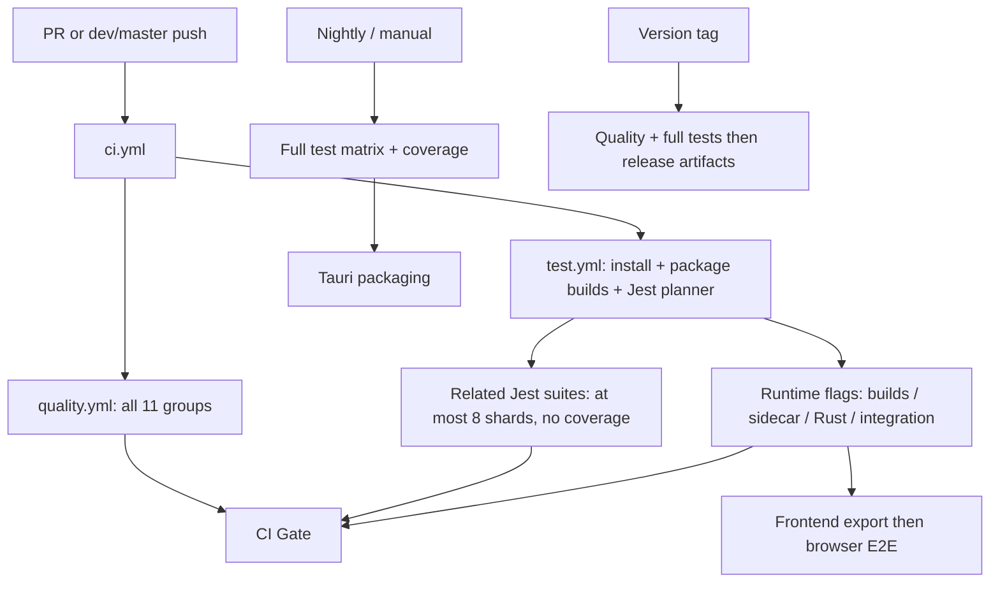

# CI and incremental testing audit

Date: 2026-10-15 (Asia/Shanghai)

Repository baseline: `dev`, `f3b0e5ca9fa9dc1930156564a3939be60f09ff3c`.
Scope: research and verification; no workflow or application changes.

## Decision

Extend the existing affected-test planner rather than replace the CI system.
The repository already selects incremental Jest tests on PRs and trunk pushes.
The main problems are a broken shallow-history planning path, unconditional
quality groups, coarse runtime boundaries, and an unhealthy full-run safety net.

Priorities:

1. Make change detection reliable and distinguish push, PR, and recovery baselines.
2. Select quality gates and runtime lanes before installing/building their prerequisites.
3. Use dependency-aware package/crate selection plus explicit runtime contracts.
4. Validate narrower selection against successful full runs before making it authoritative.

This is a proposal, not an implemented optimization or a measured speedup claim.

## Current flow



The diagram compresses reusable-workflow dependencies; `CI Gate` consumes the
aggregate results of `quality` and `test`, rather than each child directly.

| Area               | Actual behavior                                                                                                               | Implication                                                                      |
| ------------------ | ----------------------------------------------------------------------------------------------------------------------------- | -------------------------------------------------------------------------------- |
| Main entry         | `ci.yml` runs for PRs and pushes to `dev`/`master`; no path filter                                                            | Stable entry point is useful for required checks                                 |
| Quality            | `quality.yml` gets every group from `check-all.mjs`; 122 entries, all currently blocking, in 11 groups                        | A docs-only change still starts Rust, SDK, artifact, and script-test groups      |
| Jest               | Direct changed tests, colocated tests, Jest related tests, deleted-module consumers/fallback, dependency smoke contracts      | Incremental selection already exists; do not rebuild it from scratch             |
| Jest scheduling    | Incremental at most 8 shards / 4 parallel; full at most 64 shards / 8 parallel; immutable plan artifact                       | Sharding bounds execution; it does not reduce selected work                      |
| Coverage           | Incremental jobs do not collect coverage; full jobs collect and merge it                                                      | Keep opt-in coverage policy; this audit ran no coverage collection               |
| Runtime builds     | `classifyCiImpact` emits flags for frontend, sidecar, docs, web, mobile, Rust, etc.                                           | Path matching is lane selection, not a dependency graph                          |
| Browser E2E        | Frontend impact builds an E2E export; PRs use `@smoke                                                                         | @critical                                                                        | @a11y | @visual`; non-PR runs use the full configured project suites | An ordinary frontend trunk push still requests broad browser regression |
| Rust               | Any workspace/native impact runs all workspace crates except Tauri on Linux, plus Tauri tests on Windows after frontend build | Small isolated crate changes can trigger a large cross-platform chain            |
| Full runs          | Nightly uses full mode; configured daily at 03:00 UTC / 11:00 Asia/Shanghai; tagged releases also use full mode               | Full testing is already separated, but its health must be restored               |
| Services / Compose | Service workflows and Compose have their own path filters and schedules                                                       | Selection policy is distributed across files                                     |
| Images             | Relevant PR paths trigger image checks; tags/manual runs can publish                                                          | Images are a separate workflow, not automatically downstream of the main CI Gate |
| Deployment         | `deploy.yml` is manual/reusable, with environment enablement and credential-presence gates                                    | Do not equate those gates with successful tests of the exact deployed artifact   |

Source anchors: [orchestrator](../../.github/workflows/ci.yml),
[test workflow](../../.github/workflows/test.yml),
[quality workflow](../../.github/workflows/quality.yml),
[planner](../../scripts/test/coverage-changed.mjs),
[registry](../../scripts/gates/check-all.mjs),
[nightly](../../.github/workflows/nightly.yml),
[release](../../.github/workflows/release.yml),
[images](../../.github/workflows/images.yml),
[deployment](../../.github/workflows/deploy.yml).

## Hosted evidence

Observed on 2026-10-15; these are individual samples, not a representative latency benchmark.

| Run                                                                               | Finding                                                                                                                                                                                                                                              |
| --------------------------------------------------------------------------------- | ---------------------------------------------------------------------------------------------------------------------------------------------------------------------------------------------------------------------------------------------------- |
| [38561507260](https://github.com/MaxQian888/cognia-next/actions/runs/38561507260) | Push at the audited SHA. Planner failed in `Freeze exact test plan`; 11 quality groups still ran. Their summed job durations were **71.85 runner-minutes**, not wall-clock time or billed minutes. Slowest quality group: plugin-sdk, 925 seconds.   |
| [38538156681](https://github.com/MaxQian888/cognia-next/actions/runs/38538156681) | Another push failed in the same planner step. Quality groups consumed **69.00 summed runner-minutes**. The workflow's roughly 66-minute elapsed time includes scheduling/waiting and must not be attributed entirely to test execution.              |
| [38535819287](https://github.com/MaxQian888/cognia-next/actions/runs/38535819287) | Scheduled full run created 64 Jest shards, but multiple shards, builds, Rust/integration jobs, and coverage tooling failed. Browser E2E and final Tauri packaging were skipped through dependencies. This is not a successful regression safety net. |

The first planner spent 84 seconds building Jest prerequisites before failing
within one second at plan freezing. The second spent 80 seconds on prerequisites.
Both had successful planner contract-test steps before the Git failure.

Exact failure in the latest run:

```text
[coverage-changed] Command failed with exit code 1: git merge-base 0346eef5393a88764f97f24856899b73a9ef8d05 f3b0e5ca9fa9dc1930156564a3939be60f09ff3c
```

At inspection time, GitHub reported default branch `dev`. The classic required
status-check API returned `Branch not protected`; the branch rules API returned
`[]`. Thus the stable `CI Gate` exists in YAML but was not shown as an enforced
required check by either inspected API. Recheck before changing branch rules.

## Findings

### 1. Shallow ancestry breaks the planner before tests run

`test.yml` checks out depth 2 and fetches the previous push SHA at depth 1.
`listCommittedChanges` then calls `git merge-base` unconditionally. Possessing
both endpoint commits is insufficient to establish ancestry across a multi-commit
push when the intervening history is absent.

A temporary five-commit Git fixture reproduced the workflow's history shape:

| Operation                                               | Exit status |
| ------------------------------------------------------- | ----------- |
| Depth-2 HEAD + depth-1 prior tip, then `merge-base`     | 1           |
| Direct endpoint tree diff of those same fetched commits | 0           |
| Fetch complete history, then `merge-base`               | 0           |

Recommended semantics:

- Push delta: compare the exact previous tip and current tested tree directly.
- PR integration: distinguish testing the synthetic merge commit against its base
  from computing a source-branch merge-base diff; record both identities explicitly.
- Local branch mode: merge-base remains appropriate, with enough ancestry.
- Recovery: a failed/skipped earlier run must not disappear from validation when
  the next push diffs only against its immediate predecessor. Use an ancestor
  last-successfully-validated SHA, preferably tracked per lane, or an explicit
  catch-up full run. Reject incompatible/non-ancestor baselines.
- Missing history: deepen/fetch, then deliberately widen scope if still unresolved.
  If even the fallback cannot be planned/executed, fail the gate. Never interpret
  discovery errors as an empty successful plan.

### 2. Quality selection is the largest clearly demonstrated overbroad area

Every change launches every quality group. Group metadata currently contains
toolchain/resource/blocking information, but no input/dependency scope.
Caching ESLint, formatting, and TypeScript state reduces repeated work inside jobs;
it does not avoid launching irrelevant jobs or paying their installation costs.

Extend the existing registry with declared inputs, shared/config inputs, owner or
dependency scope, and an explicit always-run policy. Keep a small registry/planner
integrity gate unconditional. Evaluate expensive gates before provisioning their
toolchains. For a global invariant, selecting the gate and narrowing its file set
are separate decisions: some selected gates must still inspect the entire tree.

### 3. Runtime flags are broad and also have gaps

Direct execution of the current classifier produced:

| Single changed path                | True runtime flags, excluding false flags                                                                       |
| ---------------------------------- | --------------------------------------------------------------------------------------------------------------- |
| `docs/content/docs/en/example.mdx` | docs                                                                                                            |
| `components/chat/message.tsx`      | frontend                                                                                                        |
| `lib/utils.ts`                     | frontend, sidecar                                                                                               |
| `packages/primitives/src/index.ts` | frontend, sidecar, browserExtension, gateway                                                                    |
| `crates/cognia-git/src/lib.rs`     | rust, gateway, productionBuild                                                                                  |
| `pnpm-lock.yaml`                   | globalJS plus frontend, sidecar, deepseekRuntime, docs, web, mobile, browserExtension, gateway, productionBuild |
| `postcss.config.mjs`               | productionBuild only                                                                                            |
| `scripts/e2e/serve-out.mjs`        | none                                                                                                            |

These are classifier probes, not executed builds or proof of all consumers.
They show why generic package changes fan out widely, while a browser harness
change does not itself select the browser lane. Global quality tests may cover
parts of those changes; that does not demonstrate real browser verification.

Use the actual pnpm workspace/package graph and Cargo metadata reverse-dependency
closure where boundaries are reliable. Include build dependencies, feature sets,
generated artifacts, native includes, and standalone projects. Preserve explicit
contract edges for IPC, schemas, runtime registration, filesystem-loaded fixtures,
and E2E product journeys that static imports cannot establish.

### 4. Dependency changes need a more explicit risk policy

Root lock/manifests currently activate many runtime lanes, but Jest selects eight
fixed dependency smoke suites rather than all affected dependency consumers.
That tradeoff is documented in the planner; it is not complete compatibility evidence.
By contrast, Jest/TS configuration and patches select the full Jest inventory even
while the plan remains in incremental mode without coverage.

Eventually parse changed lockfile importers and dependency closure. Until that
analysis is reliable, broaden validation for shared React/Jest/Next/runtime changes.
Do not reduce those to only the adjacent unit test or a fixed smoke list while
the nightly baseline remains red.

### 5. Browser selection needs product-level contracts

The repository has `test:e2e:changed`, but CI uses tags rather than that command.
Browser specs often navigate a prebuilt application without importing its source;
source-to-spec selection is therefore not equivalent to Jest's module graph.

Use a small stable critical smoke set plus affected journeys (chat, account,
sharing, plugin, etc.), with global expansion for routing, boot, transport, auth,
schema, shared styling, and test harness changes. Keep full browser regression
until shadow comparisons establish that a narrower policy is trustworthy.

### 6. The plan should precede expensive setup

Today every test runtime depends on `jest-plan`, which installs dependencies and
builds workspace packages before establishing whether Jest or those runtimes are
needed. Split a lightweight change/lane plan from Jest suite discovery. Docs-only
and isolated service work should not wait for unrelated Jest prerequisites.
Keep immutable base/head and selection-reason artifacts in both phases.

## Industry guidance applied here

Detailed primary-source notes are in
[the companion research](2026-10-15-ci-test-selection-primary-sources.md).

- **Affected selection, caching, and sharding solve different problems.**
  Select tasks using dependency closure; reuse deterministic task results only
  with complete inputs; distribute the remaining tasks across runners.
- **Jest related tests are useful within the existing root graph.** Keep them,
  with explicit coverage for dynamic/file-based dependencies and deletions.
- **pnpm filters / Nx affected / Turbo affected are package/task tools.** Adopt
  their graph principles now. Pilot task caching on bounded package builds before
  migrating the whole multi-runtime pipeline. Root-app granularity will remain
  coarse without deeper ownership boundaries.
- **Playwright only-changed is a heuristic.** Official guidance presents it as
  fail-fast ordering before the full suite, not proof that unrelated specs are safe
  to remove. Product journey mapping requires independent validation.
- **Stable required checks need explicit aggregation.** Keep the always-triggered
  CI entry point; let jobs skip by plan and make the final gate verify every
  selected job. A skipped required workflow can remain pending; a skipped job can
  appear successful. Add `merge_group` support if a merge queue is enabled.

## Proposed target policy

| Tier           | Policy                                                                                                                                                                                 |
| -------------- | -------------------------------------------------------------------------------------------------------------------------------------------------------------------------------------- |
| PR fast checks | Always-run planner integrity; affected gates; changed/related Jest; affected package typechecks/builds; critical smoke plus affected browser journeys                                  |
| High-risk PR   | Expand relevant domains or full suites for shared infrastructure, dependency graph, migrations, auth/transport/protocol, planner/config changes, or unresolved ownership               |
| Trunk          | Validate accumulated changes since a trustworthy successful baseline; publish reusable caches only after the corresponding task succeeds; retain broader browser checks during rollout |
| Nightly        | Complete regression and existing full-mode coverage; cross-browser/native integration; visible recovery ownership for failures                                                         |
| Release/CD     | Verify the exact source and artifact identities, full relevant release validation, then promote immutable artifacts and run deployment smoke checks                                    |

Expected examples after rollout: docs content selects docs/link/format checks;
an isolated UI leaf selects its graph and relevant UI journey; an isolated package
selects reverse dependents; a shared protocol selects both producer and consumer
contract tests. These examples are design goals, not current guarantees.

## Rollout and acceptance

1. **Correctness first.** Add real temporary-repository tests for shallow multi-commit
   pushes, first push, force push, PR merge refs, rename/deletion, failed prior runs,
   and missing ancestry. Repair the hosted planning failure and restore a usable
   full-run baseline.
2. **Quality selection in shadow mode.** Extend `check-all.mjs`; output intended
   selected/skipped gates and reasons while the existing checks still run. Start
   with documentation and clearly isolated service/SDK paths. Compare on the same SHA.
3. **Enable low-risk skips.** Require no observed omitted regressions across a
   representative sample, explicit ownership for unknown paths, and a full-mode
   override. Zero observed misses is evidence, not proof of complete safety.
4. **Refine graph selection and caches.** Add package/crate closure and only then
   finer E2E journeys. Avoid using cross-file-insensitive lint caches as correctness
   evidence for typed/global rules. Do not cache live external integration results.

Measure separately: PR p50/p95 elapsed time, queue time, summed runner-minutes,
installation/build overhead, selected/total suites, gate/lane selection rates,
cache hit rates, fallback reasons, failed-baseline age, and regressions caught
only by the full run. Do not claim percentage savings until matched before/after
samples exist.

## Verification and limits

- Read workflow sources, planner, gate registry, workspace configuration, and CI docs.
- Read hosted run/job metadata and the two failed planner logs; no workflows were
  dispatched, rerun, or modified.
- Ran `node --test scripts/test/coverage-changed.test.mjs
scripts/test/jest-timing-sequencer.test.mjs scripts/ci/workflow-contract.test.mjs`:
  **78 tests passed, 0 failed**. No coverage collection was requested or run.
- Reproduced the shallow-history failure in a disposable Git repository. Existing
  workflow-mode tests stub Git and Node, explaining why they do not prove this
  real ancestry path works.
- Ran pure classifier probes. No full Jest, browser, Rust, application build, or
  deployment acceptance was performed.
- The shared worktree contains unrelated application edits; inspected CI source
  paths had no local diff. This audit adds research documents only.

## CLI build and cache follow-up (2026-10-15)

This follow-up was requested after the change-planner and affected-Quality
implementation. The verification limits above describe the original audit.

There are two separate CLI products: `crates/cognia-cli` builds the Rust `cognia`
plugin-author/operator binary, while `cli/` builds the JavaScript/Bun
`cognia-agent`. Their artifacts cannot be substituted for each other.

| Path                                                    | Work performed                                                                 | Reuse boundary                                                                                           |
| ------------------------------------------------------- | ------------------------------------------------------------------------------ | -------------------------------------------------------------------------------------------------------- |
| Quality `sdk:scaffold:test`                             | `cargo build -p cognia-cli`, then exercises real generated plugin projects     | Debug executable; one build before both template cases                                                   |
| Quality Clippy and workspace Rust tests                 | Analyze/test workspace members including `cognia-cli`                          | Different modes/features; the test harness is not the scaffold executable                                |
| `entry.bundle.test.ts` and `coding-loop.bundle.test.ts` | Each runs `build-cli.mjs --js-only`                                            | Confirmed duplicate JS build entrypoints; no shared prepared CLI artifact                                |
| Release `publish-agent-hosts`                           | Native helpers in release mode, then a Bun executable for each OS/architecture | Platform artifacts differ; no Rust cache configured in this job                                          |
| Release Bun full/slim                                   | One `Bun.build`, followed by two layouts                                       | Core executable is already built once; full/slim are not two compiles                                    |
| Release `publish-agent-sdk`                             | `agent:sdk:smoke` builds a Node ESM CLI again                                  | Different output from Bun; fresh runner has no native helpers although the full Node build requires them |
| Docker server full/slim                                 | Shared Rust and brain stages on one BuildKit builder                           | Already shares stages; only full exports the registry cache                                              |
| Docker server source changes                            | Broad `COPY src-tauri` / `COPY crates` precede server and CLI builds           | Unrelated Rust edits can invalidate the CLI build layer; dependency layers may still hit                 |

Root `postinstall` builds linked packages and sidecar assets, but does not call
either CLI builder. Tauri development can invoke the Rust CLI build twice
(wrapper and `predev`); on one workspace Cargo can make the second call a
fingerprint no-op. That development path is not evidence of a duplicate CI
release compile.

### Hosted cache evidence and local corrections

In [CI run 38561507260](https://github.com/MaxQian888/cognia-next/actions/runs/38561507260),
the `plugin-sdk` job `115843695958` and `rust` job `115843696119` both requested
`v0-rust-gates-Linux-x64-c7b3ef7d-93a86557` and logged `No cache found.`
The scaffold gate took 79.3 seconds, including generated-project install, tests,
and builds; that duration must not be presented as Rust compilation time alone.
Both groups failed, so the prior default cache policy saved neither group.

The local change adds a matrix-group suffix to Quality's Cargo cache key and
enables `cache-on-failure`, retaining the existing trunk-only write policy.
This avoids competing immutable-cache writers with different dependency sets
and lets failed trunk runs warm dependency caches. It does not cache a passing
test result or skip Cargo's validation. The scaffold gate now declares its Rust
runtime and Cargo resource so local parallel gate groups respect the same mutex.

[rust-cache v2](https://github.com/Swatinem/rust-cache/blob/v2/README.md) defaults
to job-based keys and dependency artifacts, excluding workspace crates and
incremental compilation state. Thus a cache hit does not imply that `cognia`
itself is already built. [GitHub's cache reference](https://docs.github.com/en/actions/reference/workflows-and-actions/dependency-caching)
also distinguishes immutable caches from artifacts and restricts cross-ref
access: a cache written only under one release tag cannot warm a different tag.
Adding a release-only cache without a reusable producer would leave that gap.

### Follow-up implementation and remaining boundaries

1. **Implemented locally:** the Jest planner prepares the JS CLI once when either
   bundle suite is selected. A separate SHA-named artifact avoids transferring
   thousands of CLI chunks to unrelated shards and frontend jobs. Both suites
   verify SHA/runtime identity, file closure, digests and permissions, then run
   the restored bundle. Local invocations still rebuild current sources.
2. **Implemented locally:** a default-branch-only nightly/manual job warms release
   native helper dependencies on the same three native runner/target pairs as
   release. Tag jobs restore read-only; cold or unavailable caches still run
   the ordinary Cargo builds and smoke checks. Compiler and dependency hashes
   remain enabled. This requires one successful warm run after landing on the
   default branch; runner-image/toolchain changes may cause cold misses.
3. Run SDK smoke against the verified release host, or explicitly provision
   the Node bundle's native prerequisites. The current fresh-runner gap is
   source-confirmed, but no tagged release was dispatched to reproduce it.
4. Separate Docker CLI inputs from unrelated server sources only after mapping
   the CLI's transitive workspace dependencies and embedded assets. Narrowing
   `COPY` to only `crates/cognia-cli` would omit real inputs.

No hosted cache-hit improvement or end-to-end build-time reduction has yet
been measured for these local changes.

Validation of this follow-up: **143 Node regression checks passed**, including
real temporary Git repositories, artifact transfer between different checkout
paths, two consumers sharing one build, irrelevant-shard skips, local rebuild
fallback, stale SHA/runtime rejection, archive/file corruption, missing/extra
files and executable-mode loss. Scoped ESLint and workflow actionlint passed.
The production esbuild pipeline also succeeded with the isolated `--outdir`.

The two real Jest CLI suites were run: **3 passed, 15 failed**. They reached CLI
startup and encountered `ajv@8.20.0` importing `json-schema-draft-07.json` without
an import attribute of `type: json`. A control build using the previous
`HEAD:scripts/build/build-cli.mjs` with only its output directory redirected
reproduced the identical `--version` failure against the same local dependency
tree. This is a pre-existing runtime validation blocker, not a passing CLI
acceptance result. No dependency changes, three-platform Cargo builds or hosted
release dispatch were made as part of this follow-up.

### Runtime blocker resolution (2026-10-15)

The subsequent acceptance run fixes the startup blocker above at its source:
`lib/plugin/library/schema.ts` now annotates the external Ajv draft-07 JSON data
import with `with { type: "json" }`. No dependency or bundler externalization
changes are needed. A co-located regression bundles the actual schema module
with the production CLI esbuild configuration, imports it through native Node
ESM, and checks valid/invalid schemas and values. It failed with the exact
`ERR_IMPORT_ATTRIBUTE_MISSING` before the fix. Jest's CJS transform alone did
not expose that runtime error. See [Node's import attribute documentation](https://nodejs.org/api/esm.html#import-attributes).

With startup repaired, both provider coding-loop scenarios exposed a second
real defect: the CLI's injected project LSP reader still accepted an absolute
file path, while the shared reader now passes `(rootDir, relativePath)`. The
adapter tried to read the directory and the reader returned `null`, so the
fixture server override never loaded. The existing real-filesystem unit test
also failed before the fix. The adapter now joins those two arguments; its
co-located test additionally checks malformed and missing configuration files.
The coding-loop assertions for real LSP hover, sandbox boundaries, process
execution, session continuation and PTY interaction remain enabled.

Verification after both fixes on macOS arm64 / Node 26.5.0:

- Full `entry.bundle.test.ts`, `coding-loop.bundle.test.ts`, `schema.test.ts`
  and `to-build-context.test.ts`: **4 suites, 109 tests passed, 0 skipped**
  (94.736 seconds). Both providers reached three actual TUI approvals each.
- `node cli/dist/cognia-agent.mjs --version`: exit 0, output `0.1.0`.
- Artifact helper, release Rust-cache contracts and workflow contracts:
  **64 Node tests passed, 0 skipped**.
- Scoped ESLint and `git diff --check` passed for the runtime fixes. Read-only
  review found no actionable issue in the import attribute, adapter or their
  co-located regressions.

The isolated artifact verification uses a local clone of the committed baseline
plus only this task's source changes, committed with a repository-local verified
identity. Shared-worktree dependency changes are excluded. Root and sidecar
installs use their committed frozen lockfiles; dependency links stay inside the
clone. Initial setup deferred lifecycle scripts, so two real prepare attempts
failed on missing Webclone output and the sidecar AST binary. Both failures were
retained; canonical prerequisite builds/installations repaired the environment
before the successful prepare. The initial consumer checkout under `/private/tmp`
was also excluded by Jest's existing `/tmp/` rule. Moving that owned checkout
outside `/tmp/` preserves the SHA and artifact bytes without changing Jest's
configuration.

The first isolated artifact that built successfully still failed the real
coding-loop acceptance: **4 failed, 2 passed**, with `sandbox_write` absent.
The log tied this directly to the missing `cognia-sandboxed-tools` plugin chunk.
This exposed an actual cold-CI gap: `postinstall` and the Jest planner do not
build built-in plugin assets, while `--js-only` omits them when the generated
tree is absent. The Jest bundle helper now invokes the existing canonical
plugin builder **before** CLI esbuild, so the embedded catalog and staged
chunks agree. This happens once for a selected producer, or for a local source
build; artifact consumers and unselected plans build neither. A plugin build
failure stops preparation before the CLI build/publication. New cold-fixture
and failure regression checks were confirmed red before this change; the
complete focused Node regression run now passes **65 tests, 0 skipped**.

Final cold producer SHA: `2aa1feefa42ca6832fef983941cf353cdef27108` in the disposable
clone. Preparation started without the generated plugin tree or its build cache,
built 54 plugin assets once and the CLI once, and passed the tracked-source
cleanliness guard. The complete coding-loop consumer passed **6/6 tests, 0
skipped** (60.867 seconds), including three actual TUI approvals per provider.
Manifest, archive and frozen-plan hashes were unchanged after this consumer.

The second shard restored the original transferred artifact again and passed
the complete entry suite: **12/12 tests, 0 skipped** (19.439 seconds). Final
artifact acceptance is therefore **18/18 tests, 0 failures, 0 skips**, with
coverage explicitly disabled. External process tracing includes both Jest
workers and both `ensure` calls: **one plugin-builder invocation and one CLI
builder invocation in the producer; zero rebuilds in either consumer**.

The final archive contains 4,261 payload files, including all 54 plugin assets.
Both consumers preserve the manifest, archive and frozen-plan hashes exactly:

| File              | SHA-256 before and after both consumers                            |
| ----------------- | ------------------------------------------------------------------ |
| `cli-bundle.json` | `536345855641b396646d6963d752206ed1d3d6116ea9d0664753fa3f4efaef22` |
| `cli-bundle.tar`  | `f8e01c35973df6f2f9d093272bb32a60f0075dc150d1ce6ec34f0e1428e55cb2` |
| `plan.json`       | `0d8f4ebb76985d7bba2ce0520d7e1cf23688ad15c878236685d9dfa33075c9d5` |

The tracked checkout remained clean. The external evidence bundle retains the
source patch, temporary commit metadata, frozen lockfile hashes, test logs,
process trace, manifest and every earlier failure; no failing test was converted
to a skip. Native helpers were existing local ARM64 release binaries whose
architecture and sandbox smoke were verified, not rebuilt at this SHA. Providers
were local HTTP fixtures. These results establish local macOS/Node artifact
acceptance; hosted GitHub Actions and Linux/Windows release acceptance remain
unrun. The shared branch was not committed or pushed.
