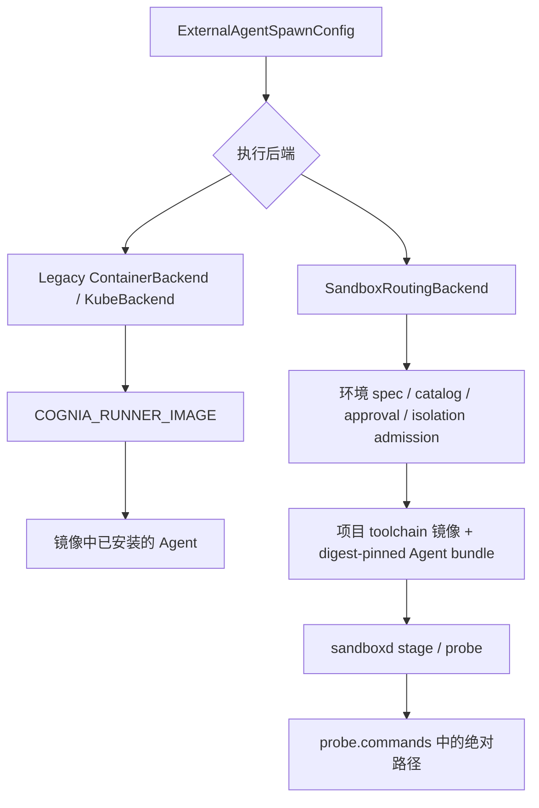

# Runner 与 Agent bundle 精简：执行链路、对抗审查与验证

日期：2026-10-21。范围：当前工作区实现，尚未提交或发布。

本次提供构建与部署级的 Agent 选择：指定 runtime IDs 构建精简 Runner
或 bundle，再由现有部署配置提供这些镜像。Full 保持兼容默认。会话启动
仍使用部署提供的已构建产物，缺少 Agent 时明确拒绝。

## 两条实际执行链路

Legacy Runner 将配置中的 command/args 交给镜像；没有 bundle 注入。
Pool 将 Agent 包带到项目镜像中，并根据 probe 的命令集解析启动请求，
缺项产生 `sandbox_command_unavailable`，不会改从项目 PATH 下载或执行。
环境 baseline 文件优先于 `COGNIA_RUNNER_IMAGE` 派生的 legacy catalog。

因此，仅修改 Runner 或仅裁剪 bundle manifest 都不能完成精简。

## 审查发现及处理

| 反例                                                           | 判定与处理                                                                                                                   |
| -------------------------------------------------------------- | ---------------------------------------------------------------------------------------------------------------------------- |
| 过滤 manifest 后，完整 npm 依赖仍在镜像中                      | 有效。使用 npm 离线裁剪 master lock；保留包的 version/resolved/integrity 必须完全一致。                                      |
| Claude ACP、Pi 和 OpenCode 不是一 runtime 一文件               | 有效。按 runtime 的真实 commands 保留依赖；共享命令去重，不扁平化嵌套 Codex 版本。                                           |
| Legacy `npx` 会下载被排除的 Agent                              | 有效。selected Runner 将已知 Agent 请求路由到冻结 shim；未选项拒绝。项目工具可使用 native npx 离线运行。                     |
| `--yes=true` 绕过 Agent 路由；`--no-offline=true` 关闭离线     | 有效。新增实际 native npx 复现和回归测试；使用限定参数语法，拒绝未解析配置与 source alias。                                  |
| Droid-only 没有 musl runtime，但远程 provider 仍 stage 双 libc | 有效。stage 可以复制基础树；probe/command 仍只公开实际支持的 runtime。保留 required-entry、安全复制、marker 和目录替换检查。 |
| custom image 的 ENTRYPOINT 会拦截 Agent 启动                   | 有效。Runner 清除继承入口，保持与服务端 workspace 所有权兼容的 root 身份，检查 glibc/Node。                                  |
| Full 与 bundle 的 Agent 集合不同                               | 有效。Full 按原 Runner 兼容范围保留；selected 只接受 master 中可验证分发的 runtime。                                         |
| npm 新版跳过 Claude/OpenCode 必要 postinstall                  | 实际构建发现。初始安装禁用脚本，随后只允许 master 中明确列出的脚本并显式 rebuild。                                           |
| 静态 Git 的链接检查依赖 GNU find，但 Alpine 提供 BusyBox find  | 实际构建发现。Git 构建阶段补齐 findutils；最终构建不再出现不支持的 `-lname`，安装器仍校验复制树。                            |
| smoke 保留全部注入卷直到结束，放大验证磁盘峰值                 | 实际验证发现。每个 case 成功后释放自己的卷，退出 trap 继续处理异常路径。                                                     |
| 给 manifest 增加 profile 字段会被旧消费者拒绝                  | 有效。保持 manifest v1，以 runtimes 子集表达内容。                                                                           |

独立复审覆盖依赖裁剪、npx 路由、共享 CLI、Full 兼容与 CI wiring；
首轮修复后复查没有发现剩余可操作问题；用户追加复审后确认的三项边界
缺口及修复见末节。构建工具与卷清理的后续修复已通过本地真实构建和
smoke 验证。
用户选择跳过可选跨模型审查；未调用外部 Agent CLI。

## 使用方式与兼容边界

详见 [Runner profiles](../../deploy/runner/README.md) 与
[Agent bundle](../../deploy/bundle/README.md)。两个 Dockerfile 都从仓库根构建。

- `AGENT_RUNTIMES=codex-app-server,codex-acp`：选择 Codex 两种接口。
- `full` / `all`：全部可验证分发的 bundle runtime。
- `none`：保留工具、Node 与执行基础设施，不公开 Agent CLI。
- Legacy 自定义基础镜像：`RUNTIME_IMAGE=python:3.12-slim` 等兼容
  Debian/glibc 镜像；最终通过 `COGNIA_RUNNER_IMAGE` 配置。
- Pool 自定义 toolchain 镜像：继续走 Image catalog / 已批准声明；Agent
  bundle 通过 baseline 或 `COGNIA_AGENT_BUNDLE_IMAGE` 单独配置。

selected 使用裁剪后的完整依赖锁。Full 的 npm Agent 默认版本已经固定，
Kiro/Droid 使用固定 URL 与 SHA256；Full 全局 npm 安装仍保留兼容行为，
不提供 transitive-lock 保证。Cursor 是 Full-only 的可选、未校验、可变
vendor installer，构建时可用 `INSTALL_CURSOR_AGENT=0` 关闭。

镜像版本固定不等于 runtime certification。镜像中预装的其他 CLI
也不能覆盖 Pool 的 bundle 命令解析。

## 已取得的证据

| 检查                                                      | 实际结果                                                                                                                                                                                         |
| --------------------------------------------------------- | ------------------------------------------------------------------------------------------------------------------------------------------------------------------------------------------------ |
| Node 选择、锁完整性、Runner 参数与 image/deploy gate 回归 | 83/83 通过。                                                                                                                                                                                     |
| `cognia-sandboxd` 单元、CLI、persistent runtime 测试      | 148/148 通过。                                                                                                                                                                                   |
| Pool bundled command 测试                                 | 4/4 通过。                                                                                                                                                                                       |
| `pnpm lint`                                               | 恢复后重新运行通过；focused ESLint 通过。                                                                                                                                                        |
| deploy-suite、agent-host-image、actionlint                | 通过。                                                                                                                                                                                           |
| Final selected Runner，真实 ARM64 Docker                  | 离线启动 Codex `0.157.1`，ACP `1.13.1` initialize 成功；旧 ACP alias、参数绕过拒绝及未选 Agent 拒绝通过。                                                                                        |
| 自定义 Python Runner                                      | Python `3.12.15`、冻结 Node `26.8.2`、Codex 与离线 ACP initialize 通过。                                                                                                                         |
| Full Runner（Cursor 关闭）                                | 全部 npm CLI 命令存在；版本检查适用的 CLI、Cline、Kiro、Droid 启动 及新旧 Codex ACP 初始化通过；额外限制 capabilities / 提权 / pids / memory 后 ACP 仍通过。                                     |
| bundle 完整 smoke                                         | Debian / Python 的 glibc、Alpine 的 musl：注入、文件/manifest 一致性、Node/CLI、离线 ACP initialize 全部通过；Python 内 bundled Git HTTPS fetch 通过；uclibc 拒绝 64、不可写 workspace 拒绝 68。 |
| selected Claude/OpenCode                                  | Claude `2.1.283`、OpenCode `1.18.32` 启动通过；Claude ACP `0.81.2` 和 OpenCode ACP 均在离线、无 capabilities、禁止提权的容器内 initialize 成功。                                                 |

相同 ARM64 平台下，Docker `image inspect` 的 `Size`：Codex selected 为
460,651,801 bytes，Full（Cursor 关闭）为 1,751,015,388 bytes。这里比较
同一个 API 指标，不代表构建峰值或实际磁盘占用。

日志位于 `.cache/runner-selection/`。Docker Hub 拉取超时后，本地验证使用
相同版本的 registry mirror；APK mirror 调整仅存在于缓存中的验证 recipe，
没有写入正式 Dockerfile。

## 环境恢复与验收边界

并行构建曾耗尽 Docker backing storage，出现
`metadata_v2.db: input/output error`。用户已明确授权重启 Docker Desktop，
现已完成重启。三个 local-auth 服务恢复 healthy；`traex-bridge` 在重启前
已处于 restart loop，未修改该服务。只清理已记录的本任务镜像和构建缓存，
未重置 Docker 或删除数据卷。后续构建串行执行，并设置磁盘余量停止保护。

Final selected 与自定义 Python Runner 已重新构建并通过离线 smoke。
Full 的 Droid 下载使用分段缓存，文件与 master SHA256 完全一致；本地
registry/APT/APK mirror 和缓存 URL 均仅用于 `.cache/` 验证 recipe。

本地 ARM64 的 selected、custom Python、Full、bundle 和 selected
Claude/OpenCode 验证全部完成。为避开 Cargo 网络停滞，本地构建使用
固定 Git commit 的缓存，以及逐一对照 `Cargo.lock` SHA256 验证的
299 个 registry archive，Rust 编译以 `--locked --offline` 完成。
临时镜像在记录证据后清理；smoke 的临时卷全部释放。
CI 已增加 Full/Codex profiles 的测试后发布流程，bundle 保留 amd64/arm64
原生矩阵。远程 CI、K8s/E2B 和 authenticated model request 尚未运行。
不能把已通过的本地测试表述为完整部署验收。

## 追加复审：npx 与自定义基础镜像

再次按现有代码做独立对抗审查，确认并修复三项问题：

| 问题                          | 实际反例                                                                              | 修复                                                                                                     |
| ----------------------------- | ------------------------------------------------------------------------------------- | -------------------------------------------------------------------------------------------------------- |
| P1：空版本标签绕过冻结分发    | `npx @openai/codex@` 进入 native npm，执行项目内错误版本；普通未选 Agent 请求会拒绝。 | 识别空版本后仍归入已知 Agent；明确指定的空版本无法匹配冻结版本，未选 Agent 也不会进入 npm。              |
| P2：误拒绝工具自身参数        | 包名后的 `--offline=false` 属于项目 CLI，却被作为 npm 配置拒绝。                      | 只解析包名前的 npm 参数；其后参数完整转发，native npm 的离线前缀仍保留。                                 |
| P2：自定义镜像的 npx 路径固定 | base 中 `/usr/bin/npx` 可运行，wrapper 却执行不存在的 `/usr/local/bin/npx`。          | 在最终 base 中、添加 wrapper PATH 前发现 native npx 并绑定；无 npm 时明确报错，拒绝绑定到 wrapper 自身。 |

前两项先通过行为测试复现失败，再修复通过。追加验证结果：

- 五组 Node 回归共 **85/85** 通过；`pnpm lint`、Prettier、actionlint、deploy-suite、agent-host-image 与 scoped diff 检查通过。
- **24/24** 离线依赖裁剪场景通过：每个 runtime 单独选择、`none`、`full`，以及 Full 逐项排除一个 runtime；保留依赖的版本、来源和 integrity 均未漂移。
- 实际 ARM64 Node `26.8.2` 容器中，将 native npx 移至 `/usr/bin` 后重现旧路径失败，再用最终 base 绑定逻辑修复成功。断网、384 MiB 内存、禁用 capabilities/提权下，项目参数转发、npm offline=true、空标签拒绝、无 npm 提示及 wrapper 自引用拒绝全部通过。日志：`.cache/runner-selection/reaudit/container-check.log`。

本次小容器检查前 Docker 控制命令超时，沿用用户既有授权恢复 Docker；
未执行 factory reset 或删除数据卷。此次没有重建全部 Agent 镜像；本节
容器证据验证最新分发器与 base 绑定，前文完整镜像证据属于此前构建。
远程 CI、amd64、K8s/E2B 和认证模型调用仍在验收边界之外。

自定义 base 已有的软件会保留；Agent 选择裁剪的是 Cognia 自带 payload。
需要约束完整安装集合时，应选用精简的 toolchain base。

## 后续优化：原生入口、构建缓存与 CI 回归

按用户要求跳过 typecheck，本轮只调整 Runner 相关实现与验证：

- 原生 npx 的自引用检查使用实际文件路径，覆盖符号链接别名；启动时保留 npx 的调用名称，兼容按名称分派的 toolchain shim。
- 保留合法 PATH 中目录符号链接后的 `..` 语义，以及相对路径在构建工作目录中的含义。相关 executable 测试先复现错误，再验证修复；独立复审补充了路径遍历反例，最终复查没有新的实质问题。
- 将 dispatcher 的 COPY 移至 `npm ci` 之后，避免只修改分发脚本就使依赖安装层失效；新增构建顺序检查。
- Images 的 Runner job 现在执行 `install-selected.test.mjs`，镜像 smoke 同时检查 selected 与 omitted Agent 的空版本标签拒绝。

已验证：宿主五组 Node 测试 **88/88**；固定 Node `26.8.2` 的实际 ARM64 Linux 离线容器内 Runner 测试 **13/13**；`pnpm lint`、Prettier、actionlint、deploy-suite、agent-host-image 均通过。没有运行 typecheck。

selected Codex 镜像已重建并通过 smoke；其本地标签
`cognia-runner:optimized-check` 后续已为 Full/bundle 验证释放磁盘而清理。Docker inspect ID 为
`sha256:3fe76e328d4227ce5f9a16b04a3d15ea6ad4bfb0054476aa84aecef5eeab3e47`，
ARM64，Size 为 460,654,586 bytes。实际离线验证 Codex `0.157.1`、
ACP `1.13.1` 新旧包名初始化、空标签与未选 Agent 拒绝全部通过；
`/usr/bin/npx` 的实际 custom-base 回归也通过。宿主生产输入哈希在
构建前后没有变化。日志位于 `.cache/runner-selection/optimization/`。

直接下载两个 native tarball 曾长时间停滞；本地验证改用分段下载，
逐个对照 master lock 的 SHA512 验证，然后仅作为临时 npm cache
注入构建。正式 Dockerfile、版本锁和产物内的依赖来源未改写。
registry/APT mirror 与 cache context 只存在于 `.cache/` 验证 recipe。
本轮未重建 Full 和完整 bundle，远程部署验收边界保持前文所述。

## 2026-10-22：Full 重建与完整 bundle 复验

本轮继续跳过 typecheck。最初以 Node `26.8.2` 重建 Full 默认配置（包含可选 Cursor），
实际镜像 ID 为 `sha256:446a30a6f86d4986cbf0b627097af4fbb07d22c0a3bafcad3157f5258887520f`，
平台为 Linux ARM64，Docker inspect Size 为 1,938,550,037 bytes。
构建进程在镜像安装、导出和载入完成后触发 3 GiB 磁盘保护，退出 75；
因此不能将该构建命令记为 exit 0。随后检查了已载入镜像的身份和文件层，
并对该产物独立完成以下运行验证：

- 未改动的 Runner Full smoke 通过，所有约定的版本命令及 Codex ACP 新旧别名初始化通过。
- Claude ACP 新旧别名、Pi ACP、OpenCode ACP 在断网容器内完成协议初始化；空标签与 `latest` 请求被拒绝。
- 所有 npm 顶层版本与版本文件一致；Kiro、Droid 启动通过；Cursor 实际版本为 `2026.10.19-6bbf2c4`。Cursor 的可选安装和未固定制品仍是 Full 的兼容例外。

运行验证增加 2 GiB 内存、2 GiB memory+swap、256 PID 限制，禁用 capabilities 和提权。
此前一次未限制资源的 smoke 遇到 Docker metadata I/O 错误，不计为通过；
按已有授权恢复 Docker 后，上述受限 smoke 均 exit 0。完整日志和镜像检查
记录位于 `.cache/runner-selection/full-recheck/` 的 `full-bounded-smoke.log`、
`full-extra-smoke.log`、`full-cursor-inventory.log` 和 `full-result.json`。
该 Full 镜像已在保留证据后清理，为完整 bundle 腾出空间。

此前报告中的 bundle 运行结果来自 selected Codex payload，不能代替
包含所有受支持 runtime 的完整 bundle 验收。本轮静态 Git、ripgrep/CA
和静态程序已各自重新构建；静态程序也已按其他修改更新后的当前 Cargo
锁文件重新构建，并在四类基础镜像中通过 8/8 启动检查。所有清理均限定
本任务产物或用户明确授权的旧容器、镜像及 `target/debug/` 编译产物；
未删除数据卷、源码或共享 Cargo registry。

### 当前输入的最终结果：Node 26.12.1

复验过程中，共享工作树的 Node pin 更新为 `26.12.1`，npm lock 增加
sharp override。构建时的一致性检查正确拒绝了旧 Node，因此没有将旧
产物记作当前输入验收。同步临时验证 recipe 后，Full 和两种 libc 的
完整 bundle payload 均按更新后的输入重新构建并正常退出 0；最终
`current-verification-contract.json` 的生产输入哈希无漂移。

| 产物          | 实际镜像 ID                                                               | 运行结果                                                                                                                                                                          |
| ------------- | ------------------------------------------------------------------------- | --------------------------------------------------------------------------------------------------------------------------------------------------------------------------------- |
| Full 默认配置 | `sha256:48b264d63ba6a433a9ddabc7ccefad6487b88a8f85327b91b681dab4f8258e82` | 标准 Full smoke、Claude/Codex 新旧 ACP 别名、Pi/OpenCode ACP、冻结标签拒绝和精确顶层版本清单均通过；Cursor `2026.10.19-6bbf2c4` 启动通过。                                        |
| 完整 bundle   | `sha256:2bc1b52fb1de48d3ece719553401f42f09426a3d9ea77de9752fe3ede8fcd2b0` | 全部 11 个 runtime 的约定版本检查、Debian/Python glibc 与 Alpine musl 注入、Codex ACP、Git HTTPS、拒绝码 64/68 全通过；Claude/Pi/OpenCode 在两种 libc 下额外 6/6 ACP 初始化通过。 |

Bundle 为降低磁盘峰值，分别构建正式 Dockerfile 的标准阶段，再流式
组装 OCI；未执行一次完整的默认 Dockerfile assemble/COPY 构建命令。
最终载入的是完整双 libc 树，并由未改动的 `deploy/bundle/smoke.sh`
验证其真实安装和运行行为。临时 recipe 仅调整镜像源、已校验的公开
下载缓存、离线 Cargo transport 和资源控制，版本与完整性校验均保留。

临时导出脚本曾将二进制 tar 流写入 Docker 容器日志，造成额外磁盘
增长；已为这类导出设置 `--log-driver=none`，删除对应临时容器并 trim
已释放块。继续使用 3 GiB 余量保护、2 GiB 容器内存上限和逐 case
释放卷；最终 Full/bundle 验证镜像及压缩层副本均在保存身份与日志后
清理。未删除非授权数据卷或源码。

证据位于 `.cache/runner-selection/full-recheck/`：
`full-current-result.json`、`full-current-{build,smoke,extra-smoke,inventory}.log`、
`full-bundle-current-result.json`、`full-bundle-smoke.log`、
`full-bundle-extra-acp.log`、`static-current-portability.log` 和
`current-source-final-check.json`。当前锁下 Node 回归 46/46 通过；
原先 88/88 的更广回归记录保留在前节。此次实际验证范围是本地
Linux ARM64 的 CLI 启动、注入和协议初始化；amd64、远程 CI、K8s/E2B
和认证模型推理未在本轮运行。没有运行 typecheck 或 coverage。

最终全仓 `pnpm lint` 退出 0；报告 Prettier 检查、scoped diff 检查和
证据台账 `--final` 检查均通过（0 error、0 warning）。本轮没有新增
产品源码修改，最终 preflight 范围为本报告、证据台账和 `.cache/`
验证脚本，因此无需重新分派产品代码专项审计。清理后复查没有遗留
本轮 smoke/ACP 临时卷，宿主磁盘约剩 19 GiB。
