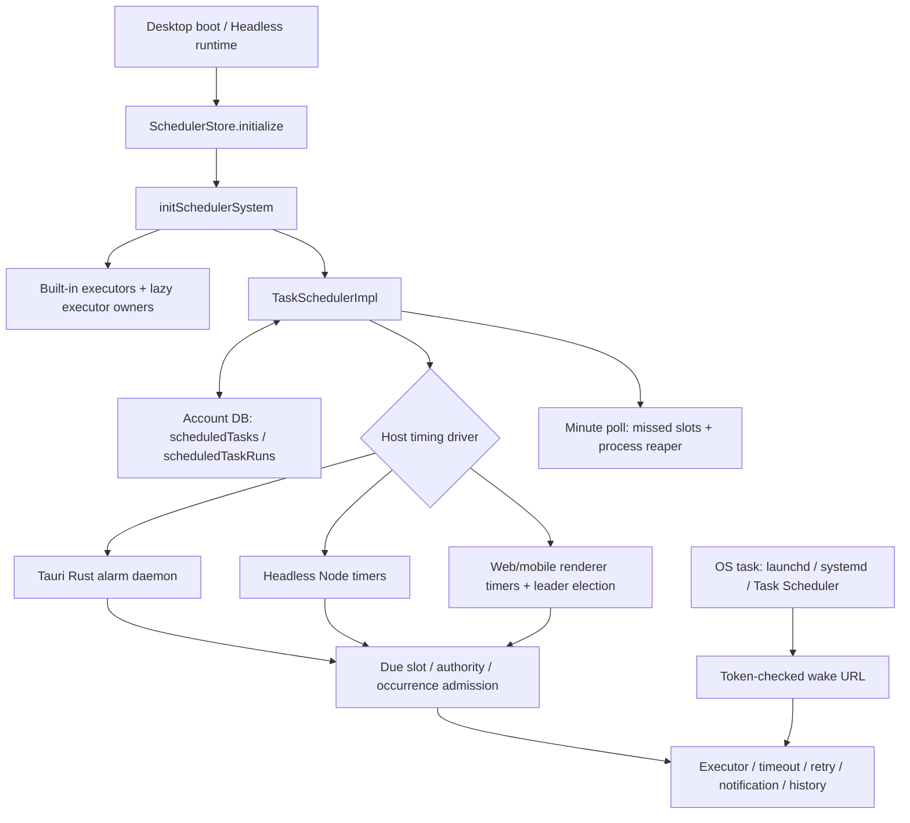

# Cognia scheduled-task implementation audit

Date: 2026-10-22 (Asia/Shanghai). Scope: two implementation reviews followed by the user-authorized repair. Historical findings below describe the pre-fix source. The repair extends the existing scheduler and preserves unrelated working-tree changes. Native fixtures use a private database and uniquely named alarms; existing user schedules and provider configuration are not mutated by the fixture.

## Assessment

Cognia has connected scheduling paths across app tasks, plugins, workflows, backup, connectors and OS tasks. The first audit found F1/F2 in catch-up and F3 in the alarm bridge. The re-review confirms those findings with the real Dexie facade, expands their lifecycle impact, and adds F4/F5. The reviews identified three P1 findings and two P2 findings. F1–F5 are repaired. A subsequent user-authorized hardening pass found and repaired three additional async lifecycle races (F6–F8). Current acceptance is 291 core tests, 264 affected-consumer tests and 19 real Tauri cases; details are recorded below. The inventory and original reproductions remain as historical evidence.

| Priority | Finding                                                                                                 | Evidence strength                                                            |
| -------- | ------------------------------------------------------------------------------------------------------- | ---------------------------------------------------------------------------- |
| P1 / F1  | Catch-up writes an old snapshot over counters, pauses and deletion, recreating a deleted active task.   | Real Dexie-backed behavioral probes.                                         |
| P1 / F2  | Catch-up bypasses remaining run budget and continues after pause/stop; a stopped scheduler can restart. | Real Dexie-backed budget and lifecycle probes.                               |
| P1 / F4  | An old native event can consume the newly rescheduled future slot and run it early.                     | Actual Rust timing driver + scheduler + Dexie; only native transport mocked. |
| P2 / F5  | The grace tier can skip a fresh missed slot because the count cap selects an expired older slot first.  | Actual cron parser + scheduler + Dexie.                                      |
| P2 / F3  | Tauri IPC/listener failures resolve as success and hide a broken alarm path.                            | Source and existing bridge tests; no real-desktop fault injection.           |

## Runtime and ownership map

- Desktop composition: [`workflow-automation-boot-initializers.tsx`](../../components/providers/initializers/workflow-automation-boot-initializers.tsx) mounts [`SchedulerInitializer`](../../components/scheduler/scheduler-initializer.tsx), which calls the store initializer. The boot bundle is capability/profile driven; lifecycle writes can initialize the core before the UI initializer mounts.
- Headless composition: [`initializers.ts`](../../lib/headless/runtimes/initializers.ts) registers the required `scheduler` runtime for `brain`, starts the same store and execution bridge, and returns teardown.
- [`initSchedulerSystem`](../../lib/scheduler/index.ts) registers executors, attempts legacy schedule adoption, initializes the live scheduler, then installs four core maintenance schedules. [`executor-owners.ts`](../../lib/scheduler/executor-owners.ts) additionally lazy-loads built-in executors when a task fires before normal boot registration. There are 22 central built-in executor types plus subsystem-owned types; `connection:*` executors belong to the adapter runtime.
- The core supports `once`, `interval`, `cron`, and `event`, with timezones, overlap policy, host concurrency, timeout, retry, notifications, dependency/event chaining, bounds and execution history. Normal timed slots use a database transaction to claim the slot and reserve the run budget before execution. The catch-up path is where the findings below diverge.
- [`SchedulerDatabase`](../../lib/scheduler/scheduler-db.ts) is an account-database facade. Reads resolve the active database dynamically; deleting a task and its history is transactional. The legacy machine-wide database is adopted into the first active account because its rows contain no historical account identity.
- The unified source registry registers six kinds: `app`, `plugin`, `workflow`, `backup`, `system`, `connector`. It provides a common management surface over several execution mechanisms; it does not make them one timer engine.
- Host routing, per-task ownership and configured execution authority are separate checks. Browser leader election prevents multiple local tabs from owning timing. This audit does not establish exactly-once external side effects across crashes or independent hosts.

## Built-in scheduled work

| Work                      | Cadence / condition                                                                                                                   | Owner and live wiring                                                                                                                                          |
| ------------------------- | ------------------------------------------------------------------------------------------------------------------------------------- | -------------------------------------------------------------------------------------------------------------------------------------------------------------- |
| Conversation auto-archive | Every 6 hours; executor checks archive policy.                                                                                        | [`auto-archive-schedule.ts`](../../lib/chat/auto-archive-schedule.ts); installed by `initSchedulerSystem`.                                                     |
| Files trash purge         | Every 6 hours; applies configured trash semantics.                                                                                    | [`trash-purge-schedule.ts`](../../lib/files-library/trash-purge-schedule.ts); installed by `initSchedulerSystem`.                                              |
| Harness evolution         | Hourly sweep.                                                                                                                         | [`background.ts`](../../lib/harness/runtime/background.ts); installed by `initSchedulerSystem`.                                                                |
| Provider diagnostics      | 5-minute clock; reachability probes every 15 minutes, primary balance every 30 minutes, other balance every 2 hours; failure backoff. | [`refresh.ts`](../../lib/provider-diagnostics/refresh.ts); installed by `initSchedulerSystem`.                                                                 |
| Connector housekeeping    | Daily clock plus boot/event-driven sweeps and debounce.                                                                               | [`housekeeping-scheduler.ts`](../../lib/connectors/housekeeping-scheduler.ts); connector runtime installs it.                                                  |
| Connector presence        | Per-adapter `intervalMinutes`.                                                                                                        | [`usage-status-runner.ts`](../../lib/connectors/presence/usage-status-runner.ts); updates the live scheduler.                                                  |
| External issue sync       | 15 minutes, with up to 60 seconds of jitter; singleton exists only while external bindings exist.                                     | [`github-sync-schedule.ts`](../../lib/issues/github-sync-schedule.ts); despite the name, includes other external binding providers.                            |
| Twin ingest/distill       | User-configured cron.                                                                                                                 | [`cron-bridge.ts`](../../lib/twin/cron/cron-bridge.ts).                                                                                                        |
| Wiki rebuild / lint       | Preset or custom cron.                                                                                                                | [`schedule/cron-bridge.ts`](../../lib/wiki/schedule/cron-bridge.ts), [`lint-cron-bridge.ts`](../../lib/wiki/lint/lint-cron-bridge.ts).                         |
| Radar reports             | User-configured cron.                                                                                                                 | [`radar-cron-bridge.ts`](../../lib/radar/radar-cron-bridge.ts).                                                                                                |
| Bot timed triggers        | Installation/trigger definitions.                                                                                                     | [`reconcile-timed-triggers.ts`](../../lib/bot/schedule/reconcile-timed-triggers.ts); desktop and headless boot reconcile schedules.                            |
| Workflow cron             | Deployed workflow trigger settings.                                                                                                   | Rust [`cron_daemon.rs`](../../crates/cognia-scheduling/src/workflow/triggers/cron_daemon.rs) and TS trigger subscriptions; separate from the app alarm daemon. |

The shared [`managed-tasks.ts`](../../lib/scheduler/managed-tasks.ts) uses live create/update calls, retires duplicate maintenance rows, preserves manual pauses, and rejects reserved identity collisions. The Twin/Wiki/Radar bridges now use this live lifecycle. Radar suggestion acceptance has a direct transactional insert but explicitly re-arms after commit; it is not a storage-only orphan.

Maintenance notification policy is centralized in [`maintenance-tasks.ts`](../../lib/scheduler/maintenance-tasks.ts). Default internal upkeep is quiet, with history available for inspection and explicit notification choices preserved. Quiet notifications alone do not indicate that a task failed to run.

## Independent timer loops

These mechanisms remain outside `TaskSchedulerImpl`:

| Loop                                   | Timing / lifecycle                                                                                                                                                                     | Implication                                                                                                                                                     |
| -------------------------------------- | -------------------------------------------------------------------------------------------------------------------------------------------------------------------------------------- | --------------------------------------------------------------------------------------------------------------------------------------------------------------- |
| Automatic backup                       | Immediate check, then every 30 minutes; actual backup follows `intervalDays`. Desktop provider and headless runtime share [`backup-scheduler.ts`](../../lib/data/backup-scheduler.ts). | Appears through the unified backup adapter, but stopping the app scheduler does not itself stop this provider/runtime. Separate cron `backup` tasks also exist. |
| Codex / Anthropic usage                | Adaptive `setTimeout` loop, started by the respective provider initializer.                                                                                                            | Separate stop handles and cadence; not ordinary scheduled-task rows.                                                                                            |
| Memory queue                           | Default 30-second worker interval.                                                                                                                                                     | Queue-worker lifecycle, not a schedule row.                                                                                                                     |
| Online evaluation                      | Renderer-only 60-second drain.                                                                                                                                                         | Headless dormancy is explicitly documented together with its absent producer.                                                                                   |
| Storage and automation-audit retention | Boot sweep plus daily interval.                                                                                                                                                        | Separate retention runtime; central storage retention owns usage/cost pruning.                                                                                  |
| Collaboration refresh                  | 60-second base with visibility/backoff behavior; headless has its own transport-aware runtime.                                                                                         | Separate from scheduler pause/resume.                                                                                                                           |

The backup path has a scoped durable `lastLocalRun` watermark and shared write coordination. [`backup-write-lock.ts`](../../lib/data/backup-write-lock.ts) coordinates in-process work and same-origin Web Locks where available. It is not a cross-host lock.

## Confirmed findings

### F1 — P1: catch-up overwrites the task after execution

[`reconcileMissedRecurringTask`](../../lib/scheduler/task-scheduler.ts#L1345) executes missed slots using its initial task snapshot. Each run updates the latest stored counters and may auto-pause through `updateTaskStats`. Afterwards, [`persistNextFutureSlot`](../../lib/scheduler/task-scheduler.ts#L1243) spreads the original `task` back into a full `put`, undoing those changes.

Reproduction: an active 60-second interval is five minutes overdue, `runMissedOnStartup: true`, `maxMissedRuns: 2`; the executor succeeds twice. Actual persisted `runCount` and `successCount` are both **0**, expected **2**. A separate failure probe with `pauseAfterConsecutiveFailures: 1` ends with **`active` / failureCount 0**, expected **`paused` / failureCount 1**.

The first probe used an injected timing driver and a stateful storage seam. The re-review repeated the assertions through the real `SchedulerDatabase`, serialization, compound indexes and transactions over isolated fake IndexedDB: both still fail with the same results. This is persistence-stack logic evidence, not native/device acceptance.

The re-review also deletes the task through the public `scheduler.deleteTask` during the first replay. After the sweep, `schedulerDb.getTask` returns the task again with `status: active`, `runCount: 0` and a future slot. The final stale `put` recreates the deleted row. This expands F1 beyond inaccurate counters: a user deletion is reversed.

Suggested repair: advance only scheduling fields against the current stored row, preserve terminal/manual state, never recreate a deleted row, and avoid re-arming a row paused during catch-up. Add durable state assertions, rather than checking only executor calls and future `nextRunAt`.

### F2 — P1: catch-up bypasses current admission and lifecycle controls

The same [`catch-up loop`](../../lib/scheduler/task-scheduler.ts#L1345) walks the slots selected by `maxMissedRuns` without reserving each slot against the current `maxRuns` budget. Normal [`claimTaskSlot`](../../lib/scheduler/scheduler-db.ts#L174) performs an atomic budget check and reservation. Catch-up does not use that path and defers ordinary next-run finalization.

Reproduction: `maxRuns: 1`, `runCount: 0`, two missed slots, successful executor. Actual executor calls: **2**; expected: **1**. This is an admission defect in addition to F1's overwritten counters; repairing the final statistics write alone will not prevent the extra work.

The re-review also applies public lifecycle actions during the first replay:

- `scheduler.pauseTask`: actual **two executor calls and final status active**, expected one call and paused.
- `scheduler.stop`: actual **two executor calls and final initialized true**, expected one call and initialized false. The minute sweep calls reconciliation without an expected lifecycle version. Its final `scheduleTask` sees an unready driver and lazily initializes the stopped scheduler again.

These probes use an immediate test executor that invokes the action at a deterministic boundary. They establish admission and lifecycle failures; no real external effects are performed.

Suggested repair: capture and recheck scheduler/task lifecycle, current status, authority and bounds before each replay and before advancing the schedule. Reserve budget atomically per replay. An already-running catch-up continuation must not initialize a stopped scheduler. Re-read current state after awaited work rather than carrying the original task across it.

### F3 — P2: desktop alarm failures are invisible to the scheduler

[`daemon-bridge.ts`](../../lib/scheduler/daemon-bridge.ts#L18) catches native invoke errors and returns `null`; `armTask` discards that result. A failed event subscription similarly returns a no-op unsubscribe. [`RustDaemonTimingDriver`](../../lib/scheduler/timing/rust-daemon-driver.ts#L38) treats this as a successful subscription/arm, so the core can report initialized/armed while no usable alarm path exists.

The existing tests explicitly assert that an `ipc down` arm resolves and that listener failure produces a no-op unsubscribe. They establish the hidden-error behavior, not a successful native recovery. The minute poll can provide partial fallback for eligible recurring catch-up; it is renderer-driven and can skip runs by policy or expire a missed one-shot. It is not evidence of reliable native recovery.

Suggested repair: retain off-Tauri no-op behavior, but expose operational errors on Tauri; make initialization/arming failure visible and define explicit recovery or fallback. Real Tauri fault injection is still required.

### F4 — P1: stale native delivery executes a future slot early

The actual Rust timing driver preserves the old event's `scheduledForMs` when a newer arm already exists. Its existing re-arm race test explicitly allows that forwarding. But [`handleTaskDue`](../../lib/scheduler/task-scheduler.ts#L997) reads `armedCanonicalMs.get(taskId)` for the **current** arm, then deletes that entry before verifying which arm produced the delivery. An old event is therefore relabelled as the new slot; `claimTaskSlot` then sees a matching new `nextRunAt` and consumes it.

Reproduction: arm an old one-shot, change its trigger through public `updateTask` to one hour in the future, then deliver the old queued native event. Actual: the executor runs once immediately, and the completed execution's `scheduledFor` is one hour ahead of `startedAt`. Expected: ignore the stale event and retain the new slot. The probe uses actual `RustDaemonTimingDriver`, the scheduler and Dexie, with a mocked native transport. Spies only await the unmodified async methods so the test needs no timing sleep.

Suggested repair: bind deliveries to their specific arm generation/armed timestamp and canonical slot. Reject an obsolete delivery before clearing the newer arm or claiming a slot, while preserving jitter's mapping from armed timestamp to canonical occurrence. Add a driver-through-scheduler integration regression; isolated driver tests currently miss the relabelling.

### F5 — P2: count capping hides a fresh grace-window occurrence

[`collectMissedRunSlots`](../../lib/scheduler/task-scheduler.ts#L1222) collects the oldest `maxMissedRuns` slots, then skips the rest to find the first future slot. Only afterwards does [`reconcileMissedRecurringTask`](../../lib/scheduler/task-scheduler.ts#L1285) filter by `catchupWindowMs`. The `grace` tier promises one still-fresh delivery but sets `maxMissedRuns: 1`, so an expired oldest slot can consume the entire candidate cap while a later fresh slot is discarded without consideration.

Reproduction: daily UTC cron, pending `nextRunAt` two days before the current day's just-elapsed slot, 15-minute grace window and one missed run maximum. Today's occurrence is less than a minute old. Actual executor calls: **0**, and the schedule advances to tomorrow. Expected: one still-fresh delivery. This uses the actual cron parser and persistence stack. The existing `catchup-policy.test.ts` test named `delivers exactly one still-fresh slot on the grace tier` only compares the defaults object; it does not exercise reconciliation.

Suggested repair: select eligible slots within the time window before applying the replay count cap, with an explicit policy for choosing among fresh slots. Preserve bounded work when advancing a long backlog.

## Verification performed

Logs and the temporary probe source are under `.cache/scheduler-audit/` in this checkout. Probe code was removed from `lib/scheduler` after execution; no permanent product test was added during this inspection.

| Check                                                                                                                                                                                                                                  | Actual result                                        | Scope                                                                                                                             |
| -------------------------------------------------------------------------------------------------------------------------------------------------------------------------------------------------------------------------------------- | ---------------------------------------------------- | --------------------------------------------------------------------------------------------------------------------------------- |
| `pnpm test -- --runInBand lib/scheduler components/scheduler/scheduler-initializer.test.tsx components/providers/initializers/workflow-automation-boot-initializers.test.tsx stores/scheduler/scheduler-store.test.ts hooks/scheduler` | **102 suites / 1,712 tests passed**, 48.822 seconds. | Existing scheduler, driver, executor, persistence, hooks and initializer regressions.                                             |
| Focused maintenance/bridge checks, listed below                                                                                                                                                                                        | **17 suites / 178 tests passed**, 5.164 seconds.     | Built-in upkeep, cron bridges, backup write coordination, headless startup failure cleanup and backup providers.                  |
| `cargo test -p cognia-scheduling --lib --locked`                                                                                                                                                                                       | **144 passed, 0 failed, 0 ignored**.                 | macOS host; native timing, cron/workflow and backend logic. Does not exercise Windows/Linux OS services or install OS tasks.      |
| Additional catch-up probes                                                                                                                                                                                                             | **3 failed / 3 total**, 1.178 seconds.               | Expected-behavior assertions fail with F1/F2's actual outcomes. Reproduced with the pnpm CLI explicitly launched on Node 26.12.1. |

The first pnpm invocation printed a Node 24.19.0 engine warning from the bundled pnpm launcher; maintenance checks and the final probe run explicitly launched pnpm with the repository-compatible Node 26.12.1 executable. No coverage command was run.

Maintenance suites: `lib/chat/auto-archive-schedule.test.ts`, `lib/files-library/trash-purge-schedule.test.ts`, `lib/harness/runtime/background.test.ts`, `lib/provider-diagnostics/refresh.test.ts`, `lib/connectors/housekeeping-scheduler.test.ts`, `lib/connectors/presence/usage-status-runner.test.ts`, `lib/issues/github-sync-schedule.test.ts`, `lib/twin/cron/cron-bridge.test.ts`, `lib/wiki/schedule/cron-bridge.test.ts`, `lib/wiki/lint/lint-cron-bridge.test.ts`, `lib/radar/radar-cron-bridge.test.ts`, `lib/bot/schedule/reconcile-timed-triggers.test.ts`, `lib/data/backup-scheduler.test.ts`, `lib/data/backup-write-lock.test.ts`, `lib/headless/runtimes/initializers.failure.test.ts`, `lib/headless/runtimes/backup-scheduler.headless.test.ts`, `components/providers/backup-scheduler-provider.test.tsx`.

Probe replay: copy `.cache/scheduler-audit/audit-probe.test.ts.source` to the temporary path `lib/scheduler/audit-20261022-probe.test.ts`, run `pnpm test -- --runInBand --runTestsByPath lib/scheduler/audit-20261022-probe.test.ts`, then remove only that temporary file. The historical pre-fix outcome was three assertion failures; use the permanent regression suite below for the repaired implementation. The cache is local supporting evidence, not a tracked acceptance suite.

## Re-review evidence and reconciliation

The user requested another review and then continued the interrupted run. A fresh-context reviewer received the implementation and lifecycle contract without the first report/ledger. It supplied two substantive candidates: catch-up state/lifecycle violations and stale native event relabelling. Both were classified **valid and actionable**, supported by the persistence-backed probes. The interruption ended that reviewer before a final independent report; no broader independent sign-off is claimed. The user explicitly chose to skip additional cross-model review. No external model CLI was invoked.

Final re-review command: `pnpm test -- --runInBand --runTestsByPath lib/scheduler/audit-20261022-review-db.test.ts lib/scheduler/task-scheduler.test.ts lib/scheduler/scheduler-db.test.ts lib/scheduler/timing/rust-daemon-driver.test.ts lib/scheduler/daemon-bridge.test.ts lib/scheduler/catchup-policy.test.ts`, with pnpm explicitly launched on Node 26.12.1.

| Check                                                | Final result                                                                                    | Evidence                                                                                                    |
| ---------------------------------------------------- | ----------------------------------------------------------------------------------------------- | ----------------------------------------------------------------------------------------------------------- |
| Five existing focused regression suites              | **254 passed**                                                                                  | `.cache/scheduler-audit/jest-review-final.log`                                                              |
| Added positive control: ordinary public `runTaskNow` | **1 passed**; completed execution, runCount 1, successCount 1, failureCount 0                   | Same final log and cached probe source.                                                                     |
| Eight expected-behavior probes                       | **8 failed / 8 total**                                                                          | Counters, auto-pause, maxRuns, deletion, stop, manual pause, grace-window selection, stale native delivery. |
| Entire final invocation                              | **1 failed suite, 5 passed suites; 8 failed tests, 255 passed tests, 263 total**, 3.103 seconds | Failure status is retained; this is not a green acceptance run.                                             |

An intermediate fixture incorrectly returned `undefined` for asynchronous `emitSchedulerEvent`. That fixture was corrected before the final invocation, and the positive control passed. Only the corrected final log supports the re-review results. The old first-pass logs above remain historical evidence; the full 119-suite and Rust runs were not repeated in this round.

The strengthened fixture uses isolated fake IndexedDB and the actual Dexie facade, serializers, indexes and transactions. Notifications, event fan-out, plugin hooks and native transport remain stubbed to prevent external side effects. It is not a real browser/Tauri test. Source hashes for the five core files were unchanged through verification (`review-source-hashes.json`).

Final probe source: `.cache/scheduler-audit/review-db-probe.test.ts.source`. Copy it to the temporary path `lib/scheduler/audit-20261022-review-db.test.ts` and run the final command above to reproduce, then remove only that temporary file. Historical pre-fix result: eight defect assertion failures and one positive-control pass. The repaired cases now live in the permanent integration suite. Temporary probe files were removed from `lib/scheduler` after the review.

## Acceptance boundaries and next work

- No actual browser scheduler flow, Tauri minimize/tray, sleep/resume, application-quit OS wake, mobile background delivery, paired-host failover or authenticated provider delivery was run in this audit. The existing browser E2E covers create/pause/reload/resume; it does not observe a timed execution. These scenarios remain separate acceptance work.
- Renderer/mobile scheduling requires the page/runtime to remain active and is subject to platform suspension. Tauri's Rust alarm is an in-process clock, and task execution returns to TypeScript; it is not a service that executes app tasks after the whole app exits. OS promotion separately wakes the app through a token-checked deep link.
- Headless `scheduledTasks` survive snapshots, while `scheduledTaskRuns` is deliberately excluded. Historical execution retention and replay deduplication therefore have a different restart boundary from desktop IndexedDB. Do not infer durable exactly-once external effects from the in-process occurrence checks.
- Typecheck is explicitly skipped at the user's request. Verification is limited to affected-file Jest, ESLint and formatting checks, plus the isolated real Tauri scheduler flow. Full-repository lint, production packaging and device/provider acceptance are not claimed.
- The repair closes F1–F5 within the core scheduler and native IPC boundary. Physical sleep/resume, application-quit OS wake, mobile background delivery and authenticated provider outcomes remain distinct acceptance work; the native test executor has no provider effects.

## Repair implementation and verification

The user authorized implementation after both reviews and later requested skipping typecheck and checking only the affected files.

- F1/F2: replay uses the existing transactional slot claim against the current row, reserves each run budget, checks current authority/status and scheduler/task lifecycle before every continuation, and allows only one replay pipeline per task/lifecycle. Skipped backlog advancement uses a narrow compare-and-set transaction. Updating a missing task never upserts it. Completion can no longer restore an old catch-up snapshot over counters, pause or deletion.
- F4: core arm state retains both the actual fire timestamp and canonical slot; stale events return before consuming or clearing a replacement arm. Jitter retains its canonical occurrence identity.
- F5: grace-window eligibility is applied before the replay count cap. Interval and cron cursor jumps avoid walking an unbounded expired backlog.
- F3: off-Tauri no-ops remain; native invoke/listen errors reject with `TIMING_DRIVER_FAILED`. Failed arms are removed from status, partial bootstrap failure clears all arm state and can retry, and same-time queued arm requests retain separate identities. A failed next arm cannot discard the already-claimed current occurrence; optional prewarm failure is logged without breaking the main alarm. Async due/disarm failures are handled.

Independent preflight review found the next-arm loss, partial-bootstrap status and same-time replacement cleanup gaps. Each was reproduced in a failing regression before repair. The final read-only review and check results are recorded in the ledger. New files are limited to a real-persistence integration test, an executable native fixture/runner and a patch changeset: existing unit modules cannot verify the complete cross-module IndexedDB contract or drive the real Tauri webview by themselves.

| Check                                  | Actual result                                       | Evidence                                                                          |
| -------------------------------------- | --------------------------------------------------- | --------------------------------------------------------------------------------- |
| Six changed-source regression suites   | 283 tests passed                                    | `.cache/scheduler-fixes/core-check.log`                                           |
| Thirteen affected consumer suites      | 264 tests passed                                    | `.cache/scheduler-fixes/consumers-check.log`                                      |
| Real macOS Tauri / WKWebView scheduler | 11 cases passed; 3 genuine Rust due events observed | `.cache/scheduler-fixes/native/28ed6832-7dc9-4c81-8cb2-a8f780f079b2/results.json` |
| Affected-file ESLint                   | Passed with zero warnings                           | `.cache/scheduler-fixes/eslint.log`                                               |

The native runner is `node scripts/smoke/scheduler-tauri.mjs` after an agent-debug shell is ready. It bundles the current production scheduler, actual Dexie schema/facade, Rust timing driver, daemon IPC and pure test executor into the real main webview. Notifications, plugin hooks, workspace attribution and external completion fan-out are isolated. Assertions execute inside WKWebView; they are not a jsdom/browser substitute. The 11-case run covers actual timed execution, buffering an actual old Rust event across rescheduling, pause/delete before due, catch-up counters/budget/pause/delete/stop, fresh daily cron admission and a real Rust IPC argument rejection.

The first native rebuild failed with `ENOSPC`; the passing real-shell run used the existing debug binary and newly bundled current TypeScript sources. No Rust source changed in this repair. A later shared-workspace launch replaced the app. Once its helper became ready, the final 11-case fixture was rerun successfully in that authenticated same-workspace real shell (PID 21265, helper API 3). The shared process was left running. The current scheduler sources were unchanged between the passing core tests and both native runs.

Final diagnostics: no console errors; the expected auto-pause warning and an unrelated plugin compatibility warning were observed. Native screenshots captured the desktop wallpaper rather than the app, so no visual UI acceptance is inferred. Authenticated helper identity, actual Rust event payloads, in-webview assertions and the retained database/counter results establish the scheduler runtime evidence. No UI source changed.

## Follow-up hardening: pending lifecycle transitions

The user requested continuing the improvement while retaining the previous instruction to skip typecheck and check only corresponding files. The follow-up stayed in the existing scheduler, database and native fixture; no Rust or UI source changed.

| Finding                                                   | Reproduced failure                                                                                                                                                                                  | Repair                                                                                                                                                                                                          |
| --------------------------------------------------------- | --------------------------------------------------------------------------------------------------------------------------------------------------------------------------------------------------- | --------------------------------------------------------------------------------------------------------------------------------------------------------------------------------------------------------------- |
| F6 / P1: pending due re-arm ignores task lifecycle        | Pause/delete while the next arm is pending still starts the old occurrence; deletion is followed by a new completed execution row.                                                                  | Capture task lifecycle at due entry and check it after database read, slot claim and native re-arm. A later reschedule also invalidates the old continuation.                                                   |
| F7 / P1: pending one-shot expiry overwrites current state | Reschedule an overdue one-shot during its skipped-record write: old trigger/status overwrite the active future schedule and remove its new arm. Pause and stop have equivalent stale continuations. | Reuse the existing active-slot CAS to expire only the expected persisted slot, preserving live metadata. Check task/scheduler lifecycle after async work and disarm only after a successful, still-current CAS. |
| F8 / P2: main-arm completion creates prewarm after stop   | Stop during the main arm: completion subsequently arms a new prewarm despite stopped status.                                                                                                        | Carry task/scheduler lifecycle through lazy initialization and main-arm completion; reject the continuation before creating a prewarm.                                                                          |

Seven permanent behavioral regressions first failed against the previous implementation (`.cache/scheduler-fixes/followup/red-all.log`: 7 failed, 14 passed). They now pass. An additional database regression covers successful conditional expiry and rejection of an obsolete slot. Existing authority checks now assert the transactional expiry path rather than snapshot writes.

| Final follow-up check             | Actual result                               | Evidence                                                                                                       |
| --------------------------------- | ------------------------------------------- | -------------------------------------------------------------------------------------------------------------- |
| Six changed-source suites         | **291 passed**                              | `.cache/scheduler-fixes/followup/core-check.log`                                                               |
| Thirteen affected consumer suites | **264 passed**                              | `.cache/scheduler-fixes/followup/consumers-check.log`                                                          |
| Independent targeted recheck      | **8 passed**, 54 unrelated tests skipped    | Read-only reviewer reran the new race/CAS patterns across two suites and found no remaining blocker for F6–F8. |
| Real macOS Tauri / WKWebView      | **19/19 passed**, 10 actual Rust due events | `.cache/scheduler-fixes/native/4ad413b4-2b59-43fd-8616-e8c682c4eda5/results.json`                              |
| Affected-file ESLint              | Passed with zero warnings                   | `.cache/scheduler-fixes/followup/eslint.log`                                                                   |

Native coverage now includes a timed task while the real main window is hidden, next-arm native rejection without losing current work, partial bootstrap rejection followed by retry, pause/delete/reschedule during a pending actual re-arm, replacement of a one-shot while expiry persistence is blocked, and stop while the main arm is pending before prewarm. The hidden-window test restores the original visibility. The fixture continues using its private IndexedDB and uniquely prefixed native alarms; the shared app is left running.

The runner records hashes of core sources and the fixture, refuses source changes during bundling, checks private-database removal automatically, and saves diagnostics on failure as well as success. One intermediate module import failed before fixture execution; its evidence is retained. The final run passed all 19 cases. Captured console errors are exactly the two expected native argument rejections injected by the next-arm and bootstrap tests. Runtime evidence is based on authenticated shell identity, Rust event payloads, assertions and actual persisted results; screenshots are not treated as UI acceptance proof.

No typecheck, coverage command, full repository lint/build or native rebuild was run during this follow-up. Physical sleep/resume, app-quit OS wake, mobile/paired-host behavior and real provider delivery remain separate acceptance boundaries.

## Real OS and provider acceptance follow-up

The user additionally authorized physical resume, OS wake and both IM/notification and AI provider checks. Typecheck and coverage remain skipped, with unrelated uncommitted work preserved.

| Finding                                   | Demonstrated behavior                                                                                                                             | Repair                                                                                                                                                                                                                            |
| ----------------------------------------- | ------------------------------------------------------------------------------------------------------------------------------------------------- | --------------------------------------------------------------------------------------------------------------------------------------------------------------------------------------------------------------------------------- |
| F9 / P1: macOS absolute once translation  | Equal UTC/offset instants produce different calendar fields; year and seconds are fabricated on readback; plist Label differs from registered ID. | Use task.id, retain canonical runAt, convert a UTC-ceiled minute to host Local, and reject invalid dates.                                                                                                                         |
| F10 / P1: early/duplicate promoted once   | Legacy promoted row without nextRunAt executes 45 seconds early and records wake receipt as its occurrence.                                       | Retain promotion head; restore legacy once identity from trigger.runAt; reject future heads and deduplicate the canonical occurrence.                                                                                             |
| F11 / P1: yearly calendar replay          | StartCalendarInterval has no year/seconds or durable once semantics.                                                                              | Fixed positional-argv guard checks the absolute epoch and atomically creates an owned UUID marker; annual/reboot replay permits only one scheduled attempt. Failures consume that attempt; successful delivery is not guaranteed. |
| F12 / P1: pending promotion lifecycle     | Pending wake read still executes after pause/delete/stop/reschedule; pending OS creation restores stale active state after pause.                 | Capture generation before read; transactionally patch only promotion metadata; remove obsolete OS jobs and conditionally roll back metadata, including persistence failure.                                                       |
| F13 / P2: manual once argument corruption | New manual guard bypass exposed pre-existing trim and double XML decoding, changing argv/env literal bytes.                                       | Decode scalar strings once, keep containers raw and preserve edge whitespace; execute manual original argv/cwd/env independently of the schedule.                                                                                 |
| F14 / P2: inaccurate wake result          | A rejected runner returning null still reports ran=true.                                                                                          | Return ran=false for refused/early/no-execution outcomes.                                                                                                                                                                         |

Permanent red logs are retained under `.cache/scheduler-fixes/real-acceptance/`: `red-promoted.log`, `red-macos.log`, `red-promoted-lifecycle.log`, `red-promotion-create.log`, `red-manual-xml.log` and `red-wake-result.log`. The first launchd test exposed a fixture output-file race, repaired by waiting for nonempty content rather than file existence.

| Current-source check               | Actual result                                                                                                        | Evidence                                                                                 |
| ---------------------------------- | -------------------------------------------------------------------------------------------------------------------- | ---------------------------------------------------------------------------------------- |
| Scoped core + promotion Jest       | 8 suites, **340 passed**                                                                                             | `real-acceptance/core-check-final.log`                                                   |
| Affected consumer Jest             | 13 suites, **264 passed**                                                                                            | `real-acceptance/consumers-final.log`                                                    |
| Rust scheduling crate              | **150 passed**, 1 opt-in real-OS test ignored by default                                                             | `real-acceptance/rust-check-final.log`                                                   |
| Real launchd calendar              | 1 passed: scheduled once, explicit manual once, duplicate OS start suppressed, delete/recreate and cleanup confirmed | `real-acceptance/launchd-live-final.log` (22,002 ms after absolute target; never early)  |
| Real Tauri / WKWebView             | **23 passed**, 9 genuine Rust events; private database absent after cleanup                                          | `native/ab0fd5c7-c877-474f-972e-c777e7448b89/{results,sources,cleanup,environment}.json` |
| Native debug build                 | Passed                                                                                                               | `real-acceptance/native-build-final.log`                                                 |
| Scoped ESLint / Prettier / Rustfmt | Passed                                                                                                               | `real-acceptance/eslint-final.log`, `format-final.log`; rustfmt --check                  |
| Independent bounded recheck        | 11 targeted Jest tests and 1 XML Rust regression passed; no remaining blocker in the repaired three findings         | Read-only final reviewer                                                                 |

The shared Tauri process belongs to another active session. The current fixture bundles and hashes production TS sources into that same-workspace authenticated API v3 WKWebView, uses a private DB and alarm IDs, and does not navigate or alter window visibility. The already-running shell's Rust backend is not replaced. The newly built native binary is separately verified as buildable, and the current Rust launchd backend is exercised by the actual OS test. These layers do not establish app-quit deep-link startup.

The OS fixture installs only uniquely named user LaunchAgents. It does not modify existing schedules or LaunchServices handlers. Calendar rounding is less than one minute, followed by OS delivery latency. A persistent marker is one scheduled attempt, not an exactly-once provider receipt; manual executions remain separate. launchd resumes missed calendar work after a machine wakes; it does not itself wake sleeping hardware. [Apple scheduling documentation](https://developer.apple.com/library/archive/documentation/MacOSX/Conceptual/BPSystemStartup/Chapters/ScheduledJobs.html)

The live AI probe uses the production LlmClient behind the actual scheduler and Rust timing driver, a synthetic marker prompt checked by hasNoLeakingPii, and the native unlocked LocalProfile's ownerAccountId/accountGeneration. Its diagnostic executor is not the built-in chat/plan executor. It keeps the key inside the webview, stores only safe status/output, and suppresses whole-window diagnostics. The bound request returned **HTTP 402**, recorded a failed execution with runCount=1 and successCount=0, and cleaned its private DB (`native/1927128a-0939-41b7-bad9-622af3a9c22c/provider-results.json`). This verifies real provider rejection and failure persistence, not successful model completion. [DeepSeek documents 402 as insufficient balance](https://api-docs.deepseek.com/zh-cn/quick_start/error_codes/). The earlier probe had selected a unique configured account without binding to the active profile; that fixture was corrected and its old result is not accepted as active-profile evidence.

Read-only active-account inspection found **0 adapterInstances**, **0 conversationOverrides**, no scheduler fallback conversation, and no environment-backed IM live configuration. The user selected both provider paths but has not yet designated a safe IM test recipient. No IM message was sent, and enqueue success is not substituted for external receipt.

Physical sleep is blocked by real OS authentication: sudo -n reports `a password is required`. The existing runner now supports resume-arm/read/cleanup with a retained isolated module/database; `.cache/scheduler-fixes/real-acceptance/sleep-wake.sh` authenticates locally, arms a 45-second task, schedules an RTC wake approximately 100 seconds ahead, then sleeps, records pmset logs, reads persisted native results and cleans its job/DB. Its awake control is separate evidence; physical sleep, hardware wake and app-quit startup remain unverified. The user was asked to run this prepared helper locally without sending a password.

Remaining actions: complete the administrator-assisted physical test, run cold app wake when the shared app can be exclusively controlled, restore provider credit for a successful AI response, and configure a designated IM test target. The ledger remains verifying with these boundaries open. Mobile/paired-host acceptance remains outside this increment.

Final resume-harness awake control passed (`native/cb6972fa-4720-4a5a-8c62-4a61f501e4dc`): the task was armed 45 seconds ahead, produced exactly one genuine Rust event and one completed execution with the canonical slot, started 37 ms after the target, then cleaned its DB and alarms. It did not sleep the host. Final source hashes still match the accepted 23-case native bundle and staging is unchanged (`real-acceptance/preservation-check.json`).

## Supplied v4.1 Flash proxy: successful AI acceptance

The user deferred IM and selected `ark-deepseek-v4.1-flash` through `http://127.0.0.1:8787/v1`. The authenticated live model catalog confirms it exists. The running proxy is reused without changing or stopping it, and its key is read with the supplied CLI into process memory only.

The first actual scheduled request found a production transport defect: the standalone LlmClient used the SDK's browser fetch, so WKWebView could not reach the non-CORS local proxy (`TypeError: Load failed`). The fix passes the existing `platformStreamingFetch` into provider SDK settings and composes the Perplexity Responses adapter with it. This reuses Cognia's native streaming HTTP bridge, host detection and cancellation; it adds no native command and does not change user provider settings. Two permanent complete/stream transport assertions were red before repair; a Perplexity test also verifies actual delegation with authorization and normalized request body preserved.

| Real Tauri scheduled path | Actual outcome                                                                     |
| ------------------------- | ---------------------------------------------------------------------------------- |
| Ordinary completion       | **completed**, expected synthetic marker, 1363 ms, runCount=1, successCount=1      |
| Streaming completion      | **completed**, expected marker, 6 text chunks, 1151 ms, runCount=1, successCount=1 |
| Persistence               | Both retain canonical scheduledFor and start after the target                      |
| Cleanup                   | Private fixture database removed; unique native alarm lifecycle stopped            |
| Credential scan           | 28 acceptance files checked, zero runtime-key matches                              |

Evidence: `.cache/scheduler-fixes/native/aff33c4a-b249-4974-9f84-0a0c3e377e02/{provider-results,sources,environment,cleanup}.json`. The native main WKWebView is authenticated helper API v3 in this workspace; production scheduler, Rust timing driver, real DB facade, production LlmClient and real provider are used. The task type is a synthetic diagnostic executor; this is not built-in chat/plan-executor acceptance. No navigation, window visibility or unrelated account data was changed. The 211-token usage snapshot is cumulative over both requests.

Focused regressions: **3 suites / 93 passed** (`proxy-acceptance/transport-tests-final.log`). Scoped ESLint passes. Additional consumers: **35 passed, 1 failed** (`consumer-tests.log`): the existing Azure renderer assertion expects protocol `azure`, while provider resolution returns `openai`; that suite fully mocks the changed LlmClient, so this mismatch is recorded separately from the transport repair. No unrelated Azure behavior was edited. Typecheck and coverage are skipped as requested.

The previous AI balance blocker is resolved for this explicitly selected proxy/model path. IM is deferred by the user. Physical sleep/hardware wake and app-quit cold startup still require the earlier administrator/exclusive-session prerequisites; these successful provider tasks do not claim those results.

## Azure protocol and OS acceptance follow-up (2026-10-23)

Azure default resolution now retains the existing native SDK family even though the provider catalog marks its wire protocol as OpenAI-compatible. Explicit built-in/custom protocol overrides still win; Claude relay defaults and Cohere/Mistral compatibility routes remain unchanged. The existing Azure renderer assertion passes without weakening it. Four regressions invoke the actual installed Azure SDK with a rejecting fetch to check Chat/Responses URL construction, Azure `api-key`, version parameters, deployment model and custom gateway origin before any network send. This does not claim a real Azure cloud response.

**5 suites / 157 tests pass**, covering shared resolution, renderer clients, production LlmClient, utility generation and the goal judge (`azure-wake/tests-final.log`). Scoped ESLint, Prettier and diff checks pass. Independent functional and PII reviews report no blocker. IM, typecheck and coverage remain skipped.

The real Tauri OS probe first detects a stale native binary: PID 83487 still emits the old UTC calendar, mismatched Label and missing once guard. Its failed result is retained, and its exact fixture jobs are removed. Another active session then rebuilds/replaces the shell. The final probe runs through the replacement **PID 97006**, authenticated helper API v3, actual system-scheduler wrapper/local TauriTransport, genuine Rust IPC and user launchd:

| Assertion           | Observed result                                                                                |
| ------------------- | ---------------------------------------------------------------------------------------------- |
| Once plist          | Correct Label, canonical once metadata, local minute ceiling and persistent guard              |
| Calendar execution  | Exactly once at `2026-10-23T00:16:06+08:00`, 13,055 ms after the canonical target; never early |
| Duplicate OS start  | Suppressed; output remains one line                                                            |
| Explicit manual run | Succeeds; output becomes two lines; argv preserved                                             |
| Cleanup             | Task deleted and absent; private public module removed                                         |
| Shared app          | Window URL unchanged; no other process stopped                                                 |

Artifacts: `.cache/scheduler-fixes/native/5ee2363c-32e6-45fb-b045-994164ff0a64/{os-calendar-results,created,environment,sources}.json` and `native.plist`. The source-hash-matched Rust opt-in launchd test independently passes again, including deletion/recreation (`azure-wake/current-source-launchd.log`).

Physical sleep/resume and RTC wake remain **unverified by explicit user deferral** after local administrator authentication could not complete. No power event or sleep was initiated. Cold-app deep-link launch also remains unverified because the available native instance belongs to another active session. A separate owned launch attempt did not acquire a private endpoint after the replacement instance took the single-instance lock; its unused cached bundle was removed. These boundaries are not inferred from the passing awake launchd job. Other uncommitted changes and staging are preserved.
