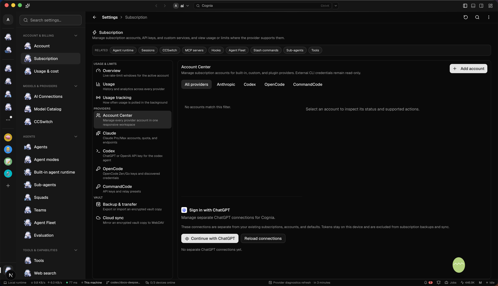

# SIWC desktop acceptance follow-up — 2026-10-18

Status: the real-shell empty state and native profile boundary were verified.
Checks independent of a stable window are complete. Interactive connected-state
acceptance remains pending: other sessions repeatedly restarted the shared Tauri
instance, and the maintainer asked to prioritize independent checks without
stopping those sessions.

## Real Tauri evidence

- Platform: macOS / Apple Silicon, native `main` window, authenticated
  `agent-debug` bridge with helper API 3. This was the actual WKWebView, not a
  browser-only or jsdom result.
- Opened `/settings?section=subscription&subTab=accounts`. Account Center rendered
  the independent SIWC card, isolation text, enabled “Continue with ChatGPT” and
  “Reload connections” controls, and the empty-state message.
- `siwc_list_connections` for the already-unlocked local profile returned `[]`.
  No authorization, registration or model request was needed to render the card.
- Both images loaded successfully with nonzero natural widths:
  `/icons/lobe/codex-color.svg` and `/icons/lobe/openai.svg`. The native screenshot
  was inspected visually.
- Seven real IPC calls with a nonexistent profile were rejected with
  `the requested account is not the unlocked account`: list, begin login, poll,
  refresh, sign-out, delete and model discovery. In particular, the rejected begin
  call did not open a browser or reach OAuth.

The single-instance app prevented an independent test process. Existing shared
processes were not stopped. Debug endpoint discovery was pinned privately while
probing; that temporary credential copy and the in-memory interception state were
removed afterward. No synthetic registration or configuration was persisted in
the user's app.

## Reproduced and repaired configuration race

Two concurrent `configureSiwcChatConnection` calls could both pass the existing
provider check before either queued settings write completed. Each generated a
different random provider ID, so the serialized settings queue correctly saved
two entries for one profile/registration/model selection.

The regression failed with two distinct IDs before the fix. Configuration now
derives a stable SHA-256 ID from the JSON tuple of local profile, registration and
model, reusing the existing Web Crypto helper and serialized settings upsert.
The account/database authority is checked again after the asynchronous digest.
No new lock, authorization migration or default selection was introduced.
Previously configured entries are retained by the existing selection check.

Tests prove concurrent requests converge, different profiles/registrations/models
stay distinct, overlapping settings writes leave one entry, defaults remain
unchanged, and captured database ownership is preserved without Host mirroring.

## Independent validation

| Check                                                        | Result                                                                                                                 |
| ------------------------------------------------------------ | ---------------------------------------------------------------------------------------------------------------------- |
| Final UI/transport/configuration/routing/settings/hash group | 10 Jest suites, 357 passed, 0 failed                                                                                   |
| Native SIWC core                                             | 39 passed, 0 failed; includes real child-process OS locking, concurrent refresh, stale mutation and cancellation cases |
| Native desktop Host                                          | 6 passed, 0 failed; account unlock generations, capability checks and protected app-server RPC                         |
| Companion API generation                                     | 932 remote commands / 113 classified routes, check passed                                                              |
| Agent capability generation and audit                        | Both passed                                                                                                            |
| Scoped ESLint / Prettier / whitespace                        | Passed                                                                                                                 |

The native runs reused already-built test binaries; this follow-up changed no Rust
source. No coverage, real OAuth, real token refresh, provider inference or paid
request was performed. This follow-up did not invoke a subscription/authorization
mutation or change the selected account, provider or model. Concurrent sessions'
unrelated edits and process ownership were preserved.

## Pending interactive acceptance

After the independent checks, a synthetic flow was attempted without restarting
the app. Its first semantic interaction returned `webview_eval_timeout`; no
connected-flow assertions were counted as passes. The fixture interceptor and
configuration-action replacements were restored. A read-only cleanup check
confirmed zero synthetic rows and no remaining interceptor. The saved fixture
harness requires a document-local marker so a renderer restart cannot redirect a
test action to a real login control.

These need one stable native window and were not promoted from unit-test evidence
to real-shell acceptance:

1. Synthetic connected/identity-only/signed-out rows and explicit model selection.
2. Synthetic delayed begin/poll, double-click, cancellation and navigation cleanup.
3. In-memory capture of chat/app-server configuration actions, proving no default
   switch or child spawn occurs.
4. Synthetic sign-out/revocation disclosure and removal confirmation.
5. An adjacent settings surface and a scoped console/network/native-log comparison.

Real ChatGPT authorization and inference remain outside the authorized test scope.
The earlier workspace-wide typecheck limitations and upstream refresh-timing
acceptance boundary are recorded in the
[implementation report](./siwc-implementation-2026-10-18.md); they are not claimed
as passing gates here.
