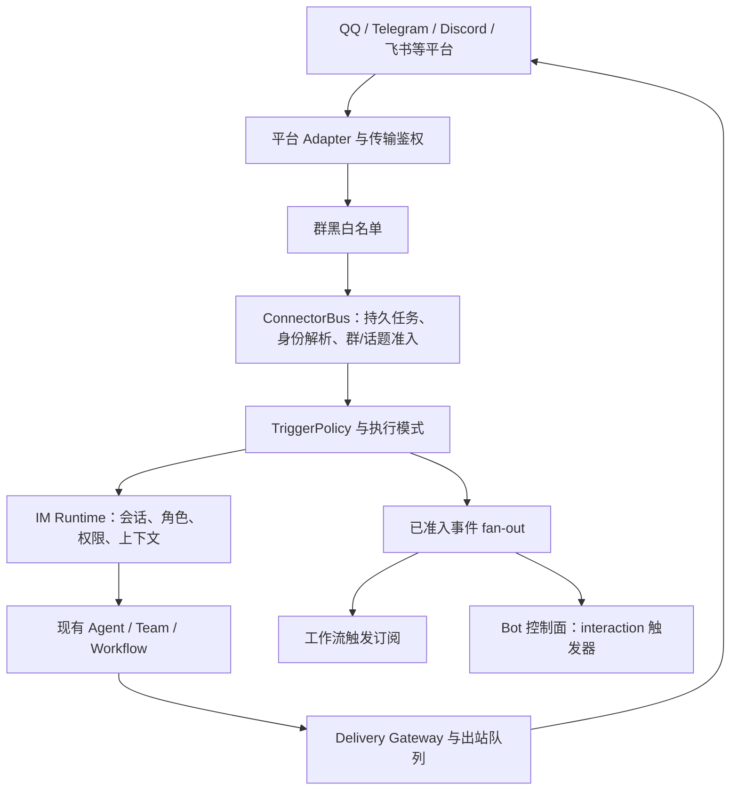

# Cognia 作为普通群聊 Bot 的可行性研究

研究日期：2026-10-20（Asia/Shanghai）  
结论性质：当前工作区源码审计、上游一手资料核对、聚焦单元测试；未连接真实群聊、未部署、未修改业务代码。

## 1. 结论

**可行，且已有大部分消息处理基础设施。适合沿用 IM Connectors，补齐普通群聊 Bot 的配置和权限边界，不需要重建一个 AstrBot 式消息引擎。**

需要区分三种目标：

| 目标                                                   | 当前判断                     | 成立条件                                                                       |
| ------------------------------------------------------ | ---------------------------- | ------------------------------------------------------------------------------ |
| 自己维护的少量测试群，@ 后问答、角色聊天               | 具备试点基础                 | 配置平台凭据与模型，使用专用账号/宿主，完成真实群验收                          |
| 群成员无需注册 Cognia 即可使用，支持群上下文和少量工具 | 有条件可行，需要产品化补齐   | 明确群准入、公共身份、记忆范围、命令管理和工具上限；飞书需特别处理身份绑定语义 |
| 对标 AstrBot 的多平台群 Bot 产品和插件生态             | 工程上可演进，尚不能宣称等价 | 还涉及会话隔离选项、平台新能力、群运营插件、安装体验、持续运行与容量验证       |

这里的“普通群聊 Bot”按以下需求理解：加入指定群；群成员可 @、引用回复或按规则触发；保留多轮上下文和发言者；可选图片/文件/语音；管理员控制模型、角色和工具；无需每个成员先拥有 Cognia 账号。最后一项在不同平台上的当前行为不一致。

本报告独立成文，因为既有 connector 审计主要按平台/传输排查，本次问题跨越 IM、`/bots`、个人记忆、权限与 AstrBot 产品比较，不适合直接覆盖原有审计的证据时间与范围。

## 2. 应该复用哪条路径

当前有两个不同的 Bot 概念：

1. **IM Connectors**：平台适配器接收消息，规范化后经过准入和策略，驱动单 Agent、Team 或 Workflow，最后回复原平台。这就是普通群聊 Bot 的主路径。
2. **`lib/bot/` 和 `/bots`**：将触发器与现有执行器绑定的自动化控制面。`connector.inbound` 是其事件来源之一，它是已准入消息的额外消费者，不是第四种 IM 会话执行目标。

实际调用关系：



证据：

- [`adapter-registry.ts`](../../lib/connectors/adapter-registry.ts)：`buildAdapterFromRow` 注册 11 个内置平台种类，并支持插件贡献的 Adapter。注册存在不代表每个平台的群能力都已实测。
- [`bus.ts`](../../lib/connectors/bus.ts)：`runInboundPipeline`、`enqueueRouteHandlerTurn`、`dispatchBotFanOut`。
- [`runtime.ts`](../../lib/connectors/runtime.ts)：`installRuntime` 调用既有执行路径并生成回复。
- [`connector-inbound.ts`](../../lib/bot/sources/connector-inbound.ts)：明确保持 `ImTargetKind = direct | team | workflow`，将 Bot 作为 fan-out consumer。
- [ADR 0174](../content/docs/zh/adr/0174-the-bot-control-plane.md)：Bot 是绑定，不是新引擎。

**设计含义**：基础群聊天使用 Connector 自身的自动回复即可。只有定时摘要、事件通知、专项处理等额外自动化才接 `/bots`。直接在已有自动回复上再叠一个会发言的 interaction Bot，需要明确回复归属，否则可能产生两路答复；本次没有制造该场景进行实测。

## 3. 当前已有哪些群聊能力

| 能力                        | 源码证据                                                                                                                               | 可用边界                                                                                         |
| --------------------------- | -------------------------------------------------------------------------------------------------------------------------------------- | ------------------------------------------------------------------------------------------------ |
| 私聊和群内 @、引用 Bot 回复 | [`policy.ts`](../../types/connectors/policy.ts)、[`conversation-admission.ts`](../../lib/connectors/conversation-admission.ts)         | 默认策略含 private/self-mention/reply-to-bot；必须同时通过准入和 trigger                         |
| 关键词、正则、命令前缀触发  | [`policy-eval.ts`](../../lib/connectors/policy-eval.ts)                                                                                | 只增加关键词规则不会穿透前置 mention 准入；应同步配置 admission                                  |
| 群共享多轮会话              | [`session-bindings.ts`](../../lib/connectors/session-bindings.ts)、[`event.ts`](../../types/connectors/event.ts)                       | 按 platform、adapter、chat、可选 thread 标识会话；群成员通常共享上下文                           |
| 发言者区分                  | [`runtime.ts`](../../lib/connectors/runtime.ts)：`groupSpeakerHeader`、`inboundEventToSendContent`                                     | 给模型加入经过脱敏的 speaker 信息；不是成员权限隔离                                              |
| 引用消息与短期群上下文      | 同上：`withConversationContext`、`recentGroupContextBlock`                                                                             | 当前尾部最多 8 条、24 小时、单条 200 字符、正文总预算 2,000 字符；仅从已进入会话消息表的记录构建 |
| 会话切换与新建              | [`commands/dispatch.ts`](../../lib/connectors/commands/dispatch.ts)、[`session-bindings.ts`](../../lib/connectors/session-bindings.ts) | 支持 `/new`、`/sessions`、`/switch` 等控制路径，写命令有独立权限门                               |
| 同群排序、跨群并行          | [`bus.ts`](../../lib/connectors/bus.ts)                                                                                                | 每个 conversation FIFO；不会让一个等待审批的群阻塞所有群；未做容量压测                           |
| 限流、防互相触发            | [`policy.ts`](../../types/connectors/policy.ts)、[`sibling-bots.ts`](../../lib/connectors/sibling-bots.ts)                             | 群默认每用户 5/分钟、每频道 20/分钟、回复后冷却 3 秒；同伴 Bot 默认 ignore                       |
| 图片、文件、语音等          | [`runtime.ts`](../../lib/connectors/runtime.ts)、各 Adapter 的 `capability.ts`                                                         | 平台收发、附件下载、OCR/转写、模型读取是不同能力；不代表任意媒体都能直接送给模型                 |
| 投递、重试、恢复            | [`bus.ts`](../../lib/connectors/bus.ts)、[`outbound-runner.ts`](../../lib/connectors/outbound-runner.ts)                               | IM 模型回合副作用不明确时保留 `recovery_required`，不能等同于自动恢复恰好一次执行                |

特别注意两处容易误配的关系：

- **接收 ≠ 触发 ≠ 自动发送**。平台把消息推过来之后，仍有身份、群准入、trigger、autonomy/engagement 和出站门控。`always` admission 不等于每条消息都匹配 trigger；`auto` 模式也不等于平台会提供所有群消息。
- **审计留存 ≠ 模型群上下文**。未 @ 消息如果在 admission 被标成 `history_only`，不会自动变成 `StoredMessage`。普通群想实现“大家先讨论，@ Bot 时它理解前文”，需要明确允许群消息入库但不逐条触发模型。现有 `store-only` 与 context builder 可复用；默认 mention_each 配置不能被描述成完整旁听能力。

## 4. 阻碍“普通群成员直接使用”的主要差距

### 4.1 飞书默认属于受控身份模式

[`feature-flags.ts`](../../lib/connectors/feature-flags.ts) 默认开启 `larkPrincipalRegistry`。[`principal/resolve.ts`](../../lib/connectors/principal/resolve.ts) 要求 `tenantKey + appId + openId` 对应到当前 runtime account；未绑定、被禁用、跨账号会返回不同拒绝结果。`bus.ts` 在群准入、命令、Agent 和 Bot fan-out 之前执行该检查。

[`principal/unbound.ts`](../../lib/connectors/principal/unbound.ts) 对未绑定发送者创建 bind request，并给出限频绑定提示；因此不能将当前飞书入口直接理解成“任意群成员 @ 就可聊天”。其他平台在这个解析器里返回 `legacy`，但仍受各自 transport、群名单、trigger 和命令权限约束。

现有 per-adapter `settings.larkPrincipalRegistry=false` 可改变这条解析路径；环境变量优先级高于 adapter 设置。**关闭它是回到 legacy 行为，不是已经具备一个受约束的公共群 Bot 身份模型。** 它不适合作为在个人工作宿主上直接开放所有能力的完整方案。

建议补一个显式用途配置（名称仅为建议，未实现）：

- 私人助手：保留 owner/principal 强绑定，允许经授权的个人资料和工具。
- 群聊助手：以“专用运营账号拥有 Bot、允许列表中的群成员使用”为准入语义；发言者仅是平台身份，不获得 owner 权限。

不要将新成员默认绑定为 owner，也不要通过新增平行 Agent runtime 解决身份问题。

### 4.2 会话隔离与记忆授权要分别解决

群共享会话本身符合群聊天用途，但源码中没有看到一套通用的“群共享 / 群内每成员独立”会话策略开关。若需要后者，应在现有绑定解析中增加会话范围，保留真实 delivery target；不能直接把收件群地址替换成用户 ID。

更关键的是长期记忆：

- `runtime.ts:resolveInboundSendOptions` 会为 IM 构造 twin 和 memory recall 依赖。
- [`build-options.ts`](../../lib/claude/build-options.ts) 的长期记忆段遵循 session 和角色的 memory policy，并传递 character/project/agent reader；它不是无范围读取。
- 但 [`agent-policy.ts`](../../lib/memory/agent-policy.ts) 的缺省 readable scopes 包含 `global`。群 ChatSession 隔离本身不会把 owner 的 global memory 自动变成群可见资料。
- [`memory/control-plane/policy.ts`](../../packages/memory/src/control-plane/policy.ts) 中外部上下文主要影响学习许可，不能视为统一禁止 recall。

**判断是“存在被配置带入群回复的路径”，不是“已经证明发生过泄露”。** PII 脱敏也不等同于对私人资料的访问授权。

试点优先使用独立运营账号/数据目录与专用角色，禁用该角色的个人 memory recall/create/update/forget/autoLearn，不绑定个人 Twin。后续只开放群专属知识与明确允许共享的 workspace 数据，并补跨群、跨私聊记忆验收。

### 4.3 工具边界已有基础，需要一份群 Bot 默认配置

[`im-permission-ceiling.ts`](../../lib/connectors/im-permission-ceiling.ts) 为直接、Team、Workflow 路径建立共享 ceiling；[`permission-resolve.ts`](../../lib/connectors/permission-resolve.ts) 已有 built-in skill ceiling 和 host capability ceiling。

现有默认不是毫无限制：Computer Use、goal driving、schedule tools 等有明确开启条件，写操作 HITL 默认开启。但不能因此推断所有 shell、文件、MCP、插件工具均已自动按“公共群访客”收紧。

建议群 profile 默认只提供聊天和明确授权的只读知识检索；通过现有 `allowedTools`/`disallowedTools`、MCP 范围和 sandbox policy 收窄执行。群管理写命令改为显式管理员 allowlist：`commands/dispatch.ts:isCommandAllowed` 缺省 `private-only`，意味着允许私聊执行一般写命令；如果 Bot 对外开放私聊，也需要单独配置。调度写入已有更严格的 allowlist 门。

### 4.4 普通群的呈现应简化

OneBot 无原生消息编辑和交互按钮，`ONEBOT_A2UI_CAPABILITY` 会将交互内容降级成可读文本。普通群聊天应以最终文本、必要引用和图片为主，进度卡、执行细节、欢迎消息、审批等按平台和用途选择。

本次测试还发现一个 Feishu mixed card/A2UI 用例失败，详见验证记录；不能将所有平台的卡片体验判断为已通过。

## 5. 平台选择

| 路径                 | 对普通群 Bot 的适配判断                                   | 当前需要注意的事实                                                                                                                            |
| -------------------- | --------------------------------------------------------- | --------------------------------------------------------------------------------------------------------------------------------------------- |
| QQ + OneBot / NapCat | 与 AstrBot 常见个人 QQ 群接法接近，适合已有测试账号的试点 | Cognia 已有 v11/v12 parser、正向/反向 WS、媒体与引用；还需要外部 QQ 客户端和协议实现，不是直接填写一个 Cognia Bot token 就能登录 QQ           |
| QQ 官方 Bot          | 已有群 @ 接入基础；最新官方路径需要更新审计               | Cognia parser 只识别四种现有事件，未识别 `GROUP_MESSAGE_CREATE`，且将支持事件视为已指向 Bot；不能将上游新增全量群聊能力算作本项目已支持       |
| Telegram             | 适合验证通用群聊天流程                                    | longpoll/webhook 已实现；Privacy Mode 决定收到什么，后台开关不会让默认隐私模式自动提供所有群消息                                              |
| Discord              | 适合服务器/频道 Bot                                       | Gateway 和 thread 路径已实现；普通频道内容依赖 `MESSAGE_CONTENT` privileged intent 的配置及适用审批；@ 等有官方例外                           |
| 飞书 / Lark          | 适合团队群助手；公共群用途要先明确身份模型                | 应用 Bot 事件接入与单向自定义 webhook Bot 不同；默认 principal gate、新成员绑定、所有群消息权限及实际投递探测均需处理                         |
| 个人微信 / 公众号    | 当前不应宣称支持普通微信群 Bot                            | 本项目 iLink parser 将消息归为 `private`、以 from_user_id 构建会话；微信公众号不是微信群通道。企业微信 Adapter 也不能等同于任意个人微信群支持 |

官方资料核对：

- [NapCat 网络配置](https://doc.napneko.icu/config/basic) 明确区分 WS server/client、消息数组格式、上报自身消息、token 和重连；与 Cognia OneBot 两种 WS 路径吻合。
- [Telegram Privacy Mode](https://core.telegram.org/bots/features#privacy-mode) 说明默认只收相关命令/回复等，管理员 Bot 或关闭隐私模式的 Bot 可获得更广消息；修改隐私设置后的重新加入要求以该官方指南为准。
- [Discord Message Content Intent](https://docs.discord.com/developers/events/gateway#message-content-intent) 说明内容字段权限和 DM/@ 等例外。
- [飞书接收消息事件](https://open.feishu.cn/document/uAjLw4CM/ukTMukTMukTM/reference/im-v1/message/events/receive) 页面正文在本次抓取中为空；其[官方站点同文档](https://open.larkenterprise.com/document/uAjLw4CM/ukTMukTMukTM/reference/im-v1/message/events/receive) 可检索到全量群消息与 @ 消息的不同权限说明。实际租户授予和投递状态仍需在线验证。
- QQ 新路径的官方和 AstrBot 证据、固定源码版本，见[独立 AstrBot 参照笔记](./2026-10-20-astrbot-group-chat-reference.md)。[腾讯公开事件文档](https://bot.q.qq.com/wiki/develop/api-v2/dev-prepare/interface-framework/event-emit.html)目前同时描述 Webhook 与 WebSocket，群事件表仍列 `GROUP_AT_MESSAGE_CREATE`；AstrBot 文档与源码则额外描述/实现全量群消息路径。应分别记录这两层证据，不能把后者推断为所有账号普遍可用。本项目“WebSocket 已废弃”的源码注释也不宜作为当前平台事实。

## 6. 与 AstrBot 的差异与接入选择

AstrBot 的 Platform/Event/MessageChain、会话标识和流水线，与 Cognia Adapter/NormalizedInboundEvent/MessageSegment/ConnectorBus 有相似职责。Cognia 已有 Agent、Team、Workflow、投递治理和持久执行，不需要为了普通群聊天引入第二套模型和消息循环。

一个具体差异是 AstrBot 内置 `GroupChatContext` 会按 UMO 缓存非命令群消息，并在被触发的请求中注入前文；自发接话有独立开关、白名单与概率。[固定源码](https://github.com/AstrBotDevs/AstrBot/blob/f2404c191716a64daaa422be7f3c567cace50d39/astrbot/builtin_stars/astrbot/group_chat_context.py#L44-L198)支持这一点。Cognia 已有短期群上下文拼装，但前提是消息进入会话表，因此最值得补齐的是“听见但不回答”的配置闭环，而不是把 `always` 等同于全群每条 AI 回复。

对照源码和官方文档，值得借鉴的主要是：

1. 以群 Bot 为中心的创建与配置体验，一次明确平台、模型、人格、触发、插件和上下文。
2. 清晰的群共享/成员独立语义，以及“只响应被呼叫”与“收集前文”的分离。
3. 按会话配置模型、角色、可用工具/插件、知识范围和管理命令。
4. 普通群使用者无需理解宿主、Agent 执行器和运行控制面就能完成对话。

也不能把 AstrBot 当作所有能力的正确性保证：其会话隔离覆盖受 Adapter 实现影响，插件代码与 Agent sandbox 的隔离边界不同；具体证据见参照笔记。

| 方案                                       | 收益                                    | 代价与判断                                                                                                                              |
| ------------------------------------------ | --------------------------------------- | --------------------------------------------------------------------------------------------------------------------------------------- |
| A. Cognia 原生 Connector + 群 Bot 配置     | 保留现有执行、治理、会话、投递链路      | 推荐作为产品路线；重点补用途 profile，而非新引擎                                                                                        |
| B. AstrBot 做前门，Cognia 提供有限任务能力 | 可利用已验证的 AstrBot 群插件和运营体验 | 适合已有 AstrBot 的用户；需明确会话映射、身份、超时/取消、幂等、输出归属与审批；本次未实现桥接，也未验证某个现成 API 能无损承载这些语义 |
| C. 移植 AstrBot runtime / 直接加载其插件   | 看似可复用生态                          | 不建议作为首选；Python 插件 API 与 Cognia plugin SDK 不兼容，双会话、双模型路由与权限边界维护成本高，许可条件需单独评估                 |

## 7. 最小落地范围与验收

以下是建议范围，不是已实施的变更或工期承诺：

### 阶段一：受控真实群试点

- 一个专用账号/宿主、一个模型、一位不使用个人 Twin/记忆的角色。
- 一个平台、一个允许群，先做 @ 与引用回复；群管理命令仅管理员可执行。
- 只读或关闭工具，关闭不必要的执行进度与群广播。
- 保持主回复由 IM Runtime 负责，避免同一消息叠加另一个自动回复 Bot。

验收：两位真人交替发言，@、引用和多轮上下文正确；未触发不调用模型；重复入站不重复答复；两个群/私聊不串会话；非管理员不能改配置；个人记忆和其他 workspace 的资料不能进入回复；断线重连后无重复输出。

### 阶段二：补成普通群 Bot 产品

- 增加用途 profile，并统一带入身份、记忆、工具、命令和呈现策略。
- 飞书提供受约束的群成员准入，保留现有私人助手安全语义。
- 显式控制“收前文但不逐条回答”；需要时增加 per-member session policy。
- QQ 官方 Adapter 重新对齐新事件、鉴权与群主授权能力。
- 将跨群知识权限和同群消息上下文分别建模并验收。

### 阶段三：持续运行与运营能力

源码已有 headless brain：[`connector-runtime.ts`](../../lib/headless/runtimes/connector-runtime.ts) 注册 `connector-runtime`，与桌面共用 `installConnectorRuntime`；[`runtimes/index.ts`](../../lib/headless/runtimes/index.ts) 实际导入它和 Bot runner；[`docker-compose.yml`](../../deploy/compose/docker-compose.yml) 提供 `cognia-server` 的 server profile、数据卷与重启策略。因此不必让群 Bot 依赖用户持续打开浏览器页面。

这只证明部署路径存在，不能替代本次未执行的部署验收。静态 Next.js 导出页面自身不是持续在线的 Bot 服务；手机或普通浏览器应控制宿主。还需验证实际凭据、出站网络、OneBot 网络地址、持久化、重启、健康探测、队列积压与模型费用。固定“可支持多少群/并发”的数字在没有压测前不应给出。

## 8. 本次验证与限制

源码基线记录：开始审计时 HEAD 为 `94a4db67efaeb0848dbf83b152ee70902a6eb247`，工作区存在大量并发未提交修改。报告描述的是读取时工作区，不是该 commit 单独的发布能力。CodeGraph 未初始化，使用 `rg` 与直接源码读取完成导航；没有自动建索引。

运行：

```sh
pnpm test --runInBand --runTestsByPath \
  lib/connectors/conversation-admission.test.ts \
  lib/connectors/policy-eval.test.ts \
  lib/connectors/bus.runtime.test.ts \
  lib/connectors/runtime.test.ts \
  lib/connectors/session-bindings.test.ts \
  lib/connectors/principal/resolve.test.ts \
  lib/connectors/feature-flags.test.ts \
  lib/connectors/im-permission-ceiling.test.ts \
  lib/connectors/bus.bot-fanout.test.ts \
  lib/connectors/adapters/onebot/contract.test.ts \
  lib/connectors/adapters/qq-official/parse.test.ts \
  lib/headless/runtimes/connector-runtime.test.ts
```

实际结果：`11 passed, 1 failed, 12 total` suites；`372 passed, 1 failed, 373 total` tests；20.68 秒。

失败用例：`installRuntime — ai-run Lark result card › enqueues each card as its own request when other segments surround it`，`runtime.test.ts:3313`：

```text
Expected: "card"
Received: "a2ui"
```

这是当前检出的断言失败；本次没有改变相关业务代码，也没有确认其根因是输出顺序、测试排序假设还是并发改动，因此不扩大为所有飞书回复均失败的结论，也不将测试套件描述为全绿。

未执行：真实 QQ/飞书/Telegram/Discord 收发、真实模型推理、部署、重启恢复、UI 验收、负载/费用测试、全量 lint/typecheck/build、coverage。研究只新增 Markdown，无业务实现；这些未执行项目不应被解读成已经通过。

## Sources

内部直接证据位于各节相邻的仓库链接。外部一手资料核对日期均为 2026-10-20：

- [AstrBot 官方仓库](https://github.com/AstrBotDevs/AstrBot) 与[详细参照笔记](./2026-10-20-astrbot-group-chat-reference.md)。
- [NapCat 官方配置文档](https://doc.napneko.icu/config/basic)。
- [Telegram Bot Features — Privacy Mode](https://core.telegram.org/bots/features#privacy-mode)。
- [Discord Gateway — Message Content Intent](https://docs.discord.com/developers/events/gateway#message-content-intent)。
- [飞书接收消息事件](https://open.feishu.cn/document/uAjLw4CM/ukTMukTMukTM/reference/im-v1/message/events/receive)及[同平台官方文档域名](https://open.larkenterprise.com/document/uAjLw4CM/ukTMukTMukTM/reference/im-v1/message/events/receive)。
