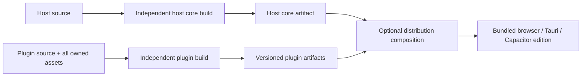

# 第一方插件独立仓库可行性复核

- 日期：2026-10-25，Asia/Shanghai。
- 目标：独立维护、发布第一方插件；不是扩大第三方生态，也不预设 SDK 必须一起迁出。
- 证据范围：当前共享工作区，HEAD `313d484c59da3426f843cd747087a9d9d2e05aa7`，包含其他会话未提交的 plugin-contract、sandboxed-tools 等改动。结论不等于远程 `dev` 的验收结果。
- 本轮只做研究、检查和隔离实验，没有迁移产品代码、创建远程仓库、提交或发布。
- 延续的证据账本：[plugin repo split feasibility](../evidence/2026-10-21-plugin-repo-split-feasibility.md)。

## 结论与选择

**技术上可行，建议采用“第一方插件及其全部资源拆仓，SDK、contract、runtime 暂留宿主”的边界。主体构建不能再调用插件 producer；预装插件由独立发行组装步骤接入。当前只有显式外部产物消费路径可用，默认构建尚未解耦。**

相比 2026-10-21 初次评估，宿主对插件源码的编译依赖和 SDK 对宿主的直接依赖已明显减少。现在的主要工作在于补全生产端输入、依赖产物、发布与获取流程、测试边界和兼容性验收。

| 路线                                                              | 对当前目标的作用                       | 当前判断                                                            |
| ----------------------------------------------------------------- | -------------------------------------- | ------------------------------------------------------------------- |
| 插件保留主仓，只分别打版本和 ZIP                                  | 可以先验证独立版本、发布规范           | 最小改动，但没有实现仓库维护权分离                                  |
| 第一方插件及作者侧工具迁入一个集合仓；SDK/contract/runtime 留主仓 | 满足独立维护与发布；宿主按固定版本接入 | **推荐；补齐下述前置项后迁移**                                      |
| plugins + SDK/UI 一起迁仓；contract/runtime 留主仓                | 增加 SDK 团队及版本管理边界            | 暂无当前目标上的必要收益；仍有源码引用、构建脚本和依赖闭包问题      |
| 每个插件单独一个仓库                                              | 最大化每个插件的自治                   | 当前 74 个插件会带来大量 CI、依赖升级和联合验证开销，缺少必要性证据 |

这里建议的是一个第一方插件集合仓；各插件保留自己的 `plugin.json` 版本，可分别发布安装包，另有一个供宿主固定引用的完整 artifact set。

## 用户追问后的边界修正：public 所有权与主体构建

用户明确指出：“public 如果不拆出去……还是要互相依赖……主体应该是不依赖于插件构建的”。这一约束成立。前一版评估证明了“显式提供外部 set 时可以不读源码”，没有证明默认构建已经独立；两者不能混用。

### 当前确实存在的双向构建依赖

```text
宿主 pnpm build / dev
  -> prebuild / predev
  -> stage-plugin-artifacts
  -> 默认发现 plugins/，调用 producePluginArtifacts
  -> 编译插件

插件 producer
  -> host packages/plugin-contract/contract/catalog.json
  -> host lib/plugin/distribution/*.json
  -> host public/plugins/<id> 里的原始主题/图标资源
```

`scripts/build/stage-plugin-artifacts.mjs:56–65` 没有把“消费产物”和“生产插件”彻底拆开。2026-10-25 的隔离 resolver 实验得到：

| 输入                                         | 当前默认选择                                              |
| -------------------------------------------- | --------------------------------------------------------- |
| 存在 `plugins/`，也存在缓存目录              | 仍调用 producer，调用次数 1；增量命中与否由 producer 处理 |
| 仅有缓存目录，未设置外部产物参数             | 报 `No plugin artifact set`；不会自动把缓存视作固定输入   |
| 没有源码，显式设置 `COGNIA_PLUGIN_ARTIFACTS` | 选择 external，不调用 producer                            |

这个实验用注入的 producer 记录调用，没有编译插件，也没有消费伪造的缓存 manifest。它验证入口分支选择；先前完整 set 的字节和 staging 验证仍由独立的 consumer 实验提供。

CLI 也有独立入口：`scripts/build/lib/stage-builtin-plugin-assets.mjs:48` 在 bundle 阶段可能隐式调用 stage，再进入 producer。只改 Next 的两个 hooks 还不够；需要覆盖 CLI 与 mobile 的实际入口。

### public 应按资源所有权拆分

| 内容                                                            | 源码所有者                              | 宿主允许保留什么                         |
| --------------------------------------------------------------- | --------------------------------------- | ---------------------------------------- |
| `public/plugins/<id>` 中的插件原始壁纸、SVG、图标等             | 插件仓，归入对应插件的 `assets/` 等目录 | 正式发行中的产物副本；插件构建不能回读它 |
| `public/_cognia/builtin-plugins`、`public/_cognia/plugin-icons` | 插件发布流水线生成                      | 发行组装时复制的输出；当前已 gitignored  |
| `src-tauri/resources/plugins`                                   | 插件发布流水线生成                      | Tauri 安装包组装输出；当前已 gitignored  |
| 宿主自身的 logo、favicon、静态页面等                            | 宿主仓                                  | 继续由宿主维护                           |

关键是插件资产只保留一个可编辑来源。把插件资源源码继续留在主仓、让新插件仓反向读取，会保留用户指出的耦合；本报告不建议这种路线。

### 不调用插件编译器，还不等于主体构建完全独立

当前宿主静态 import 三份每次插件发行都会改变的 JSON：

- `lib/plugin/core/browser-builtin-registry.ts:7` → builtin asset index。
- `lib/plugin/core/builtin-preboot-manifests.ts:2` → preboot tables / character packs。
- `lib/plugin/distribution/seed-bundled-plugins.ts:40` 和 `manager.ts:11` → desktop seed catalog。

所以，把 producer 从 prebuild 删除、改成先下载产物再编译 Next，只实现了“不现场编译插件”，主体编译仍吃插件发行元数据。若希望主体产物本身也不依赖插件产物，需要进一步把这些 JSON 改为运行时读取的通用 package descriptor，并从宿主源码输入中移出。

建议采用更严格的构建目标：**core edition 在没有任何插件源码、资源和产物时可以构建、启动；bundled edition 在发行组装阶段加入固定预构建插件。** “不调用插件构建”是用户明确的约束；“core 的编译连插件产物都不需要”是本次推荐进一步收紧的设计，不是当前已实现的事实。



这不能只靠最后复制文件：PWA 的 precache 当前在 `next.config.ts` 的 Next/Serwist 构建流程生成，CLI 和 native 包也有各自的资源归档步骤；发行组装必须维护这些离线和安装契约。Capacitor 还需保持 `mobile/scripts/restore-web-plugin-assets.mjs` 的资源恢复约定，以及 descriptor 资源基址与现有 `/plugins/<id>/...` 路径的兼容。

图中的 host core artifact 也不能直接等同于今天已经编译、签名的 Tauri 成品。`src-tauri/build.rs` 和运行时 context 参与静态资源嵌入，安装器另打包 resources。沿用当前嵌入模式时，composition 必须在最终 native embedding / packaging / signing 之前完成；若要求同一个已编译宿主二进制直接组合不同插件集合，还必须实现独立资源目录的受控寻址与校验。主体代码编译与插件编译独立，不代表现有平台打包流程已经支持事后任意拼装。

数据库启动需要在 opening / schema 恢复时获得已安装插件的描述，并继续保留 persisted plugin schema，即使某个插件当前未装载；bundled 模式还必须在首次角色 seed 前加载元数据，避免异步到达后错过首次 seed。声明为 bundled 的发行版缺少必需产物应明确失败，不能静默当作空插件版。core-only 与 bundled 必须通过显式 edition 声明区分，不能用 descriptor 缺失推断。

本轮仍只研究和修订边界，没有直接删除 build hooks 或移动资源；那会在新目录读取、catalog 和发行组装尚未实现时破坏现有功能。

## 当前已经成立的边界

| 证据                                           | 2026-10-25 结果                                                                                       | 能证明什么                                                                              |
| ---------------------------------------------- | ----------------------------------------------------------------------------------------------------- | --------------------------------------------------------------------------------------- |
| 插件清单                                       | 74 个 `plugin.json`；host browser curation 列表 58 项                                                 | 当前迁移对象规模；并非每个插件都应该在每个 shell 激活                                   |
| `node scripts/plugin/check-author-imports.mjs` | 74 个插件通过                                                                                         | 生产源码遵守 public SDK 边界；第一方 bundled-kit 和带 pragma 的宿主集成测试仍有明确例外 |
| 宿主生产源码扫描                               | 在 app/lib/components/hooks/stores/types/cli/sidecar 中，未发现 `@/plugins/` 引用                     | 旧的直接编译引用已消除；不代表脚本、测试或磁盘扫描不存在源码依赖                        |
| artifact pipeline 测试                         | Node v26.12.1，40/40 通过                                                                             | producer/consumer、hash、路径约束、mirror、web-only 和损坏产物拒绝的现有逻辑            |
| 外部 set 隔离实验                              | 完整 staging：1,697 文件、39,742,460 bytes；web-only：1,648 文件、37,284,935 bytes；全部 SHA-256 匹配 | 两个原本为空的宿主目录可以消费已有产物；fs tripwire 检测到的 `plugins/` 访问为 0        |
| `node scripts/plugin/check-sdk-standalone.mjs` | 通过基线，仍有 5 处 host reference                                                                    | 已接近源码边界目标，但这个 gate 的“通过”并不表示零依赖或可独立发布                      |

消费实验读取的是本机 `.cache/plugin-artifacts`，其 manifest 修改时间为 `2026-10-25T03:18:46.100Z`。它验证既有 set 的 staging 和字节完整性，没有重新生产全部插件，也没有验证其与全部未提交源码逐字一致。

核心实现：

- `scripts/build/stage-plugin-artifacts.mjs:46`：显式 `--from` / `COGNIA_PLUGIN_ARTIFACTS` 优先，只有本地源码路径才延迟导入 producer。
- `scripts/build/plugin-artifact-format.mjs:42`：分别分发 browser chunks、icons、desktop plugins、builtin index、preboot snapshot、desktop catalog。
- `lib/plugin/core/loader.ts:322`：builtin 从 hash 固定的 chunk URL 加载。
- `lib/plugin/core/shared-modules.ts:86`：SDK subpath 由宿主提供实例；不能为了拆仓把 React 或含 registry 的 SDK 模块打成每个插件各自一份。

## 必须补齐的前置项

### 1. 插件输入不止 `plugins/`

当前 `public/plugins/` 有 1,334 个 Git 跟踪文件，约 11.82 MiB；其中 1,333 个在同名插件源码路径下不存在。它们主要属于七个主题/图标插件，不能全部当作可丢弃的构建输出。

实际实验以 `cognia-arknights-theme` 隔离资源读取：

```text
without host public mirror:
Missing plugin resource cognia-arknights-theme/assets/lemuen-rain-transit.webp

with current host mirror:
buildFrontendPlugin succeeds, 19 packaged files, wallpaper included
```

实验使用真实 `buildFrontendPlugin` 和 esbuild，注入该插件的 JSON manifest，以便只检验资源收集，未执行 metadata 模块发现，也未写出发布包。Builder 在 `scripts/plugin/build-frontend-plugins.mjs:267` 和 `:309` 明确回读 host public mirror。

**迁移时应先让插件源码目录拥有完整资源，再由 artifact set 生成宿主副本。** 不应让新插件仓通过读取旧主仓的 `public/` 来完成正式构建。Git 跟踪的 `plugins/` 本身约 15.09 MiB、1,321 个文件；本机目录更大的占用包含未跟踪环境和缓存，不能用于宣称拆仓可减少同等大小的源码仓库。

### 2. SDK 留主仓，也必须交付可安装的作者依赖

`packages/plugin-sdk/package.json:357` 声明六个 `workspace:*` 依赖。当前公开 npm registry 对 SDK、UI、contract、provider-core、provider-types、provider-routing、github-bot-kit 的查询均返回 404；这不说明私有 registry 或尚未检查的其他渠道不存在。

尤其要注意：`scripts/plugin/test-sdk-package.mjs:95–130` 会把未发布 Cognia 包通过 `link:` 和 overrides 指回本机主仓。所以该测试即使成功，也不能证明“另一台机器只拿到 SDK tarball 就能安装”。

Standalone gate 的剩余引用包括：

- 两处生产源码：SDK root 的 `resolveEffortSurface` re-export，以及 contract backup API 对 `@/lib/data/types` 的类型引用。
- 三处测试引用。
- gate 沿源码和测试引用共触及 26 个 workspace package，其中 24 个标记 private。这个数字不是必须发布 26 个包的结论；最终分发闭包应按真实 tarball 的 runtime/type 依赖确定。

可选分发方式是版本化 registry 包，或包含完整依赖闭包的固定作者工具产物；**不要求先把 SDK 源码迁仓，也不要求立刻公开发布 npm**。现有 GitHub Bot 插件依赖的私有 `@cognia/github-bot-kit` 同样需要明确所有权和可用产物。

验收必须是：冷缓存安装、无宿主 checkout、无 `@/*`、无指回宿主的 `link:` / path override，完成插件 build、typecheck、test。

`workspace:` 约束和打包时的版本替换规则可见 [pnpm Workspace 文档](https://pnpm.io/workspaces#publishing-workspace-packages)；替换版本号本身不等于被依赖包已经可下载。

### 3. 宿主有 consumer，还没有固定产物获取流程

`stage-plugin-artifacts.mjs:56` 当前只接受本地已有目录，或现场编译本地 `plugins/`。两者都没有会明确失败。`.github/workflows/test.yml:141`、`release.yml:306` 等路径直接运行 stage；未发现 plugin set 的远程 locator/pin/fetch 接入。

建议主仓提交一个插件集合 pin，记录来源仓库、不可变 revision / release asset、archive SHA-256 和兼容标识。统一 fetch 到 `.cache/` 后，由 bundled 发行和显式联调入口消费；core 构建不调用 producer，也不应隐式触发插件下载。Jest conformance、CLI/native 资源组装和 mobile 发行接入同一固定集合。已有的 `integrations/cognia-services.json` 是“主仓选择固定外部 revision”的本地先例，但不是现成插件获取实现。

原始 GitHub Releases 可作为可下载产物载体（[官方文档](https://docs.github.com/en/repositories/releasing-projects-on-github/about-releases)）；仓库拆分和 Releases 的存在不会自动把它接入 Cognia marketplace 或 updater。

### 4. 固定产物还需校验集合身份和兼容性

当前 artifact manifest 主要是 `{schema, files}`。它验证文件是否与 set 自带 hash 一致，不能单凭这份 manifest 证明发布者身份。Builtin 在 `manager.ts:3740` 走宿主构建信任，不要求每次加载时有插件签名，因此跨仓信任必须在宿主接入外部 set 时建立。

另一个隔离反例：只含三个必需 JSON 文件、builtin entries 为 0、文件 hash 全部正确的 synthetic set，被当前 consumer 接受。**这说明 hash 正确不保证宿主预期的插件没有漏发。**

宿主接入前需要确认：

- 固定在宿主信任范围内的 archive / manifest digest，或可信签名/attestation；普通网络来源加同包 checksum 不够。
- 预期 plugin id、version 和完整成员集合；browser/desktop/preboot/icon 各 section 的一致性。
- host、SDK/UI、plugin contract 和 host curation snapshot 的兼容标识；artifact schema `1` 只描述容器结构。
- 失败时保留上次已知可用的 pin 和缓存，能够恢复上一套一致产物。

已有 manifest runtime compatibility 检查可以复用；当前 manager 的默认策略仍允许 warn，不能据此声称不兼容外部集合已经在 staging 阶段被拒绝。

### 5. 测试和本地开发还没真正分开

导入 gate 允许 `@cognia-host-integration-test`。例如 `plugins/workflow-ai/src/store-bridge.test.ts:1` 有这个 pragma，并引用 host store/API。它是宿主集成测试，不会因为 gate 通过就变成可迁出的插件单元测试。

另外，`lib/plugin/dexie/builtin-manifests.test.ts:10` 仍遍历 `plugins/`，`plugins/standalone-packages.test.ts` 仍使用 host Loader / CLI，WIT mirror gate 也读取 `plugins/wasm-example-formatter/wit/world.wit`。

建议按验证对象分配：插件仓保留纯作者测试、Python/WASM 构建和发布测试；宿主保留 context/loader/schema/security conformance；跨仓集成按固定 artifact fixtures 运行，避免两边 CI 都依赖对方实时源码。

开发时现有 `--plugins <external-dir>` 可作为过渡，但执行者仍是 host toolchain，不能当作正式的独立构建证明。`COGNIA_PLUGIN_ARTIFACTS` 在 predev/prebuild 时 stage，现有 desktop local-source watcher 也不能自动刷新 builtin set；需要明确两仓 build → restage → reload/restart 的快速命令。

### 6. preboot 数据不能作为任意热更新内容

首屏源码不等待插件管理器的 effect 完成（`plugin-runtime-initializer.tsx:207`）；但数据库启动会读取插件 preboot snapshot，在正常插件发现之前恢复表（`lib/db/boot.ts:103`）。内置角色也有宿主持久化身份约束。

所以“插件没有激活，app shell 仍能出现”和“移走插件不会影响功能”是两个不同结论。OCR、computer use、sandbox tools、插件角色/模板等需要对应产物和运行时贡献。更新包含 `dexie` 或 character pack 的插件，还需要旧数据升级、版本一致性及回退规则；建议初期仍随主仓 pin 和整包验收进入宿主，不额外承诺任意独立热更新。

## 建议的交付边界与推进顺序

作者侧依赖只通过已经版本化的 SDK/UI/kit、contract/curation 快照进入插件仓。宿主 core 编译和插件编译没有直接调用关系；两者的产物只在上述发行组装处汇合。

| 阶段                        | 具体交付                                                                                                          | 退出条件                                                                                   |
| --------------------------- | ----------------------------------------------------------------------------------------------------------------- | ------------------------------------------------------------------------------------------ |
| 1. 补齐输入与依赖           | 资源归属、作者工具产物、curation snapshot；标出测试归属                                                           | 无宿主 checkout 的插件仓可冷安装、build/typecheck/test；不依赖 host public mirror          |
| 2. 拆开 core 构建与发行组装 | 移除隐式 producer 路径、运行时 package descriptor、插件版本和集合版本、可信 digest、host pin、fetch/cache/compose | core 在没有插件源码和产物时独立构建；bundled 联调/发行只消费同一固定集合；离线有缓存可复现 |
| 3. 两仓兼容验收             | shared-module、完整集合、安全、旧数据库、三端 smoke；处理当前失败检查                                             | browser/Tauri/Capacitor 的目标功能、升级和回退通过，不能只看 UI 首屏                       |
| 4. 迁移代码及维护权         | 插件源码、资源、作者侧工具和测试移入集合仓；主仓删源码依赖                                                        | 两个 clean checkout 分别通过其独立 CI；插件 PR 可独立发布                                  |

固定 bundled snapshot 的 browser/mobile 用户仍通过宿主 pin 更新获得新快照。若目标进一步变为“插件一发版，所有已安装客户端无需宿主升级就能更新”，还需要设计并验收 marketplace/feed、权限变化确认、版本选择和持久化数据回退；本次没有把这个额外目标默认纳入拆仓。

开发协同仍需要现实预期：2026-09-25 至 2026-10-25 按提交粒度统计，52 个触及 `plugins/` 的提交中 47 个也触及宿主源码（90.4%）；53 个 SDK 提交中 51 个也触及宿主（96.2%）。统计包含批量提交，不能推断每次插件修改必然需要 host 改动；它表明 API 演进仍需两仓联调。插件逻辑/资源修复可独立发布，新增 host API 则先落 contract/SDK，再由插件采用。

## 本轮对抗性审查：源码归属之外的阻断项

本轮由用户明确要求发起一次新的对抗性审查。两名未继承前文推理的 reviewer 分别检查运行时/持久化和构建/发布边界；主会话逐项核实源码，保留六项需要落实的设计问题。审查时 HEAD 为 `e5401e517b35bb277bf5284c96a8d617c3402caf`；本节是新快照，前文实验仍只适用于其记录的原始快照。

审查结论：**保留拆仓方向，但当前方案还不能作为立即迁移依据。构建独立性、运行包版本、数据 schema 和恢复来源必须一起定义。** 以下失败场景除已注明的现有单测外，均为源码支持的风险推演，未在真实旧库或设备上复现。

### A1 · P1：schema 与运行代码可能选择了不同版本

- **证据**：`lib/db/boot.ts:103–107` 优先采用 persisted manifest，bundled descriptor 只补缺失项；`lib/plugin/core/manager.ts:2756–2794` 随后又按当前 builtin catalog 更新 runtime manifest。`lib/plugin/dexie/bridge.ts:127–143` 幂等判定只比较表名和表是否存在，没有比较索引定义。
- **反例**：已有 v1 表，v2 在同一张表增加索引。数据库先按旧定义恢复，v2 代码随后激活；因为表名相同，apply 提前返回，新索引未建立。
- **修正要求**：schema、seed、激活前先确定唯一的 package revision；记录实际 data-schema version/index fingerprint。旧 schema 保留与新 schema 迁移是两件事，必须定义协调规则。
- **验收**：用已有 v1 数据启动 v2，覆盖同名表新增/修改索引、独立安装包覆盖 bundled 包、失败后的重启；确认代码和数据 schema 的选择一致。

### A2 · P1：回退插件文件不能证明插件数据可回退

- **证据**：`crates/cognia-plugin-runtime/src/backup.rs:73–96` 备份 package 和磁盘状态目录，未归档 renderer IndexedDB。`lib/plugin/lifecycle/rollback.ts:462–495` 的 migration 实际转换 `plugin.config`。Bundled seeding 使用目录安装路径，而非 updater 的完整备份流程（`seed-bundled-plugins.ts:169`）。
- **反例**：v2 已改写 Dexie 行格式，之后启动失败并换回 v1 文件；v2 数据仍在，v1 可能无法读取或错误解释。
- **修正要求**：把 package revision 与 data-schema compatibility 分开记录。必须有包含相关 IndexedDB 数据的恢复点、可逆迁移，或经过证明的旧代码兼容；否则禁止自动降级，不能仅凭旧 artifact pin 宣布安全回退。
- **验收**：在迁移前、迁移后、激活中途分别中断，验证重启和降级后的数据兼容性。当前没有完成此验收，也未证明现有用户已经发生数据损坏。

### A3 · P1：同版本不同 digest 会让新装用户与旧用户运行不同内容

- **证据**：ZIP 名称按 id/version 生成（`scripts/plugin/build-frontend-plugins.mjs:453`）；`lib/plugin/distribution/seed-bundled-plugins.ts:141–147,160–173` 按版本判断是否跳过，未以新的 package digest 决定替换。
- **反例**：仅修正资源或构建方式，插件版本不变，集合 pin 从 digest A 改为 B。新安装得到 B，已有 seed marker 的用户继续使用 A。
- **修正要求**：明确同一 `(pluginId, version, target)` 对应不可变内容，任何内容变化必须升版本；或者引入正式 package revision，并让更新身份包含它。仍要保留用户移除标记、独立安装来源和更高版本保护。
- **验收**：以相同版本不同字节尝试发布，CI 必须拒绝；若选择 revision 模型，则已有安装必须按规则更新，且不覆盖用户独立安装的版本。

### A4 · P2：core-only 的默认 seed 还没有引用闭包

- **证据**：`lib/db/characters.ts:686` 在没有 character pack 时跳过 seed；`lib/db/seed.ts:28` 仍调用团队 seed；`lib/db/teams.ts:284–340` 无条件构建引用 `char_builtin_*` 的团队。
- **反例**：全新 core-only 可以完成数据库 boot，却生成缺少成员角色的内置团队。“能启动”不等于默认数据可用。
- **修正要求**：角色及依赖团队应归入同一 package seed 单元，或按已验证集合检查引用依赖。已有用户数据需保留并标记缺依赖，不能静默删除。
- **验收**：空库 core-only、已有 bundled 库切 core-only、重新安装角色包，检查团队/角色及其他默认数据的引用闭包。

### A5 · P2：builtin 不能继续被当作跨发行版本可恢复的来源

- **证据**：`lib/plugin/origin/install-origin.ts:52` 按 `builtin://` 路径生成无下载 locator 的 builtin origin；`lib/plugin/cogpack/export.ts:114` 把它当作 reproducible，因此不嵌入文件；`resolvers.ts:85–88` 只检查 DB row，缺少时返回 `builtin-missing`。
- **反例**：bundled 用户导出的 cogpack，在 core-only 或已不再预装该插件的发行版中无法获取该包。残留 DB row 也不能证明执行文件仍在。
- **修正要求**：区分“发行时预装”与“精确可获取的安装来源”。Origin 需要 locator/version/digest，或导出时嵌入包；没有可恢复来源时应明确报告不可移植。历史 builtin origin 需有兼容路径。
- **验收**：已有 `cogpack/resolvers.test.ts` 和 `export.test.ts` 两个 suite、12 tests 本轮通过，确认了当前 builtin 查行/缺失行为。跨 edition 的完整导出、重装、导入仍未执行，需另行验收。

### A6 · P2：SDK 留宿主时，SDK 自己的发布工具不能随插件工具全部迁走

- **证据**：`packages/plugin-sdk/scripts/build-package.mjs:9–12` 依赖 `scripts/plugin/generate-author-types.mjs`；`scripts/plugin/test-sdk-package.mjs:265–269` 的打包门禁直接复制 `plugins/deep-research` 源码。
- **反例**：按目录或“author-side tooling”笼统迁移，会移走 SDK build helper 或让宿主 SDK 发布门禁继续读取插件仓源码，留下新的发布依赖环。
- **修正要求**：SDK 编译、声明生成和最小契约 fixture 留在 SDK 所有者侧；插件 producer/author CLI 明确逐文件归属。真实插件对 SDK 的验证放在固定制品组成的跨仓 CI。
- **验收**：宿主 SDK 发布测试和插件仓发布测试分别在不挂载对方 checkout 的条件下运行。当前 packed consumer 的 host links 不能当作这个证明。

### 本轮未重复计为新增问题的项目

SDK/shared-module ABI 配对、公开包依赖闭包、可信 digest/完整集合校验、显式 edition、pre-seed 描述校验、Tauri embedding、PWA precache 和 Capacitor 资源路径，已经在前文列为前置条件。本轮继续保留，但不把“还未实现”包装成新发现；两名 reviewer 的 SDK ABI 和依赖闭包意见归入已有要求。

另有一项范围决策需要保持显式：G9 的“主仓不编译插件、不读取插件源码”与 G10 的“主仓连插件产物也不需要”不同。后者引入 core-only edition、运行时 descriptor 和更大的兼容面，是更强的可选架构目标。它不能因为被推荐，就被悄悄当成用户已经确认的拆仓必要条件。实施计划应分别列出两档验收。

本轮没有修改产品源码、迁移仓库、发布制品或运行真实数据降级。沿用用户此前选择，只做仓内独立审查，没有调用额外跨模型 CLI。停止条件为本轮各独立子边界审查完成，结果已按现有约束去重并转为验收义务；不继续重复审查同一未修改实现。

## 原研究验证记录与限制

- Node v26.12.1；artifact pipeline 40/40 通过。最初通过系统 pnpm wrapper 运行时有 Node v24 engine warning，随后用 Node v26 直接执行相同五个脚本测试文件，40/40 再次通过。
- author-imports gate 通过；sdk-standalone gate 通过既有基线，但剩余 5 处引用没有归零。
- 外部 set 双模式 staging、资源缺失正反例、空集合反例均在 `.cache/plugin-split-feasibility/2026-10-25/` 隔离执行，临时宿主副本已删除，保留脚本/JSON/log 便于本机重跑。
- 通过仓库 `pnpm test` 入口运行 7 个宿主相关 suite：**5 个通过、2 个失败；114 tests 通过、2 tests 失败**。初始化器、shared modules、preboot、seed、boot capability suite 通过。失败分别为 builtin registry 期望表漏了三个 remote-desktop 插件，以及 route-capabilities 测试仍从原文件解析已迁走的 `SettingsSectionId` union；另有 jsdom 的 CSS `@scope` 解析日志。
- 当前没有执行全量 lint/typecheck/Next build、Tauri/Capacitor 构建、真实安装、设备升级或回退 smoke。研究没有修改产品源码；本轮最多约 6.9 GiB 可用磁盘，未启动三端构建。已有旧 ledger 中的完整构建和真实安装义务继续保留，不能用本轮 staging 实验关闭。
- CodeGraph CLI 可用，但当前仓库没有索引；使用直接源码扫描、Git history 和执行实验取证。
- 已完成一次 fresh-context adversarial review，并核实其九项发现。用户选择跳过额外跨模型审查。没有把未执行的 clean-checkout CI、真实 shell 或数据回退记为通过。

**本次研究的交付是可执行的拆仓边界、前置项和验收条件；仓库迁移与发布链实施尚未进行。**

## Sources

- 本地主要实现：`scripts/plugin/artifacts/*`、`scripts/plugin/build-frontend-plugins.mjs`、`scripts/build/{stage-plugin-artifacts,plugin-artifact-format}.mjs`、`packages/plugin-sdk/*`、`packages/plugin-contract/*`、`lib/plugin/{core,distribution,dexie}`、`lib/db/boot.ts`、`jest.config.ts`、`.github/workflows/{test,release}.yml`。
- 既有架构约束：[ADR-0155](../content/docs/en/adr/0155-plugins-reach-the-host-through-one-door.md)、[ADR-0156](../content/docs/en/adr/0156-every-in-tree-plugin-is-a-third-party-plugin.md)、[ADR-0195](../content/docs/en/adr/0195-a-plugin-writes-to-the-contract-not-around-it.md)、[ADR-0209](../content/docs/en/adr/0209-a-cogpack-pins-plugins-and-a-cogset-owns-what-runs.md)。
- 外部规则核对：[pnpm Workspace](https://pnpm.io/workspaces)、[GitHub Releases](https://docs.github.com/en/repositories/releasing-projects-on-github/about-releases)，访问于 2026-10-25。公开 npm registry 查询仅代表该渠道当时可见状态。
